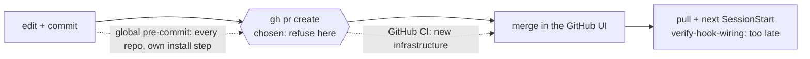

# 0049 — A pull request is refused while a registered hook is stored non-runnable

- **Status:** Accepted (2026-10-18). The choice of the PR moment was Mark's, 2026-10-17; the
  sub-decisions marked "my call" in the card are Claude's, open to his review. Not live until the
  branch merges and the main checkout pulls (hooks load from there).
- **Context:** `hooks/hook-exec-pr-guard.sh` (new, `100755`) and `hooks/hook-exec-pr-guard.test.sh`
  (new); `hooks/lib/registered_hook_modes.py` (new, the checker moved out of
  `hooks/registered-hooks-executable.test.sh`'s heredoc, plus `--rev`); the suite switched onto that
  module; one registration in `settings.json` under `PreToolUse` on `Bash`, after
  `dependency-guard.sh`; a stub in `rules/gates.md`. Full design, scenarios, Known gaps and the task
  record: `docs/features/hook-exec-bit-pr-guard.md`. A follow-up of
  `docs/features/hook-exec-bit-test.md`, which left its check hand-run and set "teaching
  `verify-hook-wiring.sh` to read the git mode" and "adding CI" aside as separate decisions. Another
  consumer of the shared `gh` reader `hooks/lib/classify-pr-command.py` (**ADR 0012**, **ADR 0029**)
  and of the shell-segment lexer (**ADR 0013**), and a speed bump in the same family as
  **ADR 0048** and **ADR 0039**.
- **Note on anchors:** this ADR cites file, constant and heading names, never line numbers.
- **Note on the number:** Task 0 of the card (2026-10-18) found `0048` the highest on `origin/main`
  and the one open PR (#108) adding no ADR file. This ADR did not re-check open branches again.

## Context

A hook script that git stores as `100644` cannot be started by Claude Code (exit 126), so the hook
silently does nothing. It has happened twice, and both times it came in through a pull request:
`hooks/dependency-guard.sh` (merged in #109, fixed in #110) and `hooks/handoff/handoff-keep-guard.sh`
(added in `ecd3ba0`, registered in `da18d30`, merged in #105, fixed in #112).

Two checks existed and neither stopped it. `hooks/verify-hook-wiring.sh` (SessionStart) reads the
mode **on disk** in the main checkout, so it speaks only after the merge and pull, when the guard is
already dead, and never when the disk copy is executable but git stores `100644`.
`hooks/registered-hooks-executable.test.sh` reads the git mode of every registered script, but only
when someone runs it. Per the card's Evidence, no non-test hook read a git file mode at all.

## Decision 1 — refuse `gh pr create` (Mark, 2026-10-17)

The check runs when a pull request is opened, as a `PreToolUse` hook on `Bash` that refuses
`gh pr create` while the branch's HEAD stores any registered hook as anything but `100755`.

| Option | Why it lost |
|---|---|
| **Refuse `gh pr create`** (chosen) | Fires while the mistake is still on a branch, in the one repo that has the problem, with no new infrastructure. |
| A SessionStart warning | Fires after the merge and pull; that is the check that already exists. |
| A global git `pre-commit` hook | Runs in every repo on the machine and needs its own install step. |
| GitHub CI | New infrastructure; set aside earlier (the `hook-exec-bit-test` card). |

Mark also decided the scope: **this repository only**, the main checkout `~/.claude` and its
worktrees. In every other repo the guard does nothing.

## Decision 2 — the sub-decisions that are Claude's (open to Mark's review)

| Choice | Why, where the card says |
|---|---|
| Check HEAD, not the index (`--rev HEAD`) | HEAD is what `gh pr create` publishes; the index can hold staged work that is not in the PR. A staged fix that is not committed does not unblock. |
| Check every registered hook, not only changed ones | An old mistake blocks the next PR until fixed. |
| One shared checker, `hooks/lib/registered_hook_modes.py` | The card states no reason beyond "one shared checker serves the suite and the guard". The effect is that the two cannot disagree about what counts as registered or runnable. |
| Bypass is `HOOK_EXEC_EXEMPT=<reason>` | A leading assignment on the segment that runs `gh pr create`, logged to stderr; empty is no bypass; `JUDGE_EXEMPT` and `MERGE_EXEMPT` never satisfy it and it never satisfies them. |
| Decide scope first, from bash and git only; fail closed only once in scope | Nothing this guard depends on can then block a command in another repository. In scope, broken machinery refuses, as `judge-guard.sh` does. |
| A payload with no command passes | There is no command to classify, so it cannot be a PR creation. `judge-guard.sh` refuses this case; `merge-guard.sh` allows it (card, citing `merge-guard.sh:60`; not re-read for this ADR). |
| `python3` only, not `judge-guard.sh`'s `python3 \|\| python` | Task 4's note: a bare `python` may be Python 2, which has neither `-I` nor `stdout.reconfigure`. |

The decision order the guard follows is the card's flowchart; this ADR does not duplicate it.

## Consequences

- **Per-Bash-call cost.** Counted from `hooks/hook-exec-pr-guard.sh` and the two modules it loads,
  not traced at run time. A "python3 invocation" is one `python3 -I …` process the guard starts;
  `command -v python3` is a shell builtin and `cat`/`sed`/`printf` are not counted. The classifier
  and lexer make no subprocess call (a search for `subprocess`, `os.system` and `Popen` in
  `classify-pr-command.py` and `shell_segments.py` finds one docstring mention), so loading them adds
  no process; the checker calls `git` through `subprocess.run`.

  | Bash call | `git` processes | `python3` processes |
  |---|---|---|
  | Empty stdin | 0 | 0 |
  | Not in a git repo | 1 (`rev-parse --is-inside-work-tree`) | 0 |
  | In another git repo | 2 (that, plus `--git-common-dir`) | 0 |
  | In scope, payload with no command | 2 | 1 (the payload parse) |
  | In scope, **not** `gh pr create` | 2 | **2** (payload parse, classifier) |
  | In scope, `gh pr create` with `HOOK_EXEC_EXEMPT` | 2 | 2 |
  | In scope, `gh pr create`, no bypass | 3 (adds `--show-toplevel`) + 4 inside the checker (`rev-parse --git-dir`, `rev-parse --verify`, `show <rev>:settings.json`, `ls-tree -r -z <rev>`) | **3** (adds the checker) |

  So outside this repo the cost is one or two `git rev-parse` calls and no Python; inside it, every
  Bash call that is not a PR creation starts Python twice. That is on top of the nine hooks already
  on this matcher. **Not measured:** wall-clock time, and whether Claude Code runs the hooks of a
  matcher group in parallel or in sequence; this ADR claims no latency figure.
- **A broken guard blocks every Bash command in this repo and its worktrees** when `python3` is
  missing, the payload is unreadable, or the classifier is unusable (R8). `judge-guard.sh` already
  blocks in the same three states, so this adds no new blocked state; the one new thing that can
  block is a broken checker, and only for `gh pr create`. Every such message names a repair route
  that survives the block (the Write tool, or unregistering the hook).
- **The registration brings the guard under the existing suite.** With it, the real-repo run reads
  39 entries and checks 24 distinct scripts, all `100755` (run 2026-10-18).
- **Verified so far (2026-10-18):** `hooks/hook-exec-pr-guard.test.sh` 82 passed, 0 failed;
  `hooks/registered-hooks-executable.test.sh` 43 passed, 0 failed. **Not yet done:** the
  implementation-stage observability judge (Task 6) and the live check in a throwaway worktree after
  merge (Task 7). This ADR claims no liveness.
- **Known gaps** are the card's **Known gaps** section; this ADR does not copy it and states no
  count of its rows. The ones that most change what the guard means: a PR opened outside a session
  (GitHub web, Mark's own terminal) is not seen; `gh pr create --head <other-branch>` checks the
  session checkout's HEAD, not that branch; command shapes the classifier does not read (ADR 0012)
  are accepted-open; and if the guard's own file loses its bit it cannot run to say so (exit 126
  does not block), which `verify-hook-wiring.sh` and the suite's real-repo check are left to report.
  It is a momentum guardrail, not a security boundary.
- **`gh pr create` now meets two independent refusals** in this repo: `judge-guard.sh` until a
  verdict exists, and this one until the modes are right. Neither satisfies the other.

## Alternatives considered

The three options in Decision 1's table are the ones the card records. Teaching
`verify-hook-wiring.sh` to read the git mode is the SessionStart option under another name, and was
set aside with CI by the `hook-exec-bit-test` card. The card records no other alternative.
