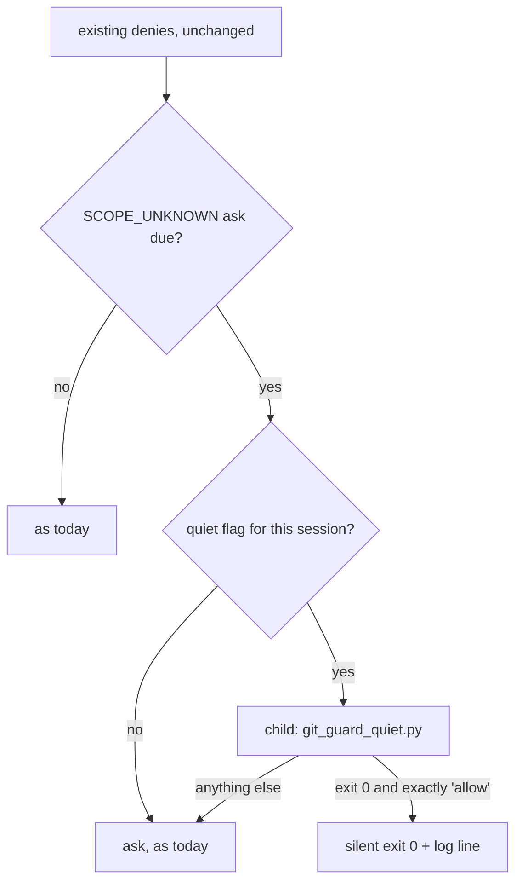

# 0051 — Quiet turns named asks into allows, and never adds a deny

- **Status:** Accepted (2026-10-27). The design was specified in
  `docs/features/git-guard-quiet.md` (spec frozen at revision 8, 2026-10-26; planning-to-implementation
  gate confirmed by Mark on 2026-10-27). That card holds the full decision table (D1–D18), the
  requirements, the scenarios and the Known-gaps list; this record keeps only the rationale that has
  to outlive the card.
- **Context:** `hooks/git-guard.sh` (Guard 3, the `SCOPE_UNKNOWN` ask), `hooks/lib/git_guard_quiet.py`
  (the quiet decision, run as a child process), `hooks/lib/git_quiet_class.py` and the `SEG_QUIET`
  fact emitted by `hooks/lib/classify-git-command.py`, and the toggle `hooks/git-quiet-toggle.sh`
  (`UserPromptSubmit`).
- **Note on the number:** `0051` was checked free with `git log --all --remotes --name-only --
  'docs/decisions/0051*'` on 2026-10-27. Per ADR 0050's lesson, re-check at merge time.

## Context

git-guard asks for confirmation whenever a git command carries an option ahead of the subcommand
that it cannot account for, which in practice means `git -C <dir> …`. Mark approves that prompt
almost every time, and a prompt that is always approved trains approval without reading.

The prompt cannot simply be silenced. A segment with a blocking option gets no `COMMIT*`/`PUSH*`
fact, so for `git -C <repo on main> commit` or `git -C <repo> push --force` the ask is the only
check git-guard makes (card § Why).

## Decision

1. **A per-session switch, off by default.** Mark types the exact whole message `git-guard quiet`
   to turn it on and `git-guard on` to turn it off. A `UserPromptSubmit` hook flips a flag file
   keyed to `session_id`. Every session starts with the prompt on (D10–D15).
2. **An allowlist, not a denylist.** With quiet on, the ask becomes an allow only for a line made
   entirely of named shapes: read-only lookups, `git add`, and a commit or a `push <remote> HEAD`
   whose single, checkable `-C` folder is on a branch other than `main`/`master` with nothing in
   progress. Everything else still asks (D2–D9, § The lists).
3. **Quiet never adds a deny and never touches an existing decision.** Every existing deny runs
   first, unchanged. Quiet off and quiet on differ only in asks becoming allows (D2).
4. **The decision runs as a child process whose only allow is an explicit one.** git-guard allows
   only when the child exits 0 and prints exactly `allow`. A missing library, a crash, a timeout or
   any other output falls through to today's ask. An allow is a silent `exit 0`, never a
   `permissionDecision` JSON (card § Design).
5. **The folder check is narrower than worktree-guard's resolver.** Only an absolute path, `~` or
   `~/…` counts as checkable for a commit or push. Variables, globs, other `~` forms and two `-C`s
   ask (D6). Task 0 also measured that the `PreToolUse` payload's `cwd` can lag the directory the
   command starts in, so relative folders ask too (card § Known gaps, "Measured in Task 0").

## Why an allowlist

Revision 4 stated Mark's rule — "let every `-C` command through unless it would commit or push to
`main`/`master`" — as a denylist. Round 4 of the judges found seven ways to still land on `main`:

- a `switch main` earlier on the line,
- `merge`,
- `HEAD:main`,
- `--all` and `--mirror`,
- `export GIT_DIR=`,
- `pushd`,
- a bare push under `push.default=upstream`.

Each fix would have added one more pattern to an open-ended list. An allowlist fails closed instead:
a shape nobody thought of asks, which is today's behaviour. Rounds 5 and 6 still found corners
inside the allowlist: a command substitution inside an allowed argument, `branch --list --no-list`,
a tag named `main`, and a case-variant branch on a case-insensitive filesystem. Each fix only added
asks.

## Why quiet never adds a deny

A deny that exists only while quiet is on would make the switch change behaviour in both
directions. Mark could then no longer reason about it as "the same guard, with fewer prompts".
Keeping it one-directional means turning quiet off always restores exactly today's guard.

## Why D6 is narrower than worktree-guard's resolver

Round 3 measured `resolve_effective_repo` exiting the hook instead of returning on some inputs. The
quiet decision needs a resolver that can only answer "checkable" or "not", so it accepts few forms
and treats everything else as not checkable, which asks.

## Consequences

- By design, Mark's two reported prompt shapes (read-only `-C` lookups) and plain feature-branch
  commit/push lines pass silently. That is pinned by R2–R4 in the card; the live check is the
  card's § Verification, after merge. Each silenced ask appends one log line with a hash of the command, never the
  command text (D16).
- **Not a security boundary.** The flag is a plain file that Claude could create without Mark's
  phrase. Under the stop rule Mark set on 2026-10-26, a bypass that needs a deliberate construction
  gets a Known-gaps line, not a design change. The full list is in the card's § Known gaps.
- doc-guard and feature-sync-guard still never see `-C` commits. That blind spot is unchanged here.
  Under quiet, though, the prompt was the one moment a human saw such a commit, and it goes away.
  Fixing the blind spot is a separate card.

