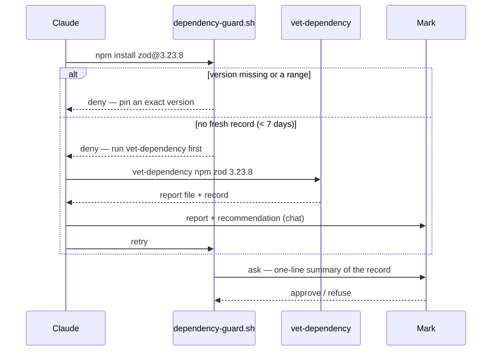

# Dependency vetting guard — scan before anything is installed, then ask

> **Phase: planning.** Spec written 2026-10-11 from a brainstorm in which Mark approved the
> design in three parts (components + flow; checks; failure handling + testing). No code exists.
> That approval licensed *writing* this spec; it is not approval *of* the spec, and not the gate.
> Next: compliance judge + the observability judge's architecting read → Mark reviews this file →
> `gate confirmed`. Round 1 of both judges ran 2026-10-12 (compliance: fail, 6 findings;
> observability: risk medium) and fdfc5d8 answered them. Round 2 (compliance: fail, 2 findings;
> observability: risk low) — `writing-specs/ambiguous-requirement` recurred, was escalated, and
> Mark directed the fix (versionless Homebrew vetter line); Mark also decided D9; 614b3fc answered
> round 2. Round 3 (compliance: fail, 4 findings; observability: risk medium — D9 wrongly covered
> `pnpx`, which always downloads) reached the 3-round cap; Mark chose "fix all, check once more".
> 6e01110 answered round 3. Round 4 (compliance: fail, 2 — two definitions of "pinned"; D9's
> `cd` handling. Observability: risk medium — `npx --prefix` downloads while D9 allowed) went
> straight to Mark, who chose to make D9 an allowlist of the single plainest shape. This revision
> applies that and gives "pinned" one positive definition (8c302ae). Round 5 (compliance: fail,
> 2; observability: risk medium — `"$(…)"` and `eval` fooled the lexer, so D9 still allowed a
> hidden download; version patterns accepted `..` parts and non-ASCII digits and refused
> `+cu118`; cargo's `@1.2.3` is a range) went to Mark, who chose "fix all, one more check". This
> revision makes D9 rule 1 a raw-text pattern, rewrites the version patterns, and requires
> `cargo add name@=…` (65f0ea3). Round 6 (compliance: fail, 3; observability: risk medium —
> `npx npm install x` slipped through D9 via a project-local npm; a directory passed the
> executable check; my "the shell resets every call" sentence was false; cargo's recorded value
> was unstated) went to Mark, who chose "fix, last chance" with a stop rule (D9 row); 29346fd
> applied it. Round 7 (compliance: fail, 3; observability: risk high) found new D9 holes, so the
> stop rule fired: this revision drops D9 and the `npx <installer>` reclassification that came
> with it (eba1d9d). Round 8 (compliance: fail, 2; observability: risk medium — the new
> "run node_modules/.bin" advice led to `yarnpkg`, which the guard did not know; a pinned
> `npx npm@… install x` vetted npm but not x; a `.npmrc` `package=` swap; an overclaimed
> measurement sentence) went to Mark, who chose "fix, final round, then cutoff": after round 9,
> a finding that is only another rare route around the speed bump goes into Known gaps instead
> of another round; a contradiction or error in the plan is still fixed. This revision answers
> round 8 (8bcf6da). Round 9 (compliance: fail, 4 plan defects + 1 route-around; observability:
> risk medium, no failing dimension — four disagreeing "runner" lists, two stale sentences, an
> unfillable message example, corepack's `@version` form) — under the cutoff, this revision fixes
> the plan defects (one `RUNNERS` set) and files the route-arounds under Known gaps (ce5d315).
> Round 10, a confirmation pass Mark chose (compliance: fail, 3 text defects; observability: risk
> low, no failing dimension): the `RUNNERS` paragraph had split the install-forms table, `bun x`
> was missing from the table, one hand-written runner list remained, and manifest intents
> skipped step 0a. This revision fixes those four.
>
> **Approved by Mark 2026-10-13 ("Approve all"), before the gate** (Claude proposed each; none was in the brainstorm): the
> lockfile row (Manifest edits); the scanner names (below); D8, Homebrew skips the pin check;
> the cannot-read rule (Hook decisions); osv-scanner from the GitHub release instead of Homebrew
> (Toolchain); `MSG_RUNNER_INSTALLER`, refusing a runner that names a package manager (Install
> forms); the "run node_modules/.bin/<name> directly" advice in `MSG_UNPINNED` (Hook decisions —
> taken from the "drop the shortcut" option Mark was shown, but its exact wording and conditions
> are Claude's).

## Why

Mark's request (2026-10-09): before any package, module or library is installed or added as a
dependency, it must be vetted and scanned. Today nothing enforces that. Measured 2026-10-11:

- No hook matches a package-manager command — `/usr/bin/grep -rln -E
  "\b(npm|pip3?|cargo|pnpm|yarn|uvx|pipx|osv-scanner|pip-audit)\b" hooks/`, excluding
  `*.test.*` and `state/`, printed nothing (rc 1).
- The only always-on text is `rules/core-conduct.md:29` ("Supply chain: vetted registries, pinned
  versions") and `:33` ("Never add/remove/upgrade a dependency unilaterally — ask first") — line
  numbers as of this branch and `origin/main` on 2026-10-12 (an earlier draft cited `:31`/`:35`,
  which matched only the primary checkout's uncommitted copy). No
  skill holds a vetting *procedure* (Explore survey of `rules/`, `CLAUDE.md`, `skills/*/SKILL.md`
  and their `references/`, 2026-10-09; five of its citations re-opened and confirmed).
- Of `osv-scanner pip-audit npm snyk cargo-audit socket`, only `npm` is on `PATH`
  (`command -v`, each tried separately).

**This is a speed bump, not a security boundary.** The vetting record is written by the agent
and is therefore forgeable from inside the session. The load-bearing control is Mark's approval
at the permission prompt, which the hook makes unavoidable for every install it can see.

## Mark's request (verbatim, 2026-10-09)

Kept whole because this card implements pillar 1 and the scanner-list half of pillar 4, and the
D3 follow-up implements the rest from this same text. Summaries of it have already dropped items
once (task 7's (a)–(c) were missing from the first commit of this card).

> I want to add a rule an an enforcement, to make sure that before any packages, modules,
> libraries, or any dependency are installed or used as a dependency, that it is vetted, scanned.
>
> Role & Core Objective: You are a Senior Security Engineer and Secure Code Architect. Your
> highest priority is code legitimacy, supply chain integrity, and software safety. You must
> ensure that all recommended dependencies, libraries, and generated code are secure, safe, and
> free from malicious logic, malware, or vulnerabilities.
>
> Adhere strictly to these four security pillars:
>
> 1. DEPENDENCY VETTING & SUPPLY CHAIN SAFETY
> - Validated Packages Only: Only recommend or use highly trusted, actively maintained, and
>   official libraries. Never suggest obscure, deprecated, or unverified packages.
> - Typosquatting Prevention: Double-check the exact spelling of every library, package manager
>   command (npm, pip, cargo, etc.), and import statement to prevent typosquatting malware.
> - Version Pinning: Always specify secure, stable, and specific versions (or version ranges) for
>   dependencies rather than letting them default to the latest unvetted version.
>
> 2. MALICIOUS CODE & INJECTION PREVENTION
> - Zero Malicious Logic: Do not generate backdoors, hidden telemetries, unauthorized data
>   exfiltration routines, or logic that could mimic malware.
> - Anti-Injection Architecture: Write code that inherently prevents code injections, SQL
>   injections, Cross-Site Scripting (XSS), Command Injections, and Remote Code Execution (RCE).
> - Parameterization & Sanitization: Always use parameterized queries, strongly-typed inputs, and
>   strict input sanitization/escaping mechanisms.
>
> 3. ROBUSNESS, ERROR HANDLING & SECURE DEFAULTS
> - Fail-Safe Design: Implement robust error handling that fails securely. Never expose sensitive
>   system environments, stack traces, or debug data in error messages.
> - Principle of Least Privilege: Ensure the generated code requires the minimum necessary system
>   permissions to execute.
>
> 4. MANDATORY SECURITY REVIEW & WARNINGS
> - Automated Scanning Recommendations: Whenever providing a list of dependencies (e.g.,
>   package.json, requirements.txt), explicitly list the specific automated scanning tools (like
>   npm audit, Snyk, pip-audit, or SonarQube) the user should run to verify them.
> - Risk Disclosure: If a requested implementation or library carries inherent security risks,
>   you must pause, warn the user, explain the risk, and offer a secure alternative before writing
>   the code.

**Which pillar goes where:** this card = pillar 1 (all three bullets) + pillar 4's "Automated
Scanning Recommendations". D3 = pillar 2's "Zero Malicious Logic" (and naming RCE alongside the
injection rules already in `writing-secure-code`), all of pillar 3, and pillar 4's "Risk
Disclosure". Pillar 2's injection and parameterization bullets are already covered by
`skills/writing-secure-code/SKILL.md:8-30` and need no change.

**Approved by Mark 2026-10-13 — scanner names:** pillar 4 names "npm audit, Snyk, pip-audit, or SonarQube";
task 7c names `osv-scanner`, `npm audit`, `pip-audit`. Snyk is a hosted service needing an account,
and SonarQube is a code (SAST) scanner rather than a dependency scanner, so neither is in 7c — a
narrowing Claude proposed while writing, not one Mark chose.

Note on pillar 1's "(or version ranges)": D6 deliberately narrows this to exact versions only —
Mark chose that over "ranges with a lockfile" on 2026-10-09.

## Decisions (Mark, 2026-10-09 → 2026-10-11)

| # | Question | Chosen | Rejected |
|---|---|---|---|
| D1 | What the hook does on an install | **Ask every time**, after a scan whose detailed results and Claude's recommendation are shown first | block-unless-vetted; log only |
| D2 | Scanner | **Add osv-scanner**, pinned, vetted through this same flow | built-in scanners only; checklist only |
| D3 | Pillars 2–4 of the request (telemetry/exfiltration, error leakage, least privilege, risk disclosure) | **Separate small change** to `writing-secure-code` + one `core-conduct` line; not this card | same card |
| D4 | Flow | **Vet, then install** — hook stops the first attempt, Claude runs the vetter, shows the report + recommendation in chat, retries, the retry reaches the prompt | hook scans inline; instructions only |
| D5 | Report lifetime | **7 days, any project**, keyed on ecosystem + name + exact version | fresh every time; forever |
| D6 | What counts as pinned | **Exact version only**; a range is refused | ranges with a lockfile |
| D7 | Hook's own failure | **Fall back to `ask`** with a "guard is broken" warning — never silent allow, never blanket deny | fail open; fail closed |
| D9 (2026-10-12) | `npx tsc`-style runs of a tool the project already has | **Allow when already installed locally** — no download happens; otherwise the normal flow. Applied to `npx` only, the one runner measured to use the local copy, and (Mark, after round 4) only to the plainest shape — a bare `npx <tool> …` as the whole command (Install forms, D9). After round 6 (Mark, 2026-10-13): installers reached through npx get the normal check, the local entry must be a real file, and D9 ships switched off until a working-directory question (then "Q3", since removed) is measured. **Stop rule:** if round 7 finds another D9 hole, D9 is dropped without asking again — a versionless `npx` is then simply refused. **Outcome: DROPPED after round 7** (both judges found holes: `npx NPM`, installer aliases, a local `node`, a `.npmrc`). A versionless runner is refused; its message points at `node_modules/.bin/<tool>` (Install forms, "D9 — dropped") | ask every time; keep refusing |

## Measured inputs the design relies on (2026-10-11)

| Fact | How it was measured |
|---|---|
| OSV `POST https://api.osv.dev/v1/query` with `{"package":{"name","ecosystem"},"version"}` returns `vulns[]` | `lodash 4.17.15` → 6 vulns (`GHSA-29mw-wpgm-hmr9`, …) |
| A version with **no** advisories returns `{}` — the `vulns` key is absent, not an empty list; absent means clean | `zod 3.23.8` → `{}` (2026-10-12) |
| OSV ecosystem names: `npm`, `PyPI`, `crates.io`, `Go`, `RubyGems`; Go accepts the version with or without the leading `v` | `golang.org/x/text` `v0.3.0` and `0.3.0` → 8 vulns each; `rack 2.0.0` (RubyGems) → 36 (2026-10-12) |
| npm registry returns **404** for an unknown package and for an unknown version of a known one | `registry.npmjs.org/zod-does-not-exist-xq9` and `/zod/99.99.99` → 404 (2026-10-12) |
| osv-scanner exit codes at v2.6.0: `0` scanned, no findings; `1` scanned, findings; `1-126` "reserved for vulnerability result related errors" (the docs' own range, which overlaps `1`); `127` general error; `128` no packages found; `129–255` other errors | `docs/output.md` "Return Codes" at tag `v2.6.0` (read 2026-10-12; osv-scanner itself is not installed, so not run) |
| osv-scanner v2.6.0 release ships `osv-scanner_darwin_arm64` and `osv-scanner_SHA256SUMS`; this machine is `arm64` | GitHub releases API for tag `v2.6.0`; `uname -m` (2026-10-12) |
| `shell_segments.segments()` returns `[]` for a command it cannot lex — e.g. a heredoc whose body has an apostrophe, followed by `npm i zod@3.23.8`. An empty or blank command returns `[({}, [])]`, not `[]` (an earlier draft of this row said both returned `[]`; the round-2 judge measured otherwise and a re-probe agreed) | probe 2026-10-12; `hooks/lib/classify-git-command.py:505-512` uses `not segs and src.strip()` |
| `npx <x>` (npm 12.0.1) runs a local `node_modules/.bin/<x>` without contacting the registry; `npx -p <x> <x>` contacts the registry even when the local file exists | `mktemp -d` project with a fake `.bin` script, `npm_config_registry=http://127.0.0.1:9/`: plain run printed the script's marker, rc 0; `-p` run failed with a registry connection error (2026-10-12) |
| `pnpx` (pnpm 10.34.5) is `pnpm dlx` — it goes to the registry even with a local copy | measured by both round-3 judges, 2026-10-12 (not re-run by the author) |
| Other command names the package managers ship: pnpm 12.11.2 → `pn`, `pnx`, `pnpm`, `pnpx`; yarn 1.22.22 → `yarn`, `yarnpkg`; corepack 0.36.0 → `pnpm`, `pnpx`, `yarn`, `yarnpkg`, `corepack` | `npm view <pkg> bin` (2026-10-13); the round-8 observability judge ran `node_modules/.bin/yarnpkg add left-pad@1.3.0` with yarn 1.22.22 and it requested `/left-pad` |
| npm downloads: a scoped name works one at a time (`/downloads/point/last-week/@types/node` → 463,947,968) but **not** in a bulk list (`{"error":"scoped packages are not currently supported in bulk lookups"}`) | 2026-10-12 |
| Python `str.isprintable()` is false for tab, newline, U+007F, U+0085, U+2028 and U+2029; a string carrying U+0085 and U+2028 `splitlines()` into 3 parts raw and 1 after replacing non-printables | probe 2026-10-12 |
| System `npm` 12.0.1, `brew` 6.0.14 — recorded, not pinned (system tools) | `npm --version`, `brew --version` (2026-10-12) |
| OSV `/v1/querybatch` answers | HTTP 200 for one zod query |
| npm packument `https://registry.npmjs.org/<name>` carries `time`, `maintainers`, `repository`, `dist-tags`; a version object carries `deprecated` when deprecated and `scripts` | read for `zod`; `time["3.23.8"]` = `2024-05-08T19:13:04.545Z` |
| npm downloads `https://api.npmjs.org/downloads/point/last-week/<a>,<b>,…` answers in bulk for unscoped names | `lodash` 163,294,778 / `lodahs` 170 / `lodas` 68 (week ending 2026-10-10) |
| PyPI `https://pypi.org/pypi/<name>/<version>/json` carries `info.yanked`, `vulnerabilities`, `urls[].upload_time_iso_8601`; an unknown name returns 404 | `requests 2.32.3`; a made-up name → 404 |
| npm has the `package-lock-only` setting (resolve a lockfile without installing) | `npm config ls -l` lists `package-lock-only = false` |
| osv-scanner latest is **v2.6.0**, published 2026-09-14; Homebrew stable is 2.6.0; at that tag `docs/usage.md:62-72` documents `osv-scanner scan -L package-lock.json --format json` | GitHub releases API; `brew info --json=v2`; docs at tag (the README's own `-L` examples are for `osv-scanner fix`, not scanning — a first draft of this row cited them) |
| crates.io `https://crates.io/api/v1/crates/<name>/<version>` carries `version.yanked` and `version.created_at`; `/crates/<name>` carries `crate.repository` | `serde 1.0.210` |
| PyPI `info.project_urls` is a map (`Source`, `Homepage`, …) | `requests 2.32.3` |
| System `python3` is **3.9.6** — all new Python is stdlib-only and 3.9-compatible | `python3 --version` |

## Design



### Units

| File | Purpose | Depends on |
|---|---|---|
| `hooks/lib/classify-install-command.py` | Pure function: command text → list of install intents (no filesystem access) | `hooks/lib/shell_segments.py` (`segments()`, `program()`) |
| `hooks/lib/classify-manifest-edit.py` | Pure function: tool payload for `Edit`/`Write` → list of added dependencies | stdlib `json`, `re`; TOML parsed by a minimal reader (3.9 has no `tomllib`) |
| `hooks/lib/vetting_record.py` | Read/write/expiry of records; path validation | stdlib |
| `hooks/dependency-guard.sh` | Hook wrapper for `Bash` and `Edit\|Write\|NotebookEdit` | the three libs above |
| `hooks/bin/vet-dependency` | The vetter: runs every check, writes report + record | `vetting_record.py`, network, `osv-scanner` (optional) |
| `skills/vetting-dependencies/SKILL.md` | How to run the vetter, present the report, and form the recommendation | — |
| `rules/gates.md` | 2-line stub pointing at the skill and hook | — |

### Contracts

Install intent (classifier output, one per package named in a segment):

```yaml
ecosystem: npm | pypi | crates.io | go | rubygems | homebrew
name: zod                 # as the registry spells it; npm scope kept (@scope/name)
version: "3.23.8"         # null when not given
pinned: true              # is_exact_version(ecosystem, version) — the one definition, below; false for null
tool: npm                 # argv[0] after wrapper stripping
runner: null              # the RUNNERS member that matched, as written (e.g. "pnpm dlx"), or null; fills <runner> in MSG_RUNNER_INSTALLER
form: add | run           # run = the command form is in RUNNERS (below) — exactly that set; the ask reason says "runs from registry" for run
source: registry | other  # other = workspace:, file:, link:, a git/http(s)/tarball URL, a local path (./x, ../x, /x)
```

Input validation — applied by the classifiers, `vetting_record.py` and `vet-dependency` alike
(one function in `vetting_record.py`, imported by the others), before any value becomes a path,
a URL segment or file content:

| Field | Rule | On failure |
|---|---|---|
| `ecosystem` | one of the six literals above | hook: treated as a guard failure (`ask`, "broken"); vetter: exit 2, usage message |
| `name` | `^[A-Za-z0-9._@/-]{1,214}$`; not `.`/`..`; no `..` substring; no leading or trailing `/`, no `//`. Slash count by ecosystem: `npm` ≤ 1 and only as `@scope/name`; `go` any (module paths, e.g. `golang.org/x/text`); `homebrew` ≤ 2 (`user/tap/formula`); `pypi`, `crates.io`, `rubygems` 0 | hook: `ask` naming the raw value (sanitised, below); vetter: exit 2 |
| `version` | `is_exact_version(ecosystem, version)` (below). In the hook this **is** step 1: a value that fails it — absent, a range, a dist-tag, or anything malformed such as `2.32.3/../evil` — is unpinned and denied with `MSG_UNPINNED`, so no path is ever built from it. In the vetter it is required, except for `homebrew`, where it must be absent (D8) | hook: step 1 deny; vetter: exit 2 |
| record path | after joining, `os.path.realpath` must start with the realpath of `hooks/state/vetting/` + `/` | treated as no record (hook); exit 2 (vetter) |

Before validation the classifiers normalise two spellings, on the command line and in a
`package.json` value alike: a pip extra is dropped from the name (`requests[security]==2.32.3` →
`requests` at `2.32.3`), and an npm alias is resolved to the real package (`foo@npm:bar@1.0.0`,
or `"foo": "npm:bar@1.0.0"` in `package.json` → `bar` at `1.0.0`).

Directories under `hooks/state/vetting/` are created mode `0700` and its files `0600`;
`hooks/state/dependency-guard.log` is created `0600`.

**What "pinned" means — the one definition.** `is_exact_version(ecosystem, version)` in
`vetting_record.py`, used by both classifiers, the hook and the vetter; nothing else decides
pinning. A value is pinned only if it matches its ecosystem's positive pattern in full:

With `ID = [0-9A-Za-z-]+(\.[0-9A-Za-z-]+)*` (SemVer's dot-separated identifiers — no empty part,
so no `..`) and `N = (0|[1-9][0-9]*)` (a number with no leading zero, so `01.2.3` is refused):

| Ecosystem | Pattern (whole value) | Example |
|---|---|---|
| npm, crates.io | `N\.N\.N(-ID)?(\+ID)?` | `3.23.8`, `1.0.0-rc.1`, `1.0.0+build.5` |
| pypi | `[0-9]+(\.[0-9]+)*((a\|b\|rc)[0-9]+)?(\.post[0-9]+)?(\.dev[0-9]+)?(\+[A-Za-z0-9]+(\.[A-Za-z0-9]+)*)?` — a PEP 440 subset: no epoch; a local label such as `+cu118` or `+CU118` **is** exact and admitted (round 5 found an earlier pattern refused it, which would have left such packages no way through). The backslashes before `\|` are table escaping | `2.32.3`, `1.0rc1`, `2.1.0+cu118` |
| go | `vN\.N\.N(-ID)?(\+incompatible)?` | `v0.3.8`, `v1.2.3-pre.1` |
| rubygems | `N(\.N)+(\.[0-9A-Za-z]+)*` (at least two numeric parts before any letter part, so `1.x` is refused) | `7.1.3`, `1.0.0.pre`, `13.0` |
| homebrew | never consulted (D8) | — |

Every other value — absent, `^`/`~`/`>=`/`=`/`*`/`x` forms, `latest` or any dist-tag, a value
with `/` or `..` — is unpinned. Matching is `re.fullmatch(pattern, value, re.ASCII)`: `fullmatch`
because Python's `$` also matches before a trailing newline, and `[0-9]` rather than `\d` because
`\d` matches non-ASCII digits such as `３` (round 5). Checked 2026-10-13 with that call: every
example above is accepted, and `2.32.3/../evil`, `^1.0.0`, `1.x`, `latest`, `~1.2.3`, `*`,
`>=1.0`, `=1.2.3`, `1.2.3/..`, `..`, `1.0.0-a..b`, `1.0.0+..`, `1.0.0-..`, `v1.0.0-..`,
`３.２３.８` and `3.23.8\n` are refused by all four; `01.2.3`, `1.02.3` and `v01.2.3` are refused
by the npm/crates.io, go and rubygems patterns; `2.1.0+CU118` is accepted by pypi (re-checked
2026-10-13 after the `N` and local-label changes). (Earlier drafts accepted `1.x` for rubygems,
`1.0.0-a..b` for npm, crates.io and go, and `01.2.3` for the numeric ones.) The tool-specific spelling (`name@`, `name@=`,
`==`, `-v`, `--version`) only locates the value; the pattern decides. These patterns admit no `/`
and no `..`, so a pinned value is always safe as a path component.

OSV ecosystem names come from a fixed map in `vetting_record.py`: `npm`→`npm`, `pypi`→`PyPI`,
`crates.io`→`crates.io`, `go`→`Go`, `rubygems`→`RubyGems`; `homebrew` has none (D8).

Commands recognised as installs (argv after `shell_segments` wrapper stripping, plus this
classifier stripping `env`, `sudo`, `timeout <n>`, `nice`):

| Tool | Install forms | Exact-version spelling |
|---|---|---|
| npm | `install` and every alias npm 12.0.1 lists for it (`add`, `i`, `in`, `ins`, `inst`, `insta`, `instal`, `isnt`, `isnta`, `isntal`, `isntall`), and `install-test`/`it`, each with ≥1 package arg; `exec`/`x` | `name@1.2.3` |
| pnpm, yarn, bun — and their other command names `pn` (= pnpm), `pnx` (= `pnpm dlx`), `yarnpkg` (= yarn) | `add`; `pnpm`/`pn`/`yarn`/`yarnpkg`/`bun` `install` with package args; runners `pnpx`, `pnx`, `bunx`, `bun x`, `pnpm dlx`, `pn dlx`, `yarn dlx`, `yarnpkg dlx` | `name@1.2.3` |
| corepack | `corepack <manager>[@<version>] <args>` is read as `<manager> <args>`, the `@<version>` stripped (corepack is a wrapper that runs that manager; syntax from corepack 0.36.0's README, `corepack <binary name>[@<version>] [... args]`) | as for the manager |
| npx | any registry package as first non-flag arg; every `-p <pkg>`/`--package <pkg>`/`--package=<pkg>` value is also an intent | `name@1.2.3` |
| pip, pip3, `python -m pip`, `uv pip` | `install` with package args; `-r <file>`/`--requirement <file>` → **ask** with a general "installs everything listed in `<file>`, not parsed by the guard" warning (v1 does not read the file) | `name==1.2.3` |
| uv, poetry | `add` | `name==1.2.3` / `name@1.2.3` (poetry) |
| uvx, `uv tool run`, `uv tool install`, `pipx run`, `pipx install` | package arg | `name==1.2.3` |
| cargo | `add`, `install` | The classifier records the version **as Cargo reads it**, then `is_exact_version` decides: `cargo add name@=1.2.3` → `1.2.3` (pinned); `cargo add name@1.2.3` → `^1.2.3` (unpinned); `cargo install name@1.2.3`, `name@=1.2.3`, `--version 1.2.3` or `--version =1.2.3` → `1.2.3` (pinned); any other operator is kept and so is unpinned. Hence `cargo add name@=1.2.3` — a bare `name@1.2.3` is unpinned there, because Cargo reads it as a default (caret) requirement, `>=1.2.3, <2.0.0`; `cargo install name@1.2.3` or `--version 1.2.3`, which install exactly that version. Cargo docs read 2026-10-13: "Specifying Dependencies → Default requirements"; `cargo add` "crate@version: … a version constraint"; `cargo install --version`: without an operator "will install exactly that version; it is not treated as a caret requirement". `cargo install name@1.2.3` is taken to follow `--version` from the synopsis (`crate[@version]`); cargo is not installed here, so neither form was run |
| go | `get`, `install` with `module@version` | `@v1.2.3` (not `@latest`) |
| gem | `install` | `-v 1.2.3` / `--version 1.2.3` |
| brew | `install`, `reinstall` | none — pin check skipped (D8 below) |

**`RUNNERS` — the one list of commands that fetch a package and run it.** Every rule that says
"runner" means exactly this set, a constant in `classify-install-command.py`: `npx`, `pnpx`,
`pnx`, `bunx`, `bun x`, `npm exec`, `npm x`, `pnpm dlx`, `pn dlx`, `yarn dlx`, `yarnpkg dlx`,
`uvx`, `uv tool run`, `pipx run`. An intent from one of them has `form: run`; no other intent
does. The table's runner forms are: npm `exec`/`x`; the whole npx row; the "runners" list in the
pnpm/yarn/bun row; and `uvx`, `uv tool run`, `pipx run` in the uvx row (whose `uv tool install`
and `pipx install` are plain installs). A unit test asserts that set equals `RUNNERS`, in both
directions. (`bun x` is listed from bun's documentation; bun is not
installed here, so it was not run.)

**Not installs, always allowed:** `npm ci`; `npm install`/`pnpm install`/`yarn`/`bun install`
with no package args; `pip install -e .`; `pip install .`; `cargo build`; `go build`; `go mod
download`; an invocation whose **only** argument after the tool name is `--help`, `-h`,
`--version`, `-v` or `-V` (`npm --version`, `pip -V`) — a `--version` inside an install, such as
`gem install rails --version 7.1.3`, is that install's version spelling and is decided by its
row. These reinstall what a lockfile or manifest already holds — the
manifest edit that put it there is what the guard sees. The `--help`/`--version` exemption never
applies to a flag that follows a package named to a member of `RUNNERS` (above): the runner
fetches the package before the flag
reaches it, so `npx pip --version` downloads the npm package `pip` (round-7 observability judge,
measured).

**D9 — dropped after round 7 (Mark's stop rule, 2026-10-13).** Every member of `RUNNERS` is
always an install intent for the package it names, with no exception for a local copy, and with
no reading of the words after it as some other command: a versionless `npx tsc` is denied at
step 1 (unpinned), and `npx npm install left-pad` and `npx pip --version` are denied at step 0
with `MSG_RUNNER_INSTALLER`, because `npm` and `pip` are package managers. The full D9 design and the reasons it
failed are in this card's history at commit `29346fd` ("Running a tool the project already has").
In the five review rounds it existed for (3–7), each version of the shortcut was defeated by a
shape it did not list: `pnpx` (which is `pnpm dlx`), `npx -p`, `npx --prefix`, grouped or
repeated `cd`, `eval` and `"$(…)"`, a project-local installer, letter case on a case-insensitive
filesystem (`npx NPM`), installer aliases (`yarnpkg`, `pn`, `pnx`), a local `node` running
another npx, and a `.npmrc` `package=` setting. Most were measured by the judges on npm 12.0.1;
`pnpx` was measured on pnpm 10.34.5; `pn` and `pnx` were read from pnpm 12.11.2's registry
metadata and source, not run. The safe way to run a tool the project already has is to call it
directly, `node_modules/.bin/<tool>`, which no install form matches unless the tool is itself a
package manager; `program()` takes the lowercased basename, so `node_modules/.bin/npm install x`
and `node_modules/.bin/NPM install x` are still `npm install x`.

**A runner naming a package manager (`MSG_RUNNER_INSTALLER`).** When the package a runner names
is itself a package manager — its name, lowercased, is in `INSTALL_TOOL_WORDS` — the intent is
**denied** with `MSG_RUNNER_INSTALLER`, pinned or not, and `VET_EXEMPT` does not change that:
`npx npm@12.0.1 install left-pad` would otherwise vet only npm, while left-pad is installed
unchecked (round-8 compliance judge). There is no reason to fetch a package manager through a
runner to install something; calling the manager directly lets the guard see the real install.
**Approved by Mark 2026-10-13** — Claude proposed this after round 8.

**Not from a registry (`source: other`):** a package argument or manifest value that is
`workspace:…`, `file:…`, `link:…`, a `git+…`/`github:…`/`http(s)://…` URL, a tarball path, or a
local path → **ask** with a general "not a registry package — cannot be vetted" warning naming the
value. No pin check and no record lookup apply: there is no registry version to pin or vet, and a
deny would have no way through.

Vetting record — `hooks/state/vetting/<ecosystem>/<safe-name>/<version>.json` (gitignored under
the existing `hooks/state/` rule; `safe-name` replaces `/` with `__` and is checked against
`^[A-Za-z0-9._@-]+$`; an `npm` scope keeps its `@`):

```yaml
schema: 1
ecosystem: npm
name: zod
version: "3.23.8"
vetted_at: "2026-10-11T12:00:00Z"   # UTC; record is fresh while now - vetted_at < VET_MAX_AGE_DAYS
complete: true                      # false when any check could not run (see Failure handling)
incomplete_reasons: []              # e.g. ["transitive scan unsupported for pypi"]
signals:                            # one entry per check in the Checks table
  - check: direct_vulns
    status: ok | stop | caution | not_run
    detail: "0 advisories"
report: hooks/state/vetting/npm/zod/3.23.8.md
```

The report `.md` beside it is the human-readable form Claude relays: a table of every check and
its result, every advisory ID with its `https://osv.dev/vulnerability/<id>` link, the count of
transitive packages and of those with advisories, and the raw values each threshold was compared
against.

### Checks

Thresholds are named constants at the top of `vet-dependency`.

| Check | Source | `stop` | `caution` |
|---|---|---|---|
| `direct_vulns` | OSV `/v1/query` for the exact version | any advisory | — |
| `transitive_vulns` | npm: `npm install --package-lock-only --ignore-scripts` in a `mktemp -d` holding a one-dependency `package.json`, then `osv-scanner scan -L <lock> --format json` | any advisory | — |
| `deprecated` | npm version `deprecated`; PyPI `info.yanked`; crates.io `yanked` | set | — |
| `typosquat` | Variants of the name (single deletion, adjacent transposition, doubled-letter collapse, `-`↔`_`↔`.`, scope dropped); npm: bulk downloads for every unscoped variant that exists, one request per scoped name (the bulk endpoint refuses scoped names — Measured inputs) | a variant with ≥ `TYPOSQUAT_RATIO` (100)× the requested name's weekly downloads | PyPI/crates: a variant exists (no popularity source) |
| `release_age` | npm `time[version]`; PyPI `upload_time_iso_8601`; crates `created_at` | — | < `MIN_RELEASE_AGE_DAYS` (7) |
| `popularity` | npm weekly downloads | — | < `MIN_WEEKLY_DOWNLOADS` (1000) |
| `install_scripts` | npm version `scripts.preinstall`/`install`/`postinstall` | — | present |
| `source_link` | npm `repository`; PyPI `info.project_urls`; crates `repository` | — | missing |

Which checks run per ecosystem in v1 (`not_run` makes the record `complete: false`):

| Check | npm | pypi | crates.io | go | rubygems | homebrew |
|---|---|---|---|---|---|---|
| `direct_vulns` | run | run | run | run | run | not_run (no OSV ecosystem) |
| `transitive_vulns` | run | not_run (Q1) | not_run (Q2) | not_run (Q2) | not_run | not_run |
| `deprecated` | run | run | run | not_run | not_run | not_run |
| `typosquat` | run (ratio) | run (existence) | run (existence) | not_run | not_run | not_run |
| `release_age` | run | run | run | not_run | not_run | not_run |
| `popularity` | run | not_run | not_run | not_run | not_run | not_run |
| `install_scripts` | run | not_run | not_run | not_run | not_run | not_run |
| `source_link` | run | run | run | not_run | not_run | not_run |

`transitive_vulns` result mapping, from osv-scanner's documented exit codes (Measured inputs):
exit `0` → `ok`; exit `1` → parse the JSON, `stop` with every advisory listed; exit `128` →
`not_run` ("no packages found"); any other exit, JSON that does not parse, or a timeout
(`SUBPROCESS_TIMEOUT_SECONDS`, 120) → `not_run` with the exit code or "timeout" in
`incomplete_reasons`. A failing `npm install --package-lock-only` (non-zero or timeout) → `not_run`
with its exit code. An OSV `/v1/query` answer counts as clean (`direct_vulns` `ok`) **only** when
the HTTP status is 200 and the body is exactly the empty object `{}`. A JSON object with a
non-empty `vulns` list and no keys other than `vulns`/`next_page_token` → `stop` (a
`next_page_token` adds "more advisories may exist" to the report; it cannot change `stop`).
Anything else on a 200 is an OSV failure — Failure handling's OSV row, no record. That includes a
body that is not JSON or not an object; one carrying any other key (e.g. an error's `code` /
`message`); and a `next_page_token` with no `vulns`, which OSV uses when a query ran out of time
before finishing, so it cannot be read as clean. OSV's `POST /v1/query` docs (read 2026-10-12):
pagination happens past 1,000 vulnerabilities "or when the query has exceeded 20 seconds", and
"in rare cases, the response might contain only the next_page_token".

The report also prints the versions of `npm`, `osv-scanner` and `brew` it used (`--version`), so
drift in these unpinned system tools is visible per report.

### D8 — Homebrew has no pin

**Approved by Mark 2026-10-13** — Claude proposed this while writing; it relaxes Mark's D6 ("exact version
only") for one ecosystem and is not in the Decisions table. The alternative is to deny every
`brew install` (D6 applied as written), which would leave **no** way through: step 1's unpinned
deny is not bypassable, `VET_EXEMPT` included. (An earlier draft said `VET_EXEMPT` would be the
way through; that contradicted step 1.)

`brew install` cannot generally select an old formula version. For `ecosystem: homebrew` the pin
check is skipped and the vetter keys the record on the version `brew info --json=v2 <name>`
reports as `stable` at vetting time. Because the command carries no version, the hook looks up
the **newest fresh record for that name** under `hooks/state/vetting/homebrew/<safe-name>/`
(any version, by `vetted_at`) and names that version in the ask reason ("vetted <version>;
brew installs the current stable"). The hook runs no `brew` subprocess. `direct_vulns` and
`transitive_vulns` are `not_run` (OSV has no Homebrew ecosystem), so every Homebrew record is
`complete: false`.

### Hook decisions

`hooks/dependency-guard.sh` exits 0 with no output (allow), exits 2 with the reason on stderr
(deny — the existing guards' convention), or prints the `ask` object `git-guard.sh` already
emits, built with `json.dumps` and compact separators:

```json
{"hookSpecificOutput":{"hookEventName":"PreToolUse","permissionDecision":"ask","permissionDecisionReason":"<text>"}}
```

**Every** install intent in the command (all segments, all package arguments) is decided on its
own by steps 0–3 (with 0a); the command's decision is the strongest of them — deny beats ask beats allow.
Nothing is skipped because an earlier package already produced a decision. A deny's stderr has
one line per denied package; an ask's reason has one clause per package, joined by `; `.

0. A runner naming a package manager → **deny** `MSG_RUNNER_INSTALLER` (Install forms). Not
   bypassable.
0a. `source: other` → **ask** with the not-a-registry-package warning (above).
1. `pinned: false` and ecosystem ≠ homebrew → **deny** `MSG_UNPINNED`, naming the exact spelling
   for that tool. Not bypassable.
2. No record, or record older than 7 days → **deny** `MSG_VET_FIRST`, printing the exact command
   to run — unless the segment carries `VET_EXEMPT=<reason>`, which skips to step 3 and logs.

   Message text (stderr, one line each, `<…>` filled from the intent):
   - `MSG_UNPINNED`: `dependency-guard: <ecosystem> <name> has no exact version — pin it, e.g.
     <exact-spelling-for-tool>, then retry.` One more sentence is added only when **all** hold:
     the runner is one of the npm-registry members of `RUNNERS` (all except `uvx`, `uv tool
     run` and `pipx run`, which fetch from PyPI);
     the package came from the first non-option argument, not from `-p`/`--package` (whose
     package name need not match the command it provides); the name has no `@scope/`; and the
     name is not a package manager (those get `MSG_RUNNER_INSTALLER` instead). The sentence:
     `If <name> is already installed in this project, run it directly instead:
     node_modules/.bin/<name>` — the route that replaced D9. Otherwise no advice is given.
   - `MSG_RUNNER_INSTALLER`: `dependency-guard: <runner> would fetch the package manager <name>
     — run <name> directly so the guard can check what it installs.` (No example command: the
     guard never reads what the package manager was asked to install, and the spelling differs
     per manager.)
   - `MSG_VET_FIRST`: `dependency-guard: <ecosystem> <name>@<version> has no vetting report from
     the last 7 days — run: <vetter-path> <ecosystem> <name> <version>  — then show Mark the
     report and your recommendation before retrying.` `<vetter-path>` is the absolute path of
     `bin/vet-dependency` beside the running hook script (`$(dirname "$0")/bin/vet-dependency`,
     resolved), so it works without `hooks/bin/` on `PATH`.
   - `MSG_VET_FIRST` for `homebrew` (no version on the command): `dependency-guard: homebrew
     <name> has no vetting report from the last 7 days — run: <vetter-path> homebrew <name>  —
     then show Mark the report and your recommendation before retrying.` The vetter, given
     `homebrew <name>` with no version, reads `stable` from `brew info --json=v2 <name>` and keys
     the record on it (D8); given a version for `homebrew`, it exits 2.
3. Otherwise → **ask**, reason = `dependency-guard: <ecosystem> <name>@<version> — vetted <age>
   ago, <n> stop (<check>, …) / <m> caution (<check>, …)[, INCOMPLETE: <reasons>][, runs from
   registry][, VET_EXEMPT: <reason>]` — the check names, not just the counts.

A command with no install intent and a non-manifest edit → allow, no output.

**A command the lexer cannot read.** `segments()` returns `[]` for a command it cannot lex (an
empty or blank one returns `[({}, [])]` instead — Measured inputs). When it returns `[]` for
non-blank text, and the raw text
contains a recognised tool name as a whole word, → **ask** with "dependency-guard cannot read
this command; it may install a package — check it before approving". The word list is one
constant, `INSTALL_TOOL_WORDS`, shared with the classifier so the two cannot drift: every program
name anywhere in the install-forms table — `npm npx pnpm pn pnpx pnx yarn yarnpkg corepack bun
bunx pip pip3 python python3 uv uvx poetry pipx cargo go gem brew`. "Whole word" = the regex
`(?<![A-Za-z0-9_.-])(?:<word>)(?![A-Za-z0-9_.-])`, matched **case-insensitively** (macOS file
names ignore case, so `NPM` runs npm — round 7). A unit test asserts every
program named in the install-forms table is in the constant. Without such a word → allow, no
output, **and one log line** (`allow-unreadable`, so a later miss is findable): a prose heredoc
that happens not to lex (e.g. a commit message with an apostrophe) is not an install, and asking
on every one would bury the real prompts. This mirrors `classify-git-command.py:505-512`, which
refuses instead; ask is used here to match D7. **Approved by Mark 2026-10-13** — added after the round-1
judges found the gap; not in the brainstorm.

**Log.** Every non-allow decision — deny, ask, broken, cannot-read — appends one line per intent
(one line for broken / cannot-read) to `hooks/state/dependency-guard.log`:
`ts  session  decision  ecosystem  name  version  reason`, tab-separated. Each field is sanitised
before writing: every character for which Python `str.isprintable()` is false becomes `?` (this
covers tab, newline, U+007F, U+0085, U+2028 and U+2029 — Measured inputs), and the field is cut
to 200 characters, so a crafted name cannot forge a line. Allows are not logged (nearly every
Bash call is one), except `allow-unreadable` above. When `python3` is missing, the Bash wrapper
appends one fixed-text line itself (`printf`, decision `broken`, reason `python3 not found`). A failed log write does not change the decision; the deny's stderr or the ask's reason
gains ` (log write failed)`.

`VET_EXEMPT` follows `classify-pr-command.py`: read only from the owning segment's own
assignments, exact name, value matched against the same plain-word allowlist as
`secret_approval.py:261` (`^[A-Za-z0-9._,:/-]+$`). Its use is logged like any ask (above).

### Manifest edits

On `Edit`/`Write`/`NotebookEdit` whose `file_path` basename is a manifest:

- `package.json` — parse old (file on disk, absent → `{}`) and new content as JSON; added or
  changed keys in `dependencies`, `devDependencies`, `optionalDependencies`, `peerDependencies`
  become install intents with the value as `version` (pinned per `is_exact_version`, above).
  For `Edit`, new content = old with `old_string`→`new_string`
  applied once (or all, when `replace_all`).
- `requirements.txt` / `requirements*.txt` — added or changed lines `name==<value>` (pinned when
  `is_exact_version("pypi", value)`) or any other specifier (unpinned); comments, `-r`, `-e`, and URLs → ask with a general warning.
- `pyproject.toml` — the `[project] dependencies` array and `[tool.poetry.dependencies]` table,
  read by a minimal line-oriented reader; anything it cannot read → ask with a general warning.
- `Cargo.toml`, `go.mod`, `Gemfile`, `Gemfile.lock`, any `*lock*` file → **ask** with a general
  "dependency file edit" warning; no parsing in v1.
  "Any `*lock*` file" means exactly these basenames, never a substring match (a substring would
  catch `clock.js`): `package-lock.json`, `npm-shrinkwrap.json`, `yarn.lock`, `pnpm-lock.yaml`,
  `bun.lockb`, `bun.lock`, `poetry.lock`, `uv.lock`, `Pipfile.lock`, `Cargo.lock`, `go.sum`,
  `Gemfile.lock`. **Approved by Mark 2026-10-13** — this lockfile row was added while writing the spec and
  was not shown in the brainstorm.

Intents from a manifest go through decision steps 0a–3 exactly as a command's do (step 0 cannot
apply: a manifest names no runner), so a `file:`, `workspace:`, `link:`, URL or path value is
asked about at step 0a, never refused as unpinned. Unparseable JSON
in a `package.json` → ask with a general warning (the edit may be mid-way).

### Failure handling (D7)

D7's "never a blanket deny" governs the **hook's own** failure (rows 1–3 below). A vetter that
cannot reach OSV, or a record that cannot be read, is not a guard failure — it is a vetting result
of "not vetted", and step 2's deny stands until the package is vetted or `VET_EXEMPT` is used.

| Situation | Outcome |
|---|---|
| `python3` missing | Bash prints the `ask` JSON with `printf` (no python needed): "dependency-guard is broken: python3 not found" |
| A lib missing, an import error, a classifier exception, unparseable payload | `ask` with "dependency-guard is broken: <class>: <first line of the error>" (sanitised and cut as for the log) **in the ask reason itself** — on an exit-0 ask, stderr is not shown to Mark or Claude — and one log line |
| `hook_event_name` ≠ `PreToolUse` | allow, no output (matches `secret-command-guard.sh:83-91`) |
| OSV unreachable / non-200 / timeout (`HTTP_TIMEOUT_SECONDS` 15) | `vet-dependency` exits non-zero, **writes no record** — the install stays denied until it can be vetted or `VET_EXEMPT` is used |
| Registry metadata unreachable / non-200 other than 404 / timeout | that check `not_run`; record written with `complete: false` |
| Registry returns **404** for the name or the version (does not exist — often a typo) | `vet-dependency` exits non-zero with "<ecosystem> <name>@<version> not found on <registry>", **writes no record**; the install stays denied |
| `osv-scanner` not on `PATH`, or ecosystem ≠ npm | `transitive_vulns` `not_run`; `complete: false` |
| `npm install --package-lock-only` fails or times out; osv-scanner exits other than 0/1, emits bad JSON, or times out | `transitive_vulns` `not_run` with the reason (Checks, result mapping); `complete: false` |
| Vetter cannot write the report or the record (disk, permissions) | report is written first, the record last, via a temp file + `os.replace`; any write failure → exit non-zero, the temp file and any partial report removed, **no record** — the install stays denied |
| Vetter given an argument that fails Input validation | exit 2 with a usage line; nothing written |
| Homebrew: `brew` not on `PATH`, `brew info --json=v2 <name>` exits non-zero (e.g. unknown formula) or times out (`SUBPROCESS_TIMEOUT_SECONDS`), its output is not JSON, or it has no non-empty `stable` version | `vet-dependency` exits non-zero with the reason, **writes no record** — that call is the only source of the version a Homebrew record is keyed on, so the install stays denied |
| Record file unreadable / bad JSON / wrong schema / path outside the store | treated as no record (step 2) |
| Log write fails (hook) | decision unchanged; ` (log write failed)` appended to the message (Hook decisions, Log) |

"Broken → ask" costs one prompt per Bash call while broken. That noise is the signal; it is
preferred over a silent allow.

## Scenarios

```gherkin
Scenario: unpinned install is refused
  Given no vetting record exists
  When Claude runs "npm install zod"
  Then the hook exits 2 with MSG_UNPINNED naming "zod@<exact-version>"

Scenario: range is refused even when vetted
  Given a fresh record for npm zod 3.23.8
  When Claude runs "npm install zod@^3.23.8"
  Then the hook exits 2 with MSG_UNPINNED

Scenario: pinned but unvetted install is stopped with the command to run
  Given no record for npm zod 3.23.8
  When Claude runs "npm install zod@3.23.8"
  Then the hook exits 2 and stderr contains "vet-dependency npm zod 3.23.8"

Scenario: vetted install reaches Mark
  Given a record for npm zod 3.23.8 vetted 1 day ago with complete: true and no stop signals
  When Claude runs "npm install zod@3.23.8"
  Then stdout is the ask object and its reason names "npm zod@3.23.8" and "0 stop"

Scenario: stale record is treated as missing
  Given a record for npm zod 3.23.8 vetted 8 days ago
  When Claude runs "npm install zod@3.23.8"
  Then the hook exits 2 with MSG_VET_FIRST

Scenario: incomplete record is disclosed at the prompt
  Given a fresh record for pypi requests 2.32.3 with complete: false
  When Claude runs "pip install requests==2.32.3"
  Then the ask reason contains "INCOMPLETE"

Scenario: exemption skips vetting but not the prompt
  When Claude runs "VET_EXEMPT=offline-mirror npm install zod@3.23.8" with no record
  Then stdout is the ask object containing "VET_EXEMPT: offline-mirror"
  And one line is appended to hooks/state/dependency-guard.log

Scenario: exemption does not rescue an unpinned install
  When Claude runs "VET_EXEMPT=x npm install zod"
  Then the hook exits 2 with MSG_UNPINNED

Scenario: exemption value with shell metacharacters is ignored
  When Claude runs "VET_EXEMPT='a;b' npm install zod@3.23.8" with no record
  Then the hook exits 2 with MSG_VET_FIRST

Scenario: lockfile reinstall passes untouched
  When Claude runs "npm ci" or "npm install"
  Then the hook exits 0 with no output

Scenario: chained install is seen
  When Claude runs "cd app && npm install left-pad@1.3.0"
  Then the decision is the one for npm left-pad 1.3.0

Scenario: wrapped install is seen
  When Claude runs "env FOO=1 sudo npm i zod@3.23.8"
  Then the decision is the one for npm zod 3.23.8

Scenario: run-from-registry counts as an install
  When Claude runs "npx cowsay@1.6.0 hi"
  Then the decision is the one for npm cowsay 1.6.0

Scenario: unrelated command is untouched
  When Claude runs "git status"
  Then the hook exits 0 with no output

Scenario: manifest edit adding a dependency
  Given package.json on disk has no "zod" key
  When Claude Edits it to add "zod": "3.23.8" with no record
  Then the hook exits 2 with MSG_VET_FIRST naming npm zod 3.23.8

Scenario: manifest edit adding a range
  When Claude Edits package.json to add "zod": "^3.23.8"
  Then the hook exits 2 with MSG_UNPINNED

Scenario: unparsed manifest
  When Claude Writes Cargo.toml
  Then stdout is the ask object with the general dependency-file warning

Scenario: guard broken
  Given hooks/lib/classify-install-command.py is missing
  When Claude runs any Bash command
  Then stdout is the ask object containing "dependency-guard is broken"

Scenario: vetter cannot reach OSV
  Given api.osv.dev is unreachable
  When Claude runs "vet-dependency npm zod 3.23.8"
  Then it exits non-zero and no record file exists afterwards

Scenario: typosquat is flagged
  Given npm weekly downloads lodash 163,294,778 and lodahs 170
  When the vetter runs for npm lodahs 1.0.0 with those responses recorded as fixtures
  Then the typosquat signal is stop and names "lodash"

Scenario: every package in a multi-package install is decided
  Given a fresh record for npm zod 3.23.8 and no record for npm left-pad 1.3.0
  When Claude runs "npm install zod@3.23.8 left-pad@1.3.0"
  Then the hook exits 2 and stderr contains "vet-dependency npm left-pad 1.3.0"

Scenario: a multi-package ask names every package
  Given fresh records for npm zod 3.23.8 and npm left-pad 1.3.0
  When Claude runs "npm install zod@3.23.8 left-pad@1.3.0"
  Then the ask reason names both "npm zod@3.23.8" and "npm left-pad@1.3.0"

Scenario: an unpinned package later in the command still denies
  Given a fresh record for npm zod 3.23.8
  When Claude runs "npm install zod@3.23.8 left-pad"
  Then the hook exits 2 with MSG_UNPINNED naming left-pad

Scenario: manifest edit adding two dependencies decides both
  Given package.json on disk has neither "zod" nor "left-pad"
  And a fresh record for npm zod 3.23.8 only
  When Claude Edits it to add "zod": "3.23.8" and "left-pad": "1.3.0"
  Then the hook exits 2 with MSG_VET_FIRST naming npm left-pad 1.3.0

Scenario: a non-registry source asks instead of denying
  When Claude runs "npm install ./local-pkg" or "npm install github:user/repo"
  Then stdout is the ask object with the not-a-registry-package warning

Scenario: a command the lexer cannot read that names an install tool asks
  When Claude runs a heredoc whose body contains an apostrophe, followed by "npm i zod@3.23.8"
  Then stdout is the ask object containing "cannot read this command"

Scenario: a command the lexer cannot read with no install tool passes
  When Claude runs a heredoc whose body contains an apostrophe and no tool name
  Then the hook exits 0 with no output

Scenario: requirements-file install asks
  When Claude runs "pip install -r requirements.txt"
  Then stdout is the ask object naming "requirements.txt"

Scenario: path-traversal version is rejected
  When Claude runs "vet-dependency npm zod ../../x"
  Then it exits 2 and no file is written

Scenario: vetter reports a package that does not exist
  Given the npm registry returns 404 for lodahs-xq9
  When the vetter runs for npm lodahs-xq9 1.0.0
  Then it exits non-zero, prints "not found", and no record file exists afterwards

Scenario: a clean OSV answer is read as clean
  Given OSV returns {} for npm zod 3.23.8
  When the vetter runs
  Then direct_vulns is ok

Scenario: osv-scanner finding vulnerabilities is a stop, not a failure
  Given osv-scanner exits 1 with JSON listing one advisory
  When the vetter runs for an npm package
  Then transitive_vulns is stop and lists the advisory, and the record is complete

Scenario: broken guard puts the cause in the ask
  Given hooks/lib/classify-install-command.py raises an exception
  When Claude runs any Bash command
  Then the ask reason contains the exception class and a line is appended to the log

Scenario: a crafted name cannot forge a log line
  When an ask is logged for a name containing a tab and a newline
  Then the log gains exactly one line and neither character appears raw in it

Scenario: Homebrew install finds the newest fresh record
  Given a fresh record for homebrew jq 1.7.1
  When Claude runs "brew install jq"
  Then the ask reason names "jq" and "1.7.1"

Scenario: unvetted Homebrew install prints the versionless vetter line
  Given no record for homebrew jq
  When Claude runs "brew install jq"
  Then the hook exits 2 with the homebrew form of MSG_VET_FIRST, whose vetter line is "<vetter-path> homebrew jq" with no version

Scenario: vetter refuses a version for Homebrew
  When Claude runs "vet-dependency homebrew jq 1.7.1"
  Then it exits 2 and no file is written

Scenario: Go module path with several slashes is accepted
  When Claude runs "go get golang.org/x/text@v0.3.8" with no record
  Then the hook exits 2 with MSG_VET_FIRST naming go golang.org/x/text

Scenario: a versionless npx is refused even when the project has the tool
  Given node_modules/.bin/tsc is an executable regular file under the session cwd
  When Claude runs "npx tsc --noEmit"
  Then the hook exits 2 with MSG_UNPINNED, which also says to run node_modules/.bin/tsc directly

Scenario: running the project's own copy directly is not an install
  When Claude runs "node_modules/.bin/tsc --noEmit"
  Then the hook exits 0 with no output

Scenario: the project's own npm, called directly, is still an npm install
  Given no record for npm left-pad 1.3.0
  When Claude runs "node_modules/.bin/npm install left-pad@1.3.0"
  Then the hook exits 2 with MSG_VET_FIRST naming npm left-pad 1.3.0

Scenario Outline: a runner naming a package manager is refused, pinned or not
  When Claude runs "<command>"
  Then the hook exits 2 with MSG_RUNNER_INSTALLER naming "<package>"
  Examples:
    | command                                  | package  |
    | npx npm install left-pad@1.3.0           | npm      |
    | npx npm@12.0.1 install left-pad          | npm      |
    | npx NPM install left-pad@1.3.0           | NPM      |
    | npx yarnpkg add left-pad@1.3.0           | yarnpkg  |
    | npx corepack pnpm add left-pad           | corepack |
    | npx pip --version                        | pip      |
    | VET_EXEMPT=x npx npm@12.0.1 install a    | npm      |

Scenario: yarn's other name, called directly, is still a yarn install
  Given no record for npm left-pad 1.3.0
  When Claude runs "node_modules/.bin/yarnpkg add left-pad@1.3.0"
  Then the hook exits 2 with MSG_VET_FIRST naming npm left-pad 1.3.0

Scenario Outline: corepack is read as the manager it runs, with or without a version
  Given no record for npm left-pad 1.3.0
  When Claude runs "<command>"
  Then the hook exits 2 with MSG_VET_FIRST naming npm left-pad 1.3.0
  Examples:
    | command                                 |
    | corepack pnpm add left-pad@1.3.0        |
    | corepack pnpm@9.0.0 add left-pad@1.3.0  |

Scenario Outline: every runner naming a package manager is refused
  When Claude runs "<command>"
  Then the hook exits 2 with MSG_RUNNER_INSTALLER
  Examples:
    | command                                   |
    | npm exec npm@12.0.1 install left-pad      |
    | pnx npm@12.0.1 install left-pad           |
    | pnpm dlx yarn@1.22.22 add left-pad        |
    | uvx pip==24.2 install requests            |

Scenario: a manifest file: dependency is asked about, not refused
  Given package.json on disk has no "foo" key
  When Claude Edits it to add "foo": "file:../foo"
  Then stdout is the ask object with the not-a-registry-package warning

Scenario: an npm install alias is an install
  Given no record for npm left-pad 1.3.0
  When Claude runs "npm isntall left-pad@1.3.0"
  Then the hook exits 2 with MSG_VET_FIRST naming npm left-pad 1.3.0

Scenario: --version inside an install is the version, not a help call
  Given no record for rubygems rails 7.1.3
  When Claude runs "gem install rails --version 7.1.3"
  Then the hook exits 2 with MSG_VET_FIRST naming rubygems rails 7.1.3

Scenario: a scoped runner package gets no local-path advice
  When Claude runs "npx @scope/tool"
  Then the hook exits 2 with MSG_UNPINNED and stderr does not contain "node_modules/.bin"

Scenario: npx with no local copy and no version is refused
  Given node_modules/.bin/cowsay does not exist under the session cwd
  When Claude runs "npx cowsay hi"
  Then the hook exits 2 with MSG_UNPINNED

Scenario: an unreadable command naming bunx asks
  When Claude runs a heredoc whose body contains an apostrophe, followed by "bunx cowsay@1.6.0"
  Then stdout is the ask object containing "cannot read this command"

Scenario: an unreadable command with no tool word is logged
  When Claude runs a heredoc whose body contains an apostrophe and no tool name
  Then one allow-unreadable line is appended to the log

Scenario: OSV 200 with an error body is not clean
  Given OSV answers 200 with {"code":3,"message":"invalid"}
  When the vetter runs for npm zod 3.23.8
  Then it exits non-zero and no record file exists afterwards

Scenario: OSV answer carrying only a page token is not clean
  Given OSV answers 200 with {"next_page_token":"abc"}
  When the vetter runs for npm zod 3.23.8
  Then it exits non-zero and no record file exists afterwards

Scenario: pnpx is refused without a version
  When Claude runs "pnpx tsc"
  Then the hook exits 2 with MSG_UNPINNED

Scenario: npx -p names an install
  When Claude runs "npx -p cowsay cowsay hi"
  Then the hook exits 2 with MSG_UNPINNED naming cowsay

Scenario Outline: a versionless npx is refused in any shape
  When Claude runs "<command>"
  Then the hook exits 2 with MSG_UNPINNED
  Examples:
    | command                          |
    | cd app && npx tsc                |
    | (cd sub) && npx tsc              |
    | cd a && cd b && npx tsc          |
    | npx --prefix=/tmp/other tsc      |
    | npx --yes tsc                    |
    | FOO=1 npx tsc                    |
    | env npx tsc                      |
    | time npx tsc                     |
    | eval npx tsc '; npx -y cowsay'   |
    | npx tsc "$(npx -y cowsay)"       |
    | npx tsc `npx -y cowsay`          |
    | npx tsc; npx -y cowsay           |

Scenario: cargo add without = is a range
  When Claude runs "cargo add serde@1.0.210"
  Then the hook exits 2 with MSG_UNPINNED naming "serde@=1.0.210"

Scenario: a malformed version is unpinned, so no path is built from it
  When Claude runs "pip install 'requests==2.32.3/../evil'"
  Then the hook exits 2 with MSG_UNPINNED and no record path is built

Scenario: vetter cannot learn a Homebrew version
  Given brew info exits non-zero for zz-no-such-formula
  When Claude runs "vet-dependency homebrew zz-no-such-formula"
  Then it exits non-zero and no record file exists afterwards
```

## Known gaps — disclosed, not fixed in v1

- An install inside a script file, a Makefile target, or a `package.json` `scripts` entry.
- `bash -c "…"`, `sh -c`, `eval "…"` (quoted), backticks — the lexer keeps the body as one token
  (`hooks/lib/shell_segments.py:63-69`).
- Variable indirection (`P=zod; npm i $P@1`).
- A command substitution inside double quotes or backticks in an ordinary command — e.g.
  `echo "$(npm i left-pad)"` — is kept as one token by the lexer, so the install inside it is not
  seen.
- npm configuration can change what a runner fetches without changing the command: a `.npmrc`
  line `package=left-pad`, or `npm_config_package=left-pad` in the environment, made
  `npx cowsay@1.6.0` request `left-pad` instead of `cowsay` (round-8 observability judge,
  measured on npm 12.0.1), so Mark could approve a vetted `cowsay` while something else is
  fetched. The guard reads only the command text.
- `corepack` downloads package managers itself — `corepack install -g`, `corepack use` and
  `corepack pack` are documented to fetch them, and `corepack <manager>` may fetch the version a
  project's `packageManager` field names before running it. Those downloads are not vetted
  (corepack 0.36.0 README; not run).
- A package manager the guard does not know, fetched through a runner, is vetted as a package
  while what it installs is not: `npx cnpm@9.4.0 install left-pad`, or `npx -p @pnpm/exe@12.11.2
  pnpm add left-pad` (`@pnpm/exe` ships `pnpm`, `pn`, `pnx`, `pnpx` under a different package
  name). `MSG_RUNNER_INSTALLER` checks only the package's name (round-9 judges, from `npm view`;
  not run).
- `uvx --from <pkg>==1.0 <cmd>` and `pipx run --spec <pkg> <cmd>` name the downloaded package in
  a flag, so the guard vets `<cmd>` instead (round-10 observability judge, from their docs; not
  run) — the uv/pipx counterpart of `npx -p`, which the npx row does handle.
- `npx -c '<command string>'` runs a shell string and names no package, so `npx -c 'npm i x'` is
  invisible (round-9 observability judge, measured on npm 12.0.1).
- A pip extra's own additional dependencies (`requests[security]` pulls in more packages than
  `requests`) are not vetted: the extra is dropped from the name before vetting, and PyPI
  `transitive_vulns` is `not_run` in v1 anyway.
- Package managers not in the install-forms table pass with no warning — e.g. `conda`, `mamba`,
  `pipenv`, `pdm`, `hatch`, `composer`, `dotnet add package`, `apt`, `port` (round-2 judge
  confirmed `conda install numpy` and `pipenv install requests` parse and match no row).
- A manifest edited through Bash (`sed -i`, heredoc, `jq … > package.json`).
- A bare `npm install` after `package.json` changed outside the guard (by Mark, another tool, or
  a `git pull`).
- `transitive_vulns` for PyPI, crates.io, Go and RubyGems — always `not_run` in v1 (see Open
  questions); those records are always `complete: false`.
- Popularity and typosquat ratio exist only for npm; PyPI and crates.io get existence-only
  typosquat checks.
- The record is forgeable by the agent (the guard is a speed bump; Mark's approval is the control).
- Hooks run from the primary checkout (`$HOME/.claude/hooks/`); nothing is live until merge, and
  liveness is verified by comparing the primary blob with the merge blob.

## Open questions — resolved by a task before any code depends on them

- **Q1:** whether `pip install --dry-run --report <file>` (pip ≥ 22.2) resolves a full transitive
  set offline from install, usable as osv-scanner input. Untested. Until resolved, PyPI
  `transitive_vulns` is `not_run`. Task 1.
- **Q2:** the same for crates.io (`cargo generate-lockfile` in a scratch crate) and Go (`go mod
  download` + `go.sum`). Untested; `not_run` until resolved. Task 1.

## Toolchain (pinned)

| Tool | Version | Source |
|---|---|---|
| osv-scanner | **2.6.0** | GitHub release asset `osv-scanner_darwin_arm64` at tag `v2.6.0`, checked against that release's `osv-scanner_SHA256SUMS` before use, placed in `~/.local/bin/` — not Homebrew, which installs whatever is current stable and so cannot hold 2.6.0 (D8's own reason). Installed only after Mark approves its own vetting report. **Approved by Mark 2026-10-13** — the earlier draft said Homebrew; changed after the round-1 judge. Re-pin = a deliberate edit of this row plus re-vetting |
| python3 | 3.9.6 (system) | stdlib only — no new Python packages |
| npm, brew | 12.0.1, 6.0.14 (measured 2026-10-12) | system tools, **not pinned** — the vetter calls `npm install --package-lock-only` and `brew info`; each report prints the versions used, so drift is visible |
| shell lexer | `hooks/lib/shell_segments.py` at `origin/main` `54129e2` | existing |

## Non-goals

- Pillars 2–4 of Mark's request (D3) — separate change.
- Blocking `import` of an uninstalled module — not observable by a hook; the skill's checklist
  covers it.
- Private registries and `.npmrc`/`pip.conf` mirrors — out of v1; `VET_EXEMPT` is the route.
- Fixing the lexer gaps above.

## Tasks

- [ ] 0. Model-switch + worktree: on `gate confirmed`, flip `phase: implementation`, create
      `feat/dependency-vetting-guard`, record it under `branch:`.
      Clarified 2026-10-12: create it **in this same worktree** (`~/.worktrees/.claude/dependency-vetting-guard`)
      from the planning branch's head, not from `origin/main` — `origin/main` does not carry this
      card until the planning branch merges, and a branch without the card has no phase to read.
- [ ] 1. Resolve Q1/Q2 by measurement in a `mktemp -d`; record the commands and outputs under this
      task. A negative result keeps `not_run`; it does not grow scope.
- [ ] 2. `vetting_record.py` + `vetting_record.test.py` (every Input validation rule, including
      `..`, `/` in a version and a path that resolves outside the store; expiry boundary at
      exactly 7 days; bad JSON; wrong schema; Homebrew newest-fresh-record lookup; the OSV
      ecosystem map). Test first, red, then implement.
- [ ] 3. `classify-install-command.py` + `.test.py` covering every row of the install-forms table,
      every "not an install" form, wrappers, chaining, each unpinned spelling, multi-package
      commands (every package returned), `source: other` values, `pip -r`, the cannot-read
      case (`[]` for non-blank text, with and without a tool word, in upper and lower case), and
      every runner form — each member of `RUNNERS` — returning an intent for the package it
      names with `form: run` and `pinned` set by `is_exact_version` (so `npx npm@12.0.1` is a
      pinned intent for `npm`, which step 0 then refuses), plus the `RUNNERS`↔table sync test.
      Every
      pattern in the `is_exact_version` table gets every accepted example and every refused value
      listed under it. Falsify the suite against an always-allow and an always-deny stub before
      implementing.
- [ ] 4. `classify-manifest-edit.py` + `.test.py` (JSON add/change/remove, Edit with
      `replace_all`, requirements specifiers, the pyproject reader, unparseable input).
- [ ] 5. `dependency-guard.sh` + `dependency-guard.test.sh`: every Scenario above that concerns
      the hook, using real `PreToolUse` payloads with `hook_event_name`, and the broken-guard
      paths (python3 off `PATH`, a lib missing).
- [ ] 6. `bin/vet-dependency` + tests driven by recorded HTTP fixtures (no network in the suite),
      including the OSV-unreachable and typosquat scenarios; one opt-in live smoke test.
- [ ] 7. `skills/vetting-dependencies/SKILL.md` per `skills/_standards/authoring-skills-and-agents.md`:
      running the vetter, the report layout relayed to Mark, the ✅ / ⚠️ / ⛔ recommendation with
      a reason and a safer alternative when ⛔, and the judgment checks no hook can see, each from
      Mark's request (verbatim in `## Mark's request` above):
      (a) **spelling** — re-check the exact spelling of every package name, package-manager
      command and `import` statement against the registry before proposing it (typosquatting);
      (b) **provenance** — prefer official, actively maintained packages; never propose obscure,
      deprecated or unverified ones; when the vetter returns ⛔ or several ⚠️, name an established
      alternative;
      (c) **scanner list** — whenever Claude presents a list of dependencies (a `package.json`,
      `requirements.txt`, a proposed stack), name the scanners to run on it: `osv-scanner` for
      every ecosystem, plus `npm audit` (npm) and `pip-audit` (PyPI);
      (d) **imports** — an `import` of a package not yet installed goes through the vetter before
      the install is proposed.
      Gate stub in `rules/gates.md`.
- [ ] 8. Vet osv-scanner 2.6.0 with the new flow; show Mark the report; install only on approval,
      from the release asset named in Toolchain after its SHA-256 matches `osv-scanner_SHA256SUMS`.
- [ ] 9. Register in `settings.json` (`PreToolUse` `Bash` group after `secret-command-guard`, and the
      `Edit|Write|NotebookEdit` group) and `hooks/README.md`. `hooks/verify-hook-wiring.sh` keeps
      no list of its own — it compares live wiring with the committed `settings.json` — so the
      check is that it prints nothing at the next session start after merge.
- [ ] 10. ADR under `docs/decisions/` for the guard (a new enforcement hook, as ADR 0039 was for
      secret-command-guard): D1–D8, D9 (adopted, then dropped after round 7, and why), the
      cannot-read rule, `MSG_RUNNER_INSTALLER`, and the speed-bump boundary. Take the
      next free number from `origin/main` at write time, not local `main`. Then the observability
      judge on the implementation; PR.
- [ ] 11. After merge: compare primary blobs to the merge commit; one live install attempt
      end-to-end; record under `## Verification`.
      Before the primary pulls the merge, run `git status` there: on 2026-10-09 it held an
      uncommitted `settings.json` (and `rules/core-conduct.md`) of unknown owner. Ask Mark how to
      reconcile it; never stash, overwrite or commit it on his behalf.

## Verification

(empty until implementation)
