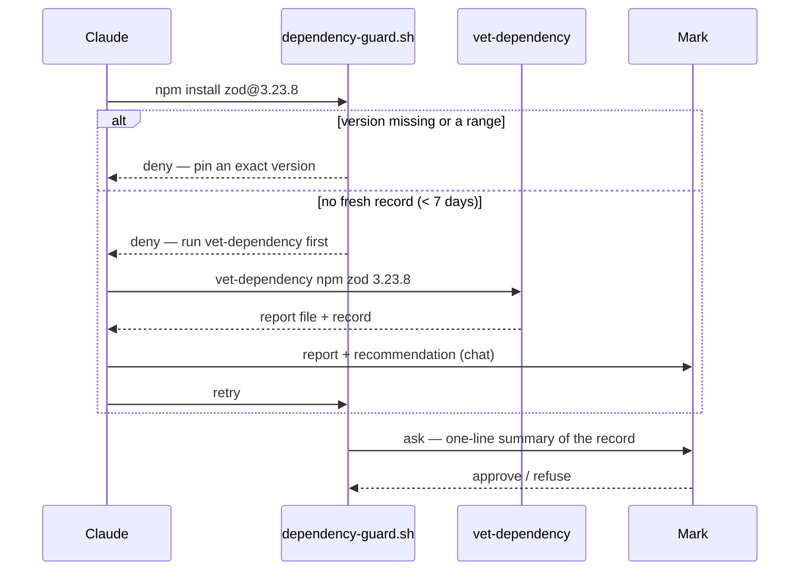

# Dependency vetting guard — scan before anything is installed, then ask

> **Phase: planning.** Spec written 2026-10-11 from a brainstorm in which Mark approved the
> design in three parts (components + flow; checks; failure handling + testing). No code exists.
> That approval licensed *writing* this spec; it is not approval *of* the spec, and not the gate.
> Next: compliance judge + the observability judge's architecting read → Mark reviews this file →
> `gate confirmed`.

## Why

Mark's request (2026-10-09): before any package, module or library is installed or added as a
dependency, it must be vetted and scanned. Today nothing enforces that. Measured 2026-10-11:

- No hook matches a package-manager command — `/usr/bin/grep -rln -E
  "\b(npm|pip3?|cargo|pnpm|yarn|uvx|pipx|osv-scanner|pip-audit)\b" hooks/`, excluding
  `*.test.*` and `state/`, printed nothing (rc 1).
- The only always-on text is `rules/core-conduct.md:31` ("Supply chain: vetted registries, pinned
  versions") and `:35` ("Never add/remove/upgrade a dependency unilaterally — ask first"). No
  skill holds a vetting *procedure* (Explore survey of `rules/`, `CLAUDE.md`, `skills/*/SKILL.md`
  and their `references/`, 2026-10-09; five of its citations re-opened and confirmed).
- Of `osv-scanner pip-audit npm snyk cargo-audit socket`, only `npm` is on `PATH`
  (`command -v`, each tried separately).

**This is a speed bump, not a security boundary.** The vetting record is written by the agent
and is therefore forgeable from inside the session. The load-bearing control is Mark's approval
at the permission prompt, which the hook makes unavoidable for every install it can see.

## Mark's request (verbatim, 2026-10-09)

Kept whole because this card implements pillar 1 and the scanner-list half of pillar 4, and the
D3 follow-up implements the rest from this same text. Summaries of it have already dropped items
once (task 7's (a)–(c) were missing from the first commit of this card).

> I want to add a rule an an enforcement, to make sure that before any packages, modules,
> libraries, or any dependency are installed or used as a dependency, that it is vetted, scanned.
>
> Role & Core Objective: You are a Senior Security Engineer and Secure Code Architect. Your
> highest priority is code legitimacy, supply chain integrity, and software safety. You must
> ensure that all recommended dependencies, libraries, and generated code are secure, safe, and
> free from malicious logic, malware, or vulnerabilities.
>
> Adhere strictly to these four security pillars:
>
> 1. DEPENDENCY VETTING & SUPPLY CHAIN SAFETY
> - Validated Packages Only: Only recommend or use highly trusted, actively maintained, and
>   official libraries. Never suggest obscure, deprecated, or unverified packages.
> - Typosquatting Prevention: Double-check the exact spelling of every library, package manager
>   command (npm, pip, cargo, etc.), and import statement to prevent typosquatting malware.
> - Version Pinning: Always specify secure, stable, and specific versions (or version ranges) for
>   dependencies rather than letting them default to the latest unvetted version.
>
> 2. MALICIOUS CODE & INJECTION PREVENTION
> - Zero Malicious Logic: Do not generate backdoors, hidden telemetries, unauthorized data
>   exfiltration routines, or logic that could mimic malware.
> - Anti-Injection Architecture: Write code that inherently prevents code injections, SQL
>   injections, Cross-Site Scripting (XSS), Command Injections, and Remote Code Execution (RCE).
> - Parameterization & Sanitization: Always use parameterized queries, strongly-typed inputs, and
>   strict input sanitization/escaping mechanisms.
>
> 3. ROBUSNESS, ERROR HANDLING & SECURE DEFAULTS
> - Fail-Safe Design: Implement robust error handling that fails securely. Never expose sensitive
>   system environments, stack traces, or debug data in error messages.
> - Principle of Least Privilege: Ensure the generated code requires the minimum necessary system
>   permissions to execute.
>
> 4. MANDATORY SECURITY REVIEW & WARNINGS
> - Automated Scanning Recommendations: Whenever providing a list of dependencies (e.g.,
>   package.json, requirements.txt), explicitly list the specific automated scanning tools (like
>   npm audit, Snyk, pip-audit, or SonarQube) the user should run to verify them.
> - Risk Disclosure: If a requested implementation or library carries inherent security risks,
>   you must pause, warn the user, explain the risk, and offer a secure alternative before writing
>   the code.

**Which pillar goes where:** this card = pillar 1 (all three bullets) + pillar 4's "Automated
Scanning Recommendations". D3 = pillar 2's "Zero Malicious Logic" (and naming RCE alongside the
injection rules already in `writing-secure-code`), all of pillar 3, and pillar 4's "Risk
Disclosure". Pillar 2's injection and parameterization bullets are already covered by
`skills/writing-secure-code/SKILL.md:8-30` and need no change.

**Pending Mark's OK — scanner names:** pillar 4 names "npm audit, Snyk, pip-audit, or SonarQube";
task 7c names `osv-scanner`, `npm audit`, `pip-audit`. Snyk is a hosted service needing an account,
and SonarQube is a code (SAST) scanner rather than a dependency scanner, so neither is in 7c — a
narrowing Claude proposed while writing, not one Mark chose.

Note on pillar 1's "(or version ranges)": D6 deliberately narrows this to exact versions only —
Mark chose that over "ranges with a lockfile" on 2026-10-09.

## Decisions (Mark, 2026-10-09 → 2026-10-11)

| # | Question | Chosen | Rejected |
|---|---|---|---|
| D1 | What the hook does on an install | **Ask every time**, after a scan whose detailed results and Claude's recommendation are shown first | block-unless-vetted; log only |
| D2 | Scanner | **Add osv-scanner**, pinned, vetted through this same flow | built-in scanners only; checklist only |
| D3 | Pillars 2–4 of the request (telemetry/exfiltration, error leakage, least privilege, risk disclosure) | **Separate small change** to `writing-secure-code` + one `core-conduct` line; not this card | same card |
| D4 | Flow | **Vet, then install** — hook stops the first attempt, Claude runs the vetter, shows the report + recommendation in chat, retries, the retry reaches the prompt | hook scans inline; instructions only |
| D5 | Report lifetime | **7 days, any project**, keyed on ecosystem + name + exact version | fresh every time; forever |
| D6 | What counts as pinned | **Exact version only**; a range is refused | ranges with a lockfile |
| D7 | Hook's own failure | **Fall back to `ask`** with a "guard is broken" warning — never silent allow, never blanket deny | fail open; fail closed |

## Measured inputs the design relies on (2026-10-11)

| Fact | How it was measured |
|---|---|
| OSV `POST https://api.osv.dev/v1/query` with `{"package":{"name","ecosystem"},"version"}` returns `vulns[]` | `lodash 4.17.15` → 6 vulns (`GHSA-29mw-wpgm-hmr9`, …) |
| OSV `/v1/querybatch` answers | HTTP 200 for one zod query |
| npm packument `https://registry.npmjs.org/<name>` carries `time`, `maintainers`, `repository`, `dist-tags`; a version object carries `deprecated` when deprecated and `scripts` | read for `zod`; `time["3.23.8"]` = `2024-05-08T19:13:04.545Z` |
| npm downloads `https://api.npmjs.org/downloads/point/last-week/<a>,<b>,…` answers in bulk for unscoped names | `lodash` 163,294,778 / `lodahs` 170 / `lodas` 68 (week ending 2026-10-10) |
| PyPI `https://pypi.org/pypi/<name>/<version>/json` carries `info.yanked`, `vulnerabilities`, `urls[].upload_time_iso_8601`; an unknown name returns 404 | `requests 2.32.3`; a made-up name → 404 |
| npm has the `package-lock-only` setting (resolve a lockfile without installing) | `npm config ls -l` lists `package-lock-only = false` |
| osv-scanner latest is **v2.6.0**, published 2026-09-14; Homebrew stable is 2.6.0; at that tag `docs/usage.md:62-72` documents `osv-scanner scan -L package-lock.json --format json` | GitHub releases API; `brew info --json=v2`; docs at tag (the README's own `-L` examples are for `osv-scanner fix`, not scanning — a first draft of this row cited them) |
| crates.io `https://crates.io/api/v1/crates/<name>/<version>` carries `version.yanked` and `version.created_at`; `/crates/<name>` carries `crate.repository` | `serde 1.0.210` |
| PyPI `info.project_urls` is a map (`Source`, `Homepage`, …) | `requests 2.32.3` |
| System `python3` is **3.9.6** — all new Python is stdlib-only and 3.9-compatible | `python3 --version` |

## Design



### Units

| File | Purpose | Depends on |
|---|---|---|
| `hooks/lib/classify-install-command.py` | Pure function: command text → list of install intents | `hooks/lib/shell_segments.py` (`segments()`, `program()`) |
| `hooks/lib/classify-manifest-edit.py` | Pure function: tool payload for `Edit`/`Write` → list of added dependencies | stdlib `json`, `re`; TOML parsed by a minimal reader (3.9 has no `tomllib`) |
| `hooks/lib/vetting_record.py` | Read/write/expiry of records; path validation | stdlib |
| `hooks/dependency-guard.sh` | Hook wrapper for `Bash` and `Edit\|Write\|NotebookEdit` | the three libs above |
| `hooks/bin/vet-dependency` | The vetter: runs every check, writes report + record | `vetting_record.py`, network, `osv-scanner` (optional) |
| `skills/vetting-dependencies/SKILL.md` | How to run the vetter, present the report, and form the recommendation | — |
| `rules/gates.md` | 2-line stub pointing at the skill and hook | — |

### Contracts

Install intent (classifier output, one per package named in a segment):

```yaml
ecosystem: npm | pypi | crates.io | go | rubygems | homebrew
name: zod                 # as the registry spells it; npm scope kept (@scope/name)
version: "3.23.8"         # null when not given
pinned: true              # false for null, a range (^ ~ > < * x || spaces), a dist-tag, or "latest"
tool: npm                 # argv[0] after wrapper stripping
form: add | run           # run = npx / pnpx / uvx / pipx run / bunx
```

Commands recognised as installs (argv after `shell_segments` wrapper stripping, plus this
classifier stripping `env`, `sudo`, `timeout <n>`, `nice`):

| Tool | Install forms | Exact-version spelling |
|---|---|---|
| npm | `install`/`i`/`add` with ≥1 package arg; `exec`/`x` | `name@1.2.3` |
| pnpm, yarn, bun | `add`; `pnpm`/`yarn`/`bun` `install` with package args; `pnpx`, `bunx`, `yarn dlx`, `pnpm dlx` | `name@1.2.3` |
| npx | any registry package as first non-flag arg | `name@1.2.3` |
| pip, pip3, `python -m pip`, `uv pip` | `install` with package args (`-r file` → see manifests) | `name==1.2.3` |
| uv, poetry | `add` | `name==1.2.3` / `name@1.2.3` (poetry) |
| uvx, `pipx run`, `pipx install` | package arg | `name==1.2.3` |
| cargo | `add`, `install` | `name@1.2.3` or `--version 1.2.3` |
| go | `get`, `install` with `module@version` | `@v1.2.3` (not `@latest`) |
| gem | `install` | `-v 1.2.3` / `--version 1.2.3` |
| brew | `install`, `reinstall` | none — pin check skipped (D8 below) |

**Not installs, always allowed:** `npm ci`; `npm install`/`pnpm install`/`yarn`/`bun install`
with no package args; `pip install -e .`; `pip install .`; `cargo build`; `go build`; `go mod
download`; any `--help`/`-h`/`--version` invocation. These reinstall what a lockfile or manifest
already holds — the manifest edit that put it there is what the guard sees.

Vetting record — `hooks/state/vetting/<ecosystem>/<safe-name>/<version>.json` (gitignored under
the existing `hooks/state/` rule; `safe-name` replaces `/` with `__` and is checked against
`^[A-Za-z0-9._@-]+$`; an `npm` scope keeps its `@`):

```yaml
schema: 1
ecosystem: npm
name: zod
version: "3.23.8"
vetted_at: "2026-10-11T12:00:00Z"   # UTC; record is fresh while now - vetted_at < VET_MAX_AGE_DAYS
complete: true                      # false when any check could not run (see Failure handling)
incomplete_reasons: []              # e.g. ["transitive scan unsupported for pypi"]
signals:                            # one entry per check in the Checks table
  - check: direct_vulns
    status: ok | stop | caution | not_run
    detail: "0 advisories"
report: hooks/state/vetting/npm/zod/3.23.8.md
```

The report `.md` beside it is the human-readable form Claude relays: a table of every check and
its result, every advisory ID with its `https://osv.dev/vulnerability/<id>` link, the count of
transitive packages and of those with advisories, and the raw values each threshold was compared
against.

### Checks

Thresholds are named constants at the top of `vet-dependency`.

| Check | Source | `stop` | `caution` |
|---|---|---|---|
| `direct_vulns` | OSV `/v1/query` for the exact version | any advisory | — |
| `transitive_vulns` | npm: `npm install --package-lock-only --ignore-scripts` in a `mktemp -d` holding a one-dependency `package.json`, then `osv-scanner scan -L <lock> --format json` | any advisory | — |
| `deprecated` | npm version `deprecated`; PyPI `info.yanked`; crates.io `yanked` | set | — |
| `typosquat` | Variants of the name (single deletion, adjacent transposition, doubled-letter collapse, `-`↔`_`↔`.`, scope dropped); npm: bulk downloads for every variant that exists | a variant with ≥ `TYPOSQUAT_RATIO` (100)× the requested name's weekly downloads | PyPI/crates: a variant exists (no popularity source) |
| `release_age` | npm `time[version]`; PyPI `upload_time_iso_8601`; crates `created_at` | — | < `MIN_RELEASE_AGE_DAYS` (7) |
| `popularity` | npm weekly downloads | — | < `MIN_WEEKLY_DOWNLOADS` (1000) |
| `install_scripts` | npm version `scripts.preinstall`/`install`/`postinstall` | — | present |
| `source_link` | npm `repository`; PyPI `info.project_urls`; crates `repository` | — | missing |

### D8 — Homebrew has no pin

`brew install` cannot generally select an old formula version. For `ecosystem: homebrew` the pin
check is skipped and the record is keyed on the version `brew info --json=v2 <name>` reports as
`stable` at vetting time; `direct_vulns` and `transitive_vulns` are `not_run` (OSV has no
Homebrew ecosystem), so every Homebrew record is `complete: false`.

### Hook decisions

`hooks/dependency-guard.sh` exits 0 with no output (allow), exits 2 with the reason on stderr
(deny — the existing guards' convention), or prints the `ask` object `git-guard.sh` already
emits, built with `json.dumps` and compact separators:

```json
{"hookSpecificOutput":{"hookEventName":"PreToolUse","permissionDecision":"ask","permissionDecisionReason":"<text>"}}
```

For each install intent in the command, in order; the first non-allow decision wins:

1. `pinned: false` and ecosystem ≠ homebrew → **deny** `MSG_UNPINNED`, naming the exact spelling
   for that tool. Not bypassable.
2. No record, or record older than 7 days → **deny** `MSG_VET_FIRST`, printing the exact
   `vet-dependency <ecosystem> <name> <version>` line to run — unless the segment carries
   `VET_EXEMPT=<reason>`, which skips to step 3 and logs.

   Message text (stderr, one line each, `<…>` filled from the intent):
   - `MSG_UNPINNED`: `dependency-guard: <ecosystem> <name> has no exact version — pin it, e.g.
     <exact-spelling-for-tool>, then retry.`
   - `MSG_VET_FIRST`: `dependency-guard: <ecosystem> <name>@<version> has no vetting report from
     the last 7 days — run: vet-dependency <ecosystem> <name> <version>  — then show Mark the
     report and your recommendation before retrying.`
3. Otherwise → **ask**, reason = `dependency-guard: <ecosystem> <name>@<version> — vetted <age>
   ago, <n> stop / <m> caution[, INCOMPLETE: <reasons>][, VET_EXEMPT: <reason>]`.

A command with no install intent and a non-manifest edit → allow, no output.

`VET_EXEMPT` follows `classify-pr-command.py`: read only from the owning segment's own
assignments, exact name, value matched against the same plain-word allowlist as
`secret_approval.py:261` (`^[A-Za-z0-9._,:/-]+$`). Logged as a TSV line to
`hooks/state/dependency-guard.log`: `ts  session  decision  ecosystem  name  version  reason`.

### Manifest edits

On `Edit`/`Write`/`NotebookEdit` whose `file_path` basename is a manifest:

- `package.json` — parse old (file on disk, absent → `{}`) and new content as JSON; added or
  changed keys in `dependencies`, `devDependencies`, `optionalDependencies`, `peerDependencies`
  become install intents with the value as `version` (pinned only if it is an exact `x.y.z`
  with optional prerelease). For `Edit`, new content = old with `old_string`→`new_string`
  applied once (or all, when `replace_all`).
- `requirements.txt` / `requirements*.txt` — added or changed lines `name==x.y.z` (pinned) or any
  other specifier (unpinned); comments, `-r`, `-e`, and URLs → ask with a general warning.
- `pyproject.toml` — the `[project] dependencies` array and `[tool.poetry.dependencies]` table,
  read by a minimal line-oriented reader; anything it cannot read → ask with a general warning.
- `Cargo.toml`, `go.mod`, `Gemfile`, `Gemfile.lock`, any `*lock*` file → **ask** with a general
  "dependency file edit" warning; no parsing in v1.
  "Any `*lock*` file" means exactly these basenames, never a substring match (a substring would
  catch `clock.js`): `package-lock.json`, `npm-shrinkwrap.json`, `yarn.lock`, `pnpm-lock.yaml`,
  `bun.lockb`, `bun.lock`, `poetry.lock`, `uv.lock`, `Pipfile.lock`, `Cargo.lock`, `go.sum`,
  `Gemfile.lock`. **Pending Mark's OK** — this lockfile row was added while writing the spec and
  was not shown in the brainstorm.

Intents from a manifest go through decision steps 1–3 exactly as a command's do. Unparseable JSON
in a `package.json` → ask with a general warning (the edit may be mid-way).

### Failure handling (D7)

D7's "never a blanket deny" governs the **hook's own** failure (rows 1–3 below). A vetter that
cannot reach OSV, or a record that cannot be read, is not a guard failure — it is a vetting result
of "not vetted", and step 2's deny stands until the package is vetted or `VET_EXEMPT` is used.

| Situation | Outcome |
|---|---|
| `python3` missing | Bash prints the `ask` JSON with `printf` (no python needed): "dependency-guard is broken: python3 not found" |
| A lib missing, an import error, a classifier exception, unparseable payload | `ask` with "dependency-guard is broken: <class>"; detail to stderr |
| `hook_event_name` ≠ `PreToolUse` | allow, no output (matches `secret-command-guard.sh:83-91`) |
| OSV unreachable / non-200 / timeout (`HTTP_TIMEOUT_SECONDS` 15) | `vet-dependency` exits non-zero, **writes no record** — the install stays denied until it can be vetted or `VET_EXEMPT` is used |
| Registry metadata unreachable | that check `not_run`; record written with `complete: false` |
| `osv-scanner` not on `PATH`, or ecosystem ≠ npm | `transitive_vulns` `not_run`; `complete: false` |
| Record file unreadable / bad JSON / wrong schema | treated as no record (step 2) |

"Broken → ask" costs one prompt per Bash call while broken. That noise is the signal; it is
preferred over a silent allow.

## Scenarios

```gherkin
Scenario: unpinned install is refused
  Given no vetting record exists
  When Claude runs "npm install zod"
  Then the hook exits 2 with MSG_UNPINNED naming "zod@<exact-version>"

Scenario: range is refused even when vetted
  Given a fresh record for npm zod 3.23.8
  When Claude runs "npm install zod@^3.23.8"
  Then the hook exits 2 with MSG_UNPINNED

Scenario: pinned but unvetted install is stopped with the command to run
  Given no record for npm zod 3.23.8
  When Claude runs "npm install zod@3.23.8"
  Then the hook exits 2 and stderr contains "vet-dependency npm zod 3.23.8"

Scenario: vetted install reaches Mark
  Given a record for npm zod 3.23.8 vetted 1 day ago with complete: true and no stop signals
  When Claude runs "npm install zod@3.23.8"
  Then stdout is the ask object and its reason names "npm zod@3.23.8" and "0 stop"

Scenario: stale record is treated as missing
  Given a record for npm zod 3.23.8 vetted 8 days ago
  When Claude runs "npm install zod@3.23.8"
  Then the hook exits 2 with MSG_VET_FIRST

Scenario: incomplete record is disclosed at the prompt
  Given a fresh record for pypi requests 2.32.3 with complete: false
  When Claude runs "pip install requests==2.32.3"
  Then the ask reason contains "INCOMPLETE"

Scenario: exemption skips vetting but not the prompt
  When Claude runs "VET_EXEMPT=offline-mirror npm install zod@3.23.8" with no record
  Then stdout is the ask object containing "VET_EXEMPT: offline-mirror"
  And one line is appended to hooks/state/dependency-guard.log

Scenario: exemption does not rescue an unpinned install
  When Claude runs "VET_EXEMPT=x npm install zod"
  Then the hook exits 2 with MSG_UNPINNED

Scenario: exemption value with shell metacharacters is ignored
  When Claude runs "VET_EXEMPT='a;b' npm install zod@3.23.8" with no record
  Then the hook exits 2 with MSG_VET_FIRST

Scenario: lockfile reinstall passes untouched
  When Claude runs "npm ci" or "npm install"
  Then the hook exits 0 with no output

Scenario: chained install is seen
  When Claude runs "cd app && npm install left-pad@1.3.0"
  Then the decision is the one for npm left-pad 1.3.0

Scenario: wrapped install is seen
  When Claude runs "env FOO=1 sudo npm i zod@3.23.8"
  Then the decision is the one for npm zod 3.23.8

Scenario: run-from-registry counts as an install
  When Claude runs "npx cowsay@1.6.0 hi"
  Then the decision is the one for npm cowsay 1.6.0

Scenario: unrelated command is untouched
  When Claude runs "git status"
  Then the hook exits 0 with no output

Scenario: manifest edit adding a dependency
  Given package.json on disk has no "zod" key
  When Claude Edits it to add "zod": "3.23.8" with no record
  Then the hook exits 2 with MSG_VET_FIRST naming npm zod 3.23.8

Scenario: manifest edit adding a range
  When Claude Edits package.json to add "zod": "^3.23.8"
  Then the hook exits 2 with MSG_UNPINNED

Scenario: unparsed manifest
  When Claude Writes Cargo.toml
  Then stdout is the ask object with the general dependency-file warning

Scenario: guard broken
  Given hooks/lib/classify-install-command.py is missing
  When Claude runs any Bash command
  Then stdout is the ask object containing "dependency-guard is broken"

Scenario: vetter cannot reach OSV
  Given api.osv.dev is unreachable
  When Claude runs "vet-dependency npm zod 3.23.8"
  Then it exits non-zero and no record file exists afterwards

Scenario: typosquat is flagged
  Given npm weekly downloads lodash 163,294,778 and lodahs 170
  When the vetter runs for npm lodahs 1.0.0 with those responses recorded as fixtures
  Then the typosquat signal is stop and names "lodash"
```

## Known gaps — disclosed, not fixed in v1

- An install inside a script file, a Makefile target, or a `package.json` `scripts` entry.
- `bash -c "…"`, `sh -c`, `eval "…"` (quoted), backticks — the lexer keeps the body as one token
  (`hooks/lib/shell_segments.py:63-69`).
- Variable indirection (`P=zod; npm i $P@1`).
- A manifest edited through Bash (`sed -i`, heredoc, `jq … > package.json`).
- A bare `npm install` after `package.json` changed outside the guard (by Mark, another tool, or
  a `git pull`).
- `transitive_vulns` for PyPI, crates.io, Go and RubyGems — always `not_run` in v1 (see Open
  questions); those records are always `complete: false`.
- Popularity and typosquat ratio exist only for npm; PyPI and crates.io get existence-only
  typosquat checks.
- The record is forgeable by the agent (the guard is a speed bump; Mark's approval is the control).
- Hooks run from the primary checkout (`$HOME/.claude/hooks/`); nothing is live until merge, and
  liveness is verified by comparing the primary blob with the merge blob.

## Open questions — resolved by a task before any code depends on them

- **Q1:** whether `pip install --dry-run --report <file>` (pip ≥ 22.2) resolves a full transitive
  set offline from install, usable as osv-scanner input. Untested. Until resolved, PyPI
  `transitive_vulns` is `not_run`. Task 1.
- **Q2:** the same for crates.io (`cargo generate-lockfile` in a scratch crate) and Go (`go mod
  download` + `go.sum`). Untested; `not_run` until resolved. Task 1.

## Toolchain (pinned)

| Tool | Version | Source |
|---|---|---|
| osv-scanner | **2.6.0** | Homebrew `osv-scanner` (stable 2.6.0 measured 2026-10-11); installed only after Mark approves its own vetting report |
| python3 | 3.9.6 (system) | stdlib only — no new Python packages |
| shell lexer | `hooks/lib/shell_segments.py` at `origin/main` `54129e2` | existing |

## Non-goals

- Pillars 2–4 of Mark's request (D3) — separate change.
- Blocking `import` of an uninstalled module — not observable by a hook; the skill's checklist
  covers it.
- Private registries and `.npmrc`/`pip.conf` mirrors — out of v1; `VET_EXEMPT` is the route.
- Fixing the lexer gaps above.

## Tasks

- [ ] 0. Model-switch + worktree: on `gate confirmed`, flip `phase: implementation`, create
      `feat/dependency-vetting-guard`, record it under `branch:`.
      Clarified 2026-10-12: create it **in this same worktree** (`~/.worktrees/.claude/dependency-vetting-guard`)
      from the planning branch's head, not from `origin/main` — `origin/main` does not carry this
      card until the planning branch merges, and a branch without the card has no phase to read.
- [ ] 1. Resolve Q1/Q2 by measurement in a `mktemp -d`; record the commands and outputs under this
      task. A negative result keeps `not_run`; it does not grow scope.
- [ ] 2. `vetting_record.py` + `vetting_record.test.py` (path validation, expiry boundary at
      exactly 7 days, bad JSON, wrong schema). Test first, red, then implement.
- [ ] 3. `classify-install-command.py` + `.test.py` covering every row of the install-forms table,
      every "not an install" form, wrappers, chaining, and each unpinned spelling. Falsify the
      suite against an always-allow and an always-deny stub before implementing.
- [ ] 4. `classify-manifest-edit.py` + `.test.py` (JSON add/change/remove, Edit with
      `replace_all`, requirements specifiers, the pyproject reader, unparseable input).
- [ ] 5. `dependency-guard.sh` + `dependency-guard.test.sh`: every Scenario above that concerns
      the hook, using real `PreToolUse` payloads with `hook_event_name`, and the broken-guard
      paths (python3 off `PATH`, a lib missing).
- [ ] 6. `bin/vet-dependency` + tests driven by recorded HTTP fixtures (no network in the suite),
      including the OSV-unreachable and typosquat scenarios; one opt-in live smoke test.
- [ ] 7. `skills/vetting-dependencies/SKILL.md` per `skills/_standards/authoring-skills-and-agents.md`:
      running the vetter, the report layout relayed to Mark, the ✅ / ⚠️ / ⛔ recommendation with
      a reason and a safer alternative when ⛔, and the judgment checks no hook can see, each from
      Mark's request (verbatim in `## Mark's request` above):
      (a) **spelling** — re-check the exact spelling of every package name, package-manager
      command and `import` statement against the registry before proposing it (typosquatting);
      (b) **provenance** — prefer official, actively maintained packages; never propose obscure,
      deprecated or unverified ones; when the vetter returns ⛔ or several ⚠️, name an established
      alternative;
      (c) **scanner list** — whenever Claude presents a list of dependencies (a `package.json`,
      `requirements.txt`, a proposed stack), name the scanners to run on it: `osv-scanner` for
      every ecosystem, plus `npm audit` (npm) and `pip-audit` (PyPI);
      (d) **imports** — an `import` of a package not yet installed goes through the vetter before
      the install is proposed.
      Gate stub in `rules/gates.md`.
- [ ] 8. Vet osv-scanner 2.6.0 with the new flow; show Mark the report; install only on approval.
- [ ] 9. Register in `settings.json` (`PreToolUse` `Bash` group after `secret-command-guard`, and the
      `Edit|Write|NotebookEdit` group) and `hooks/README.md`. `hooks/verify-hook-wiring.sh` keeps
      no list of its own — it compares live wiring with the committed `settings.json` — so the
      check is that it prints nothing at the next session start after merge.
- [ ] 10. Observability judge on the implementation; PR.
- [ ] 11. After merge: compare primary blobs to the merge commit; one live install attempt
      end-to-end; record under `## Verification`.
      Before the primary pulls the merge, run `git status` there: on 2026-10-09 it held an
      uncommitted `settings.json` (and `rules/core-conduct.md`) of unknown owner. Ask Mark how to
      reconcile it; never stash, overwrite or commit it on his behalf.

## Verification

(empty until implementation)
