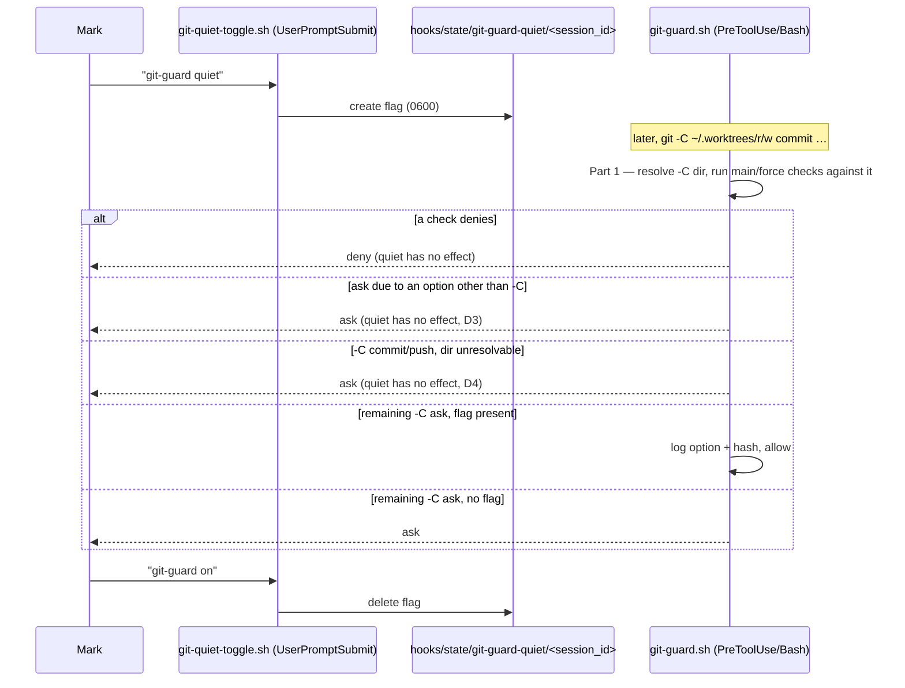

# git-guard: real blocks for `git -C`, then a session toggle for the leftover prompt

> **Phase: planning — revision 2 (2026-10-26).** Revision 1 (`64b6232`) proposed silencing the
> `-C` prompt alone. Round 1 of both judges (compliance: fail, 9; observability: risk high) measured
> that for a `-C` command the prompt is the **only** check — the commit-to-`main` and force-push
> blocks never run — so silencing it would have let those through. Mark then chose option B: fix
> that first, then add the toggle on top. No code exists. Next: judges round 2 → Mark reviews →
> `gate confirmed`.

## Why

`hooks/git-guard.sh` asks for confirmation whenever a git command carries an option ahead of the
subcommand that it cannot account for — in practice `git -C <dir> …`, which this setup uses
constantly to work in worktrees without moving the session's cwd. Mark reports being prompted
several times per session and approving "almost all the time". A prompt that is always approved
trains approval without reading.

Measured on `origin/main` `9cc42f4` (`hooks/lib/classify-git-command.py:537-540`): when a segment
carries a blocking option, the classifier `continue`s before emitting any `COMMIT*`/`PUSH*` fact
(`# denying: no COMMIT*/PUSH* fact for THIS segment`). So for `git -C . commit -m x` on `main`
and `git -C . push --force`, git-guard emits only the ask — the deny checks at
`hooks/git-guard.sh:316` (`PUSH_FORCE`) and `:379` (`COMMIT && on_main`) have nothing to fire on.
Both judges reproduced this against the live hook in a scratch repo.

Mark's rulings (2026-10-26): **silence only the prompt, keep the real blocks on**; and, once told
the blocks don't currently cover `-C`, **option B** — make them cover `-C`, then add the toggle.

## Decisions

| # | Question | Decision | Whose |
|---|---|---|---|
| D1 | Order of work | Part 1 (`-C` gets the real blocks) lands before Part 2 (the toggle) and is a precondition for it | Mark (option B) |
| D2 | What Part 1 resolves | A segment with **exactly one** `-C` whose operand is a literal path (no `$`, backtick, glob, or `~user`; plain `~`/`~/…` expands to `$HOME`) is evaluated against that directory: the commit-to-`main`/`master`, `--force-with-lease`-on-`main`, and bare-`--force` checks run with that directory as the repository. Anything else keeps today's ask | Claude's call — the narrowest rule that covers the measured worktree usage |
| D3 | What the toggle silences | Only the `SCOPE_UNKNOWN` ask for a segment whose **only** blocking option is `-C` (resolvable or not). An ask raised by any other option (`-c`, `--git-dir`, `--work-tree`, `--namespace`, unrecognised) is **never** silenced — `-c core.hooksPath=/dev/null` switches off git's own hooks, including layer 2 | Claude's call, from round-1 finding `writing-specs/edge-cases`; Mark only ever asked about `-C` |
| D4 | Ask surviving quiet | A `-C` segment that commits or pushes, and whose directory D2 **cannot** resolve, still asks under quiet — because for it the ask remains the only check | Claude's call, follows from Mark's "keep the real blocks on" |
| D5 | How quiet is switched on | Mark types the fixed phrase `git-guard quiet` | Mark |
| D6 | How it is switched back on | The fixed phrase `git-guard on` | Claude's call, offered to Mark, not objected to |
| D7 | Default | Every session starts with the prompt **on**; nothing carried over can turn it off | Mark |
| D8 | Who flips the flag | A `UserPromptSubmit` hook that sees Mark's message — not Claude via a tool call | Claude's proposal; Mark chose the fixed phrase on that basis |
| D9 | Lifetime | Until `git-guard on` or the session ends; keyed to `session_id` | Mark (D7) |
| D10 | What counts as the phrase | The **whole** message, surrounding whitespace trimmed, equals the phrase exactly (case-sensitive) | Claude's call — a pasted document, or this card, contains the phrase and must not flip it |
| D11 | Trail | Each silenced ask appends one line to a log, recording the option and a hash of the command — **never** the command text | Claude's call, from round-1 `writing-secure-code/no-secret-logging` |
| D12 | Where state lives | `$HOME/.claude/hooks/state/git-guard-quiet/` (already gitignored, `.gitignore:17`), directory mode `0700`, files `0600` | Claude's call, from round-1 `core-conduct/default-deny-data-store` |

## Scope

In: Part 1 — `-C` resolution in the classifier and git-guard. Part 2 — one new `UserPromptSubmit`
hook, one check in git-guard before the ask, the `settings.json` registration. Tests in **new**
suite files (see Tasks). One ADR. A `rules/gates.md` edit.

Out: every other guard; any option other than `-C`; resolving more than one `-C` per segment;
pane agents (each is its own session and starts with the prompt on — D7); a per-command or
per-repo toggle.

## Design



### Part 1 — `-C` gets the real blocks

- **`hooks/lib/classify-git-command.py`.** When a segment's only blocking option is `-C` and
  D2 resolves its single operand, emit the segment's usual `COMMIT*`/`PUSH*` facts plus the
  existing `SEG_GIT_C` fact carrying the resolved path, and no `SCOPE_UNKNOWN`. When D2 cannot
  resolve it, keep today's behaviour (no `COMMIT*`/`PUSH*`, `SCOPE_UNKNOWN -C`) and additionally
  emit a fact marking that the segment commits or pushes, so git-guard can apply D4.
- **`hooks/git-guard.sh`.** `on_main()` and the checks at `:316`, `:320`, `:379` evaluate against
  the `-C` directory when one is present. A `-C` directory that is not a git repository, or whose
  branch cannot be read, is treated the way git-guard treats such a state today for the session
  cwd (fail closed, per ADR 0026).
- Expected effect: most `git -C <worktree> …` commands stop asking in **every** session, with no
  phrase, because their directory now resolves and passes the checks.

### Part 2 — the toggle

- **`hooks/git-quiet-toggle.sh`** (new, `UserPromptSubmit`). Reads the payload's `prompt` and
  `session_id` (field names confirmed in Task 0). On an exact `git-guard quiet` it creates the flag
  `$HOME/.claude/hooks/state/git-guard-quiet/<session_id>`; on an exact `git-guard on` it deletes
  it. It then **re-checks** the flag's presence and prints, on stdout as plain text (which
  `UserPromptSubmit` adds to context), exactly one of:
  - `git-guard quiet: ON for this session (the -C prompt is silenced; real blocks still apply).`
  - `git-guard quiet: OFF for this session (the -C prompt is back).`
  - `git-guard quiet: FAILED to change state — the prompt is <ON|OFF>. <error>`
  The state printed is the one measured after the change, never the one intended. Any other
  message: no output, no file touched.
- **`hooks/git-guard.sh`.** Immediately before emitting the `SCOPE_UNKNOWN` ask, if D3 and D4
  allow silencing **and** the flag for the payload's `session_id` exists, append the log line and
  `exit 0`. Placed after every deny, so it can only turn an ask into an allow.
- **Log line** — `$HOME/.claude/hooks/state/git-guard-quiet.log`, one line per silenced ask,
  tab-separated, in this order: ISO-8601 UTC timestamp (`YYYY-MM-DDTHH:MM:SSZ`), `session_id`,
  the option (`-C`), SHA-256 of the raw command (hex). No command text, so no newline or tab from
  the command can reach the file. **If the log append fails, git-guard asks** instead of allowing
  — no trail, no silence.

## Requirements

Part 1:
- R1. On `main`, `git -C <repo> commit -m x` is **denied** (resolvable `<repo>`).
- R2. `git -C <repo> push --force` is **denied**; `--force-with-lease` on `main` is denied.
- R3. On a feature branch, `git -C <repo> commit -m x -- f` is allowed without asking.
- R4. A `-C` operand containing `$`, a backtick, a glob, or `~user`, or two `-C` in one segment,
  keeps today's ask.
- R5. A `-C` directory that is not a repository fails closed, matching the cwd behaviour.

Part 2:
- R6. With no flag for the current session, every ask fires exactly as after Part 1.
- R7. With the flag present, a remaining `-C`-only ask is allowed and one log line is written.
- R8. A flag for a **different** `session_id` has no effect.
- R9. With the flag present, R1, R2 and R5 still deny, and D3/D4 asks still ask — each asserted
  with a `-C` command, since a non-`-C` command cannot see the hole this card closes.
- R10. `session_id` is validated (`^[A-Za-z0-9-]{1,128}$`) before becoming a path component, in
  both hooks. Invalid or missing ⇒ the toggle prints the FAILED line and changes nothing; git-guard
  behaves as if no flag exists.
- R11. Only a whole-message exact match flips the flag (D10).
- R12. The toggle hook never blocks Mark's message: on any error it prints the FAILED line and
  exits 0.
- R13. Any error reading the flag, or writing the log, makes git-guard ask.

## Scenarios

```gherkin
Scenario: a -C commit to main is blocked (Part 1, no quiet involved)
  Given the repository at R is on branch main
  When Claude runs "git -C R commit -m x"
  Then git-guard denies it

Scenario: a -C command in a worktree stops prompting (Part 1)
  Given the worktree at W is on branch feat/x
  When Claude runs "git -C W status"
  Then git-guard allows it without asking

Scenario: quiet silences a leftover -C prompt
  Given Mark has typed "git-guard quiet" in session S
  When Claude runs "git -C \"$DIR\" status" in session S
  Then git-guard allows it without asking
  And one log line naming session S and a command hash is appended

Scenario: quiet never silences a commit it cannot check
  Given the flag is set for session S
  When Claude runs "git -C \"$DIR\" commit -m x" in session S
  Then git-guard asks

Scenario: quiet never silences -c
  Given the flag is set for session S
  When Claude runs "git -c core.hooksPath=/dev/null commit -m x" in session S
  Then git-guard asks

Scenario: a new session starts loud
  Given a flag exists for session S
  When session T runs "git -C \"$DIR\" status"
  Then git-guard asks

Scenario: on restores the prompt
  Given the flag is set for session S
  When Mark types "git-guard on"
  Then the toggle prints the OFF line and the next leftover -C command asks

Scenario: the phrase inside other text does nothing
  When Mark's message is "should I type git-guard quiet?"
  Then no flag is created and the toggle prints nothing
```

## Known gaps — disclosed, not fixed

- **Claude can forge the flag.** It is a plain file; a Bash or Write call can create it without
  Mark's phrase, and unlike `secret_approval.py` (one command, deleted on use) it covers the whole
  session. D8 makes the honest path the hook, not the only path. A momentum guardrail, not a
  security boundary.
- **Stale flags accumulate** — one empty file per session that ever went quiet. Harmless (they can
  never match again); cleanup deferred unless the directory is measured growing.
- **Unmeasured: whether in-process subagents report the parent's `session_id`.** If they do, a
  quiet session's in-process subagents are quiet too. Task 0 measures it.
- **Unmeasured: whether a running session picks up a new `settings.json` hook registration.**
  Part 1 and the git-guard half of Part 2 need no restart — every hook call runs the script file
  fresh from `$HOME/.claude/hooks/`. The new toggle hook is a new *registration*; whether open
  sessions see it without a restart is measured in Task 0, and the answer goes here.

## Tasks

- [ ] 0. Measure: a real `UserPromptSubmit` payload (`prompt`, `session_id` names); a real
      `PreToolUse` payload from an in-process subagent (its `session_id`); whether an open session
      runs a `UserPromptSubmit` hook registered after it started. Record each under Known gaps.
- [ ] 1. Part 1 tests, red, in a new `hooks/git-guard-dash-c.test.sh` (R1–R5), invoked from
      `hooks/git-guard.test.sh` so the paired runner covers them (ADR 0044). The existing suite is
      1008 lines, past the 800 cap. Falsify against always-allow and always-ask stubs.
- [ ] 2. Implement Part 1 to green; the full existing `git-guard.test.sh` stays green.
- [ ] 3. Toggle tests, red, in `hooks/git-quiet-toggle.test.sh` (R10–R12, last scenario).
- [ ] 4. Implement `hooks/git-quiet-toggle.sh` to green.
- [ ] 5. git-guard quiet-check tests, red, in a new `hooks/git-guard-quiet.test.sh` (R6–R9, R13),
      invoked from `hooks/git-guard.test.sh`.
- [ ] 6. Implement the git-guard quiet check to green.
- [ ] 7. Register the toggle in `settings.json` (`UserPromptSubmit`), stored `100755`.
- [ ] 8. ADR under `docs/decisions/` (next free number checked against `origin/main`): `-C`
      resolution, the ask-only toggle, and why other options are never silenced.
- [ ] 9. `rules/gates.md`: amend the existing **Default-branch safety** / **Chained commands** text
      rather than add a new always-loaded bullet — two phrases, what stays blocked, the forge gap.
- [ ] 10. Observability judge, then PR.

## Verification

Live, after merge into the primary checkout:
1. In any open session, `git -C <a worktree on a feature branch> status` — no prompt (Part 1).
2. `git -C <a repo on main> commit -m x` — refused.
3. Type `git-guard quiet`, see the ON line; run `git -C "$DIR" status` — no prompt, one log line.
4. Run `git -C "$DIR" commit -m x` — still asks.
5. Type `git-guard on`, see the OFF line; step 3's command asks again.
