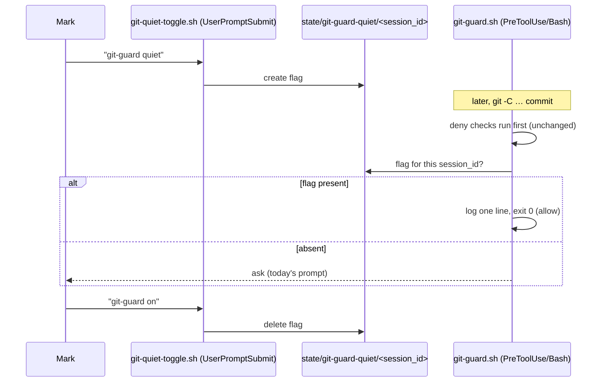

# git-guard quiet — silence the `-C` prompt for one session, on Mark's word

> **Phase: planning.** Written 2026-10-26 from a brainstorm in which Mark approved the
> description in chat. That approval licensed *writing* this card; it is not the gate. Next:
> compliance judge + the observability judge's architecting read → Mark reviews this file →
> `gate confirmed`. No code exists.

## Why

`hooks/git-guard.sh` asks for confirmation whenever a git command carries an option ahead of the
subcommand that it cannot account for — in practice `git -C <dir> …`, which this setup uses
constantly to work in worktrees without moving the session's cwd. Mark reports being prompted
several times per session and approving "almost all the time". A prompt that is always approved
trains approval without reading, which is worse than no prompt; but the prompt is still worth
having in a session where Mark wants it.

Mark's ruling (2026-10-26): **silence only the prompt, keep the real blocks on.**

## Decisions

| # | Question | Decision | Whose |
|---|---|---|---|
| D1 | What the toggle silences | Only the `SCOPE_UNKNOWN` ask (`hooks/git-guard.sh`, the `scope_option` block that emits `"permissionDecision": "ask"`). Every deny — commit to `main`/`master`, bare `--force`, `SEG_UNPARSED`, detached HEAD, outside-a-repo — is untouched | Mark |
| D2 | How it is switched on | Mark types the fixed phrase `git-guard quiet` | Mark |
| D3 | Default | Every session starts with the prompt **on**. Nothing carried over from an earlier session can turn it off | Mark |
| D4 | How it is switched back on | The fixed phrase `git-guard on` | Claude's call, offered to Mark, not objected to |
| D5 | Who flips the flag | A `UserPromptSubmit` hook that sees Mark's message — **not** Claude via a tool call | Claude's proposal, Mark chose the fixed phrase on that basis |
| D6 | Lifetime | Until `git-guard on` or the session ends. Keyed to `session_id`, so a new session never matches | Mark (D3) |
| D7 | What counts as the phrase | The **whole** message, with surrounding whitespace trimmed, equals the phrase exactly (case-sensitive). A message that merely *contains* it does not count | Claude's call — a pasted document or this card itself contains the phrase and must not flip the flag |
| D8 | Trail | Each silenced prompt appends one line to a log | Claude's proposal, in the description Mark approved |

## Scope

In: one new `UserPromptSubmit` hook, one check added to `git-guard.sh` just before the ask, their
tests, the `settings.json` registration, and a `rules/gates.md` bullet.

Out: every other guard; every deny path in git-guard; pane agents (each is its own session and
starts with the prompt on — see D3); any per-command or per-repo variant.

## Design



### Units

- **`hooks/git-quiet-toggle.sh`** (new, `UserPromptSubmit`). Reads the payload's `prompt` and
  `session_id`. On an exact `git-guard quiet` it creates
  `$HOME/.claude/state/git-guard-quiet/<session_id>`; on an exact `git-guard on` it deletes it.
  Either way it prints one line of `additionalContext` confirming the new state, so the
  conversation records it. Any other message: no output, no file touched.
- **`hooks/git-guard.sh`** (edit). Immediately before the `SCOPE_UNKNOWN` ask is emitted, if the
  flag for the payload's `session_id` exists, append one line to
  `$HOME/.claude/state/git-guard-quiet.log` (timestamp, session_id, the option, the command's
  first 200 chars) and `exit 0` without the ask. The check sits **after** every deny, so it can
  only ever turn an ask into an allow — never a deny into anything.

## Requirements

- R1. With no flag for the current session, the `-C` ask fires exactly as today.
- R2. With the flag present for the current session, the `-C` command is allowed silently and one
  log line is written.
- R3. A flag for a **different** `session_id` has no effect.
- R4. With the flag present, every deny path still denies (at minimum: commit on `main`, bare
  `git push --force`, an unlexable command).
- R5. `session_id` is validated (`^[A-Za-z0-9-]{1,128}$`) before it becomes a path component, in
  both hooks. Invalid or missing ⇒ the toggle does nothing and git-guard behaves as if no flag
  exists (fail toward the prompt).
- R6. Only a whole-message exact match flips the flag (D7). `please git-guard quiet`,
  `git-guard quiet now`, and a pasted block containing the phrase do not.
- R7. Any internal error in the toggle hook exits 0 with no file change — it must never block
  Mark's message.
- R8. Any error reading the flag in git-guard falls back to the ask (fail toward the prompt).

## Scenarios

```gherkin
Scenario: quiet silences the -C prompt
  Given Mark has typed "git-guard quiet" in session S
  When Claude runs "git -C ~/.worktrees/x/y status" in session S
  Then git-guard allows it without asking
  And one line naming session S is appended to the quiet log

Scenario: the real blocks survive quiet
  Given the flag is set for session S on branch main
  When Claude runs "git -C . commit -m x" in session S
  Then git-guard denies the commit to main

Scenario: a new session starts loud
  Given a flag exists for session S
  When session T runs a -C command
  Then git-guard asks

Scenario: on restores the prompt
  Given the flag is set for session S
  When Mark types "git-guard on"
  Then the flag is removed and the next -C command asks

Scenario: the phrase inside other text does nothing
  When Mark's message is "should I type git-guard quiet?"
  Then no flag is created
```

## Known gaps — disclosed, not fixed

- **Claude can forge the flag.** It is a plain file under `state/`; a Bash or Write call can
  create it without Mark's phrase. D5 makes the honest path the hook, not the only path. This is
  a momentum guardrail, the same class as `secret_approval.py`, not a security boundary.
- **Stale flags accumulate** — one empty file per session that ever went quiet. Harmless (D6 means
  they can never match again); cleanup is deferred unless the directory is measured growing.
- **Unmeasured: whether in-process subagents (the Agent tool) report the parent's `session_id`.**
  If they do, a quiet session's in-process subagents are quiet too. Task 0 measures it; the
  answer goes here.

## Tasks

- [ ] 0. Measure: capture a real `UserPromptSubmit` payload and a real `PreToolUse` payload from an
      in-process subagent; confirm `prompt` and `session_id` field names and record the subagent
      `session_id` answer under Known gaps.
- [ ] 1. Tests for the toggle hook (R5–R7, scenario 5), red.
- [ ] 2. Implement `hooks/git-quiet-toggle.sh` to green.
- [ ] 3. Tests in `hooks/git-guard.test.sh` for R1–R5, R8, red; falsify against always-allow and
      always-ask stubs.
- [ ] 4. Implement the git-guard check to green; full `git-guard.test.sh` stays green.
- [ ] 5. Register the toggle in `settings.json` (`UserPromptSubmit`), mode `100755`.
- [ ] 6. Add a `rules/gates.md` bullet: the two phrases, what stays blocked, the forge gap.
- [ ] 7. Observability judge, then PR.

## Verification

Live, after merge (hooks load from the primary checkout): type `git-guard quiet`, run a
`git -C` command and see no prompt, run a commit on `main` and see it still refused, type
`git-guard on` and see the prompt return.
