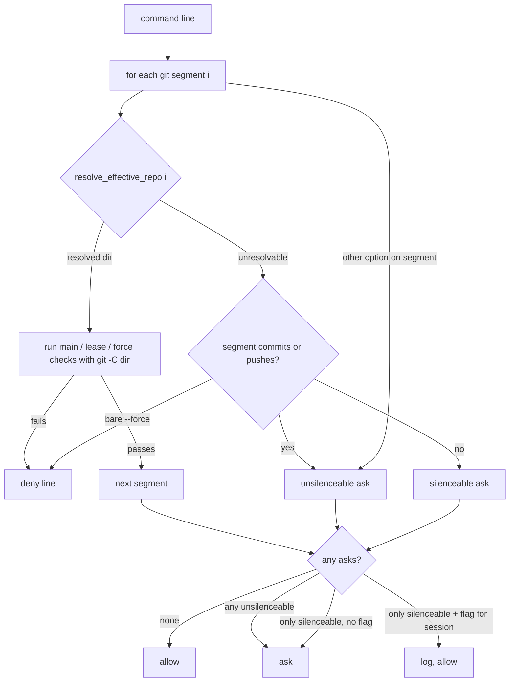

# git-guard: real blocks for `git -C`, then a session toggle for the leftover prompt

> **Phase: planning — revision 3 (2026-10-26).** Revision 1 (`64b6232`) proposed silencing the
> `-C` prompt alone; round 1 of both judges measured that for a `-C` command the prompt is the
> **only** check, so Mark chose option B. Revision 2 (`4bc66cb`) did that for single commands;
> round 2 (compliance: fail, 4; observability: risk medium) found it still treated a line as having
> one directory — mixed lines, a `cd` before `-C`, and option order could each reopen the hole —
> and that changing the shared classifier facts would move doc-guard and feature-sync-guard onto
> the wrong repository. This revision evaluates **each segment** with **new** facts only git-guard
> reads, and reuses worktree-guard's resolver. No code exists. Next: judges round 3 → Mark reviews
> → `gate confirmed`.

## Why

`hooks/git-guard.sh` asks for confirmation whenever a git command carries an option ahead of the
subcommand that it cannot account for — in practice `git -C <dir> …`, which this setup uses
constantly to work in worktrees without moving the session's cwd. Mark reports being prompted
several times per session and approving "almost all the time". A prompt that is always approved
trains approval without reading.

Measured on `origin/main` `9cc42f4` (`hooks/lib/classify-git-command.py:537-540`): when a segment
carries a blocking option, the classifier `continue`s before emitting any `COMMIT*`/`PUSH*` fact
(`# denying: no COMMIT*/PUSH* fact for THIS segment`). So for `git -C . commit -m x` on `main`
and `git -C . push --force`, git-guard emits only the ask — the deny checks at
`hooks/git-guard.sh:316` (`PUSH_FORCE`) and `:379` (`COMMIT && on_main`) have nothing to fire on.
Both judges reproduced this against the live hook in a scratch repo.

Mark's rulings (2026-10-26): **silence only the prompt, keep the real blocks on**; and, once told
the blocks don't currently cover `-C`, **option B** — make them cover `-C`, then add the toggle.

## Decisions

| # | Question | Decision | Whose |
|---|---|---|---|
| D1 | Order of work | Part 1 (`-C` gets the real blocks) lands before Part 2 (the toggle) and is a precondition for it | Mark (option B) |
| D2 | Unit of evaluation | **Each git segment on the line is judged on its own**, against its own effective directory. A line is denied if any segment is denied. Never "the line's `-C` directory" | Claude's call, from round-2 `writing-specs/unambiguous-requirements` |
| D3 | How a segment's directory is found | `resolve_effective_repo` in `hooks/lib/worktree_guard_bash_arms.sh` — the existing rule that composes earlier `cd`s, then the segment's own `-C`, and returns the owning repository or "unresolvable". **No second copy**: git-guard calls it (moving it to a shared lib is allowed if worktree-guard's GROUP S substitution still binds) | Claude's call, from round-2 observability finding 4 |
| D4 | Shared facts | **Unchanged.** `COMMIT*`, `PUSH*`, `SCOPE_UNKNOWN` and `SEG_GIT_C` keep exactly today's meaning, so doc-guard (`:144`) and feature-sync-guard (`:111`), which read `has_fact COMMIT`, see no difference. Part 1 adds **new** segment-indexed facts that only git-guard reads | Claude's call, from round-2 `core-conduct/extend-not-alter-shared-interface` |
| D5 | A `-C` segment that commits or pushes but can't be resolved | Still asks, and quiet never silences it — for it the ask is the only check. Exception: a bare `--force` push is **denied** whether or not its directory resolves, since that block holds on every branch | Claude's call, from Mark's "keep the real blocks on" and round-2 observability finding 7 |
| D6 | What the toggle silences | A line's ask only when **every** reason for it is a `-C` segment that neither commits nor pushes. Any other option **anywhere on the line** (`-c`, `--git-dir`, `--work-tree`, `--namespace`, unrecognised) makes the ask unsilenceable — `-c core.hooksPath=/dev/null` switches off git's own hooks, including layer 2 | Claude's call, from round-1 and round-2 `writing-specs/edge-cases`; Mark only ever asked about `-C` |
| D7 | How quiet is switched on | Mark types the fixed phrase `git-guard quiet` | Mark |
| D8 | How it is switched back on | The fixed phrase `git-guard on` | Claude's call, offered to Mark, not objected to |
| D9 | Default | Every session starts with the prompt **on**; nothing carried over can turn it off | Mark |
| D10 | Who flips the flag | A `UserPromptSubmit` hook that sees Mark's message — not Claude via a tool call | Claude's proposal; Mark chose the fixed phrase on that basis |
| D11 | Lifetime | Until `git-guard on` or the session ends; keyed to `session_id` | Mark (D9) |
| D12 | What counts as the phrase | The **whole** message, surrounding whitespace trimmed, equals the phrase exactly (case-sensitive) | Claude's call — a pasted document, or this card, contains the phrase and must not flip it |
| D13 | Trail | Each silenced ask appends one line to a log, recording the option and a hash of the command — **never** the command text | Claude's call, from round-1 `writing-secure-code/no-secret-logging` |
| D14 | Where state lives | `$HOME/.claude/hooks/state/git-guard-quiet/` (already gitignored, `.gitignore:17`), directory mode `0700`, files `0600` | Claude's call, from round-1 `core-conduct/default-deny-data-store` |

## Scope

In: Part 1 — new classifier facts, per-segment evaluation in git-guard. Part 2 — one new
`UserPromptSubmit` hook, the quiet check in git-guard, the `settings.json` registration. Tests,
including rewriting the existing assertions Part 1 deliberately reverses. One ADR. A
`rules/gates.md` edit.

Out: changing what any existing fact means (D4); any option other than `-C`; resolving more than
one `-C` per segment; pane agents (each is its own session and starts with the prompt on — D9);
a per-command or per-repo toggle. doc-guard and feature-sync-guard are **out of scope because D4
leaves their input unchanged** — and Task 2 asserts that rather than assuming it.

## Design



### Part 1 — `-C` gets the real blocks, per segment

- **`hooks/lib/classify-git-command.py`.** For every git segment whose only blocking option is
  `-C`, add new facts (names are the builder's; meaning is fixed here):
  - `SEG_DIRECTED<tab><i>` — segment `i` carries exactly one `-C` and no other blocking option.
  - `SEG_COMMIT<tab><i>`, `SEG_PUSH_FORCE<tab><i>`, `SEG_PUSH_LEASE<tab><i>` — what segment `i`
    does, by the same rules the line-level `COMMIT`/`PUSH_FORCE`/`PUSH_LEASE` use today, plus the
    pathspec facts git-guard's commit check reads, indexed to `i`.
  - Existing facts: no change (D4). `SCOPE_UNKNOWN` is still emitted as today.
  - Two `-C` in one segment, or any other blocking option: no `SEG_DIRECTED` for it (today's ask).
- **`hooks/git-guard.sh`.** For each `SEG_DIRECTED` segment `i`, call `resolve_effective_repo i`
  (D3). If it resolves to repository `D`, run the existing checks for that segment's own
  `SEG_COMMIT`/`SEG_PUSH_*` facts with **every** git call they make pointed at `D` (`git -C "$D"`):
  `current_branch`/`on_main` (`:129`), the sequencer and rebase-marker checks (`:144`, `:161`,
  `:192`, `:217`, `:232`, `:244`), and the staged-file read (`:388`). A `D` that is not a
  repository, or whose branch cannot be read, fails closed exactly as the session cwd does today
  (ADR 0026). Segments without `-C` are checked exactly as today.
- **The ask.** Emitted when `SCOPE_UNKNOWN` is present, **unless** every segment that caused it is
  a `SEG_DIRECTED` segment that resolved and passed. Marked **unsilenceable** if any segment
  carries a non-`-C` blocking option (`SEG_SCOPE_OPT`), or any unresolved `SEG_DIRECTED` segment
  commits or pushes (D5, D6); otherwise **silenceable**.
- Expected effect: `git -C <worktree> …` stops asking in **every** session, with no phrase,
  whenever its directory resolves and passes.

### Part 2 — the toggle

- **`hooks/git-quiet-toggle.sh`** (new, `UserPromptSubmit`). Reads the payload's `prompt` and
  `session_id` (field names confirmed in Task 0). On an exact `git-guard quiet` it creates the flag
  `$HOME/.claude/hooks/state/git-guard-quiet/<session_id>`; on an exact `git-guard on` it deletes
  it. It then **re-checks** the flag's presence and prints, on stdout as plain text (which
  `UserPromptSubmit` adds to Claude's context; Claude relays it to Mark), exactly one of:
  - `git-guard quiet: ON for this session (the -C prompt is silenced; real blocks still apply).`
  - `git-guard quiet: OFF for this session (the -C prompt is back).`
  - `git-guard quiet: FAILED to change state — the prompt is <ON|OFF>. <error>`
  The state printed is the one measured after the change, never the one intended. Any other
  message: no output, no file touched.
- **`hooks/git-guard.sh`.** When the ask is silenceable **and** the flag for the payload's
  `session_id` exists, append the log line and `exit 0` instead of asking. Sits after every deny.
- **Log line** — `$HOME/.claude/hooks/state/git-guard-quiet.log`, one line per silenced ask,
  tab-separated, in this order: ISO-8601 UTC timestamp (`YYYY-MM-DDTHH:MM:SSZ`), `session_id`,
  the option (`-C`), SHA-256 of the raw command (hex). No command text, so no newline or tab from
  the command can reach the file. **If the log append fails, git-guard asks.**

## Requirements

Part 1 (session cwd on `main` unless stated; `W` is a worktree on `feat/x`; `M` a repo on `main`):
- R1. `git -C M commit -m x` is **denied**.
- R2. `git -C M push --force-with-lease` is denied; `git -C W push --force` is denied;
  `git -C "$D" push --force` (unresolvable) is denied.
- R3. From a session cwd on `feat/x`, `git -C W commit -m x -- f` and `git -C W status` are
  allowed without asking.
- R4. **Mixed lines stay refused:** `git -C W status && git commit -m y` and
  `git commit -m y && git -C W status` are denied (the plain commit is on `main`).
- R5. **`cd` composes:** `cd M && git -C . commit -m x`, from a session cwd on `feat/x`, is denied.
- R6. A `-C` operand `resolve_effective_repo` cannot resolve, or two `-C` in one segment, keeps the
  ask; if that segment commits or pushes, the ask is unsilenceable.
- R7. A `-C` directory that is not a repository fails closed, matching the cwd behaviour.
- R8. doc-guard and feature-sync-guard return the same decision as on `origin/main` for every
  Part 1 scenario command (asserted, not assumed).

Part 2:
- R9. With no flag for the current session, every ask fires exactly as after Part 1.
- R10. With the flag present, a silenceable ask is allowed and one log line is written.
- R11. A flag for a **different** `session_id` has no effect.
- R12. With the flag present, R1, R2, R4, R5 and R7 still deny, and every unsilenceable ask still
  asks — each asserted with a `-C` command.
- R13. With the flag present, these still ask: `git -C "$D" -c core.hooksPath=/dev/null status`,
  `git -c core.hooksPath=/dev/null -C "$D" status`, and
  `git -C "$D" status && git -c core.hooksPath=/dev/null status` (option order and position).
- R14. `session_id` is validated (`^[A-Za-z0-9-]{1,128}$`) before becoming a path component, in
  both hooks. Invalid or missing ⇒ the toggle prints the FAILED line and changes nothing; git-guard
  behaves as if no flag exists.
- R15. Only a whole-message exact match flips the flag (D12).
- R16. The toggle hook never blocks Mark's message: on any error it prints the FAILED line and
  exits 0.
- R17. Any error reading the flag, or writing the log, makes git-guard ask.

## Scenarios

```gherkin
Scenario: a -C commit to main is blocked (Part 1, no quiet involved)
  Given the repository at M is on branch main
  When Claude runs "git -C M commit -m x"
  Then git-guard denies it

Scenario: a mixed line still refuses the plain commit
  Given the session cwd is on main and W is a worktree on feat/x
  When Claude runs "git -C W status && git commit -m y"
  Then git-guard denies it

Scenario: a cd before -C is honoured
  Given the session cwd is on feat/x and M is on main
  When Claude runs "cd M && git -C . commit -m x"
  Then git-guard denies it

Scenario: a -C command in a worktree stops prompting (Part 1)
  Given the worktree at W is on branch feat/x
  When Claude runs "git -C W status"
  Then git-guard allows it without asking

Scenario: quiet silences a leftover -C prompt
  Given Mark has typed "git-guard quiet" in session S
  When Claude runs "git -C \"$DIR\" status" in session S
  Then git-guard allows it without asking
  And one log line naming session S and a command hash is appended

Scenario: quiet never silences a commit it cannot check
  Given the flag is set for session S
  When Claude runs "git -C \"$DIR\" commit -m x" in session S
  Then git-guard asks

Scenario Outline: quiet never silences -c, wherever it sits
  Given the flag is set for session S
  When Claude runs "<line>" in session S
  Then git-guard asks
  Examples:
    | line                                                            |
    | git -c core.hooksPath=/dev/null commit -m x                      |
    | git -C "$DIR" -c core.hooksPath=/dev/null status                 |
    | git -C "$DIR" status && git -c core.hooksPath=/dev/null status   |

Scenario: a new session starts loud
  Given a flag exists for session S
  When session T runs "git -C \"$DIR\" status"
  Then git-guard asks

Scenario: on restores the prompt
  Given the flag is set for session S
  When Mark types "git-guard on"
  Then the toggle prints the OFF line and the next leftover -C command asks

Scenario: the phrase inside other text does nothing
  When Mark's message is "should I type git-guard quiet?"
  Then no flag is created and the toggle prints nothing
```

## Known gaps — disclosed, not fixed

- **Claude can forge the flag.** It is a plain file; a Bash or Write call can create it without
  Mark's phrase, and unlike `secret_approval.py` (one command, deleted on use) it covers the whole
  session. D10 makes the honest path the hook, not the only path. A momentum guardrail, not a
  security boundary.
- **Part 2 may turn out to be rarely needed.** Part 1 alone should remove most `-C` prompts; the
  leftover is `-C` with an operand built from a variable. Mark asked for control regardless, so
  Part 2 stays in scope; if the log shows it almost never fires, retiring it is a later decision.
- **Stale flags accumulate** — one empty file per session that ever went quiet. Harmless (they can
  never match again); cleanup deferred unless the directory is measured growing.
- **Unmeasured: whether in-process subagents report the parent's `session_id`.** Task 0.
- **Unmeasured: whether a running session picks up a new `settings.json` hook registration.**
  Part 1 and git-guard's quiet check need no restart — every hook call runs the script file fresh
  from `$HOME/.claude/hooks/`. The toggle hook is a new *registration*; Task 0 measures whether
  open sessions see it without a restart.
- **Unmeasured: whether Mark sees the toggle's confirmation line directly** or only through
  Claude's relay. Task 0.
- **Unmeasured by the round-2 judge:** `cd M && git -C . commit` from a feature-branch cwd was not
  run (the live guards refused the probe text). R5 pins it as a test instead.

## Tasks

- [ ] 0. Measure: a real `UserPromptSubmit` payload (`prompt`, `session_id` names); a real
      `PreToolUse` payload from an in-process subagent (its `session_id`); whether an open session
      runs a `UserPromptSubmit` hook registered after it started; whether a `UserPromptSubmit`
      hook's stdout is shown to the user. Record each under Known gaps.
- [ ] 1. **Rewrite the reversed baseline, as its own step:** update the existing assertions that pin
      today's `-C` asking and that Part 1 deliberately changes — `hooks/git-guard.test.sh:766-810`
      and the exact-equality fact sets in `hooks/lib/classify-git-command.test.py` at
      `:338`, `:349`, `:398`, `:403`, `:407` (compare at `:839-840`) — to the R1–R7 outcomes.
      Re-locate them by content first; the line numbers are a lead. Commit red.
- [ ] 2. Part 1 new tests, red, in a new `hooks/git-guard-dash-c.test.sh` (R1–R8), invoked from
      `hooks/git-guard.test.sh` so the paired runner covers them (ADR 0044); the existing suite is
      1008 lines, past the 800 cap. Falsify against always-allow and always-ask stubs.
- [ ] 3. Implement Part 1 to green: Tasks 1–2 and every other existing suite (including
      worktree-guard's GROUP S, doc-guard, feature-sync-guard) green, with no further test edits.
- [ ] 4. Toggle tests, red, in `hooks/git-quiet-toggle.test.sh` (R14–R16, last scenario).
- [ ] 5. Implement `hooks/git-quiet-toggle.sh` to green.
- [ ] 6. git-guard quiet-check tests, red, in a new `hooks/git-guard-quiet.test.sh` (R9–R13, R17),
      invoked from `hooks/git-guard.test.sh`.
- [ ] 7. Implement the git-guard quiet check to green.
- [ ] 8. Register the toggle in `settings.json` (`UserPromptSubmit`), stored `100755`.
- [ ] 9. ADR under `docs/decisions/` (next free number checked against `origin/main`): per-segment
      `-C` resolution, the new facts beside the unchanged ones, the ask-only toggle, and why other
      options are never silenced.
- [ ] 10. `rules/gates.md`: amend the existing **Default-branch safety** / **Chained commands** text
      rather than add a new always-loaded bullet — two phrases, what stays blocked, the forge gap.
- [ ] 11. Observability judge, then PR.

## Verification

Live, after merge into the primary checkout:
1. In any open session, `git -C <a worktree on a feature branch> status` — no prompt (Part 1).
2. `git -C <a repo on main> commit -m x` — refused.
3. Type `git-guard quiet`, see the ON line; run `git -C "$DIR" status` — no prompt, one log line.
4. Run `git -C "$DIR" commit -m x` — still asks.
5. Type `git-guard on`, see the OFF line; step 3's command asks again.
