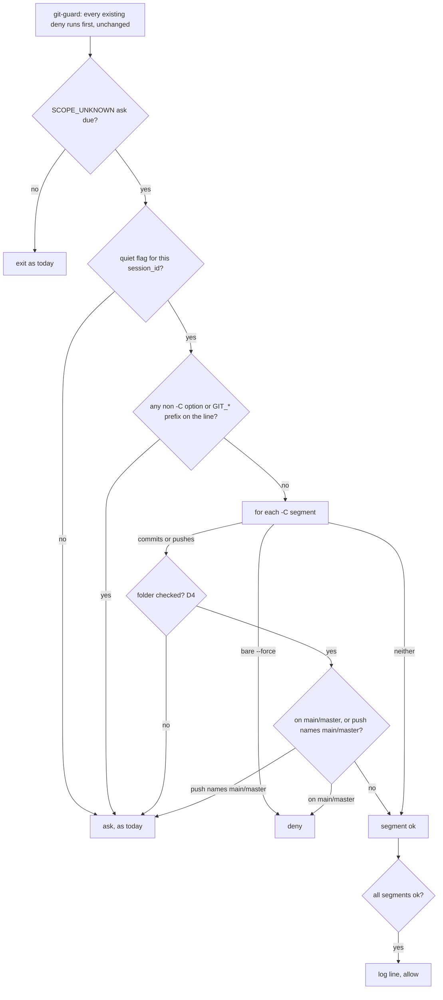

# git-guard quiet — a session toggle that lets `git -C` through unless it lands on `main`

> **Phase: planning — revision 4 (2026-10-26).** History: rev 1 (`64b6232`) silenced the `-C`
> prompt outright; round 1 measured that for a `-C` command the prompt is the **only** check, so a
> commit to `main` would have gone through. Revs 2–3 (`4bc66cb`, `8780b3f`) tried to give every
> `-C` command the real blocks in every session; rounds 2–3 kept finding new holes in that
> (mixed lines, `cd` composition, a resolver that exits instead of returning, `GIT_DIR=`), and the
> round-3 cap escalated to Mark. Mark then set the rule this revision implements, in his words:
> with quiet on, *"let every `-C` command through … including commit and push as long as it is"*
> not committing *"to a main/master or any main/master of any other repository"*. **Default
> behaviour is now unchanged** — everything new happens only while quiet is on. No code exists.
> Next: judges round 4 → Mark reviews → `gate confirmed`.

## Why

`hooks/git-guard.sh` asks for confirmation whenever a git command carries an option ahead of the
subcommand that it cannot account for — in practice `git -C <dir> …`. Mark reports several prompts
per session, approved "almost all the time". His two most recent, verbatim in shape:

- `W=~/.worktrees/Snatch-Bracket/roadmap-lane-updater; git -C "$W" status --short; git -C "$W" hash-object docs/features/roadmap-lane-updater.md; …`
- `git -C /Users/marksuyat/.worktrees/Snatch-Bracket/round-config-validation-gaps cat-file -t <sha>`

Both are read-only. A prompt that is always approved trains approval without reading.

Measured on `origin/main` `9cc42f4` (`hooks/lib/classify-git-command.py:537-540`): a segment with a
blocking option gets **no** `COMMIT*`/`PUSH*` fact, so for `git -C <repo on main> commit` and
`git -C <repo> push --force` the ask is the only thing git-guard does. Silencing it naively would
open those. This card silences it only where the command provably cannot land on `main`/`master`.

## Decisions

| # | Question | Decision | Whose |
|---|---|---|---|
| D1 | When anything changes | Only while quiet is on for the session. With quiet off, git-guard's behaviour is byte-for-byte today's | Mark (rev-4 rule; "every session starts on") |
| D2 | `-C` commands that neither commit nor push | Allowed under quiet, whatever folder they name (including `"$W"`) | Mark |
| D3 | `-C` commits and pushes | Allowed under quiet when the target folder is checked and is **not** on `main`/`master`; **denied** if it is; **asks** if the folder can't be checked | Mark (rule); "asks when unknown" is Claude's call, so a commit is never waved through blind |
| D4 | When a commit/push folder counts as "checked" | The segment has exactly one `-C`; its operand is a literal path (absolute, `~`, `~/…`, or relative — relative resolves against the payload's `cwd`) with no `$`, backtick, glob or `~user`; **no `cd` anywhere earlier on the line**; no `GIT_*=` assignment on the segment; no grouping (`SEG_GROUPED`). Otherwise it can't be checked → ask | Claude's call — deliberately narrower than worktree-guard's `resolve_effective_repo`, which round 3 measured exits the hook (an allow in `log` mode) instead of returning |
| D5 | How "not on `main`/`master`" is read | `git -C <dir> symbolic-ref --short HEAD` in that folder — its **own** HEAD, so a linked worktree reads its own branch. Detached HEAD, not a repository, a rebase/merge in progress, or any error → ask | Claude's call, from round-3 `writing-specs/unambiguous-requirements` (EFF_DIR vs EFF_ROOT) |
| D6 | Pushes to `main` from a feature branch | A `-C` push is allowed only if, besides D5, none of its arguments after the subcommand names `main` or `master` as a destination (`main`, `master`, `*:main`, `*:master`, `refs/heads/main`, `refs/heads/master`); otherwise ask | Claude's call — Mark's rule covers pushes *to* `main`, not just pushes *from* it |
| D7 | Bare `--force` / `-f` push with `-C` | **Denied**, quiet or not — that block holds on every branch | Claude's call, consistent with the existing every-branch rule |
| D8 | Other options and prefixes | Any non-`-C` blocking option **anywhere on the line** (`-c`, `--git-dir`, `--work-tree`, `--namespace`, unrecognised), or a `GIT_*=` prefix on any git segment, keeps the ask even under quiet — `-c core.hooksPath=/dev/null` switches off git's own hooks | Claude's call, from rounds 1–3 `writing-specs/edge-cases` |
| D9 | Switching on | Mark types the fixed phrase `git-guard quiet` | Mark |
| D10 | Switching back | The fixed phrase `git-guard on` | Claude's call, offered to Mark, not objected to |
| D11 | Default | Every session starts with the prompt **on**; nothing carried over can turn it off | Mark |
| D12 | Who flips the flag | A `UserPromptSubmit` hook that sees Mark's message — not Claude via a tool call | Claude's proposal; Mark chose the fixed phrase on that basis |
| D13 | Lifetime | Until `git-guard on` or the session ends; keyed to `session_id` | Mark (D11) |
| D14 | What counts as the phrase | The **whole** message, surrounding whitespace trimmed, equals the phrase exactly (case-sensitive) | Claude's call — a pasted document, or this card, contains the phrase and must not flip it |
| D15 | Trail | Each silenced ask appends one log line with the outcome and a hash of the command — **never** the command text | Claude's call, from round-1 `writing-secure-code/no-secret-logging` |
| D16 | Where state lives | `$HOME/.claude/hooks/state/git-guard-quiet/` (gitignored, `.gitignore:17`), directory `0700`, files `0600` | Claude's call, from round-1 `core-conduct/default-deny-data-store` |
| D17 | Shared facts | Existing facts keep exactly today's meaning; doc-guard (`:144`) and feature-sync-guard (`:111`) see no change. New segment-indexed facts are added that only git-guard reads | Claude's call, from round-2 `core-conduct/extend-not-alter-shared-interface` |

## Scope

In: new classifier facts; the quiet decision in git-guard; one new `UserPromptSubmit` hook; its
`settings.json` registration; tests; one ADR; a `rules/gates.md` edit.

Out: any change with quiet off (D1); doc-guard, feature-sync-guard, worktree-guard and every
other guard; resolving `cd` or variables for commits/pushes (D4 — those ask); pane agents (each
its own session, starting with the prompt on).

## Design



### Classifier — new facts only (D17)

`hooks/lib/classify-git-command.py`. For every git segment `i` that carries a blocking option
(names are the builder's; meaning is fixed here):

- `SEG_DIRECTED<tab><i>` — the segment's only blocking option is exactly one `-C`.
- `SEG_LANDS<tab><i><tab><kind>` — the segment's subcommand is `commit` (`kind=commit`) or `push`
  (`kind=push`, `push_force` for a bare `--force`/`-f` without `--force-with-lease`, by the same
  rule the line-level `PUSH_FORCE` uses today).
- `SEG_PUSH_ARGS<tab><i><tab><arg>` — each argument after `push` and its options, for D6.

Every existing fact — `COMMIT*`, `PUSH*`, `SCOPE_UNKNOWN`, `SEG_GIT_C`, `SEG_SCOPE_OPT`,
`SEG_ENV`, `SEG_CD`, `SEG_GROUPED` — is emitted exactly as today.

### git-guard — the quiet decision

`hooks/git-guard.sh`, at the point the `SCOPE_UNKNOWN` ask is about to be emitted (after every
existing deny), and **only if** the flag for the payload's `session_id` exists:

1. If the line has any `SEG_SCOPE_OPT`, any git segment with a `SEG_ENV` `GIT_*` assignment, or any
   git segment with a blocking option but no `SEG_DIRECTED` → ask (D8).
2. For each `SEG_DIRECTED` segment `i`:
   - `SEG_LANDS i push_force` → deny with today's bare-force message (D7).
   - `SEG_LANDS i commit|push` → apply D4; not checkable → ask. Checkable → read the folder's
     branch per D5; `main`/`master` → deny with today's main message; error/detached/in-progress →
     ask. For `push`, any `SEG_PUSH_ARGS` naming `main`/`master` per D6 → ask.
   - no `SEG_LANDS` → fine (D2).
3. All segments fine → append the log line and `exit 0`.

With no flag, the ask is emitted exactly as today.

### The toggle

`hooks/git-quiet-toggle.sh` (new, `UserPromptSubmit`). Reads the payload's `prompt` and
`session_id` (names confirmed in Task 0). On an exact `git-guard quiet` it creates
`$HOME/.claude/hooks/state/git-guard-quiet/<session_id>`; on an exact `git-guard on` it deletes it.
It then **re-checks** the flag and prints, on stdout as plain text (added to Claude's context;
Claude relays it to Mark), exactly one of:

- `git-guard quiet: ON for this session (-C commands pass unless they would land on main/master).`
- `git-guard quiet: OFF for this session (the -C prompt is back).`
- `git-guard quiet: FAILED to change state — the prompt is <ON|OFF>. <error>`

The state printed is the one measured after the change. Any other message: no output, no file
touched.

### Log line

`$HOME/.claude/hooks/state/git-guard-quiet.log`, one line per silenced ask, tab-separated, in this
order: ISO-8601 UTC timestamp (`YYYY-MM-DDTHH:MM:SSZ`), `session_id`, `read` or `lands` (whether
any segment committed or pushed), SHA-256 of the raw command (hex). No command text. **If the
append fails, git-guard asks.**

## Requirements

`F` is a worktree on `feat/x`; `M` a repository on `main`; the session cwd is `~/.claude` on `main`.

With quiet **off**:
- R1. Every command in R3–R11 gets exactly today's decision (asserted against `origin/main`'s
  git-guard on the same fixtures).

With quiet **on**:
- R2. `git -C "$W" status` (variable) and `git -C F cat-file -t <sha>` → allowed, one `read` log line.
- R3. `git -C F commit -m x -- f` → allowed, one `lands` log line.
- R4. `git -C M commit -m x` → **denied**.
- R5. `git -C F push -u origin HEAD` → allowed; `git -C F push origin HEAD:main` → asks;
  `git -C M push` → denied.
- R6. `git -C F push --force` and `git -C "$W" push --force` → **denied**;
  `git -C F push --force-with-lease` → allowed.
- R7. `git -C "$W" commit -m x` and `cd F && git -C . commit -m x` → ask (folder not checkable, D4).
- R8. A `-C` folder that is detached, mid-rebase, or not a repository, on a commit → asks.
- R9. `git -C F -c core.hooksPath=/dev/null status`, `git -c core.hooksPath=/dev/null -C F status`,
  and `git -C F status && git -c core.hooksPath=/dev/null status` → ask.
- R10. `GIT_DIR=M/.git git -C F commit -m x` → asks.
- R11. `git -C F status && git commit -m y` → **denied** (the plain commit is on `main` — an
  existing deny, unchanged).
- R12. A flag for a **different** `session_id` has no effect.

Toggle and failure handling:
- R13. `session_id` is validated (`^[A-Za-z0-9-]{1,128}$`) before becoming a path component, in
  both hooks. Invalid or missing ⇒ the toggle prints the FAILED line and changes nothing; git-guard
  behaves as if no flag exists.
- R14. Only a whole-message exact match flips the flag (D14).
- R15. The toggle hook never blocks Mark's message: on any error it prints the FAILED line, exits 0.
- R16. Any error reading the flag, resolving a folder, or writing the log makes git-guard ask.

## Scenarios

```gherkin
Scenario: quiet lets a read-only -C lookup through
  Given Mark has typed "git-guard quiet" in session S
  When Claude runs a line setting W and running "git -C \"$W\" status --short" in session S
  Then git-guard allows it without asking

Scenario: quiet lets a worktree commit through
  Given the flag is set for session S and F is on feat/x
  When Claude runs "git -C F commit -m x -- f" in session S
  Then git-guard allows it without asking

Scenario: quiet never lets a commit land on main
  Given the flag is set for session S and M is on main
  When Claude runs "git -C M commit -m x" in session S
  Then git-guard denies it

Scenario: quiet asks when it cannot see the folder of a commit
  Given the flag is set for session S
  When Claude runs "git -C \"$W\" commit -m x" in session S
  Then git-guard asks

Scenario Outline: quiet never silences -c, wherever it sits
  Given the flag is set for session S
  When Claude runs "<line>" in session S
  Then git-guard asks
  Examples:
    | line                                                     |
    | git -C F -c core.hooksPath=/dev/null status              |
    | git -c core.hooksPath=/dev/null -C F status              |
    | git -C F status && git -c core.hooksPath=/dev/null status |

Scenario: a new session starts loud
  Given a flag exists for session S
  When session T runs "git -C F status"
  Then git-guard asks

Scenario: on restores the prompt
  Given the flag is set for session S
  When Mark types "git-guard on"
  Then the toggle prints the OFF line and the next -C command asks

Scenario: the phrase inside other text does nothing
  When Mark's message is "should I type git-guard quiet?"
  Then no flag is created and the toggle prints nothing
```

## Known gaps — disclosed, not fixed

- **Claude can forge the flag.** It is a plain file; a Bash or Write call can create it without
  Mark's phrase, and unlike `secret_approval.py` (one command, deleted on use) it covers the whole
  session. D12 makes the honest path the hook, not the only path. A momentum guardrail, not a
  security boundary.
- **doc-guard and feature-sync-guard never see `-C` commits** (`has_fact COMMIT || exit 0` at
  `doc-guard.sh:144`, `feature-sync-guard.sh:111`). True today, unchanged by this card; under quiet
  the git-guard prompt — the one moment a human sees such a commit — goes away for commits D3
  allows. Round 3 measured doc-guard passing a 400-line `-C .` commit (rc=0) that it refuses
  without `-C` (rc=2). Fixing that blind spot is a separate card.
- **`-C` commits are already refused in `~/.claude`** by test-marker-guard (`FOREIGN_REPO`,
  observed in this session), so R3's allow only shows in repos that haven't opted in to it.
- **Stale flags accumulate** — one empty file per session that ever went quiet; harmless (they
  can never match again). Cleanup deferred unless the directory is measured growing.
- **Unmeasured:** whether in-process subagents report the parent's `session_id`; whether an open
  session runs a `UserPromptSubmit` hook registered after it started; whether a `UserPromptSubmit`
  hook's stdout is shown to Mark directly. All three: Task 0. git-guard's own change needs no
  restart — each hook call runs the script file fresh from `$HOME/.claude/hooks/`.

## Tasks

- [ ] 0. Measure the three unknowns above and the `UserPromptSubmit` payload field names; record
      each under Known gaps.
- [ ] 1. **Baseline update, as its own step:** the exact-equality fact sets in
      `hooks/lib/classify-git-command.test.py` (compare at `:839-840`) for lines carrying a
      blocking option gain the new facts. Re-locate those cases by content. Commit red.
- [ ] 2. New classifier tests for `SEG_DIRECTED`/`SEG_LANDS`/`SEG_PUSH_ARGS`, red; implement to
      green; every existing classifier, git-guard, doc-guard and feature-sync-guard suite stays
      green with no further edits.
- [ ] 3. Quiet-decision tests, red, in a new `hooks/git-guard-quiet.test.sh` (R1–R12, R16), invoked
      from `hooks/git-guard.test.sh` so the paired runner covers them (ADR 0044; the existing suite
      is 1008 lines, past the 800 cap). Falsify against always-allow and always-ask stubs.
- [ ] 4. Implement the git-guard quiet decision to green.
- [ ] 5. Toggle tests, red, in `hooks/git-quiet-toggle.test.sh` (R13–R15, last scenario).
- [ ] 6. Implement `hooks/git-quiet-toggle.sh` to green.
- [ ] 7. Register the toggle in `settings.json` (`UserPromptSubmit`), stored `100755`.
- [ ] 8. ADR under `docs/decisions/` (next free number checked against `origin/main`): the quiet
      rule, why it is quiet-only, why D4 is narrower than worktree-guard's resolver.
- [ ] 9. `rules/gates.md`: amend the existing **Default-branch safety** text rather than add a new
      always-loaded bullet — the two phrases, what still asks or denies, the forge gap.
- [ ] 10. Observability judge, then PR.

## Verification

Live, after merge into the primary checkout:
1. Without quiet: `git -C <a worktree> status` — prompts, as today.
2. Type `git-guard quiet`, see the ON line; repeat step 1 — no prompt, one `read` log line.
3. `git -C <a worktree on a feature branch> commit …` in a repo without test-marker-guard — no prompt.
4. `git -C <a repo on main> commit -m x` — refused.
5. `git -C "$W" commit -m x` — asks.
6. Type `git-guard on`, see the OFF line; step 2's command prompts again.
