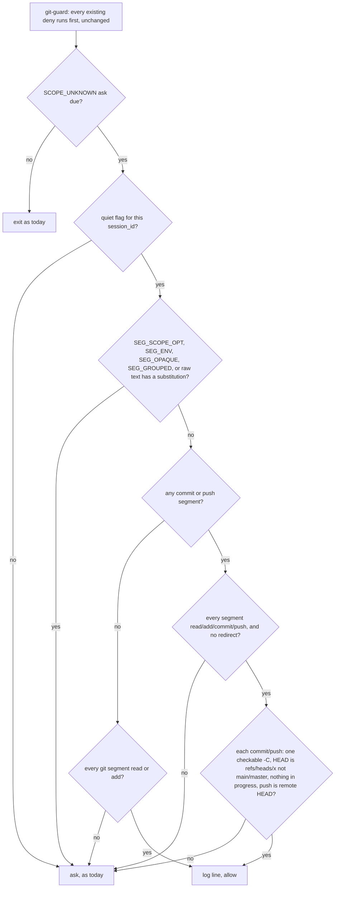

# git-guard quiet — a session toggle that lets known-safe `git -C` commands through without a prompt

> **Phase: implementation (`gate confirmed` by Mark, 2026-10-27) — spec frozen at revision 8 (2026-10-26).** History: rev 1 (`64b6232`) silenced the `-C`
> prompt outright; round 1 measured that for a `-C` command the prompt is the **only** check, so a
> commit to `main` would have gone through. Revs 2–3 (`4bc66cb`, `8780b3f`) tried to give every
> `-C` command the real blocks in every session; the round-3 cap escalated to Mark. Rev 4
> (`5ff3fb3`) implemented Mark's rule "with quiet on, let every `-C` command through unless it
> would commit or push to `main`/`master` of any repository" as a **denylist** — round 4 measured
> seven ways to still land on `main` (a `switch main` earlier on the line, `merge`, `HEAD:main`,
> `--all`/`--mirror`, `export GIT_DIR=`, `pushd`, a bare push under `push.default=upstream`).
> Mark then approved (2026-10-26, "yes go with that") flipping it to an **allowlist**: quiet
> silences only a named set of read-only commands, `git add`, and a commit/push in the plain
> case; everything else still prompts, and **quiet never adds a deny**. Rev 5 (`5a606e6`) was
> that allowlist; round 5 (compliance fail 3, observability risk medium) measured four corners
> that still reached `main` — a `$(…)`/redirect hidden inside an allowed line, `branch --list
> --no-list`, a tag named `main` fooling `symbolic-ref --short`, and a bare `push` under
> `push.default=matching`/`remote.*.push`/mirror — plus an unstated crash path and a wrapper
> contradiction. Two ids recurred, so it escalated; Mark approved all the proposed fixes ("yes"),
> which revision 6 (`6a8a3c7`) applied. Round 6 (compliance fail 2, observability risk medium)
> measured a case-variant branch (`Main` on a case-insensitive filesystem *is* `main`) and a
> crash path in the new shell library that would let a command run; it also found zsh-only
> code-running expansions and an unprompted read-only redirect. Mark approved ("yes fix them")
> **revision 7**: fold case in D7, run the quiet decision as a child process whose only allow is
> an explicit one, record the other two as Known gaps, and adopt the **stop rule** below.
> Every fix only adds asks. Round 7: compliance **pass**, observability risk **low**, with small
> follow-ups Mark approved ("Yes") as **revision 8**: a timeout on every git call the quiet decision
> makes (a hang asks), "allow" restated as a silent exit 0, `eval` lines ask, a Unicode-aware case
> fold, the child's input format, and two Known-gaps lines. No code exists.
> Next: compliance re-check → Mark reviews → `gate confirmed`.
>
> **Stop rule (Mark, 2026-10-26, from round 7 on):** a bypass that needs a deliberate construction
> (a crafted expansion, an engineered repository state) gets a Known-gaps line, not a design
> change; only a route an ordinary command could hit by accident changes the design. Reason: the
> flag itself is forgeable (Known gaps), so quiet cannot be a boundary against deliberate misuse,
> and patching each new construction has not converged.

## Why

`hooks/git-guard.sh` asks for confirmation whenever a git command carries an option ahead of the
subcommand that it cannot account for — in practice `git -C <dir> …`. Mark reports several prompts
per session, approved "almost all the time". His two most recent, verbatim in shape:

- `W=~/.worktrees/Snatch-Bracket/roadmap-lane-updater; git -C "$W" status --short; git -C "$W" hash-object docs/features/roadmap-lane-updater.md; …`
- `git -C /Users/marksuyat/.worktrees/Snatch-Bracket/round-config-validation-gaps cat-file -t <sha>`

Both are read-only. A prompt that is always approved trains approval without reading.

Measured on `origin/main` `9cc42f4` (`hooks/lib/classify-git-command.py:537-540`): a segment with a
blocking option gets **no** `COMMIT*`/`PUSH*` fact, so for `git -C <repo on main> commit` and
`git -C <repo> push --force` the ask is the only thing git-guard does. Silencing it naively would
open those. This card silences it only for the shapes listed below; every other shape keeps
today's prompt.

## Decisions

| # | Question | Decision | Whose |
|---|---|---|---|
| D1 | When anything changes | Only while quiet is on for the session. With quiet off, git-guard's behaviour is byte-for-byte today's | Mark ("every session starts on") |
| D2 | What quiet can do | Turn today's `-C` **ask** into an **allow**, for a line made only of the shapes in D3–D5. It never turns anything into a deny and never touches a decision today's guards already make — every existing deny runs first, unchanged | Mark (allowlist approved 2026-10-26); "never a new deny" is Claude's call, so quiet off and quiet on differ only by asks becoming allows |
| D3 | Read-only commands | A git segment whose subcommand is on the read list (§ The lists) passes, whatever folder `-C` names (including `"$W"`) | Mark (his two examples); list contents are Claude's call |
| D4 | `git add` | Passes, whatever folder — it stages, it cannot move a branch | Claude's call |
| D5 | Commit and push | Pass only when (a) **every** segment on the line is a git segment classed `read`, `add`, `commit` or `push` — no `cd`, `pushd`, `export`, assignment-only segment, script, or other git subcommand anywhere on the line, and the raw command text contains no `<` or `>` (no redirection), so nothing on the line can switch branch or repository. A wrapper word that `segments()` already strips (`WRAPPERS`, `hooks/lib/shell_segments.py:70`: `rtk`, `time`, `command`, `builtin`, `exec`, `nohup`) is judged as the command it wraps, exactly as every git guard treats it today — **except `eval`**, which `segments()` also strips but which re-reads its arguments as new shell code (round 7 measured `eval git -C F commit -m "x; git -C F switch main; …"` moving `main`), so any line whose raw text contains the word `eval` asks (D9); any other prefix (`env`, `sudo`, `xargs`, …) leaves argv[0] not `git`, so the segment is `nongit` (or `SEG_OPAQUE` when a later word is `git`), and a commit/push line asks; (b) the segment has exactly one `-C` whose folder is checkable (D6); (c) that folder is on a branch other than `main`/`master` with nothing in progress (D7); (d) for a push, the push is the one allowed shape (D8). Any condition unmet → ask | Mark's rule ("not to a main/master of any repository"); conditions (a)–(d) are Claude's call, each closing a measured round-4 or round-5 hole |
| D6 | Checkable folder | Exactly one `-C`; its operand is an absolute path, `~`, `~/…`, or relative (resolved against the payload's `cwd`, valid because D5(a) forbids anything that changes directory); no `$`, backtick, glob character (`*?[`), and no other `~` form (`~user`, `~+`, `~-`, `~0` expand to other places) | Claude's call — deliberately narrower than worktree-guard's `resolve_effective_repo`, which round 3 measured exits the hook instead of returning |
| D7 | Branch check | `git -C <dir> symbolic-ref HEAD` (full name, **not** `--short`, which prints `heads/main` when a tag named `main` exists — measured round 5) must succeed and start with `refs/heads/`, and the name — **compared case- and look-alike-insensitively** (`unicodedata.normalize("NFKC", name).casefold()`, so `Main`, `MASTER` and `maſter` with a long-s all fold to the protected name; round 7 measured `maſter` being the same file as `master` here) — must equal neither `refs/heads/main` nor `refs/heads/master`, because on a case-insensitive filesystem (macOS APFS default) a checkout of `Main` writes to the very file `refs/heads/main` (measured round 6). A branch whose name differs from `main`/`master` only in case therefore asks; and none of `rebase-merge`, `rebase-apply`, `MERGE_HEAD`, `CHERRY_PICK_HEAD`, `REVERT_HEAD`, `BISECT_LOG` may exist under `git -C <dir> rev-parse --git-path <name>`. Detached, not a repository, in progress, on `main`/`master`, or any error → ask | Claude's call |
| D8 | Allowed push shape | One shape only: options only from `-u`, `--set-upstream`, `-q`, `--quiet`, `-v`, `--verbose`, `--force-with-lease` (bare, no `=`), each a separate word, then exactly **`<remote> HEAD`**, where `<remote>` matches `^[A-Za-z0-9._-]+$` (git documents `push <remote> HEAD` as "push the current branch to the same name", which D7 already proved is not `main`/`master`; round 5 measured it staying on the feature branch under every push config tried). A bare `push` (no positional) **asks**: round 5 measured `@{push}` naming the feature branch while the push moved remote `main` under `push.default=matching`, a `remote.<r>.push` refspec, and a mirror remote. Anything else — `--force`, `-f`, `-uf`, `--all`, `--mirror`, `--tags`, `--delete`, `--force-with-lease=…`, `--receive-pack`/`--exec`, `--repo=`, a refspec with `:` or `+`, a branch name, any other option → ask | Claude's call, from rounds 4–5 `writing-specs/edge-cases`; dropping bare push approved by Mark (rev 6) |
| D9 | Other options, prefixes and hidden commands | Any non-`-C` blocking option anywhere on the line (`SEG_SCOPE_OPT`), any `GIT_*` assignment (`SEG_ENV`), any `SEG_OPAQUE`, `SEG_GROUPED`, or — checked on the **raw command text**, not the lexer's parse — any `$(`, backtick, `<(` or `>(`, or the word `eval` (regex `\beval\b`), anywhere on the line → ask, read-only lines included. A command substitution inside an argument runs a whole hidden command the classifier never sees (round 5 measured a "read-only" `status -- "$(… switch main; … commit …)"` landing on `main`). Plain variables (`"$W"`) do not trigger this | Claude's call, from rounds 1–5; raw text so the check does not inherit the lexer's blind spots |
| D10 | Switching on | Mark types the fixed phrase `git-guard quiet` | Mark |
| D11 | Switching back | The fixed phrase `git-guard on` | Claude's call, offered to Mark, not objected to |
| D12 | Default | Every session starts with the prompt **on**; nothing carried over can turn it off | Mark |
| D13 | Who flips the flag | A `UserPromptSubmit` hook that sees Mark's message — not Claude via a tool call | Claude's proposal; Mark chose the fixed phrase on that basis |
| D14 | Lifetime | Until `git-guard on` or the session ends; keyed to `session_id` | Mark (D12) |
| D15 | What counts as the phrase | The **whole** message, surrounding whitespace trimmed, equals the phrase exactly (case-sensitive) | Claude's call — a pasted document, or this card, contains the phrase and must not flip it |
| D16 | Trail | Each silenced ask appends one log line with the outcome and a hash of the command — **never** the command text | Claude's call, from round-1 `writing-secure-code/no-secret-logging` |
| D17 | Where state lives | `$HOME/.claude/hooks/state/git-guard-quiet/` (gitignored, `.gitignore:17`), directory `0700`, files `0600` | Claude's call, from round-1 `core-conduct/default-deny-data-store` |
| D18 | Shared facts | Existing facts keep exactly today's meaning; doc-guard (`:144`) and feature-sync-guard (`:111`) see no change. One new segment-indexed fact is added, emitted only on lines that already carry `SCOPE_UNKNOWN`, read only by git-guard | Claude's call, from round-2 `core-conduct/extend-not-alter-shared-interface` |

## The lists

Each git segment on a line carrying `SCOPE_UNKNOWN` is put in exactly one class. A subcommand is
matched by its exact name, so an alias (`git -C F st`) is never on a list and asks.

| Class | Subcommands and the argument rule |
|---|---|
| `read` | `status`, `log`, `diff`, `show`, `cat-file`, `rev-parse`, `ls-files`, `ls-tree`, `show-ref`, `merge-base`, `describe`, `blame`, `shortlog`, `for-each-ref` — with **no** argument starting `--output` (these write a file; round 5 measured git rejecting abbreviations of it). `hash-object` with no `-w` and no single-dash option bundle containing `w` (`-wt` writes). `branch` with exactly the one argument `--show-current`, or `--list`/`-l` followed only by words that do not start with `-` (round 5 measured `--list --no-list -D main` deleting `main`). `worktree list` with nothing after it. |
| `add` | `add`, any arguments |
| `commit` | `commit`, any arguments — D5/D6/D7 do the checking |
| `push` | `push` in the D8 shape |
| `other` | every other git segment, including a push not in a D8 shape and every subcommand not named above (`merge`, `switch`, `checkout`, `rebase`, `reset`, `pull`, `fetch`, `cherry-pick`, `revert`, `am`, `update-ref`, `symbolic-ref`, `config`, `branch -f`, `stash`, …) |
| `nongit` | a segment that is not a git command (`wc`, `cd`, `pushd`, `export`, an assignment-only `W=…`, a script) |

**Line rule.** With quiet on, the line passes if no D9 fact is present and:
- it has no `commit`/`push` segment, and every git segment is `read` or `add` (`nongit` segments
  allowed — they get exactly the treatment they would get on their own line); or
- it has a `commit`/`push` segment, every segment is `read`/`add`/`commit`/`push` (no `nongit`, no
  `other`), the raw text holds no `<` or `>` (D5(a)), and every `commit`/`push` segment meets D6
  and D7 (and D8 for push).

Otherwise: ask, exactly as today.

## Design



### Classifier — one new fact (D18)

The class rules live in a new module `hooks/lib/git_quiet_class.py` (pure function: subcommand +
remaining argv → class), imported by `hooks/lib/classify-git-command.py`, which is 602 lines and
should not absorb them. On a line that carries `SCOPE_UNKNOWN`, the classifier emits, for **every**
segment `i`:

- `SEG_QUIET<tab><i><tab><class>` — `class` from § The lists (`read`, `add`, `commit`, `push`,
  `other`, `nongit`).

**Errors at this boundary.** The class function never raises: `git_quiet_class.classify()`
catches every exception internally and returns `other`. The classifier additionally wraps the
import and each call: if the module is missing, fails to import, or raises anyway, every segment
gets `SEG_QUIET<tab><i><tab>other` and every other fact is emitted unchanged. So a fault in the new
code can only make quiet ask — it can never change a quiet-off decision, and never trips
git-guard's classifier-failure deny (`git-guard.sh:75-79`) or doc-guard's fail-open
(`doc-guard.sh:129`). Pinned by R19.

Lines without `SCOPE_UNKNOWN` get no new fact. Every existing fact — `COMMIT*`, `PUSH*`,
`SCOPE_UNKNOWN`, `SEG_GIT_C`, `SEG_SCOPE_OPT`, `SEG_ENV`, `SEG_CD`, `SEG_OPAQUE`, `SEG_GROUPED`,
`SEG_BRANCH_MOVE`, `SEG_WORKTREE_ADD` — is emitted exactly as today. The `-C` operand for D6 comes
from the existing `SEG_GIT_C` (which is `UNRESOLVABLE` for two `-C`s).

### git-guard — the quiet decision

`hooks/git-guard.sh` (488 lines) **runs** — does not `source` — a new `hooks/lib/git_guard_quiet.py` as
a child process (`"$py" -I <lib>`), once, at the start of Guard 3, after every existing deny, and **only if** the flag for the payload's
`session_id` exists. It applies the D9 raw-text checks and the line rule, running D7's git calls with `-C <dir>` for each
`commit`/`push` segment. The child prints exactly `allow` (after appending the log line itself — a child killed between the two leaves a log line for a prompt that was in fact shown, accepted as an over-count) or `ask`. git-guard
allows **only** when the child exits 0 **and** its whole stdout is exactly `allow`; a missing or
unreadable library, any other exit code (including an uncaught exception), a
kill, or any other output → fall through to today's ask text, unchanged. Round 6 measured why a
`source` of a shell library is not enough: a sourced function aborting under `set -u` ends git-guard itself with
rc=1 and no decision, which Claude Code treats as a non-blocking failure — the command runs.
With no flag, Guard 3 runs exactly as today and the library is never started.

**Input.** One JSON object on the child's stdin: `{"command": <raw command string>, "cwd":
<payload cwd>, "session_id": <payload session_id>, "facts": [<one classifier fact per element>]}`,
built by `"$py"` from the payload and the fact lines (as git-guard already builds its ask JSON) —
never by string concatenation in bash. JSON keeps a multi-line command from posing as fact lines.
Unparseable input or a missing key → `ask`.

**Timeouts.** Every git call the child makes (D7) runs through `subprocess.run(…, timeout=
QUIET_GIT_CALL_TIMEOUT_SECONDS)`, a named constant of **3** seconds; a timeout → `ask`. The child
makes two git calls per `commit`/`push` segment (`symbolic-ref HEAD`, then one `rev-parse
--git-path` call naming all six in-progress markers), so a stalled disk ends in a prompt well inside Claude Code's
hook timeout (none is set for git-guard at `settings.json:17`, so the platform default applies)
rather than in a killed hook — which, by this repo's notes (not re-measured), lets the command run.

**What "allow" means.** On the child's `allow`, git-guard `exit 0`s with **no stdout** — exactly
what it does today for a command it has no opinion on. It never emits
`"permissionDecision": "allow"`, which would also skip Claude Code's own permission check for
every non-git command on the line.

### The toggle

`hooks/git-quiet-toggle.sh` (new, `UserPromptSubmit`). Reads the payload's `prompt` and
`session_id` (names confirmed in Task 0). On an exact `git-guard quiet` it creates
`$HOME/.claude/hooks/state/git-guard-quiet/<session_id>`; on an exact `git-guard on` it deletes it.
It then **re-checks** the flag and prints, on stdout as plain text (added to Claude's context;
Claude relays it to Mark), exactly one of:

- `git-guard quiet: ON for this session (read-only -C lookups, git add, and plain feature-branch commits and "push <remote> HEAD" pass without a prompt; everything else still asks).`
- `git-guard quiet: OFF for this session (the -C prompt is back).`
- `git-guard quiet: FAILED to change state — the prompt is <ON|OFF>. <error>`

The state printed is the one measured after the change. Any other message: no output, no file
touched.

### Log line

`$HOME/.claude/hooks/state/git-guard-quiet.log`, one line per silenced ask, tab-separated, in this
order: ISO-8601 UTC timestamp (`YYYY-MM-DDTHH:MM:SSZ`), `session_id`, `read` or `lands` (whether
any segment committed or pushed), SHA-256 of the raw command (hex). No command text. Created `0600` if absent (its parent
`hooks/state/` is owner-only today). **If the
append fails, git-guard asks.**

## Requirements

`F` is a worktree on `feat/x`; `M` a repository on `main`; `U` a worktree on `feat/u` whose
upstream is `origin/main` with `push.default=upstream`; `T` a worktree on `main` in a repository
that also has a **tag** named `main`; the session cwd is `~/.claude` on `main`.

With quiet **off**:
- R1. Every command in R2–R13, R20–R23, R25 and R26 gets exactly today's decision (asserted against
  `origin/main`'s git-guard on the same fixtures).

With quiet **on** — allowed, one log line each:
- R2. Mark's first example (`W=…; git -C "$W" status --short; git -C "$W" hash-object <f>; wc -l <f>`)
  and `git -C F cat-file -t <sha>` → allowed, `read`.
- R3. `git -C F add -- f && git -C F commit -m x -- f && git -C F push -u origin HEAD` → allowed, `lands`.
- R4. `time git -C F commit -m x` → allowed, `lands` (a stripped wrapper is judged as its command).

With quiet **on** — still asks (each was a measured or named round-4 or round-5 route to `main`):
- R5. `git -C M commit -m x`; `git -C M push origin HEAD`.
- R6. `git -C F switch main && git -C F commit -m x`; `git -C M merge feat/x`;
  `git -C F symbolic-ref HEAD refs/heads/main`; `git -C F config core.hooksPath /dev/null`.
- R7. `git -C F push origin HEAD:refs/heads/main`; `git -C F push origin HEAD:main`;
  `git -C F push --all`; `git -C F push --mirror`; `git -C F push origin feat/x`.
- R8. `git -C U push`; `git -C F push` (any bare push, whatever its upstream or push config).
- R9. `git -C F push --force`; `git -C F push -uf origin HEAD`; `git -C F push --force-with-lease=feat/x`.
- R10. `export GIT_DIR=M/.git; git -C F commit -m x`; `pushd M && git -C . commit -m x`;
  `cd M && git -C . commit -m x`; `git -C "$W" commit -m x`; `GIT_DIR=M/.git git -C F status`.
- R11. A commit folder that is detached, mid-rebase, mid-merge, or not a repository.
- R12. `git -C F -c core.hooksPath=/dev/null status`, `git -c core.hooksPath=/dev/null -C F status`,
  `git -C F status && git -c core.hooksPath=/dev/null status`; `git -C F st` (alias);
  `git -C F diff --output=/tmp/x`.

- R20. `git -C F status -- "$(git -C F switch main; git -C F commit -m x)"`;
  ``git -C F commit -m "x`git -C F switch main`"``; `git -C F log <(git -C M merge x)`.
- R21. `git -C F status > F/.git/HEAD && git -C F commit -m x` (a redirect on a commit line).
- R22. `git -C F branch --list --no-list -D main`; `git -C F branch -l -M main old`;
  `git -C F hash-object -wt blob f`; `git -C F worktree list --porcelain x`.
- R23. `git -C T commit -m x` (the tag makes `symbolic-ref --short` print `heads/main`).

Unchanged existing decision:
- R13. `git -C F status && git commit -m y` → **denied**, as today (the plain commit is on `main`;
  Guard 1, `git-guard.sh:378`, runs before Guard 3).

Toggle and failure handling:
- R14. A flag for a **different** `session_id` has no effect.
- R15. `session_id` is validated (`^[A-Za-z0-9-]{1,128}$`) before becoming a path component, in
  both hooks. Invalid or missing ⇒ the toggle prints the FAILED line and changes nothing; git-guard
  behaves as if no flag exists.
- R16. Only a whole-message exact match flips the flag (D15).
- R17. The toggle hook never blocks Mark's message: on any error it prints the FAILED line, exits 0.
- R18. Any error reading the flag, running a D7 git call, or writing the log makes git-guard ask.
- R19. With `git_quiet_class.py` absent, unimportable, or patched to raise: the classifier exits 0,
  emits `SEG_QUIET … other` for every segment and every other fact unchanged; quiet off, every
  R1 command still gets today's decision; quiet on, every line asks.
- R24. With `git_guard_quiet.py` absent, unreadable, exiting non-zero, raising, receiving
  unparseable input, a D7 git call exceeding `QUIET_GIT_CALL_TIMEOUT_SECONDS` (a stub `git` that
  sleeps), or printing anything other than exactly `allow`: quiet on, R2 and R3 ask (they are
  allowed only when the library works); no log line is written by git-guard.
- R26. Quiet on, `eval git -C F status` and `eval git -C F commit -m x` ask.
- R27. Quiet on, an allowed line (R2, R3) produces **empty stdout** from git-guard and exit 0 —
  never a `permissionDecision` JSON. A multi-line command whose second line looks like a fact
  (`SEG_QUIET\t0\tread`) changes nothing (R3's commit with such a message still decides as R3).
- R25. Quiet on, a worktree on `Main` (and one on `MASTER`, and one on `maſter` with U+017F), in a repository on a
  case-insensitive filesystem: `git -C <it> commit -m x` asks.

## Scenarios

```gherkin
Scenario: quiet lets a read-only -C lookup through
  Given Mark has typed "git-guard quiet" in session S
  When Claude runs a line setting W and running "git -C \"$W\" status --short" in session S
  Then git-guard allows it without asking

Scenario: quiet lets a plain worktree commit and push through
  Given the flag is set for session S and F is on feat/x
  When Claude runs "git -C F commit -m x -- f && git -C F push -u origin HEAD" in session S
  Then git-guard allows it without asking

Scenario Outline: quiet still asks for anything that could land on main
  Given the flag is set for session S, F is on feat/x and M is on main
  When Claude runs "<line>" in session S
  Then git-guard asks
  Examples:
    | line                                              |
    | git -C M commit -m x                              |
    | git -C F switch main && git -C F commit -m x      |
    | git -C M merge feat/x                             |
    | git -C F push origin HEAD:refs/heads/main         |
    | git -C F push --mirror                            |
    | git -C F push                                     |
    | git -C \"$W\" commit -m x                         |
    | pushd M && git -C . commit -m x                   |
    | git -C F status -- \"$(git -C F switch main)\"    |
    | git -C F branch --list --no-list -D main          |
    | git -C T commit -m x                              |

Scenario Outline: quiet never silences -c, wherever it sits
  Given the flag is set for session S
  When Claude runs "<line>" in session S
  Then git-guard asks
  Examples:
    | line                                                     |
    | git -C F -c core.hooksPath=/dev/null status              |
    | git -c core.hooksPath=/dev/null -C F status              |
    | git -C F status && git -c core.hooksPath=/dev/null status |

Scenario: a new session starts loud
  Given a flag exists for session S
  When session T runs "git -C F status"
  Then git-guard asks

Scenario: on restores the prompt
  Given the flag is set for session S
  When Mark types "git-guard on"
  Then the toggle prints the OFF line and the next -C command asks

Scenario: the phrase inside other text does nothing
  When Mark's message is "should I type git-guard quiet?"
  Then no flag is created and the toggle prints nothing
```

## Known gaps — disclosed, not fixed

- **Claude can forge the flag.** It is a plain file; a Bash or Write call can create it without
  Mark's phrase, and unlike `secret_approval.py` (one command, deleted on use) it covers the whole
  session. D13 makes the honest path the hook, not the only path. A momentum guardrail, not a
  security boundary.
- **doc-guard and feature-sync-guard never see `-C` commits** (`has_fact COMMIT || exit 0` at
  `doc-guard.sh:144`, `feature-sync-guard.sh:111`). True today, unchanged by this card; under quiet
  the git-guard prompt — the one moment a human sees such a commit — goes away for commits D5
  allows. Round 3 measured doc-guard passing a 400-line `-C .` commit (rc=0) that it refuses
  without `-C` (rc=2). Fixing that blind spot is a separate card.
- **`-C` commits are already refused in `~/.claude`** by test-marker-guard (`FOREIGN_REPO`,
  observed in this session), so R3's allow only shows in repos that haven't opted in to it.
- **Check-then-run race.** D7 reads the folder's branch when the hook runs; another session could
  switch that worktree's branch before the command executes. Nothing on the *same* line can
  (D5(a)); a parallel session can.
- **A hostile repository's own config still runs.** `git -C <dir> status` honours `<dir>`'s
  `core.fsmonitor`, external diff and textconv settings — the same exposure as
  `cd <dir> && git status`, which git-guard allows today without asking. Quiet removes the prompt
  that would have preceded it for `-C`.
- **`nongit` segments on a read-only line** (`git -C F status; ./script.sh`) lose the incidental
  prompt the `-C` used to give them; they are judged exactly as if they stood alone, which is
  today's treatment of `./script.sh` on its own line.
- **Quoting is invisible to the classifier.** `"~/x"` (a literal folder named `~`) and `~/x` lex
  the same, so D6 expands both; this fails toward asking (the folder check errors) unless a folder
  literally named `~` exists under the cwd. Measured round 5, accepted.
- **A raw `<`/`>` in a commit message makes a commit line ask** (`commit -m "a > b"`) — D5(a)'s
  raw-text redirect check cannot tell a quoted `>` from a redirection. Accepted: it fails toward
  the prompt you get today.
- **zsh-only expansions can run code inside an argument** (measured round 6): a glob qualifier
  `*(e:'…':)` and the `${(e)X}` parameter flag run a command with none of D9's four spellings
  present, and a commit line using one switched to `main` and committed there. The Bash tool runs
  zsh here. Not fixed, under the stop rule: these need a deliberate construction, zsh's set of
  such forms is open-ended, and plain (non-`-C`) git-guard is equally blind to them today.
- **A read-only line may redirect output without a prompt** (`git -C F log > some/file`). The
  `<`/`>` ban applies only to commit/push lines (D5(a)). Such a write cannot itself land a commit
  — every later commit is re-checked by D7 — and the same command without `-C` is allowed today.
  Barring it would make routine `2>/dev/null` lookups prompt. Accepted.
- **A commit into another session's feature-branch worktree is now silent.** `git -C <other
  worktree on feat/y> commit` passes D5–D7 — Mark's rule allows any non-`main`/`master` branch —
  so a wrong-folder commit no longer gets the prompt that might have caught it.
- **D8's remote pattern accepts a word starting with `-`** (`push -f HEAD` matches
  `^[A-Za-z0-9._-]+$` as a remote). Every such form round 7 ran failed harmlessly; noted, not
  narrowed.
- **Out of scope, found in round 5:** zsh expands `=git` to git's path, and the classifier sees
  nothing in `=git commit …`, so every git guard is blind to that spelling today, quiet or not.
  Needs its own card.
- **Stale flags accumulate** — one empty file per session that ever went quiet; harmless (they
  can never match again). Cleanup deferred unless the directory is measured growing.
- **Unmeasured:** whether in-process subagents report the parent's `session_id`; whether an open
  session runs a `UserPromptSubmit` hook registered after it started; whether a `UserPromptSubmit`
  hook's stdout is shown to Mark directly. All three: Task 0. git-guard's own change needs no
  restart — each hook call runs the script file fresh from `$HOME/.claude/hooks/`.

## Tasks

- [ ] 0. Measure the three unknowns above and the `UserPromptSubmit` payload field names; also
      confirm that the `PreToolUse` payload's `cwd` is the directory the Bash command starts in
      (D6 resolves relative `-C` folders against it). Record each under Known gaps; if `cwd` is not
      the start directory, relative folders become not checkable (ask) before Task 2.
- [x] 1. **Baseline update, as its own step:** the exact-equality fact sets in
      `hooks/lib/classify-git-command.test.py` (compare at `:839-840`) for lines carrying
      `SCOPE_UNKNOWN` gain the new `SEG_QUIET` facts. Re-locate those cases by content. Commit red.
      Done in `5d0c0ec`, together with task 2 and not as a separate red commit: test-marker-guard
      refuses any commit whose paired suite has not passed, so a red commit cannot be made.
- [x] 2. Class tests, red, in a new `hooks/lib/git_quiet_class.test.py` (paired by name with the
      new module, so the marker gate covers it); falsify against always-`read` and always-`other`
      stubs. Implement `hooks/lib/git_quiet_class.py` and the `SEG_QUIET` emission to green; every
      existing classifier, git-guard, doc-guard and feature-sync-guard suite stays green with no
      further edits. Done in `5d0c0ec`.
- [ ] 3. Quiet-decision tests, red: unit tests for the child in a new `hooks/lib/git_guard_quiet.test.py`
      (paired by name; input parsing, timeouts, D6–D8), and hook-level tests in a new
      `hooks/git-guard-quiet.test.sh` (R1–R14, R15's git-guard side, R18–R27), invoked
      from `hooks/git-guard.test.sh` so the paired runner covers them (ADR 0044; the existing suite
      is 1008 lines, past the 800 cap). Falsify against always-allow and always-ask stubs.
- [ ] 4. Implement `hooks/lib/git_guard_quiet.py` and its one call in Guard 3 to green — the JSON
      input built by `"$py"`, the silent exit 0 on allow.
- [ ] 5. Toggle tests, red, in `hooks/git-quiet-toggle.test.sh` (R15–R17, last scenario).
- [ ] 6. Implement `hooks/git-quiet-toggle.sh` to green.
- [ ] 7. Register the toggle in `settings.json` (`UserPromptSubmit`), stored `100755`.
- [ ] 8. ADR under `docs/decisions/` (next free number checked against `origin/main`): the quiet
      rule, why an allowlist and not a denylist (round 4), why quiet never adds a deny, why D6 is
      narrower than worktree-guard's resolver.
- [ ] 9. `rules/gates.md`: amend the existing **Default-branch safety** text rather than add a new
      always-loaded bullet — the two phrases, what quiet lets through, that everything else still
      asks, the forge gap.
- [ ] 10. Observability judge, then PR.

## Verification

Live, after merge into the primary checkout:
1. Without quiet: `git -C <a worktree> status` — prompts, as today.
2. Type `git-guard quiet`, see the ON line; repeat step 1 — no prompt, one `read` log line.
3. `git -C <a worktree on a feature branch> commit …` in a repo without test-marker-guard — no prompt.
4. `git -C <a repo on main> commit -m x` — prompts.
5. `git -C <a worktree> merge <x>` — prompts.
6. Type `git-guard on`, see the OFF line; step 2's command prompts again.
