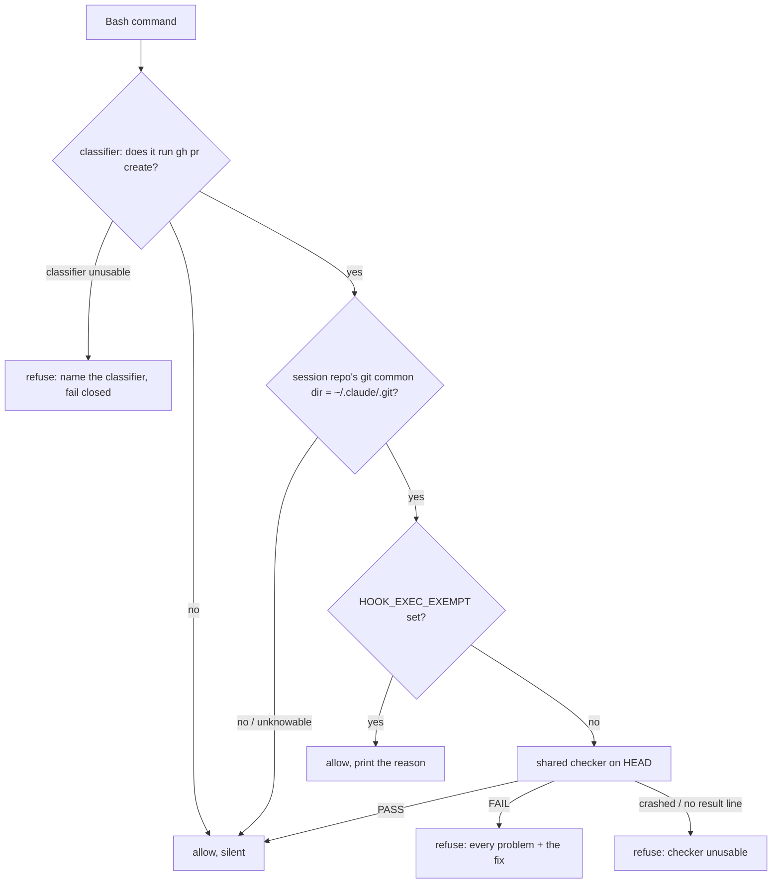

# Refuse a pull request while a registered hook is stored non-runnable

Planned 2026-10-17 on `docs/hook-exec-bit-pr-guard`, cut from `origin/main` @ `61d69dd` (PR #112
merge). Follow-up of `docs/features/hook-exec-bit-test.md` (phase `review`), which left its check
hand-run (its R7a) and set "teaching `verify-hook-wiring.sh` to read the git mode" and "adding CI"
aside as separate decisions. Code is written by a Sonnet implementer; judges run on Opus. Nothing
here is built until Mark types `gate confirmed`.

## Why

A hook script that git stores as `100644` cannot be started by Claude Code (exit 126), and the
hook silently does nothing. It has happened twice, and both came in through a PR:
`hooks/dependency-guard.sh` (#109, fixed in #110) and `hooks/handoff/handoff-keep-guard.sh`
(added `ecd3ba0`, registered `da18d30`, merged in #105, fixed in #112).

What exists today catches it too late or only by hand:

- `hooks/verify-hook-wiring.sh` (SessionStart) checks the bit **on disk** in the main checkout
  (`os.access(path, os.X_OK)`, `hooks/verify-hook-wiring.sh:149`). It speaks only after the merge
  and pull, when the guard is already dead, and never when the disk copy is executable but git
  stores `100644`.
- `hooks/registered-hooks-executable.test.sh` checks the git mode of every registered script, but
  only when someone runs it.

## Decisions

Mark (2026-10-17):

- **Catch it when a pull request is opened**, by refusing `gh pr create`. Chosen over a SessionStart
  warning (fires after the merge), a global git `pre-commit` hook (runs in every repo on the
  machine, needs its own install step) and GitHub CI (new infrastructure; set aside earlier).
- **This repository only**: the main checkout `~/.claude` and its worktrees. In every other repo
  the guard does nothing.

Mine, open to Mark's review (each marked "(my call)" where it appears below): the guard checks the
branch's last commit, not the index; it checks every registered hook, not only changed ones; one
shared checker serves the suite and the guard; the bypass variable is `HOOK_EXEC_EXEMPT`; the
machinery fails the same way `judge-guard.sh` does. Triage (`triaging-new-instructions`): a script
decides it from the command string and the commit, so it is a hook.

## Evidence — measured 2026-10-17 on `61d69dd` (re-measure in Task 0)

- `bash hooks/registered-hooks-executable.test.sh` → `27 passed, 0 failed`; real repo `entries read
  38 | checked scripts (distinct) 23 | skipped commands 11`. Every registered script is `100755`.
- No non-test hook reads a git file mode (`git grep` for `ls-files -s|ls-tree|100755|100644` under
  `hooks/`, tests and probes excluded, finds one unrelated `ls-tree --name-only`).
- Nine hooks are registered on `PreToolUse` `Bash`; `judge-guard.sh` and `merge-guard.sh` already
  read `gh` commands through `hooks/lib/classify-pr-command.py`. Its `classify(src, subcommand,
  exempt_var)` takes the exempt variable as an argument; `merge-guard.sh` imports it with
  `importlib` to pass its own (`hooks/merge-guard.sh:62-69`).
- From this worktree, `git rev-parse --path-format=absolute --git-common-dir` →
  `/Users/marksuyat/.claude/.git`, the main checkout's git dir.
- Versions: Python 3.9.6, git 2.50.1 (Apple Git-155), gh 2.96.0.

## Scope

In: a shared checker module, a new `PreToolUse` `Bash` hook and its suite, its registration, the
existing suite switched onto the shared checker, an ADR, a gate stub.

Out: other repositories; a SessionStart or `pre-commit` check; CI; changing any other hook.

## Design



### Units

| File | Role |
| --- | --- |
| `hooks/lib/registered_hook_modes.py` (new) | The checker, moved out of the suite's heredoc. |
| `hooks/registered-hooks-executable.test.sh` | `check_repo` calls the module; gains the `--rev` cases. |
| `hooks/hook-exec-pr-guard.sh` (new, `100755`) | The guard. |
| `hooks/hook-exec-pr-guard.test.sh` (new) | Its suite. |
| `settings.json` | One new `PreToolUse` `Bash` registration. |
| `docs/decisions/00NN-*.md` (new) | The ADR (number taken from `origin/main` in Task 5). |
| `rules/gates.md` | A stub line under the existing gates. |

## Requirements

R1. **Shared checker.** `python3 -I hooks/lib/registered_hook_modes.py <repo-root> [--rev <commit>]`
holds today's `check_repo` logic unchanged (registered-command parsing, skips, fail-closed rules,
output lines, counts, `result: PASS|FAIL…`, exit 0 clean / 1 problems). Without `--rev` it reads
the index exactly as today (`git show :settings.json`, `git ls-files -s -z`). With `--rev <c>` it
reads `git show <c>:settings.json` and modes from `git ls-tree -r -z <c>`; a `<c>` that does not
resolve is a `FAIL` naming it. Any exit other than 0 or 1, or no `result:` line, means the checker
did not run. Standard library only.

R2. **Suite on the shared checker.** `check_repo` becomes a one-line call to R1 without `--rev`.
Every existing fixture case stays and must pass unchanged. Two cases are added: a script `100755`
in the index but `100644` in the commit fails with `--rev HEAD`; the reverse passes with `--rev
HEAD` and fails without it.

R3. **Which commands.** The guard reads the payload's `tool_input.command` and classifies it with
`classify(..., subcommand=("pr","create"), exempt_var="HOOK_EXEC_EXEMPT")` imported the way
`merge-guard.sh` does. `NO` → exit 0, silent. Accepted-open shapes are the classifier's own
(ADR 0012). An empty payload → exit 0.

R4. **Which repository.** The guard acts only when the session's working directory is inside a
git work tree whose `git rev-parse --path-format=absolute --git-common-dir`, resolved with
`os.path.realpath`, equals the realpath of `$HOME/.claude/.git`. That covers the main checkout and
all its worktrees. Not in a repo, a different repo, `$HOME` unset, or a common dir that cannot be
read → exit 0, silent (Mark's scope decision; `judge-guard.sh` still applies to every PR).

R5. **What is checked (my call).** R1 with `--rev HEAD`, run against `git rev-parse
--show-toplevel`: HEAD is what `gh pr create` publishes, and the index can hold staged work that
is not in the PR. Every script the branch's own `settings.json` registers is checked, changed or
not, so an old mistake blocks the next PR until fixed.

R6. **Refusal.** Exit 2, stderr: one line per `FAIL` from R1, then the fix for a mode problem —
`chmod +x <path>`, `git add -- <path>`, commit — then the bypass line. Allow (exit 0) when R1
passes.

R7. **Bypass (my call).** A non-empty `HOOK_EXEC_EXEMPT=<reason>` on the matching segment allows
the PR and prints `hook-exec-pr-guard: exempted (HOOK_EXEC_EXEMPT=<reason>)` to stderr. It is read
only after R4 says the repo is in scope. `JUDGE_EXEMPT` and `MERGE_EXEMPT` never satisfy it, and
it never satisfies them.

R8. **Machinery failures (my call: as `judge-guard.sh`).** No `python3`, an unreadable payload, or
a classifier that exits non-zero or prints anything but `PR`/`NO` → exit 2 for every Bash command,
naming the classifier path and a repair route that survives the block (the Write tool, or
unregistering the hook). In scope, an R1 crash (R1's "did not run") → exit 2 naming the module.
`judge-guard.sh` already blocks every Bash command in the first case, so this adds no new blocked
state.

R9. **Registration.** `settings.json` runs `$HOME/.claude/hooks/hook-exec-pr-guard.sh` as a bare
command under `PreToolUse` `Bash`, after `dependency-guard.sh`. The file is `100755` in git, so
the suite's real-repo count becomes 24 distinct scripts.

R10. **Records.** An ADR under `docs/decisions/` records the choice of the PR moment over the three
alternatives. `rules/gates.md` gains a two-line stub naming the hook, its bypass, and that it only
runs in this repo. The suite's header keeps "run by hand" for the suite and adds that the guard
now runs the same check at `gh pr create`.

## Scenarios

```gherkin
Feature: hook-exec-pr-guard

  Background:
    Given $HOME/.claude is a git repo with a worktree, and settings.json registers
      $HOME/.claude/hooks/a.sh on PreToolUse

  Scenario: a registered script stored non-runnable blocks the PR
    Given the worktree's HEAD stores hooks/a.sh as 100644
    When the session in that worktree runs "gh pr create --fill"
    Then the hook exits 2
    And stderr names hooks/a.sh, its events, mode 100644, the chmod/add/commit fix, and HOOK_EXEC_EXEMPT

  Scenario: a clean branch is allowed
    Given HEAD stores every registered script as 100755
    When "gh pr create" runs
    Then the hook exits 0 and prints nothing

  Scenario: an executable copy on disk does not hide the commit
    Given HEAD stores hooks/a.sh as 100644 and the file on disk is executable
    When "gh pr create" runs
    Then the hook exits 2

  Scenario: a staged fix that is not committed does not help
    Given HEAD stores hooks/a.sh as 100644 and the index stores 100755
    When "gh pr create" runs
    Then the hook exits 2

  Scenario: an unchanged old mistake still blocks
    Given hooks/a.sh was stored 100644 in an earlier commit and the branch never touches it
    When "gh pr create" runs
    Then the hook exits 2

  Scenario: a registered script missing from HEAD blocks
    Given settings.json at HEAD registers hooks/gone.sh and HEAD has no such file
    When "gh pr create" runs
    Then the hook exits 2 naming hooks/gone.sh as missing

  Scenario: another repository is untouched
    Given the session is in a different git repo whose HEAD stores a registered script as 100644
    When "gh pr create" runs
    Then the hook exits 0 and prints nothing

  Scenario: outside any repository, or with HOME unset
    When "gh pr create" runs
    Then the hook exits 0

  Scenario: the main checkout itself is in scope
    Given the session is in $HOME/.claude and HEAD stores hooks/a.sh as 100644
    When "gh pr create" runs
    Then the hook exits 2

  Scenario Outline: commands that are not a PR creation pass
    When "<cmd>" runs in scope with a 100644 registered script at HEAD
    Then the hook exits 0
    Examples:
      | cmd                                  |
      | gh pr view 5                         |
      | git commit -m "gh pr create later"   |
      | echo gh pr create                    |

  Scenario: a chained or wrapped PR creation is still read
    When "git push && gh pr create --fill" or "time gh -R o/r pr create" runs in scope with a bad HEAD
    Then the hook exits 2

  Scenario: the bypass allows and is printed
    When "HOOK_EXEC_EXEMPT=docs-only gh pr create" runs in scope with a bad HEAD
    Then the hook exits 0 and stderr carries the reason

  Scenario: another guard's bypass does not count
    When "JUDGE_EXEMPT=x gh pr create" runs in scope with a bad HEAD
    Then the hook exits 2

  Scenario: an unusable classifier fails closed
    Given the classifier file is empty
    When any Bash command runs
    Then the hook exits 2 naming the classifier path and a repair route

  Scenario: a broken settings.json at HEAD fails closed
    Given settings.json at HEAD is not valid JSON
    When "gh pr create" runs in scope
    Then the hook exits 2 naming the JSON error

  Scenario: an unusable checker fails closed
    Given the checker module is empty
    When "gh pr create" runs in scope
    Then the hook exits 2 naming the module
```

Each guard-suite case builds its own fixture: a fake `$HOME` in `mktemp -d` holding `.claude` as a
git repo (plus a worktree where the scenario needs one), `GIT_CONFIG_GLOBAL=/dev/null`,
`GIT_CONFIG_NOSYSTEM=1`, and the hook run with that directory as its working directory. The
payload carries `hook_event_name: PreToolUse`, as `judge-guard.test.sh` builds it. The suite also
asserts the hook file is executable on disk, `100755` in git, and runs with no `bash` prefix (the
#110 assertions).

## Known gaps — disclosed, not fixed

| Gap | Why accepted |
| --- | --- |
| A PR opened outside a session (GitHub web, Mark's own terminal), or a push straight to main. | Mark chose the PR moment; CI was set aside. |
| `gh pr create --head <other-branch>` checks the session checkout's HEAD, not that branch. | Same as `judge-guard.sh`; PRs here are opened from the branch's own worktree. |
| A session rooted in one checkout that `cd`s to another before `gh pr create` checks the session's repo (hooks resolve git from the session cwd). | Same as `judge-guard.sh`; house practice is `EnterWorktree` with `path:`. |
| Command shapes the classifier does not read (backticks, heredoc bodies, a command built by expansion). | ADR 0012's accepted-open shapes. |
| A fresh clone of this repo that is not a worktree of `~/.claude` is out of scope. | Mark's scope decision. |
| If this guard's own file loses its bit it cannot run to say so (exit 126 does not block). | `verify-hook-wiring.sh` reports the disk bit at session start; R9 puts the file under the suite's check. |
| The guard is live only after merge and pull into the main checkout. | True of every hook here. |

## Tasks

- [ ] 0. Re-measure on the branch base: the Evidence list (suite counts by its own output, the
  common-dir answer from a worktree and from the main checkout, the three versions) and the next
  free ADR number on `origin/main` and on open PR branches. A different count is a finding.
- [ ] 1. Suite first (R2): add the two `--rev` cases and point `check_repo` at the not-yet-existing
  module. Run it: the new and existing cases fail because the module is missing. Commit red, with
  this card's Task 1 note staged.
- [ ] 2. Write `hooks/lib/registered_hook_modes.py` (R1) by moving the heredoc body, plus `--rev`.
  Suite green: every old case plus the two new ones; real-repo counts unchanged (38/23/11).
- [ ] 3. Guard suite first: `hooks/hook-exec-pr-guard.test.sh` with every Scenario above and the
  three file-mode assertions. Run it red against a stub that always allows and one that always
  denies; record which cases each stub passes. Commit red.
- [ ] 4. Write `hooks/hook-exec-pr-guard.sh` (R3–R8), `chmod +x`, `git add --`. Guard suite green;
  exec-bit suite still green.
- [ ] 5. Register (R9); exec-bit suite shows 24 distinct scripts, all `100755`. Write the ADR and
  the gates stub, and update the suite header (R10).
- [ ] 6. Verification section; observability judge (implementation stage); open the PR, then
  commit the verdict.
- [ ] 7. After merge and Mark's pull: confirm the main checkout's hook blob and mode equal the
  merge commit's, then, with Mark's OK, one live check in a throwaway local worktree whose HEAD
  stores a registered script as `100644`: `gh pr create --dry-run` through the Bash tool must be
  refused. Remove that worktree and its branch after.

## Gotchas

- Bash `grep` here is ugrep and honours `.gitignore`; use `git ls-files`/`git show` for anything
  the suites read.
- `git update-index --chmod=+x` alone is undone by `git commit -- <path>`; `chmod +x` then
  `git add -- <path>` (hook-exec-bit-test R7).
- `test-marker-guard.sh` will want `hooks/hook-exec-pr-guard.test.sh` run against the exact bytes
  of `hooks/hook-exec-pr-guard.sh` before a commit stages the guard.
- A worktree-isolated session refuses `git -C <main checkout>`; measure the main checkout's side
  of Task 0 and Task 7 by asking Mark or from a session rooted there.
