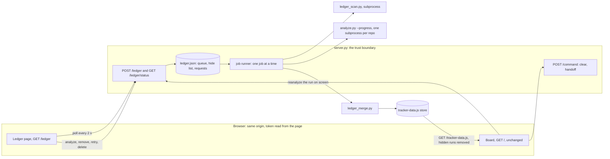
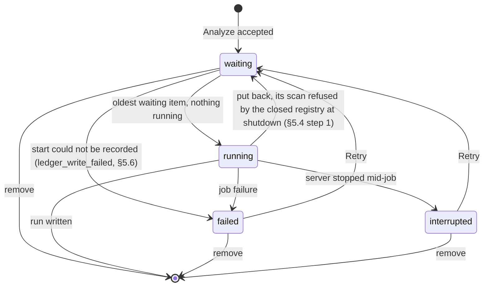

<!--
The spec half of docs/features/treko-ledger.md (ADR 0017's synced pair). It carries no
frontmatter because it is not a card: the analyzer selects cards by filename and skips every
`*.spec.md` (`grep -n SPEC_SUFFIX treko/analyze.py`). It also carries no checkbox lines on
purpose: `hooks/lib/feature_tasks.py` `compare()` matches task numbers between the two halves,
and the card's ## Tasks is not written yet. The checklist and the verification record stay in
the .md; this file is design, contracts, scenarios and acceptance criteria.
Since 2026-11-05 it does carry checkbox lines, in its closing section "Tasks, in detail
(2026-11-05)": the task detail, one item per task, with the same identities as the card's
## Tasks, which is what compare() needs. The sentence above describes the file before that date.
-->

# Treko Ledger — build spec

**What this builds.** A home page for Treko, the **Ledger**. The user types a directory; Treko
finds every git repository in and around it, analyzes them on the server one job at a time with a
progress bar that moves only when real work finishes, and lists every finished run with Open and
Delete. The card is `docs/features/treko-ledger.md`. Its decisions are cited here by number (D1–D12,
"Builder check results", and the correction about `analyze.py` at the end of that section; D13–D15,
the user's decisions after compliance round 2, are cited as U1–U3, D16–D18, his decisions after
round 3, as U4–U6, and D19–D21, his decisions after round 4, as U7–U9: U1 = D13, U2 = D14, U3 =
D15, U4 = D16, U5 = D17, U6 = D18, U7 = D19, U8 = D20, U9 = D21. U8 supersedes U3 and U5. D22, one
more judge round after which he picks what gets fixed, is a process decision and has no U-number.
D23–D25, his picks from the round-5 list, are cited as U10–U12: U10 = D23, U11 = D24, U12 = D25.
D26, a narrow round-6 check of those fixes, is a process decision and has no U-number; see the
sections revised after rounds 2 to 5. D27, his pick after round 6, and D28 and D29, his review of
this file on 2026-11-04, have no U-numbers either and are cited by D-number; see "Revised after
compliance round 6" and "Revised after his review" at the end). This file turns them into
contracts and tests. It does not reopen them.
D30, his confirmations of 2026-11-04, and D31–D34, his answers in the checklist review of
2026-11-05, are cited by D-number too; see "Revised after the checklist review" at the end.

**Tags.** **(spec call)** marks a detail the card left open that this spec settles with the
simplest safe option; the reviewer can overturn any of them. **OQ-n** marks a choice that changes
what the user sees or touches safety. Those waited for the user, in the last section, "Open
questions — resolved 2026-11-03". Where behaviour below depended on one, the text first said
"pending OQ-n" and described the recommended answer. Since 2026-11-03 it names the answer and its
tag, as the card does: **(user)** when he decided it, **(my call)** when the planning session
settled it and told him. Since his review of this file (D28, 2026-11-04), a call he confirmed
keeps its old tag and adds "confirmed by the user, D28" beside it.

**Ground truth.** Written 2026-11-03 against `feat/treko-ledger` @ `5f194df`. Every `file:line`
was opened at that commit. Lines move, so each citation also names the symbol to `grep -n` for.
Revised the same day for compliance round 1 at `6331b5d`. The code files had not changed, so the
citations still hold, and the sizes in §1.1 were measured there.
Revised again the same day for compliance round 2 and the user's decisions after it (U1–U3, listed
at the end) at `d85eabd`. `git diff --stat 5f194df..HEAD -- treko skills/treko` still prints
nothing, so every citation and size above still holds. Round 2's new measurements are each given
with the command or scratch probe that produced them; the probes ran in scratch copies, never in
this repository.
Revised a third time the same day for compliance round 3 and the user's decisions after it
(U4–U6) at `50c0f44`; the same `git diff --stat 5f194df..HEAD -- treko skills/treko` still prints
nothing. Round 3's probes are `probe_r3.sh` and `probe_partial_clone.sh` in the round-3 scratch
folder, run against a `git archive HEAD treko hooks/lib` export of the real `analyze.py` on
`/usr/bin/python3`. Their fixtures make git commits inside those scripts, in scratch repositories
only; no guard refused them.
Revised a fourth time the same day for compliance round 4 and the user's decisions after it
(U7–U9) at `dfa4149`. `git diff --stat 5f194df..HEAD -- treko skills/treko` still prints nothing,
and so does `git diff --stat origin/main HEAD -- treko skills/treko` (`origin/main` at `fc08216`,
not fetched). Round 4's probes are `surrogate.py` and `probe_r4.py` in the round-4 scratch folder,
run on `/usr/bin/python3` against the real `treko/analyze.py` at that commit, on git 2.50.1, in
scratch repositories whose commits were made with git plumbing (`write-tree`, `commit-tree`,
`update-ref`), under an explicit minimal environment with global and system git config cut off.
Revised a fifth time the same day for compliance round 5 and the user's picks after it (U10–U12)
at `47f6700`; both `git diff --stat` commands above still print nothing (`origin/main` still at
`fc08216`, not fetched). Round 5's probe is `u10_inputs.py` in the round-5 scratch folder, run on
`/usr/bin/python3`; the rest of round 5 is read from the code at that commit, and says so where
it is reasoned.
Revised again on 2026-11-04 for his review (D28, D29) at `be662cb`; both `git diff --stat`
commands above still print nothing (`origin/main` still at `fc08216`, not fetched). This
revision's probes are `config_keys.py`, `attr_keys.py`, `signal_probe.py` and
`signal_probe_server.py` in this revision's scratch folder, run on `/usr/bin/python3` 3.9.6 and
git 2.50.1. They read the man pages installed with that git and start stand-alone processes; they
touch no repository.
Revised again on 2026-11-05 for the checklist review (D31–D34 and the planning session's calls)
at `8fd9184`; both `git diff --stat` commands above still print nothing (`origin/main` still at
`fc08216`, not fetched). This revision ran no new probe.

**Size (user, 2026-11-03).** He accepted this half running over ADR 0017's 800-line cap.

## 1. Shape of the change



| File | New or changed | Owns |
|---|---|---|
| `treko/Ledger.dc.html` | new | the Ledger page, ported from the prototype (§9) |
| `treko/ledger_scan.py` | new | directory scan, worktree families, D11 card choice, narrowing (§4) |
| `treko/ledger_merge.py` | new | one run from several per-repo runs (§7) |
| `treko/ledger_state.py` | new | `ledger.json`, run ids, run rows, the hide list (§5, §8) |
| `treko/ledger_jobs.py` | new | the job runner and its subprocesses (§5, §6) |
| `treko/ledger_routes.py` | new | the `/ledger` and `/ledger/status` handlers: field validation, op dispatch, the status payload (§3) |
| `treko/cards.py` | new | split 1: the analyzer's card-reading layer, moved unchanged (§1.1) |
| `treko/board-commands.js` | new, one manifest row | split 3: the board's node-loadable command slice, moved unchanged, then the Re-analyze change, which also corrects two of the slice's comments (§1.1, §9.4, §12; the second since round 6) and, since his review, deletes the error table's leftover `reanalyze_failed` entry and the `analysis_failed` message only that entry reached (§9.4, §12; D28) |
| `treko/server.py` | changed | routes, validation, idle rule, startup, the launch address (§3, §3.2); split 2 moves its send path out (§1.1); since round 5, the token check and body reader `/ledger` and `/command` share, and the request catch-all every route runs inside, `/command` included (§3.8; U10); since his review, `SIGTERM` and `SIGHUP` handlers that take `Ctrl-C`'s shutdown path, and the shutdown's step that ignores a second signal (§5.3; D29) |
| `treko/channel.py` | changed | split 2: receives `confirm_surface`, `send_keys` and `CONFIRM_REFUSAL_REASONS` unchanged (§1.1) |
| `treko/analyze.py` | changed | two optional inputs: the progress report (§6) and `--card` (§4.3; OQ-1, (my call; confirmed by the user, D28)); since round 3 one behaviour change, a worktree whose `git status` fails shows "changes unknown" instead of "clean" (§6.3; U6); and since round 4 two more of the same kind, a branch whose `git diff --shortstat` fails shows "diff unknown" instead of an empty diff, and a branch whose worktree folder is gone shows "folder missing" instead of "clean" (§6.4; U9). Nothing else. Split 1 also moves its card layer out, with no change in behaviour (§1.1) |
| `treko/Treko.dc.html` | changed | two icon links, Re-analyze, graph svg size, the Re-analyze pop-up (§9.4); split 3 moves its command slice out (§1.1); since his review, the `analysis_failed` tone that goes with the deleted `reanalyze_failed` entry (§9.4; D28) |
| `treko/server_harness.py` | changed | an `interpreter` parameter for criterion Z1 (§11) |
| `skills/treko/SKILL.md` | changed | routes, the Ledger, the new files in the store directory, the auto-opened address (§3.2) |
| existing test modules | changed | exactly the edits §12 lists, each module measured ≤ 800 lines (§1.1) |
| nine new test modules | new | `test_ledger_routes.py`, `test_ledger_lifetime.py`, `test_ledger_scan.py`, `test_ledger_jobs.py`, `test_ledger_merge.py`, `test_ledger_state.py`, `test_ledger_page.py`, `test_analyze_options.py`, `test_file_budgets.py`, in `treko/` (§11; each ≤ 800, §1.1; row added 2026-11-05, my call) |
| `docs/decisions/<NNNN>-<slug>.md` | new | task 1's ADR: §3's wire contract, §2's amendments of ADR 0034 and ADR 0024, decision D10's defaults, the config-key table (§2; inside Z2's path filter; row added 2026-11-05, my call) |
| `docs/features/tracking-feature-state.spec.md` | changed | one dated pointer to that ADR beside each rule it amends (§2; row added 2026-11-05, my call) |

**(spec call)** The work lands in new modules rather than in `server.py`, which is 793 lines
today (`wc -l treko/server.py`) against the house limit of 800 (`rules/core-conduct.md`). The
server stays the HTTP boundary and imports the others.

**(spec call)** No row is added to `STATIC_MANIFEST` (`server.py:83-101`, 17 rows, pinned by
`test_guards.py:560` `EXPECTED_MANIFEST_ROWS`) for the Ledger page. The Ledger page is served by a
route, like the board today, and every asset it loads is already on the manifest. **Split 3
(§1.1) adds exactly one row, `board-commands.js`, for the board**, so the manifest goes from 17
rows to 18.

### 1.1 Line budgets and the three planned splits

The house limit is 800 lines a file (`rules/core-conduct.md`: "<400 lines, 800 max"). Three files
this card changes start within 17 lines of it, so each gets a budget and, where the card's growth
would cross 800, a split decided now. Sizes are `wc -l` at `6331b5d`:

| File | At `6331b5d` | Budget after this card | How |
|---|---|---|---|
| `treko/analyze.py` | 797 | ≤ 740 | split 1 |
| `treko/cards.py` (new) | — | ≤ 200 | receives split 1 |
| `treko/server.py` | 793 | ≤ 780 | split 2; all Ledger logic in the new modules, server.py only routes and delegates; since round 5 it also holds U10's shared token check, body reader and request catch-all (§3.8), about 25 lines (estimated), inside the same budget; and since his review D29's two handler installations and the shutdown's ignore step (§5.3), about 10 lines more (estimated), inside the same budget |
| `treko/channel.py` | 95 | ≤ 200 | receives split 2 |
| `treko/Treko.dc.html` | 783 | ≤ 720 | split 3 |
| `treko/board-commands.js` (new) | — | ≤ 250 | receives split 3 |
| `treko/Ledger.dc.html` (new) | — | ≤ 600 | its logic stays in an in-page slice (§9.1) |
| `treko/ledger_*.py` (five new) | — | ≤ 400 each | the house target |
| `treko/server_harness.py` | 339 | ≤ 400 | |
| `treko/test_server.py` | 789 | ≤ 800 | new behaviour is tested in new modules, with one exception since round 5: the `/command` test that drives `internal_error`, which this module's reason coverage requires (§12; U10) |
| `treko/test_analyze.py` | 599 | unchanged | E1, E2, E5, E6 (round 3) and E7–E8 (round 4) go in a new `test_analyze_options.py` |
| `treko/test_guards.py` | 599 | ≤ 800 | split 3's edits, then the re-pin (§12) |
| `treko/test_ui_commands.py` | 468 | ≤ 800 | §12 |
| `treko/test_degraded.py` | 620 | ≤ 800 | §12 |
| `treko/test_autolaunch.py` | 418 | ≤ 800 | §12 |
| `treko/test_store_writer.py` | 78 | ≤ 800 | §12 |
| any other file the card edits | its size | ≤ 800 | Z2's catch-all; §12 names none |
| every new test module | — | ≤ 800, target 400 | |
| `skills/treko/SKILL.md` | 235 | ≤ 400 | |

The six test-module rows were added in round 2 from §12's list, sized with `wc -l treko/test_*.py`
at `d85eabd` (the same bytes as `6331b5d`). **Two files in `treko/` are over 800 lines, and this
card edits neither:** `treko/test_nontext_contrast.py` (1054) and `treko/support.js` (1911), the
only two above 800 in `wc -l treko/*.py treko/*.js treko/*.html | sort -n`. Until round 2 the
card had to edit the first, because serving the Ledger at `/` broke its board load at `:405`. The
board now stays at `/` (U1, §3.2), so no line of it changes, and Z2 can pass. Measured, not
inferred: §12 records a scratch run of that module, with split 3 and the two icon links applied,
passing unchanged.

**`analyze.py`'s 740 still holds with U6 and U9 (rounds 3 and 4; spans measured, additions
estimated).** Split 1
removes the card layer, `analyze.py:189-291` (103 lines, `sed -n 189,291p treko/analyze.py | wc
-l`), and 15 constant lines (`:36-47` less `MINUS` at `:44`, and `:70-73`), and adds an import
back of a few lines: about 682 of today's 797, before blank-line adjustments. Four additions
share the remaining ~58 lines: `--progress` (four report calls and an argument), `--card` (an
argument and a path list), U6's failure branch (§6.3: a `try`/`except` around one call, one
`note` branch and one question, about ten lines), and since round 4 U9's two (§6.4: a second
`try`/`except` with its question, and one `note` branch for a missing folder, about ten lines
more). Criterion Z2 enforces the figure.

**The three splits (spec call each).** Each is a move with no change in behaviour. Each lands as
its own commit **before** any behavioural change to the file it leaves, so the existing suite
proves the move by itself:

1. **`analyze.py` → `cards.py`.** The card-reading layer moves verbatim: `_card_paths`,
   `_parse_frontmatter`, `_checklist`, `_depends_on`, `_normalize_target` and `Card`
   (`analyze.py:189-291`), with the constants they use from `:36-47` and `:70-73`, and the
   `feature_tasks` import they need. `MINUS` (`:44`) stays, because only `_diffstat` uses it
   (`:170`). `NO_VALUE`, `SPEC_SUFFIX` and `UNPARSEABLE_META` are used on both sides
   (`grep -n -w` each in `analyze.py`): they move to `cards.py` and `analyze.py` imports them
   back, so each is still defined once. `analyze.py` imports back what else it uses. That is one
   unit, "what a card is", and it is also the unit that `--card` and the scan's D11 choice
   depend on: the scan imports `cards`, not the whole analyzer. **Proof:** `test_analyze.py`
   passes unchanged (it reaches the module only through `analyzer.analyze`, measured with
   `grep -o 'analyzer\.[a-z_]*' treko/test_analyze.py | sort -u`), and criterion E2's
   byte-for-byte differential against blob `8b805d1…` passes.
2. **`server.py` → `channel.py`.** `CONFIRM_REFUSAL_REASONS`, `confirm_surface` and `send_keys`
   (`server.py:263-311`) move verbatim into `channel.py`, whose job is already "the cmux control
   channel and its closed reason set" (`server.py:38`) and which already owns `CMUX_BIN` and
   `CMUX_TIMEOUT_SECS`, so the move adds no dependency. This one goes into an existing module,
   not a new one, because a new module would split the cmux channel across two files.
   `server.py` imports the three names back, so `server.CONFIRM_REFUSAL_REASONS` (used by the
   tests) still resolves. **Proof:** `test_server.py`, `test_degraded.py` and
   `test_server_lifetime.py` pass unchanged. If `server.py` would still exceed its 780 budget after
   split 2, the next extraction is the startup checks (`read_timeout` through `probe_listener`,
   `server.py:150-257`) into a new `server_startup.py`. No other split is planned.
3. **`Treko.dc.html` → `board-commands.js`.** The node-loadable slice, from the "slice begins"
   marker to the "slice ends" marker (`Treko.dc.html:402-525`), moves verbatim, markers included,
   into a served file loaded by `<script src="./board-commands.js"></script>` right after
   `support.js`. The slice was written to need no React, no DOM and no `window`
   (`Treko.dc.html:403-409`), so as a classic script its names become the globals the page's
   component already uses. **This needs one new `STATIC_MANIFEST` row**: `board-commands.js`,
   `text/javascript`, an extension already in `EXTENSION_TYPES`. `EXPECTED_MANIFEST_ROWS`
   (`test_guards.py:560`) becomes 18. **Proof:** at the move commit, `test_guards.py`'s fence
   check, pointed at the new file, still matches its pinned sha256 (`bfe17645…`, 6692 bytes,
   `test_guards.py:29`), because the marker-inclusive bytes are unchanged. `test_ui_commands.py`
   passes with only its loader's path changed. The Re-analyze change then re-pins the fence
   deliberately (§12). The slice's own comment says it "cannot live in its own .js file",
   because a new row is a spec change (`Treko.dc.html:405-407`). This card is that spec change.
   The comment sits inside the hashed region, so it stays verbatim in the move commit, keeping
   the proof byte-exact, and is corrected in the Re-analyze commit.
   **Measured in round 2, by simulation.** The move was applied to a scratch export of `HEAD`
   (`git archive HEAD treko hooks/lib`): the slice's 124 lines, markers included, cut into
   `board-commands.js`, the script tag added after `support.js`, the manifest row added. With
   no test edited, 39 tests failed: 15 in `test_guards.py`, 22 in `test_ui_commands.py`, and 2 in
   `test_server.py` that fail identically on an unsplit export, because a scratch export is not a
   git repository and `reanalyze` runs git there. With exactly the edits Z3 lists applied, both
   modules passed, 50 of 50, and the fence pin matched in `board-commands.js` unchanged.
   `test_drawer.py`, `test_drawer_sections.py`, `test_sidebar.py`, `test_theme.py`,
   `test_nontext_contrast.py` and `test_rename.py`, which load or read the board, passed
   unchanged, and still did with the two icon links of §9.4 also applied. **Count, corrected at
   round 3:** those six modules collect 85 tests; the 135 that passed on both the split export and
   the unsplit one is those six plus `test_guards.py` and `test_ui_commands.py`, with Z3's edits
   applied (`pytest --collect-only -q` at `50c0f44`: 85 for the six, 50 for the other two).

**Card 5's line citations move too.** Card 5 cites `analyze.py` at seven distinct places and
`Treko.dc.html` at six (`grep -o -E '(analyze\.py|Treko\.dc\.html):[0-9-]+'
docs/features/treko-branch-graph-traversal.md | sort -u`). Split 1 moves `analyze.py:36-41` into
`cards.py` and shifts every later line. Split 3 shifts every `Treko.dc.html` line after the head
scripts. All are re-checked when card 5 resumes, as the card already records for `analyze.py`.

Criterion Z2 checks every budget above, and Z3 checks the splits' proofs.

## 2. Task 1 gate: the wire-contract amendment (D10)

Today the page may send only `{"id": <one of three names>}`
(`tracking-feature-state.spec.md:404-411`; the allowlist at `:691-703`; "Command arguments of any
kind" out of scope at `:1101`). `server.py:592-598` enforces it: exactly one key, `id`, a string.
**This spec amends the rule "commands take no arguments, in v1 or after".** The amendment is
deliberately narrow:

- `POST /command` keeps the rule unchanged: no arguments, ever. Its allowlist **shrinks** to
  `clear` and `handoff`. **(spec call)** `reanalyze` leaves `/command`. The card moves the board's
  Re-analyze to "re-queue the run on screen" (builder check), which needs a run id, and an
  argument on the route that types into the session is exactly what the old rule forbids. Keeping
  the old `reanalyze` beside the queue would leave a second writer of the store racing the job
  runner, still minting the folder-name ids D12 replaces.
- Arguments are allowed **only** on the new `POST /ledger`, which never reaches the session: no
  `/ledger` operation invokes `cmux` (criterion A5).
- ADR 0034 accepted the store move partly because "the browser cannot name" a path and no verb
  "takes a filesystem path". `/ledger` reverses that for **reads**: the browser names a directory
  the server scans and runs read-only git in. It never names a directory the server writes or
  serves. The store directory still comes only from the process environment, and D8 shows it
  read-only.
- Old criterion 15 (`tracking-feature-state.spec.md:1079-1096`) loses its `500` row for
  `reanalyze` and the board's reload after a successful Re-analyze. `reanalyze` leaves `/command`,
  and after a `200` the board goes to the Ledger instead (§9.4; OQ-5, (user)).
- `STATIC_MANIFEST` gains one row, `board-commands.js` (split 3, §1.1). Old criterion 13's
  expected request sets (`tracking-feature-state.spec.md:933-1064`) describe the board at `/`.
  The board stays at `/` (U1), so they still describe it there, now with `/board-commands.js` in
  both runs. Criterion 13 is an agent-run browser enumeration, not a pytest test
  (`test_server.py:16-20`), so no test module pins those sets.
- ADR 0024's "one audit line per request" gains one exception: an accepted status poll (default
  4 below).
- **`/command` gets U10's protection (user, round 5).** Its token check and body reader are the
  ones `/ledger` uses, and every route runs inside one request catch-all (§3.8). So `/command`'s
  failure table gains one row, `500 internal_error`, and two inputs that today drop its
  connection with no answer get `403 bad_token` (a token header that is not ASCII) and
  `400 malformed` (a body nested too deeply to parse). Its arguments rule is unchanged.
  **On `/command` that row's audit line says `sent=unknown` (user, D27, round 6; §3.8),** because
  the catch-all cannot tell whether `cmux send` ran: an exception it catches may come after the
  send, when the keystrokes are already typed. This widens `unknown` (confirmed by the user,
  D28), which the old spec defines
  as "`cmux send` was invoked and did not exit 0" (`tracking-feature-state.spec.md:541-544`): the
  catch-all is a third case beside a timeout kill and a non-zero exit, and it fits the reason that
  definition gives, a case "where the server genuinely cannot say whether anything was typed".
  `no` keeps its meaning, a refusal before invocation. Until round 6 the catch-all's line said
  `sent=no` on every route.

**Task 1 writes an ADR** recording the routes, ops, argument shapes and validation of §3, the
amendments above, and D10's defaults below, and, since his review, the record of its config-key
check (default 3; user, D28). Take its number from `origin/main` at write time,
not from a local listing. It is judged the way a spec is: the compliance judge, with the
observability judge's architecting read alongside (`running-the-compliance-judge`). **No Ledger
screen task starts until that verdict passes.** The card's order (Ledger, then card 5, then the
relations card) is unchanged.
**Which work waits for that verdict (user, D31, 2026-11-05).** Everything a browser can reach:
the new routes (`GET /ledger`, `GET /ledger/status`, `POST /ledger`), `/command`'s changes, the
Ledger page and the board's changes. The three splits, the analyzer's options, the scan, the merge,
the state module and the job runner may start once `gate confirmed` is given, before or alongside
task 1. Task 1's config-key check can still change the protective-settings table below (D34), so
the task that closes criterion C8 waits for that check as well.
**How the ADR is judged (user, D32, 2026-11-05).** One compliance round, with the observability
judge's architecting read alongside; the fixes it asks for; then whatever is still open goes to the
user as one list, with no further automatic round. D27's waiver covers this spec, not that ADR (my
call, 2026-11-05). A fix that would change this spec follows D34 (default 3, "Outcomes").
**What else the ADR records (my call, 2026-11-05).** It names both records it amends, ADR 0034 and
ADR 0024, and task 1 puts a one-line dated pointer to it beside each amended rule of
`tracking-feature-state.spec.md` (`:404-411`, `:541-544`, `:691-703`, `:933-1064`, `:1079-1096`,
`:1101`), as that file's own "Superseded paths" note (`:1158`) does.

D10's defaults, as requirements: the card's three, and a fourth from the observability judge's
round-1 read (O3):

1. **Existing directories only.** `directory` must name an existing directory once expanded
   (§3.4). Nothing is created.
2. **Status polling never resets the idle timer.** Today every accepted **connection** resets it
   (`ControlServer.process_request`, `server.py:650-652`, which runs once per connection; the
   handler speaks HTTP/1.1, `server.py:360`, so further requests on a kept-alive connection do not
   reset it again; read, not run; corrected at round 3 from "every request"), so a polling tab
   that opens connections as it polls would keep the server alive for ever. The reset moves to the point where the request line has been parsed and is
   skipped only when the path is `/ledger/status`, whatever the outcome. A request whose line
   cannot be parsed still resets it, as today.
3. **Git in scanned repos runs with `core.fsmonitor` off.** Measured 2026-11-03 on git 2.50.1: in a
   scratch repo whose own config set `core.fsmonitor` to a script that writes a marker file, a
   plain `git status --porcelain` ran the script, and `git -c core.fsmonitor=false status
   --porcelain` did not. `git help config` documents that `GIT_CONFIG_COUNT` pairs "override
   values in configuration files", and the analyzer's `_git` (`analyze.py:92-103`) passes no
   `env=`, so its git children inherit whatever the scan and analyzer processes are given, with no
   change to `analyze.py`.
   **Every scan and analyzer subprocess gets the variables in this table, unconditionally.** In
   the rest of this spec, "the protective settings" means exactly the table's rows, and nothing
   counts them. The fsmonitor and `core.hooksPath` rows and `GIT_OPTIONAL_LOCKS` date from round
   2; the `log.showSignature` row and `GIT_NO_LAZY_FETCH` were added at round 3 (U4), which raised
   `GIT_CONFIG_COUNT` from `2` to `3`. Until round 4 task 1's filter test could add pairs here;
   U8 removed that test and keeps file filters on (below), so no pairs are pending.

   | Variable | Value | Stops |
   |---|---|---|
   | `GIT_CONFIG_COUNT` | `3` | |
   | `GIT_CONFIG_KEY_0`, `GIT_CONFIG_VALUE_0` | `core.fsmonitor`, `false` | a repo-named fsmonitor program |
   | `GIT_CONFIG_KEY_1`, `GIT_CONFIG_VALUE_1` | `core.hooksPath`, `/dev/null` | a repo-named hook |
   | `GIT_CONFIG_KEY_2`, `GIT_CONFIG_VALUE_2` | `log.showSignature`, `false` | a repo-named `gpg.program`, which `git log` runs to check a signed commit when the repo sets `log.showSignature=true` (probes 17–20) |
   | `GIT_OPTIONAL_LOCKS` | `0` | `git status`'s optional index write, and the `post-index-change` hook it fires |
   | `GIT_NO_LAZY_FETCH` | `1` | a lazy fetch from a promisor remote, which runs the repo-named `remote.<name>.uploadpack` and downloads objects into the scanned repo (probes 21–26) |

   **The round-2 settings**, which several probes below were run with, are the same table without
   the `log.showSignature` row and `GIT_NO_LAZY_FETCH`, and with `GIT_CONFIG_COUNT=2`.

   Until round 2 the `core.hooksPath` pair and `GIT_OPTIONAL_LOCKS` were conditional on task 1
   confirming a route. They are not any more, because the routes are measured. Probes: `probe_git.sh` (probes 1–11),
   `probe_analyzer_writes.sh` (12–14) and `probe_count_overwrite.sh` (15–16), in the round-2
   scratch folder, on git 2.50.1, in scratch repositories; each group has a baseline that had to
   fire, and did:

   | Probe | Setup | Result |
   |---|---|---|
   | 1 | repo config names an fsmonitor script; plain `git status --porcelain` (baseline) | script ran |
   | 2 | plus the fsmonitor pair | did not run |
   | 3 | plus an inherited `GIT_CONFIG_PARAMETERS` naming the script | **ran** |
   | 4 | as probe 3, with `GIT_CONFIG_PARAMETERS` removed | did not run |
   | 5 | script named only in a `GIT_CONFIG_GLOBAL` file (baseline) | script ran |
   | 6 | that file plus the fsmonitor pair | did not run |
   | 7 | an inherited `GIT_CONFIG_COUNT` family naming the script, no protective pair | **ran** |
   | 8 | repo-set `core.hooksPath` with a `post-index-change` hook, a stat-dirty file, fsmonitor pair only (baseline) | hook ran, index rewritten |
   | 9 | plus `GIT_OPTIONAL_LOCKS=0` | neither |
   | 10 | plus the `core.hooksPath=/dev/null` pair, no `GIT_OPTIONAL_LOCKS` | hook did not run, **index rewritten** |
   | 11 | the round-2 settings | neither |
   | 12 | the real `analyze.py` (`/usr/bin/python3`) over a repo with one worktree, a stat-dirty file in each checkout, the same hook; no protection (baseline) | hook ran; `.git/index` and `.git/worktrees/wt-feat/index` rewritten |
   | 13 | fsmonitor pair only, the plan until round 2 | the same as probe 12 |
   | 14 | the round-2 settings | hook did not run; every file under `.git` identical in content and mtime; exit 0, run complete |
   | 15 | inherited `GIT_CONFIG_COUNT=3` whose `KEY_2` names the script (baseline) | script ran |
   | 16 | that, with `GIT_CONFIG_COUNT`, `KEY_0`/`VALUE_0` and `KEY_1`/`VALUE_1` overwritten by the round-2 settings | did not run |

   **Round 3 (U4).** Both judges' round-3 reads found two more routes open under the round-2
   settings; these probes reproduce them through the real `analyze.py` and measure each fix
   (`probe_r3.sh`, `probe_partial_clone.sh`; "all settings" means the table above):

   | Probe | Setup | Result |
   |---|---|---|
   | 17 | branch `feat` whose tip carries a `gpgsig` header; repo config `log.showSignature=true`, `gpg.program` = a marker script; plain `git log -1 --format=%cr feat` (baseline) | marker ran once |
   | 18 | the real analyzer, the round-2 settings | **marker ran twice**, exit 0 |
   | 19 | the real analyzer, all settings | did not run, exit 0 |
   | 20 | all settings except the `log.showSignature` pair (falsifier) | ran twice |
   | 21 | a `--filter=blob:none` clone (`remote.origin.promisor=true`) with a local `feat` whose blobs are missing; `remote.origin.uploadpack` = a marker script; plain `git diff --shortstat main...feat` (baseline) | marker ran, exit 128 |
   | 22 | the real analyzer, the round-2 settings | **marker ran**, exit 0 |
   | 23 | the real analyzer, all settings | did not run, exit 0 |
   | 24 | all settings except `GIT_NO_LAZY_FETCH` (falsifier) | ran |
   | 25 | a working partial clone (the real upload-pack), all settings | `feat`'s `diff` is `""`; the 2 missing objects are still missing |
   | 26 | the same clone, the round-2 settings | `feat`'s `diff` is `"+3 −1"`; the analyzer downloaded both missing objects into the scanned repo |
   | 27 | `diff.external` = a marker script; plain `git diff main...feat` (baseline) | ran |
   | 28 | the same, `git diff --shortstat main...feat` (the analyzer's form, `analyze.py:163`), round-2 settings | did not run |
   | 29 | `.gitattributes` `diff=x` and `diff.x.textconv` = a marker script; plain `git diff main...feat` (baseline) | ran |
   | 30 | the same, `git diff --shortstat main...feat`, round-2 settings | did not run |
   | 31 | `filter.x.clean` = a marker script, `.gitattributes` `filter=x`, a stat-dirty tracked file; `git status --porcelain`, all settings | **ran**: no setting in the table stops a filter |
   | 32 | the same, with `filter.x.clean`, `.smudge` and `.process` set empty and `.required=false` | did not run |
   | 33 | an ordinary repo with a worktree: the real analyzer, round-2 settings versus all settings | stdout byte-identical (2182 bytes) |

   **What a partial clone shows (U4, measured, probes 25 and 26; U9 since round 4).** With
   `GIT_NO_LAZY_FETCH=1` the analyzer never fetches. A branch whose changed blobs are not local
   makes its `git diff --shortstat` exit 128 (measured at round 4, §6.4), which today's analyzer
   turns into an empty diffstat, `""`, the value the board shows for a branch with no diff
   (probe 25); every other field of the run was unchanged. **Since round 4 (U9) that branch shows
   "diff unknown" instead, and since round 5 (U12) the run gains a question about it only when a
   card names the branch, and since his review only when that card has at least one task (D28;
   §6.4).** In the two-run comparison the only other difference was the relative commit age, a
   clock artefact of fixtures made seconds apart. Under the round-2 settings the same run fetched
   over the network and wrote the downloaded objects into the scanned repository's `.git`, which
   §13's "git writes nothing in a scanned repository" did not allow for, so the setting closes a
   write as well as a program route. Version floor: git(1) says `--no-lazy-fetch` "is equivalent
   to setting the `GIT_NO_LAZY_FETCH` environment variable to `1`", and the earliest release notes
   that name it are 2.45.0's ("`git --no-lazy-fetch cmd` allows to run `cmd` while disabling lazy
   fetching of objects from the promisor remote"); 2.44.0's name nothing of the kind (read from
   `Documentation/RelNotes/2.44.0.adoc` and `2.45.0.adoc` in git's repository on 2026-11-03).
   The variable's own first release was not separately established. §15's git is 2.50.1, which
   honours it (probes 23 and 25), so the pin does not predate it; §15's stated floor rises from
   2.31 to 2.45.
   **Below that floor the Ledger starts no analysis (user, D33, 2026-11-05; the shape is my call).**
   Once, at startup and before the runner starts, a function in `ledger_jobs.py` runs
   `git --version` through the child registry's launch method (§4), so with the builder's
   environment and the `PATH` every scan and analyzer gets, under `GIT_TIMEOUT_SECS`, and reads
   `git version <major>.<minor>` from its first line. Below 2.45, an answer with no such version,
   a non-zero exit, a timeout or a spawn error all count as too old. Then the runner is not started
   (waiting items stay `waiting` and, like a paused runner's, do not count as busy, §5.5);
   `analyze`, `reanalyze` and `retry` answer `503 git_too_old` as the first thing each op does,
   before any scan or state change, with nothing queued (§3.4 step 8, §3.5, §9.2); first launch
   queues nothing (§5.3); and startup writes one stderr line, `server: git 2.45 or newer needed;
   the Ledger will not start analyses (found <x.y>)`, with `unreadable` for `<x.y>` when no version
   was read. Nothing else changes: the board, `GET /tracker-data.js`, `/command`, the status poll,
   `remove` and `delete` work as with a newer git. At startup because one probe per process,
   before anything can launch, is the least that holds the floor. Criterion A9.

   **Which config routes were tried, and which were not (U4).** Tried, by probes in this file or
   by the judges' reads that these probes reproduce: `core.fsmonitor` (1–7), hooks through
   `core.hooksPath` (8–14), `gpg.program` through `log.showSignature` (17–20), a promisor lazy
   fetch through `remote.<name>.uploadpack` (21–26), `diff.external` and `diff.<driver>.textconv`
   (27–30, neither runs on the analyzer's `--shortstat`), and file filters (31–32, which the table
   does not stop; they stay on, U8, below). **The rest are checked once, by task 1 (user, D28;
   next paragraph).** Until his review (2026-11-04) this said: "**Not enumerated:** git's other
   config keys that can name a program have not been checked one by one, against the analyzer's
   git commands or the scan's. The routes closed here are therefore a lower bound on what exists,
   not a list of it, and each review round so far has found more (fsmonitor first, hooks at round
   2, these two at round 3)." That holds until task 1 has run: until then the routes closed here
   are a lower bound, and afterwards they cover one documented list of keys at the pinned git
   (next paragraph), not everything git can do.

   **Task 1's config-key check (user, D28; the procedure is my call, D28).** One pass over one
   documented list, at the pinned git, recorded as a table in the ADR task 1 writes:

   - **Source.** The keys git 2.50.1 (§15) prints with `git help --config`, each read in the
     `git-config(1)` page installed with that git, `$(git --man-path)/man1/git-config.1`, where
     each key has its own entry; a key printed without an entry of its own is read in its group's
     entry (at 2.50.1 the `advice.*`, `color.*`, `fsck.*` and `receive.fsck.*` keys). Plus the
     driver keys `gitattributes(5)` documents (`man5/gitattributes.5` in the same folder) that
     the list lacks, since attributes choose the drivers `git status` and `git diff` run.
     Measured 2026-11-04 (`config_keys.py`, `attr_keys.py`): 954 keys, 699 of them with an entry
     of their own, and three driver keys found only in `gitattributes(5)`:
     `diff.<driver>.algorithm`, `filter.<driver>.process` and `filter.<driver>.required`. The list
     alone would miss a route this file already names, `filter.<driver>.process` (probe 32, and
     the round-4 reasons below).
   - **Candidates, mechanically.** A key is a candidate when its text matches, case-insensitively
     at the start of a word, any of `program`, `command`, `executable`, `script`, `helper`,
     `hook`, `editor`, `pager`, `shell`, `tool`, `driver`, `invok`, `spawn`, `execut` or `run`;
     the three driver keys are candidates by rule. At 2.50.1 the words select 262 of the 699
     (measured), among them every key a probe above measured naming a program: `core.fsmonitor`,
     `core.hooksPath`, `gpg.program`, `remote.<name>.uploadpack`, `diff.external`,
     `diff.<driver>.textconv`, `filter.<driver>.clean` and `.smudge`. That is the filter's own
     falsifier: a word list that loses any of them is too narrow, and without `command` it loses
     the two filter keys (measured).
     **The set C12 compares, pinned (my call, 2026-11-05).** Exactly the keys with an entry of
     their own whose text matches the words, plus the three driver keys. A key printed without an
     entry of its own (954 − 699 = 255 at 2.50.1, by the counts above, read in the `advice.*`,
     `color.*`, `fsck.*` and `receive.fsck.*` group entries) is not a candidate, and the ADR says
     plainly that those keys were not checked one by one, as D16 had this file say of the keys no
     probe had reached.
   - **Judging, by reading.** Each candidate's text is read once. A key **names a program** when
     the text says git runs its value, a program its value names, or a program found through it
     (a hook in a directory it names), as a process or a shell command; otherwise its row quotes
     the sentence that says what the value is. A key that only switches on a program another key
     names, such as `log.showSignature` for `gpg.program`, is judged with that key.
   - **Check.** Each key that names a program is checked against the git commands the scan and
     the analyzer run: §4.1's three (`rev-parse --show-toplevel`, `rev-parse --path-format=absolute
     --git-common-dir --show-toplevel` and `worktree list --porcelain`) and the analyzer's
     (`grep -n '_git(' treko/analyze.py`: the definition at `:92` and eight calls, at `be662cb`).
     A key whose text names the commands that read it, none of them one of those, is recorded as
     unreachable on that sentence (`sendemail.*`, which only `git send-email` reads, for
     example). A key a probe above already measured is recorded from that probe. Every other key
     is measured: in a scratch repository it is set, in the repository's own `.git/config`, to a
     marker-writing script (for a key naming a directory, a directory holding one), with the
     trigger its text names built in wherever those commands can meet it (a signed tip, a missing
     blob, a stat-dirty file); then the three scan commands and the real `analyze.py` run with
     every protective setting. The fixture's baseline must fire first: a plain git command its
     text says runs it, without the settings, writes the marker. A row whose baseline cannot be
     built says why and counts as not measured, never as checked.
   - **Outcomes.** A key that fires is switched off by a protective setting like the rows of the
     table above, added there with a probe and a criterion like C10, or it is recorded as an
     accepted risk only with the user's OK, as file filters are (U8). A key measured as not firing
     is recorded as checked, with its trigger, the commands run and the result. A row left not
     measured needs the user's OK too.
     **When a key fires, or a row stays not measured (user, D34, 2026-11-05),** the builder stops
     and brings it to the user; this file, its table and its criteria change only with his OK.
     In C12's words, a key measured as not firing is "does not fire": "checked" above and in the
     Check bullet names that verdict, not a sixth one (my call, 2026-11-05).
   - **Bound.** One pass over that list at the pinned git, and nothing more. It does not cover a
     key git documents only in another page, behaviour its documentation does not describe, or
     another git version; when §15's git changes, the check runs again, and C12 fails until it
     has.

   Probe 3 reproduces the observability judge's round-2 finding: the environment the server was
   launched with can carry config that beats the pairs. A scanned repository cannot set that
   environment, so this is not a remote route, but it made the sentence this paragraph used to
   end with false. Probe 7 shows an inherited `GIT_CONFIG_COUNT` family can name a program too,
   but only where nothing overwrites it: once the builder sets its own count, an inherited pair
   numbered at or above that count is ignored and one below it is overwritten (probes 15 and 16,
   measured with the round-2 count of 2), because git reads only as many pairs as the new count
   says. So
   dropping `GIT_CONFIG_PARAMETERS` is what the protection depends on; dropping the count family
   is hygiene, kept **(my call, round 2)** because it makes the child's `GIT_CONFIG_*` set exactly
   the builder's own.
   **One builder, from an explicit base (spec call, O5; base and drops round 2).** The child
   environment is built by one function in `ledger_jobs.py`, and every scan and analyzer launch
   goes through it, the submit-time scan included. Its **base** is the server's own environment,
   read once in `server.py` `main()`, the one place the server already reads its environment
   (`read_timeout` and `read_port`, `server.py:156` and `:172`, default to `os.environ`), and
   passed to `ledger_jobs` as a plain dict. The builder copies that base, **removes**
   `GIT_CONFIG_PARAMETERS`, `GIT_CONFIG_COUNT` and every `GIT_CONFIG_KEY_<n>` and
   `GIT_CONFIG_VALUE_<n>`, whatever `<n>`, and then sets the protective settings above. Everything else
   in the base passes through, because git needs `PATH` and `HOME` and the analyzer is the same
   process tree today. The only way to run without the protection is to pass a different builder
   **as a parameter in code**, which is what criterion C8's falsifier does in-process. No request
   field, command-line flag or repository config key can switch it off; neither can the two
   environment routes measured above, which the builder drops, nor a config file, which the pairs
   override (probe 6). **Not measured:** other git environment variables that change what git runs
   or where it looks, such as `GIT_EXEC_PATH` or `GIT_DIR`. They pass through from the server's
   launch environment, which only the person launching the server sets.
   **File filters stay on (user; U8 = D20, 2026-11-03, which supersedes U3 and U5).** A scanned
   repository's own config can name a filter program, and file filters run when `git status`
   checks a repository: the analyzer runs `git status --porcelain` in each worktree
   (`analyze.py:437`), and none of the protective settings stops a filter (probe 31; the
   observability judge's round-2 read first). Git runs a clean filter when it has to re-hash a
   tracked file whose stat data differs from the index; a fresh clone is stat-clean and runs none
   (the observability judge's round-3 read), and `GIT_OPTIONAL_LOCKS=0` means the analyzer never
   refreshes that state itself. Filters stay on, decided now, and remain **the user's accepted
   risk**, as OQ-8 recorded it: his own `git status` in a terminal runs the same filters on the
   same repositories. The ADR task 1 writes records it. Repositories that use Git LFS are never
   skipped **(user)**.

   **Why it was decided without a test (round 4).** Until round 4, task 1 was to test switching
   filter drivers off by name on a real Git LFS repository, with Homebrew `git-lfs` 3.8.1 installed
   for it, and the result was to decide (U3, U5). The observability judge's round-4 read showed the
   answer in advance, with a fake LFS-shaped driver through the real analyzer; `git-lfs` is not on
   this host, so real LFS has not been measured anywhere:

   - **With filters off, a stat-dirty LFS file reads as modified.** Git then hashes the real file
     and compares it with the stored pointer, and they differ. A stat-dirty LFS-shaped file read
     `clean` with the filter on and `1 uncommitted`, `dirty: true`, with it blanked; the test's own
     fixture, which also held one really modified file, went from `1 uncommitted` to
     `2 uncommitted`. So its rule that a blanked run must match an unblanked one could not pass,
     and the answer was always going to be "keep them on".
   - **Blanking `.clean` does nothing while `.process` is set.** Git ignores
     `filter.<driver>.clean` when `.process` is set: with a working `.process` driver, a `.clean`
     wrapper ran 0 times and the `.process` driver once. The test's falsifier wrapped `.clean`, so
     it could not fire wherever `.process` is set, which the judge expects `git lfs install` to do
     (from memory, not measured).

   So the user decided now (D20): filters stay on, task 1 drops the LFS test and the `git-lfs`
   install, and no tool whose vetting checks did not run is installed. Probe 32 above, where
   emptying `.clean`, `.smudge` and `.process` and setting `.required=false` stopped a toy filter,
   stays as a measurement; it is no longer a plan. The judges' reads also found what blanking
   would have needed beyond it: `.required` set to `false`, without which a `required=true` driver
   made `git status` exit 128 (round 3), and a driver in a submodule's own config, whose name the
   per-worktree read did not find, so it still ran (round 4); blanking `.process` did stop a fake
   `.process` driver (round 3). The test's text (its blanking rule, the
   per-worktree driver-name reads measured as `probe_r3.sh` rows R1–R4, its stat-dirty fixture, its
   falsifier, its "works" rule, its three outcomes and the `git-lfs` 3.8.1 pin with its vetting
   result) was removed at round 4 with his approval; it stands in this file at commit `dfa4149`.
4. **An accepted status poll writes no audit line (spec call, O3).** ADR 0024's one line per
   request would let a Ledger tab's 2-second poll add up to 1,800 lines an hour to the only record
   of what the server did. The other requests are still audited exactly as today, including every
   refused poll: "a run of refusals is the only evidence a hostile page ever probed the endpoint"
   (`tracking-feature-state.spec.md:503-504`).

## 3. Wire contract

### 3.1 Routes

| Path | GET | POST | OPTIONS | Any other method |
|---|---|---|---|---|
| `/` | the board page, exactly as today (U1) | 405 | 405 | 405 |
| `/ledger` | the Ledger page | the five ops | 204 | 405 |
| `/ledger/status` | status JSON | 405 | 204 | 405 |
| `/command` | 405 | `clear`, `handoff` | 204 | 405 |
| a `STATIC_MANIFEST` row | the asset, as today | 405 | 405 | 405 |
| anything else | 404 | 404 | 405 | 405 |

Routing reads only the path (`urllib.parse.urlsplit`), as today, so a query string never changes
the route. A `204` carries no `Access-Control-Allow-*` header, as `/command` does today.

### 3.2 The two pages

**The board keeps `/` (user, 2026-11-03, U1).** `GET /` serves `treko/Treko.dc.html` the way it
does today: the same file, the same one meta substitution and the same headers. The file's own
bytes do change, by split 3 and §9.4, so the response is not byte-identical to today's; it is
the file as it stands after this card, served as today (criterion A1; corrected at round 3 from
"the same bytes"). `GET /ledger` serves
`treko/Ledger.dc.html`. **(spec call)** for the `/ledger` path: it is the address the page's own
ops already post to (§3.1), the way a form posts to its own page, so the page and its API share
one name and no second one is invented. A `GET` never reaches an op, and a `POST` still needs the
token and a JSON body (§3.4), so sharing the path widens nothing. Until round 2 this section moved
the board to `/board` and served the Ledger at `/`; that forced edits to five test modules that
load the board at `/`, one of them 1054 lines (§1.1, §12), and the user chose to keep the board's
address instead.

The Ledger is served exactly as `_serve_index` serves the board today (`server.py:452-476`):
`Host` must be `127.0.0.1:<port>` (else `403 host_mismatch`); one substitution injects the
`tracker-token` and `tracker-channel` metas after `<head>`; headers `Cache-Control: no-store`, the
existing `CSP` (`server.py:115-119`) unchanged, and `X-Content-Type-Options: nosniff`.
**(spec call)** Both pages get both metas, through one function that takes the file, so the
board's file is served exactly as today's code serves it (criterion A1). `check_index_injectable`
(`server.py:197-209`) checks both files at startup.

**D1 still holds: launching opens the Ledger, and the icon goes back to it.**

- **Launch address.** Today `--open` calls `webbrowser.open(config["origin"])` (`server.py:768`),
  and `origin` is `"http://%s:%d" % (HOST, port)` with no path (`server.py:677`), so the browser
  lands on the board. That call becomes `webbrowser.open(config["origin"] + "/ledger")`. `origin`
  itself is unchanged, because the `Origin` check compares against it (`server.py:532`).
- **The banner is unchanged.** `server: http://127.0.0.1:<port>/ surface=…`
  (`server.py:776` and `:780`) names the server, and `/` is still the board.
  `test_server_lifetime.py:209` reads it by the prefix `server: http://`, and
  `skills/treko/SKILL.md:66` quotes it; both stay true.
- **The skill.** `skills/treko/SKILL.md:89-90` says "The auto-opened tab is
  `http://127.0.0.1:8422/`". It becomes `http://127.0.0.1:8422/ledger`, the Ledger, and the
  paragraph adds that the board is at `/` and the Treko icon returns to the Ledger (criterion I).
  Found with `grep -rn '127\.0\.0\.1:8422' treko skills/treko`, which prints exactly two lines,
  `SKILL.md:66` and `:90`.
- **The icon** on the board links to `/ledger` (§9.4), and the Ledger's Open and Open the board
  go to `/` (§9.1).

### 3.3 `GET /ledger/status`

Checks, in order: `Host`; `Origin` and `Sec-Fetch-Site`, each only when present (the rule at
`server.py:531-536`); `X-Tracker-Token`, refused at once when it is not all ASCII and otherwise
compared by `hmac.compare_digest` (§3.8; U10, round 5). Every failure is the collapsed
`403 forbidden`. Success is `200`, `Content-Type: application/json`, `Cache-Control: no-store`,
`nosniff`:

```json
{
  "ok": true,
  "storeDir": "~/.local/state/treko",
  "queue": [
    {"item": "9f2c4a1b7d3e5f60", "state": "running", "label": "~/dev · repo memsearch",
     "queuedAt": "2026-11-03T09:12:44Z", "run": "r3fa9c2d17b40e815",
     "stage": {"done": 3, "total": 11, "label": "memsearch (1 of 2): reading cards"}},
    {"item": "0a7e1c55d2b94f31", "state": "failed", "label": "~/work", "queuedAt": "…",
     "run": "r…", "error": "analysis_failed",
     "detail": {"stage": "branches", "repo": "memsearch", "exit": 1, "timedOut": false,
                "errno": null}}
  ],
  "runs": [
    {"id": "r3fa9c2d17b40e815", "name": "dev · repo memsearch", "dir": "~/dev",
     "analyzedAt": "2026-11-03T09:13:20Z", "repos": 1, "branches": 6, "worktrees": 2,
     "features": 9, "tasksDone": 31, "tasksTotal": 58, "unreadableCards": 0, "canDelete": true}
  ],
  "runsError": null
}
```

`stage` appears only on the running item, and `stage.total` is `null` until the scan has finished
(§6.2). `error` appears only on a failed item, and `detail` (§5.1, O2) on a failed or an
interrupted one. `runs` is `null` and `runsError` is
`"store_unreadable"` when the store cannot be parsed. **(spec call)** The queue is still returned
then, so a running job stays visible. `storeDir` is the server's store directory, home-collapsed
the way `analyze._home_collapse` does it (`analyze.py:116-119`), for D8.

### 3.4 `POST /ledger`

Checks, in order. Each failure answers once and writes one audit line:

1. `Host` (`403 host_mismatch`), then `Origin` and `Sec-Fetch-Site` (`403 origin_mismatch`),
   then the token (`403 bad_token`). Same code as `_handle_command` (`server.py:524-556`), which
   since round 5 refuses a token that is not all ASCII before comparing it (§3.8; U10).
2. `Content-Type` is `application/json` (`415`).
3. The body: `Transfer-Encoding` refused, `Content-Length` required, at most
   `LEDGER_MAX_BODY_BYTES = 4096` bytes read (`413`), the same mechanics as `_read_body`
   (`server.py:558-599`), and since round 5 the same reader, shared with `/command` and taking
   the cap as a parameter (§3.8; U10). **(spec call)** 4096, not `/command`'s 1024: a macOS path
   alone can be 1024 bytes, and JSON quoting can double it. `/command` keeps 1024.
4. The body is a JSON object with a string `op` (`400 malformed`). A body nested too deeply to
   parse is `400 malformed` too (§3.8; U10).
5. `op` is one of the five below (`403 forbidden`, reason `unknown_op`). As with `/command`, an
   unknown op is indistinguishable from a bad token.
6. The key set is exactly the op's own keys, every value a string (`400 malformed`). Unknown keys
   are refused, never ignored.
7. The field rules below (`422`), starting with the UTF-8 rule after the table, which every field
   passes before any length rule (U7, round 4).
8. The op itself.
   Since D33 (2026-11-05), `analyze`, `reanalyze` and `retry` first read the startup git check
   (§2 default 3): when it found git too old, the answer is `503 git_too_old`.

| `op` | Keys: required, optional | Effect |
|---|---|---|
| `analyze` | `directory`; `repo`, `branch`, `worktree` | runs the scan (§4) at once; if it finds work, queues the request (§5) |
| `reanalyze` | `run` | queues the request recorded for that run (§8.2; a run from before the Ledger: OQ-7, (my call; confirmed by the user, D28)) |
| `remove` | `item` | removes a waiting, failed or interrupted item |
| `retry` | `item` | puts a failed or interrupted item back to waiting, unless another item for the same run is waiting or running (§3.5 `already_queued`, round 2) |
| `delete` | `run` | adds the run to the hide list (D12) |

| Field | Rule, checked before anything touches the filesystem or git, after the UTF-8 rule below (U7) |
|---|---|
| `directory` | at most 1024 UTF-8 bytes. No U+0000–U+001F or U+007F (`422 invalid_input`). After `os.path.expanduser` (a leading `~` only, the `store_location` rule) it is absolute (`422 relative_path`). Its `os.path.realpath` is an existing directory (`422 no_such_directory`). That real path is the canonical directory |
| `repo` | `""` means absent. At most 255 bytes, no control characters, no `/` (`422 invalid_input`). Only ever compared with folder names |
| `branch` | `""` means absent. At most 255 bytes, no control characters (`422 invalid_input`). Only ever compared with card `branch:` values |
| `worktree` | `""` means absent. At most 1024 bytes, no control characters (`422 invalid_input`). Only ever compared with worktree paths and folder names |
| `item` | matches `^[0-9a-f]{16}$` (`400 malformed`: the page only ever sends ids the server gave it) |
| `run` | 1–255 bytes, no control characters (`400 malformed`), and equal to the `id` of a run in the store (`404 no_such_run`) |

**Every field must be encodable as UTF-8 (user, U7 = D19, round 4).** Before any rule in the
table, each of its six string fields is encoded with `.encode("utf-8")`. A value that cannot be,
because it holds a lone surrogate such as `"/tmp/\ud800x"`, is refused with that field's own
code: `422 invalid_input` for `directory`, `repo`, `branch` and `worktree`, and `400 malformed`
for `run` and `item`, whose rows already answer `400`. It answers once and writes one audit line,
like every failure above, and the byte-length rules run only on a value that has passed it,
since they count UTF-8 bytes. Why: a JSON `\ud800` escape is plain ASCII on the wire, so the
strict UTF-8 decode `_read_body` applies to a body today (`server.py:588`), whose mechanics
`/ledger` reuses (step 3), accepts it, and on
`/usr/bin/python3` 3.9.6 `json.loads` then returns a `str` holding the lone surrogate, whose
`.encode("utf-8")` raises `UnicodeEncodeError` (measured by the round-4 compliance judge, and
again here with `surrogate.py`). Until round 4 that error escaped the length rule with no code and
no audit line: on a stub handler applying that rule on the real `server.ControlServer`, the
client saw the connection closed with no response (the compliance judge's round-4 run). For
`item` the rule changes no answer, only the order: its pattern already refuses such a value
without raising, since `re.fullmatch` returns no match (measured, `surrogate.py`).

No value reaches a shell. `repo`, `branch`, `worktree`, `item` and `run` never reach git at all.
The canonical directory reaches git only as `git -C <absolute path>`, which cannot begin with
`-`. The scan subprocess receives the request as one JSON object on stdin, never as argv
**(spec call)**, so no value can be read as a flag.

Success bodies: `analyze` and `reanalyze` return
`{"ok": true, "op": "<op>", "item": "<id>", "started": <bool>}`, where `started` is true when no
other item was running or waiting. `remove`, `retry` and `delete` return
`{"ok": true, "op": "<op>"}`.

**`reanalyze` re-runs the submit-time path (spec call: codes and wording).** It takes the request
recorded for the run (§8.2) and puts it through exactly what `analyze` does at submit: the field
rules above, so the recorded directory must still be an existing directory, then the scan (§4).
A run whose directory has been deleted gets `422 no_such_directory`. A run narrowed to a worktree
that has since been removed, which is routine here because worktrees go after a merge, gets
`422 no_such_worktree` (§4.2). Either way nothing is queued, and the board shows the pop-up of
§9.4. The other scan outcomes (`no_repository`, `no_matching_repository`, `nothing_matched`)
refuse the same way.

Every op that queues an item also records `requests[run] = request` in the same ledger write
(§5.6). Because the id is a hash of the request (§8.1), that mapping is already true before the
run exists.

### 3.5 Every failure, with its audit reason

The body is always `{"ok": false, "error": "<error>"}` and echoes nothing from the request.
**Every row has a reason and every reason has a row**; criterion A2 checks both directions.

| Status | `error` | Cause | Audit `reason` |
|---|---|---|---|
| 400 | `malformed` | §3.4 steps 3, 4, 6, a body nested too deeply to parse among them (§3.8); a bad `item` or `run` shape | `malformed` |
| 403 | `forbidden` | host, origin, token (one that is not all ASCII included, §3.8), unknown op | `host_mismatch`, `origin_mismatch`, `bad_token`, `unknown_op` |
| 404 | `no_such_item` | `remove`/`retry`: no item with that id | `no_such_item` |
| 404 | `no_such_run` | `delete`/`reanalyze`: no run with that id | `no_such_run` |
| 405 | `method_not_allowed` | §3.1 | `method_not_allowed` |
| 409 | `item_running` | `remove` of the running item | `item_running` |
| 409 | `not_retryable` | `retry` of a waiting or running item | `not_retryable` |
| 409 | `already_queued` | `analyze`/`reanalyze`: an item with the same run id is already **waiting or running**; `retry`: **another** item with the retried item's run id is waiting or running. Checked under the ledger lock (§5.6). **(spec call)**, revised at round 1 from "waiting" only, so that two identical submits racing always leave exactly one item, and at round 2 to cover `retry` (F8), so that no op can make two live items for one run | `already_queued` |
| 409 | `queue_full` | the queue already holds `MAX_QUEUE_ITEMS = 20` items, any state **(spec call)** | `queue_full` |
| 409 | `last_run` | `delete` of the only visible run (§8.4) | `last_run` |
| 413 | `too_large` | body over 4096 bytes | `too_large` |
| 415 | `unsupported_media_type` | not `application/json` | `unsupported_media_type` |
| 422 | `invalid_input` | a field length or character rule | `invalid_input` |
| 422 | `relative_path` | `directory` not absolute after expansion | `relative_path` |
| 422 | `no_such_directory` | not an existing directory; for `reanalyze`, the run's recorded directory no longer exists | `no_such_directory` |
| 422 | `no_repository` | the scan found no repository (D2) | `no_repository` |
| 422 | `no_matching_repository` | repositories found, none with that `repo` folder name | `no_matching_repository` |
| 422 | `no_such_worktree` | `worktree` names no worktree of any repository the scan found; for `reanalyze`, the run's narrowing worktree has been removed (§4.2). A pop-up, nothing queued | `no_such_worktree` |
| 422 | `nothing_matched` | no card matches `branch`/`worktree`: a pop-up at submit, nothing queued (OQ-4, (user)) | `nothing_matched` |
| 500 | `scan_timeout` | the scan passed `TREKO_SCAN_SECS` | `scan_timeout` |
| 500 | `scan_failed` | the scan exited non-zero or printed something that is not its contract | `scan_failed` |
| 500 | `launch_failed` | `analyze`/`reanalyze`: the submit-time scan subprocess could not be started at all (an `OSError` from the spawn, today's branch at `server.py:330-331`). Nothing is queued (U2) | `launch_failed` |
| 500 | `ledger_write_failed` | the request's own write of `ledger.json` failed, so nothing changed (§5.6) | `ledger_write_failed` |
| 500 | `store_unreadable` | `delete`/`reanalyze`: the store does not parse | `store_unreadable` |
| 500 | `internal_error` | any unexpected exception while a request is handled, caught by the request catch-all (§3.8; U10, round 5) | `internal_error` |
| 503 | `git_too_old` | `analyze`, `reanalyze`, `retry`: the startup check found git older than 2.45, or read no version (§2 default 3; user, D33, 2026-11-05). Nothing is queued and no scan runs | `git_too_old` |

`GET /` and `GET /ledger` keep today's `500 asset_unreadable` for an unreadable page. `/command`
changes in two ways only. Its allowlist shrinks: `{"id": "reanalyze"}` is now `403`, reason
`unknown_id`. And since round 5 it gets U10's changes (§2, §3.8): the request catch-all's
`500 internal_error` row, whose audit line there says `sent=unknown` (round 6), and two named
refusals, `403 bad_token` for a token header that is not all ASCII and `400 malformed` for a body
nested too deeply to parse. Its arguments rule is unchanged. Until round 6 this sentence said
`/command` was "unchanged apart from its allowlist", which U10 had made untrue (the round-6
compliance judge's finding).

**Codes only a failed item carries (U2, round 2).** These never answer a request, apart from the
two the table marks as also a request answer: `launch_failed`, and since round 5 `internal_error`
(U10). They are the `error` of a failed queue item (§5.4), written to `ledger.json` and shown from
it (§9.2). A2 does not drive them over HTTP as item codes; criteria D7 and D12–D14 do, through the
job runner.
Until 2026-11-05 that was not true of every code: nothing drove `store_write_failed`, a job-time
`scan_failed` or the job-time scan outcomes as an item's `error`. D12 now drives them (my call).

| `error` | Cause | `detail.stage` |
|---|---|---|
| `analysis_failed` | every family's analyzer failed (OQ-2) | the first failure's stage |
| `store_write_failed` | `store.emit_run` raised | `write` |
| `merge_failed` | `ledger_merge.merge` raised: the per-repo results could not be combined into one run | `merge` |
| `launch_failed` | a job's scan or analyzer subprocess could not be started at all (an `OSError` from the spawn). Also a request answer, above | `scan`, or `worktrees` for an analyzer (the stage it would have run first) |
| `internal_error` | any other exception on the job thread, caught by the catch-all of §5.4. Also a request answer, above, from the request catch-all (§3.8; U10) | the stage it had reached, or `null` |

`ledger_write_failed` and the scan outcomes (`no_such_directory` through `scan_failed` above) are
both: a request answer at submit, and an item's `error` at job time. So, since round 5, is
`internal_error`, from two different catch-alls: the request one (§3.8) and the job one (§5.4).
One code for both is my call, round 5, confirmed by the user, D28.

### 3.6 Audit lines and diagnostics

The audit format (`server.py:134-147`) is unchanged: one line per request, except an accepted
status poll, which writes none (§2, default 4; O3). A refused poll is audited.
**(spec call)** `id=` carries the op for `/ledger` once step 5 has accepted it as one of the five,
`status` for the poll, and `-` everywhere else: the pages, a request refused before step 5, the
request catch-all's line (§3.8), and **an unknown op, which logs `id=-` (my call, round 5)**, as
`/command` does for an unknown id (`server.py:552` passes no id, so `audit`'s default `-` is
written; measured by the round-5 compliance judge: `refused id=- … reason=unknown_id`). An
unknown op is client text, and `audit` formats every field with `%s` and no escaping
(`server.py:143-144`), so writing it would let a token holder put a newline into the log: the
round-5 compliance judge's stub call with a newline-bearing value wrote 3 lines, and
`server_harness.parse_audit` read the middle one as a normal accepted entry. Until round 5 this
sentence gave `-` only "for an op that failed before it was read", and an unknown op has been
read, so it could be taken either way. **Field values are never logged.** The directory is
request content, and the old spec bans logging request bodies "in whole or in part"
(`tracking-feature-state.spec.md:547-551`).
Job events go to stderr as `server: job <item> <event>` and name item and run ids, and never
request content. **Besides those ids and the fixed words this paragraph names below (codes,
stages, exception classes, errno names), the one value a job or scan line can carry is a
process id, in a reap-timeout line (§4, §5.4; my call, round 5):** a pid is the server's own
number, not request content. Until round 5 this sentence said "item and run ids only", which the
reap-timeout line added at round 4 contradicted. The request catch-all writes its own line,
`server: request internal_error <ExceptionClass>` (§3.8), on the same terms. An
analyzer's or scan's own last stderr line may follow, as `_reanalyze_failed` does today
(`server.py:348-351`). **(spec call, round 2)** A failed job's line names its code and
`detail.stage`; for `merge_failed` and `internal_error` it also names the exception's **class**
(`ValueError`, `KeyError`), never its message, which can carry a path or a field value. For
`launch_failed` it names the errno's symbolic name.

The volume is why. At the 2-second poll, auditing every accepted poll would write up to 1,800
lines an hour while a Ledger tab is open. Until round 1 this spec accepted that as the cost of
keeping "one line per request", on the ground that polling alone cannot keep the server alive
(§2, default 2). The observability judge's O3 replaced that with the exception above, because
those lines would bury the state-changing ones in the only record.

### 3.7 `GET /tracker-data.js` and the hide list (D12)

The containment check stays first, exactly as today (`server.py:486-501`). Then:

- **Empty hide list:** the file's bytes are served unchanged, so today's path is byte-identical.
- **Otherwise:** the server parses the store (`store.read_store`), removes runs whose `id` is
  hidden, and serves `store.dumps` of the result. A parse failure is the existing
  `500 asset_unreadable`.

Both pages therefore see only visible runs, and the board needs no hide logic. Over `file://`
there is no server, the board falls back to the bundled sample (`SKILL.md`, "Opening the vendored
file over file:// no longer shows your survey"), and nothing hidden exists to leak.

### 3.8 Requests that crash, and two inputs that used to (user, U10 = D23, round 5)

**Why.** Today an exception that escapes a route goes to `socketserver`'s default handling: a
traceback on stderr, the connection closed, no response and no audit line. `ControlHandler` and
`ControlServer` define no handler of their own (`server.py:357-652`). The round-5 compliance judge
measured two inputs that do this on the real server under `/usr/bin/python3` 3.9.6, through
`/command`, whose code §3.3 and §3.4 reuse: a token header holding byte `0xE9` (no valid token
needed) and a body of 1024 `[` (valid token). In both the client got an empty reply, no audit line
was written, and the server stayed up. Both exist today on `/command`, so this card inherits them
rather than causing them. A dropped connection also reads on the Ledger as "The control server is
no longer running." (§9.2), and §2 default 4 relies on every refusal leaving an audit line.

**Two named refusals (user).**

- **A token that is not all ASCII.** `http.server` reads header values as ISO-8859-1, so byte
  `0xE9` arrives as the one-character string `'\xe9'`, and `hmac.compare_digest` raises
  `TypeError: comparing strings with non-ASCII characters is not supported` when given it
  (both measured on 3.9.6, `u10_inputs.py`, through `http.client.parse_headers`). The shared
  token check refuses a presented token that is not entirely ASCII (`str.isascii()`) as
  `403 forbidden`, reason `bad_token`, without calling `hmac.compare_digest`, and otherwise
  compares as today. The server's own token comes from `secrets.token_urlsafe(32)`
  (`server.py:722`) and is ASCII, so the comparison then always sees two ASCII strings and cannot
  raise. The early refusal tells the caller only whether its own value was ASCII, nothing about
  the token. **(my call, round 5)** An ASCII check rather than a byte comparison: it is one line,
  and it leaves the comparison as it is today.
- **A body nested too deeply to parse.** `json.loads` raises `RecursionError` on 1000 or more
  unclosed `[`, and on 1024 nested `[` that are properly closed; it is a `RuntimeError`, not a
  `ValueError` (measured on 3.9.6, `u10_inputs.py`), so today's
  `except (ValueError, UnicodeDecodeError)` (`server.py:589`) does not catch it. The shared
  reader catches `RecursionError` beside those two and answers `400 malformed`, with one audit
  line. The depth at which it fires depends on the call stack, so the rule names the exception,
  not a depth.

**Shared with `/command` (user).** The token check is one function in `server.py`, and so is the
body reader (`Transfer-Encoding`, `Content-Length`, the cap, the strict UTF-8 decode and
`json.loads`). `_handle_command` and the `/ledger` routes call the same two. The reader takes the
cap as a parameter (`MAX_BODY_BYTES = 1024` for `/command`, `server.py:64`;
`LEDGER_MAX_BODY_BYTES = 4096` for `/ledger`), and each route keeps its own shape check: exactly
`id` for `/command` (`server.py:595-598`), §3.4 steps 4 to 6 for `/ledger`. So `/command` gets
both refusals and the catch-all below (§2).

**The request catch-all (user; the details are my call, round 5).** Every request runs inside one
handler in `ControlHandler`, around the dispatch of every method, so every route gets it: both
pages, the static assets, `GET /ledger/status`, `POST /ledger`, `POST /command`, and the 404 and
405 answers. It catches `Exception`; `KeyboardInterrupt` and `SystemExit` pass through, as on the
job thread (§5.4). When it catches one, it:

1. answers `500` with `{"ok": false, "error": "internal_error"}`, the same fixed body shape as
   every failure, when no response has started. If one has (its status line has gone out), it
   cannot answer again and sends nothing more. **A status line that `send_response` has only
   buffered has not gone out (my call, round 6; confirmed by the user, D28):** `http.server`
   writes that buffer at
   `end_headers`, so the catch-all drops it before answering, and one reply never holds two
   status lines. Measured on 3.9.6 in a stand-alone `http.server` handler (`buffer_probe.py`; the
   round-6 compliance judge saw the same): a route that raises between `send_response` and
   `end_headers`, under a catch-all that keeps the buffer, sends `HTTP/1.1 200 OK` and
   `HTTP/1.1 500` in one reply. **When the answer cannot be written (my call, round 6; confirmed
   by the user, D28),** because
   the client has gone, the catch-all sends nothing more and goes on to step 2. After a client
   resets the connection, the route's own answer raises `BrokenPipeError`, and so does the
   catch-all's `500` on the same connection (measured on 3.9.6 in a stand-alone `http.server`
   handler, `hangup_probe.py`, three runs of three). Until round 6 that failure fell under the
   "own writes" rule below and went to `socketserver`'s default, so a client that hung up would
   have left no audit line at all;
2. writes exactly one audit line:
   `failed id=- surface=- sent=<sent> status=500 reason=internal_error path=- errno=<name>`, where
   `<name>` is the symbolic errno when the exception is an `OSError` carrying one (a client that
   hung up gives `EPIPE` or `ECONNRESET`), and `-` otherwise. `id=-` because it cannot know how far
   the request got (§3.6). `status=500` even when a response had started, because the line records
   the server's verdict and the audit format requires a number there (`AUDIT_RE`,
   `server_harness.py:238-241`). The user confirmed that rule at his review, after a client
   hang-up too, with the hang-up's name in `errno` (D28). Every route writes its own audit line
   as its last step, as each does today, so a request that reaches the catch-all has written
   none (read, not run).
   **`<sent>` is `unknown` on `/command` (user, D27, round 6; §2), meaning a request `do_POST` has
   handed to `_handle_command` (my call, round 6), and `no` for every other.** `/command` is the
   one route that reaches `cmux send`, and the catch-all cannot tell whether the exception came
   before the send or after it: every route answers first and audits last (`_respond`, then
   `audit`, in `_run_send`, `server.py:630-639`), so a client that hangs up while the answer is
   written raises after the keystrokes have gone. The round-6 compliance judge measured exactly
   that over the real `ControlHandler`, with a stub `send_keys`: `/clear\n` sent, and a catch-all
   written to the round-5 text logging `sent=no … errno=EPIPE`. No other route invokes `cmux`
   (A5 for `/ledger`; the pages, the assets and the `404`, `405` and `OPTIONS` answers never
   have), so `no` is true there. "Handed to `_handle_command`" follows `do_POST`'s own decoded
   path (`server.py:445`), so `/%63ommand` and an absolute-form `http://127.0.0.1/command` count,
   while a raw comparison of `self.path` would miss both (measured on 3.9.6: each decodes to
   `/command`). Until round 6 this line said `sent=no` on every route, which asserted that nothing
   was typed when the catch-all could not know;
3. writes one diagnostic line to stderr, `server: request internal_error <ExceptionClass>`, naming
   the class only and never the message, which can carry request content (the round-4 compliance
   judge's traceback printed the offending character);
4. closes the connection, since the request's state is unknown.

It never echoes request content: not in the body, the audit line or the diagnostic line. It
replaces no named refusal: every input this spec names keeps its own code, and A2, A3 and the §10
outline drive them; the catch-all is for what nobody has named yet. **One input stays with it on
purpose (user, D28):** a request target of `http://[`, whose path decode in `do_POST`
(`server.py:445`) raises `ValueError` before any route runs (measured on 3.9.6 in a stand-alone
handler at round 6, `path_probe.py`; not run on the real server), gets the catch-all's generic
`500 internal_error`, with `sent=no` and no code of its own. If its audit line or its
diagnostic line cannot be written (stderr closed, say), the exception goes to `socketserver`'s
default, as today; an answer that cannot be written is step 1's case. Until round 6 this sentence
said "its own writes", which took in the answer too.

**Around the dispatch, not around `handle_one_request` (my call, round 6).** The handler wraps
the call to the `do_` method and nothing else. `handle_one_request` also reads the next request
line of a kept-alive connection, and catches only `socket.timeout` there (3.9.6's source, read),
so a handler wrapped around it turns a client that closes between requests into a request that
failed: the round-6 compliance judge's first stub, wrapped there, wrote a second line,
`failed … errno=ECONNRESET`, after a request already audited `accepted`, when the client closed
with data unread. A reset during that read stays with `socketserver`'s default, as today: no
request is in progress, so there is nothing to audit. A8 checks the wrap point.

**What the pages show.** The Ledger has a row for `internal_error` as a request answer (§9.2). The
board's Re-analyze maps it on its own (§9.4), because a catch-all cannot promise that nothing
changed. On `/command`, the board's behaviour needs no change: a code with no entry in its table
resolves to "Unexpected error." (`Treko.dc.html:429-436`). Only the comment above that table
changes, because it says the table holds "Every row of §Design 3's failure table"
(`Treko.dc.html:433-435`), which `internal_error` makes untrue; it is corrected in the Re-analyze
commit, with the re-pin (§12; my call, round 6, from the round-6 compliance judge's note). Until
round 6 this sentence said the board "needs no change".

## 4. Directory scan (D2, D3 as confirmed, D11)

`ledger_scan.py` runs as a subprocess, launched with the server's own `sys.executable` like the
analyzer (§5.4), with the request on stdin, and prints one JSON object on stdout. It runs under
`TREKO_SCAN_SECS = (30, 5)` (default, floor), with the same no-"never" rule
as the other timeouts (`read_timeout`, `server.py:153-168`), in its own process group, which is
killed when the bound passes. **The wait to reap it after that kill reuses `REAP_WAIT_SECS` (§5.4;
my call, round 5).** When that wait expires, the outcome is the catch-all's: a reap-timeout line
on stderr (`server: job <item> reap timeout <pid>` at job time, `server: scan reap timeout <pid>`
at submit), the process left in the child registry for shutdown's sweep, and the answer the scan
would have had anyway, `scan_timeout`. Until round 5 this wait had no stated bound, so "no item
stays `running` for ever" rested on the kill landing (the round-5 compliance judge's note).
Each git call inside it has `GIT_TIMEOUT_SECS = 5` (`server.py:61`).
**A git call that passes that bound (my call, 2026-11-05)** is killed and read as git refusing
that path: the candidate is skipped and named in §4.1's "Why could git not read `<path>`?"
question with the time limit as its context, and a family whose `worktree list` times out is left
out and named the same way, so the run says which repository is missing and why, as OQ-2 asks.
**(spec call)** Out of process for the reason `run_reanalyze` gives (`server.py:317-321`): a
directory listing that blocks cannot be interrupted inside a thread. The same scan runs twice:
at submit, to decide whether anything is queued at all (D2: nothing found means nothing queued),
and again as the job's first stage, because the tree may have changed in between.

**The submit-time scan is killed at shutdown too (spec call, round 2, F7).** It runs on a
request thread, not the job thread, so until round 2 nothing stopped it when the server exited,
and a hung scan in its own process group could outlive the server. Every scan and analyzer
subprocess, from either thread, is now added to one **child registry** in `ledger_jobs.py` when
it starts and removed when it is reaped. The registry is a set guarded by its own lock, never the
ledger lock, so a shutdown kill never waits on a slow ledger write. Shutdown kills every
registered process group (§5.3). A scan that cannot be started at all answers
`500 launch_failed` (§3.5) and is never registered.

**The registry closes at shutdown, and it is the only way to launch (spec call, round 3).** The
registry holds a `closed` flag. Every scan and analyzer launch in the ledger modules goes through
one registry method that, under the registry's lock, checks `closed`, starts the process with
`env=` set to the builder's output (§2 default 3) and registers it, all before the lock is
released. Shutdown, under the same lock, sets `closed` first and then kills every registered
group. So no process can start after the sweep, and none can start without the protective
settings: a launch the closed registry refuses starts nothing, and the code that asked for it
treats the refusal as the server stopping (§5.3), never as a failure. Until round 3 a family
could start after the sweep, because §5.4 step 3 reads a killed analyzer as a failed family and
carries on (the observability judge's round-3 read, reasoned there, not measured).

### 4.1 Finding repositories

- **Down (D2).** List the canonical directory's subdirectories, breadth-first, to depth 5. The
  directory itself is depth 0. A depth-5 folder is checked but never listed. A folder holding a
  `.git` entry (directory or file) is a candidate and is not descended into. That includes the
  directory itself: when it holds a `.git` entry, nothing below it is listed. First launch relies
  on this (OQ-6): scanning the launch repo must not pull in repositories nested inside it.
  Skipped: `node_modules`;
  hidden folders, meaning a name beginning with `.` **or** the OS hidden flag
  (`st_flags & stat.UF_HIDDEN`); and symlinked folders, which are never followed. **(spec call)**
  for the hidden flag. Measured 2026-11-03: `~/Library` carries it and `~/Documents` and
  `~/Desktop` do not, so typing `~` skips `~/Library`, which Finder also hides. A folder that cannot
  be listed is skipped and counted.
  **(spec call, O1)** Two more counts: every depth-5 folder that is not a repository (cut off at
  the depth limit, so whatever it holds was never looked at), and every symlinked folder skipped.
  All three counts feed the "Were repositories missed?" question (§7.2), so a repository at depth
  6 is never silently absent. Hidden folders and `node_modules` are not counted: skipping them is
  D2's decision, and counting them would raise the question on every scan of `~`.
- **Up (D2, accepted reading).** `git -C <dir> rev-parse --show-toplevel`. The result counts only
  if it is the directory itself or one of its 5 nearest ancestors.
- **Confirm.** Each candidate runs `git rev-parse --path-format=absolute --git-common-dir
  --show-toplevel`. A candidate git refuses (a stale worktree pointer, a repo another user owns)
  is skipped and named in a scan-level question (§7.2).
- **Families.** Candidates are grouped by their resolved common directory, so a repo reached
  directly and again through a worktree counts once (anti-goal 4). Each family's worktrees come
  from `git worktree list --porcelain`, not from the scan, so a worktree under a hidden folder is
  still pulled in (D2: "look at the related repos and other worktree"). Entries marked `prunable`
  or whose path no longer exists are left out. The **primary checkout** is the first listed
  worktree. **(spec call)** If that entry is `bare`, the first non-bare worktree takes its place.
- **Order.** Families are sorted by primary checkout path, so the same tree always yields the same
  run.

### 4.2 Narrowing (D3 as confirmed)

- **Repo** keeps the families whose primary checkout's folder name equals `repo` exactly. If
  families were found but none matches: `no_matching_repository`.
- **Branch** keeps, in each family, the cards whose chosen copy (§4.3) has `branch:` equal to
  `branch` exactly. The value is normalized as `Card.branch` does it (`analyze.py:273-274`).
- **Worktree** names a worktree of a family: either its resolved path equals the expanded,
  resolved `worktree`, or its folder name equals `worktree` **(spec call: both forms; the
  prototype's placeholder is a path)**. It keeps the cards whose chosen copy names that worktree's
  checked-out branch. Branch and Worktree together must both hold. **(spec call, round 1)** If no
  family the scan found has a worktree matching `worktree` either way: `no_such_worktree`, a
  pop-up, with nothing queued. That is distinct from `nothing_matched`, where the worktree exists
  but no card names its branch. It is also what a `reanalyze` gets when the run's narrowing
  worktree has been removed since (§3.4).
- **Closure.** Every card a kept card names in `## Depends on`, transitively, within its family, is
  kept too ("so the merge order stays true"). Edges come from `cards.Card(...).depends_on` (the
  analyzer's own parser, in `cards.py` after split 1), imported rather than rewritten.
- Under Branch or Worktree, a family with no kept card is dropped from the run **(spec call)**. If
  every family is dropped: `nothing_matched`. At submit that is a pop-up and nothing is queued
  (OQ-4, (user)).
- `branches[]` and `questions[]` of every family that remains are kept whole. Narrowing removes
  cards and nothing else **(spec call: D3 speaks of cards only)**.

### 4.3 Which copy of a card counts (D11)

Each card name appears once. Its copies are `docs/features/<name>.md`, excluding `*.spec.md`, in
every worktree of the family. A copy is **on its branch** when its own `branch:` names the branch
checked out in the worktree it sits in. The chosen copy is:

1. the copy that is on its branch. If several are, the first in `git worktree list` order, and a
   question names the disagreement;
2. otherwise the primary checkout's copy;
3. otherwise, when the primary has none, the first listed worktree's copy.

**(spec call, also raised in OQ-1; its 2026-11-03 answer did not cover this reading; settled as
my call that day, and confirmed with OQ-1 by the user, D28)** "When a card
names a `branch:`" is read per copy, because copies can disagree about `branch:`. A planning card
on `main` may still say `branch: none` while its worktree copy names the branch, and D11's purpose
is the live copy. Copies are parsed with `cards.Card` (`analyze.Card` before split 1); a copy
that cannot be read is never on its branch.

**Mechanism: OQ-1, answered (my call; confirmed by the user, D28).** D11 needs the analyzer to
read the chosen copies, which
sit in several folders, while `_card_paths` reads exactly one (`analyze.py:192-198`). The answer,
first recommended here, is one more optional input to `analyze.py`: `--card PATH`, repeatable.
When given, the analyzer reads exactly those files, ordered by file name and then path, instead of
`<root>/docs/features/*.md`. When absent, behaviour is byte-identical to today: the same
"unchanged without the options" test as the progress report covers it (criterion E2), and
criterion E5 checks the option itself.
Narrowing then needs no post-filtering: the analyzer is handed only the kept cards and derives
waves, graph and constraints from them itself.

### 4.4 The scan's output

```json
{"outcome": "ok",
 "families": [{"root": "/Users/x/dev/memsearch", "label": "memsearch",
               "cards": ["/Users/x/wt/digest-reindex/docs/features/digest-reindex.md", "…"],
               "questions": [{"q": "…", "ctx": "…"}]}],
 "questions": [{"q": "…", "ctx": "…"}],
 "missed": {"unreadable": 0, "depthLimit": 3, "symlinks": 1}}
```

`outcome` is `ok`, `no_such_directory`, `no_repository`, `no_matching_repository`,
`no_such_worktree` or `nothing_matched`. Each of these is a result, printed with exit 0.
`no_such_directory` happens only at job time, when the directory went away while the item waited;
at submit, §3.4's field rules catch it first. A crash is a non-zero exit and becomes
`scan_failed`, except a job-time scan that ended because shutdown killed it, which makes the item
`interrupted` instead (§5.3, §5.4 step 2; my call, round 5). `missed` holds §4.1's three counts.

### 4.5 Nothing found (D2)

When `outcome` is not `ok` at submit time, nothing is queued and the page shows a **pop-up**, not
inline text. The `no_repository` wording is the card's: "No git repository found in or around that
directory." The other wordings are in §9.2.

## 5. The queue and the job runner (D4, D5, builder check)

### 5.1 `ledger.json`

Lives at `<store dir>/ledger.json`, beside the runs (D5). It is written atomically (temp file in
the same directory, `fsync`, `os.replace`, the `store.write_store` pattern at `store.py:160-186`)
at mode `0o600` **(spec call)**, on every change of queue, hide list or requests. Stage progress is
never written; it lives in memory. §5.6 says who writes the file, under which lock, and what each
write does when it fails.

```json
{"version": 1,
 "queue": [{"item": "9f2c4a1b7d3e5f60", "state": "waiting", "queuedAt": "2026-11-03T09:12:44Z",
            "request": {"directory": "/Users/x/dev", "repo": "memsearch", "branch": "",
                        "worktree": ""},
            "run": "r3fa9c2d17b40e815", "error": null, "detail": null}],
 "hidden": ["r0c4d…"],
 "requests": {"r3fa9c2d17b40e815": {"directory": "/Users/x/dev", "repo": "memsearch",
                                    "branch": "", "worktree": ""}}}
```

`state` is one of `waiting`, `running`, `interrupted`, `failed`. `error` is a §5.4 code when
`failed`, and `null` otherwise. Since round 2 that set includes `launch_failed` (the scan or an
analyzer could not be started at all), `merge_failed` (the per-repo results could not be
combined) and `internal_error` (the catch-all), each recording in `detail.stage` the stage named
in §3.5's second table (U2). `request.directory` is the canonical directory. `run` is the D12 id
(§8.1). `queuedAt` uses `store.TIMESTAMP_FORMAT` (`store.py:41`).

**`detail` (spec call, O2)** is `null` unless the item is failed or interrupted. Then it holds:
`stage`, one of `start`, `scan`, `worktrees`, `branches`, `cards`, `order`, `merge`, `write`, or
`null` when unknown; `repo`, the label of the repository being analyzed, or `null`; `exit`, the
subprocess's exit status, or `null`; `timedOut`, a boolean; and `errno`, a symbolic name such as
`ENOSPC`, or `null`. **Where the request lives (rewritten at round 2, F4).** The request is
stored **twice, by design**: as `queue[].request`, the item's own copy, and as `requests[run]`,
written in the same ledger write when the item is queued (§3.4), which outlives the item so the
board's Re-analyze can find it after the job has gone. Until round 2 this paragraph said the
request was "stored once", which stopped being true when round 1 moved the `requests` write to
queue time. `detail` copies no request field. Its one string that can coincide with one is
`detail.repo`: that is the scan's label for the family that failed (§7.1), which equals the
Repo box's value whenever the job was narrowed by it, because Repo matches a folder name exactly
(§4.2). `detail` never holds text a subprocess printed, since that goes to stderr and into the
run's questions (§7.2). The Ledger builds each message from it (§9.2), because the server's log
is gone after a restart and this is not.

**On load,** an absent file is an empty ledger. A file that does not parse, carries a `version`
other than 1, or breaks any rule above **aborts startup** with exit 2, naming the file
**(spec call)**. This is the legacy-store posture the skill documents: a silent empty start would
drop waiting work and un-hide every deleted run.

**One server per store directory (spec call).** After the bind succeeds, so today's busy-port
messages are unchanged, the server takes `fcntl.flock(LOCK_EX | LOCK_NB)` on
`<store dir>/.treko-server.lock` (mode `0o600`, never deleted) and holds it for its lifetime. If
the lock is held, it aborts with exit 2: "another Treko server is using <store dir>". Without this,
two servers on different `TREKO_PORT`s would both start the same waiting item at launch, and the
store's read-modify-write could drop a run.
**Other read and open errors (my call, 2026-11-05).** A `ledger.json` that exists but cannot be
read (an `OSError` other than its absence, such as `EACCES`), and a lock file that cannot be opened
or created, take the same path as a corrupt file and a held lock: startup aborts with exit 2,
naming the file and the errno's symbolic name.

### 5.2 Item lifecycle



- **One job at a time, oldest first (D4).** "Oldest" means queue order, which is enqueue order. A
  retried item keeps its place, so it runs next.
- **Analyze starts now or queues (D4).** There is no per-item Analyze button. The runner starts
  the oldest waiting item whenever nothing is running.
- **A running item cannot be removed (D4)**: `409 item_running`.
- **Failed items stay listed** with their reason, Retry and remove, like interrupted ones
  **(spec call)**. A failure seen only by a page that was open when it happened would be invisible
  to the user D5 describes, who leaves and comes back.
- **No item stays `running` for ever (U2, round 2).** Every job leaves `running` by one of the
  diagram's four exits: the run written, `failed` (including the catch-all's `internal_error`,
  §5.4), `interrupted` at shutdown, or, since round 5, back to `waiting` at shutdown when the
  closed registry refused its first launch, its scan, so nothing of it ran (the put-back, §5.4
  step 1; user, U11 = D24). So `busy` (§5.5) always clears and the idle exit can follow. Until
  round 5 this said "three exits": round 4 added the put-back to §5.4 without adding it here or
  to the diagram.
- **One live item per run (round 2, F8).** `retry` is refused with `409 already_queued` when
  another item with the same run id is waiting or running, checked under the ledger lock like
  `analyze` (§5.6). Without it, a failed item retried while a fresh submit of the same request
  waited would run the same analysis twice.

### 5.3 Restart and shutdown

- **At startup,** after the lock: every `running` item becomes `interrupted`, the file is
  persisted, and the runner starts. Waiting items then start on their own (builder check, "After a
  server restart"). Interrupted items wait for Retry and are never restarted silently (D5). After
  a hard kill the stage and repo are unknown, so `detail.stage` and `detail.repo` are `null`. If
  this write fails, startup aborts (§5.6, write 4).
- **First launch with an empty store (OQ-6, (user)).** Today `--open` runs the analyzer on the
  launch repo before it opens the browser (`server.py:756-763`). Instead, once the runner has
  started, the server submits `{"directory": <launch repo root>}` exactly as an `analyze` op
  would: the same validation, the same submit-time scan, the same D12 id. Then it opens the
  browser at `/ledger` (§3.2; U1), where the Ledger shows the job. The condition is unchanged: the store holds no
  runs. **(spec call)** Nothing is submitted when an item for that request is already waiting or
  running, for example one carried over from the previous launch. A refusal, such as `--repo`
  naming a folder that is not a repository, is written to stderr, nothing is queued, and the
  server still serves. `run_reanalyze` (`server.py:314-345`) is then left with no caller and goes,
  and the `--repo` help text (`server.py:694-696`) stops naming `reanalyze`.
  Since D33 (2026-11-05), when the startup git check finds git too old (§2 default 3), the runner
  is not started and first launch queues nothing, writing
  `server: first launch not queued: git 2.45 or newer needed` to stderr.
- **On shutdown** (idle, parent death, `Ctrl-C`, and since his review `SIGTERM` and `SIGHUP`,
  D29, next bullet): the server **closes** the child registry first
  (§4; round 3), so nothing can start after this point: no new family of the running job and no
  new job (since round 4 the runner checks the flag before it picks up an item, §5.4 step 1, so a
  waiting item stays `waiting`). Right after that, since D29, it sets SIGINT, SIGTERM and SIGHUP
  to `SIG_IGN`, so a second signal cannot cut the rest of this list short (next bullet). It then
  kills the process group of every subprocess in the registry: the job's
  current one, and since round 2 any submit-time scan still running on a request thread (F7).
  The runner marks the item `interrupted` with the stage and repo it had reached in `detail`, and
  persists, unless the closed registry refused the job's first launch, its scan: then it puts the
  item back to `waiting` instead (§5.4 step 1, §5.6 write 6; U11). An analyzer that ends because
  shutdown killed it is never read as a failed family (§5.4 step 3), so a one-family job stopped
  mid-run is `interrupted`, not `analysis_failed`; and since round 5 a job-time scan that ends the
  same way is never read as `scan_failed` (§5.4 step 2; my call, round 5). A request whose scan was killed this
  way gets no answer; the server is exiting. If that write fails, stderr says so and the server exits anyway (§5.6, writes 5 and 6).
  This must fit inside the existing
  bound, exit within `TREKO_POLL_SECS` + 1 s of parent death (old criterion 14), and since D29
  within the same bound of a `SIGTERM` or a `SIGHUP`. A hard kill skips
  this, and the next startup's recovery reaches the same state. Since D29 a hard kill means
  `SIGKILL`, a crash or a power cut. Until his review (2026-11-04) `SIGTERM` and `SIGHUP` were
  hard kills too, because `server.py` installs no signal handler, so a stop request (`kill`, a
  logout) or a closed terminal could leave a running analyzer behind in its own process group.
- **`SIGTERM` and `SIGHUP` take `Ctrl-C`'s route (user, D29; the mechanism and its edges are my
  call, D29).** Today `server.py` has no signal handler (`grep -c -i signal treko/server.py`
  prints 0). `Ctrl-C` reaches the shutdown path only because Python's own SIGINT handler raises
  `KeyboardInterrupt`, which `main()` catches around `serve_forever` (`server.py:782-789`);
  `SIGTERM` and `SIGHUP` end the process where it stands.
  - **Mechanism.** `SIGTERM` and `SIGHUP` each get `signal.default_int_handler`, the handler
    Python installs for SIGINT, so either one raises `KeyboardInterrupt` in the main thread and
    the same `except KeyboardInterrupt` leads into the same shutdown path. Why this route: the
    three signals then share one path by construction, so they cannot drift apart; the exception
    leaves `serve_forever` at once; and the handler needs nothing, not even `httpd`. Rejected: a
    handler that starts a thread calling `httpd.shutdown()`, as the watchdog does
    (`server.py:673`). It works too, but it waits for `serve_forever`'s next poll (0.26 s
    measured; the interval is 0.5 s, the default `server.py:783` keeps), and a signal that comes
    before `serve_forever` has started waits until startup reaches it (1.82 s in the probe). And
    the handler cannot call the shutdown path itself: it runs on the main thread, inside
    `serve_forever`, and `httpd.shutdown()` called from that thread never returns (3.9.6's
    docstring: it "must be called while serve_forever() is running in another thread, or it will
    deadlock").
  - **Measured** on `/usr/bin/python3` 3.9.6 in a stand-alone probe (`signal_probe.py`, with its
    server `signal_probe_server.py`): a `ThreadingHTTPServer` in `serve_forever` on the main
    thread, signalled after it had answered one request, with one child in its own process group
    and a shutdown path in `finally` that kills that group and then records `interrupted`. With
    the handler, `SIGTERM` and `SIGHUP` each exited 0 within 0.01 s, with `interrupted` recorded
    and the child's group gone, exactly as `SIGINT` did. Without it, `SIGTERM` gave exit status
    `-15` and `SIGHUP` `-1`, the state stayed `running`, and the child's group was still alive
    afterwards. A child started while the handlers are installed had `SIGTERM` and `SIGHUP` at
    their defaults (measured), because a handler does not survive `exec`.
  - **An inherited `SIG_IGN` is kept.** Each handler is installed only when its signal's
    disposition, inherited from the parent, is `SIG_DFL`: the rule Python itself follows for
    SIGINT (measured: a child started with SIGINT ignored reports `SIG_IGN`, not Python's
    handler). `nohup` starts its child with SIGHUP ignored (measured), so under `nohup` a SIGHUP
    still does nothing (measured: with the rule, the probe was still serving a second after a
    SIGHUP, and a `SIGTERM` then ran the path; installed regardless, the same SIGHUP shut it
    down). A closed terminal then ends the server through the parent-death check, once the shell
    that started it has gone, and that takes this same path (reasoned, not measured). The
    analyzers it starts inherit the ignore (measured in the probe's child), which does not
    matter, since shutdown kills their groups. The skill's launch command uses no `nohup`
    (criterion I; `test_autolaunch.py:401`).
  - **A second signal while the shutdown runs is ignored.** The step right after the registry
    closes (previous bullet) sets SIGINT, SIGTERM and SIGHUP to `SIG_IGN`, so a second `Ctrl-C`,
    `SIGTERM` or `SIGHUP` cannot cut the rest short; the path stays inside its bound, and
    `SIGKILL` still ends it. Coming after the close, the ignore reaches no child, since none can
    start by then. Measured in the probe, with its shutdown held open for 1 s: without that step,
    a second `SIGTERM` 0.3 s in raised `KeyboardInterrupt` inside the path, which left the state
    `running` and exited `-2` with a traceback; with it, two `SIGTERM`s, two `SIGINT`s, and a
    `SIGTERM` then a `SIGHUP` each ran to `interrupted` and exited 0. This changes `Ctrl-C` as
    well: until his review a second press during shutdown would have cut it short. One window
    remains (reasoned, not measured): a second signal that arrives before that step, while the
    registry is still being closed, still raises.
  - **Before the handlers exist.** They are installed immediately before the runner starts, as
    the first statement of the `try` whose `except KeyboardInterrupt` and `finally` lead into the
    shutdown path, so from the moment a subprocess can exist a signal takes that path (measured:
    a `SIGTERM` after the installation and before `serve_forever` ran the path to its end in
    0.01 s). A signal before that point keeps its default action and ends the process at once,
    which loses nothing: no subprocess exists yet, and the only ledger write so far, startup
    recovery, is atomic (§5.6).
  - **Exit status 0**, as after `Ctrl-C`: `main()` returns 0 once the path has run
    (`server.py:784-789`; 0 in the probe for all three signals). `Server.stop()`
    (`server_harness.py:139-146`) ends every test server with `SIGTERM`, so since D29 every test
    server takes this path (§12).

  Criterion B3 checks both signals, the inherited ignore and the second signal.

### 5.4 One job

1. Mark the item `running` and persist. Stage label: "scanning <dir>". If that write fails, the
   job does not start (§5.6, write 1).
   **Before this step the runner checks the registry's `closed` flag (my call, round 4).** Once
   the registry is closed (§4, §5.3), the runner picks up no new item and marks nothing running,
   so a waiting item stays `waiting` in memory and on disk, and after a restart it starts by
   itself (§5.3; the "stops mid-job, then restarts" scenario of §10). Until round 4 nothing
   checked here: at a mid-job shutdown with an item waiting, the runner could mark it `running`,
   have its scan refused by the closed registry, and leave it `interrupted`, which that scenario
   does not allow (the observability judge's round-4 read; reasoned, not measured). **One window
   remains, and it is closed by the next rule (reasoned, not measured):** the check and the
   shutdown take different locks (§4 keeps the registry's lock apart from the ledger's), so a
   shutdown that closes the registry after the check and before this step's write still leaves
   that item marked `running`. **So a job whose first launch, step 2's scan, is refused by the
   closed registry puts its item back to `waiting` (my call, round 4; kept and written into the
   whole lifecycle by the user at round 5, U11 = D24):** nothing of it ran, so it starts by itself
   after a restart, like any other waiting item. The put-back is §5.2's fourth exit from
   `running` and §5.6's write 6; if that write fails, the file keeps `running` and the next
   startup makes the item `interrupted` (§5.6). Until round 5 this sentence said "never
   `interrupted`", which a failed put-back write makes untrue. A refusal of any later launch (a
   family's analyzer, step 3) still ends the item `interrupted`, because by then the job has run.
2. **Scan** (§4). An outcome other than `ok` fails the job with that code. A scan subprocess that
   cannot be started at all fails the job with `launch_failed`, `detail.stage = "scan"` and the
   errno (U2). **A scan that ends because shutdown killed it is never a failed scan (my call,
   round 5):** when it ends, the job checks the registry, and if the registry is closed the item
   becomes `interrupted` with `detail.stage = "scan"`, never `scan_failed` or `scan_timeout`, as
   step 3 already does for an analyzer. Until round 5 only the analyzer had this rule, so a scan
   killed at shutdown, a likely moment for Ctrl-C during a 30 s scan of `~`, would have read as a
   failed job (the observability judge's round-5 read; reasoned, not measured).
3. **Per family, in order:** `analyze.py <primary checkout> --progress`, plus one `--card` per
   chosen copy (§4.3; OQ-1, (my call; confirmed by the user, D28)), run with `sys.executable`
   like `run_reanalyze`
   (`server.py:322-327`). It runs in its own process group, under `ANALYZE_SECS`
   (`server.py:56`) **per repo**, with D10's environment. Killed at that bound, it is reaped
   within `REAP_WAIT_SECS`, with the catch-all's outcome if that wait expires (a reap-timeout
   line, the process left in the registry), and the family has failed with `timedOut` either way
   (my call, round 5; §4 says the same for the scan). stdout is drained by a second thread so
   a large run cannot fill the pipe and deadlock the stderr reader **(spec call)**. stdout must
   parse as a JSON object holding the run keys of ADR 0023's schema. A family that times out,
   exits non-zero or prints a bad run has **failed**. The job carries on, and the run gets a
   visible question naming that repo and why (§7.2). Only if every family fails does the job fail
   `analysis_failed` (OQ-2, (user)).
   **Shutdown stops the loop (round 3).** Before each family the job checks the registry; when it
   is closed (§4, §5.3), or when the analyzer ended because shutdown killed it, the job starts no
   further family and the item becomes `interrupted`, never a failed family.
   **Progress reports pass through one handler (round 3).** The job thread reads the analyzer's
   `treko-progress <stage>` lines (§6.1) and hands each to a report handler, a function passed in
   code that by default records the stage in memory (§6.2). An exception raised while handling a
   report records, as `detail.stage`, the stage that report names (the stage that just finished,
   §6.1). Criterion D14 replaces the handler to raise.
   **An analyzer that cannot be started at all** (an `OSError` from the spawn, the branch that
   today's `run_reanalyze` handles at `server.py:330-331`) **fails the whole job at once** with
   `launch_failed`, `detail.stage = "worktrees"`, `detail.repo` the family's label and `detail.errno`
   its symbolic name (U2). **(spec call)** It is not a family failure under OQ-2: it says nothing
   about the repository, since the cause is the interpreter or the process table, and every later
   family's launch would meet the same error and end as a misleading `analysis_failed`.
4. **Merge** (§7). **Any exception `ledger_merge.merge` raises** fails the job with
   `merge_failed`, `detail.stage = "merge"` (U2). Nothing is written to the store. The merge is a
   pure function over analyzer output that already passed step 3's key check, so a raise here is
   a merge bug or an analyzer run whose values have a shape the merge did not expect; either way
   the per-repo results could not be combined, and the code says exactly that.
5. **Write**: `store.emit_run(store_path, run)` (`store.py:189-211`), which upserts by id, keeps
   position and stamps `analyzedAt`. Failure: `store_write_failed`.
6. **Success:** remove the item, take `run` off the hide list (D12), persist (§5.6, write 2), and
   record the end time for the idle rule (§5.5). Until round 1 this step also set
   `requests[run] = request`. That is now recorded when the item is queued (§3.4), so a failed
   write here cannot leave a run whose request is unknown.

**Every end records `last_job_end` (round 3).** Until round 3 only step 6 recorded the end time,
so a long job that failed could let the server exit at once. Now every way an item leaves
`running` sets `last_job_end` (§5.5) in the same step that changes its state: success (step 6),
every failure code (steps 1 to 5), the catch-all below, interruption at shutdown (§5.3), and,
since round 5, the put-back to `waiting` (step 1). **The put-back counts as an end (my call,
round 5)**, so the rule keeps no exception: one rule with none is simpler to build and to test
(B1), and here the value changes nothing, because the registry is closed only during shutdown,
so a put-back only happens while the server is already exiting.

**The catch-all (U2, round 2).** Steps 1 to 6 run inside one handler on the job thread that
catches **any** other exception (`except Exception`). It:

1. **kills the process group of every subprocess this job has in the child registry** and waits
   for each to be reaped, so no analyzer or scan keeps running beside the next job (round 3; the
   compliance judge's round-3 note). **The wait is bounded (my call, round 4):** at most
   `REAP_WAIT_SECS = 5` for each process, a constant in `ledger_jobs.py`. When it expires, the
   catch-all stops waiting, writes `server: job <item> reap timeout <pid>` to stderr, and carries
   on with steps 2 to 6, so the item is still marked failed and the queue still frees. The process
   stays in the child registry, unreaped, so shutdown's sweep (§5.3) kills its group again, and
   once the server exits the system reaps it. In that case alone a killed process can outlive the
   job and still exist beside the next one; one that survives `SIGKILL` for that long is stuck in
   the kernel, for example on a hung disk, rather than running its own code (reasoned, not
   measured). Until round 4 the wait had
   no bound, so "never stuck" rested on every kill landing (the observability judge's round-4
   read);
2. marks the item `failed` with `internal_error` and `detail.stage` set to the stage the job had
   reached (`null` if it had not reached one), the rest of `detail` as far as known;
3. persists that under the §5.6 lock, as runner-side write 3, whose failure rule applies
   unchanged: memory records the failure even if the file cannot;
4. clears the running item and records `last_job_end`, so `busy` (§5.5) is false unless another
   item is waiting, and the idle exit can proceed once the idle period passes;
5. writes `server: job <item> internal_error <ExceptionClass> at <stage>` to stderr (§3.6);
6. lets the runner go on to the next waiting item.

An exception in the runner loop outside any item (choosing the next item, say) has no item to
mark. It is written to stderr the same way, and the runner **pauses** exactly as after write 1
(§5.6), so a loop that keeps raising cannot spin and a paused runner does not count as busy.
Only `Exception` is caught: `KeyboardInterrupt` and `SystemExit` belong to the main thread's
shutdown (§5.3).

Job failure codes, as `error` on a failed item: `no_such_directory`, `no_repository`,
`no_matching_repository`, `no_such_worktree`, `nothing_matched`, `scan_timeout`, `scan_failed`,
`launch_failed`, `analysis_failed`, `merge_failed`, `store_write_failed`, `internal_error`, and
`ledger_write_failed` when the start could not be recorded (§5.6, write 1). The three added at
round 2 are `launch_failed`, `merge_failed` and `internal_error` (U2), listed with their stages in
§3.5. A failed job writes nothing to the store, so the previous run stays intact, and its item
carries `detail` (§5.1). The one exception is an `internal_error` raised after step 5's write
succeeded: the run is then in the store, and Retry replaces it in place (D12).

### 5.5 The idle exit

The watchdog's idle test (`server.py:668`) becomes a pure function, so it can be tested with an
injected clock:

```
idle  ⇔  not busy  and  now − max(last_request, last_job_end) ≥ idle_secs
busy  ⇔  an item is running, or an item is waiting and the runner is not paused (§5.6)
```

A paused runner's waiting items do not count, or a broken disk would keep the server alive for
ever **(spec call, round 1)**. An item cannot hold `busy` true for ever either: every job leaves
`running`, the catch-all included (§5.2, §5.4; U2). And every job's end, not only a success's,
moves `last_job_end` (§5.4, round 3), so the rule below reads the same whichever way a job ended:
the idle exit comes no sooner than `idle_secs` after the last job's end.
A runner never started, because the startup git check found git too old (D33, 2026-11-05),
counts as paused.

A running job counts as activity (D5's ⚠️), and so does its end **(spec call)**: without that, a
job that outlasts the idle period ends with the server exiting at once, under the user who just
watched it finish. `last_request` follows §2 default 2, so polls never move it. The parent-death
check is unchanged and still ends the server mid-job; the job becomes `interrupted` (§5.3).

### 5.6 `ledger.json`: one lock, and what each write does when it fails

**One lock (spec call, from the observability judge's round-1 read).** `ledger_state.py` holds
the ledger in memory and guards it with one `threading.Lock`. Every read-modify-write runs under
that lock, from a request thread or from the job thread alike: read the state, decide, change it,
write the file. Status reads take the same lock to copy a consistent snapshot. The submit-time
scan is slow, so it runs **before** the lock is taken. The checks that depend on the queue
(`already_queued`, `queue_full`) and the enqueue itself run under the lock, after the scan.
`retry`'s `already_queued` check (another live item for the same run, F8) runs under the same lock
as its state change. The runner takes the same lock to pick the next item and mark it running.

So two identical requests that race both scan, then queue one after the other under the lock. The
first is queued; the second finds it waiting or running and gets `409 already_queued`. Across
processes, the `flock` of §5.1 keeps a second server away from the file.

**Every write** goes to a temp file in the store directory, is `fsync`ed, and is moved into place
with `os.replace` (`store.write_store`'s pattern). A failed write therefore leaves the previous
file whole and removes its temp file. The file always holds the whole in-memory state, so the next
successful write also carries any change an earlier failed write missed. Each failure writes
`server: ledger write failed: <errno name>` to stderr, never a field value.

**Request-side writes** (`analyze`, `reanalyze`, `remove`, `retry`, `delete`) are all-or-nothing.
The change is made on a copy, the copy is written, and it replaces the in-memory state only once
`os.replace` has succeeded. A failed write answers `500 ledger_write_failed` and changes nothing,
in memory or on disk.

**Runner-side writes record what has already happened, so each has its own rule (spec call):**

| # | Write | If it fails |
|---|---|---|
| 1 | job start: `waiting` → `running` | The job does not start: no subprocess runs. In memory the item becomes `failed`, with `ledger_write_failed` and `detail.stage = "start"`; the file still says `waiting`. The runner **pauses**: it starts nothing more until a later write succeeds (any request-side op, such as Retry), then resumes. After a restart the file's `waiting` item starts normally, because it never ran |
| 2 | success: item removed, run taken off the hide list | The run is already in the store, so memory records the success. The file keeps `running` and the old hide list until the next successful write. If the server stops first, the item comes back `interrupted`. Retry then re-runs it and replaces the run in place (D12). A run that was hidden before this re-analysis stays hidden until then |
| 3 | job failure: `running` → `failed` with its code and `detail`, including the catch-all's `internal_error` (§5.4) | Memory records the failure, so `busy` clears either way. If the server stops before a later write succeeds, the item comes back `interrupted`, and the failure's code and detail are lost |
| 4 | startup recovery: `running` → `interrupted` | Startup aborts with exit 2, naming the file and the errno, as for a corrupt `ledger.json` (§5.1). The server cannot keep D5's restart rule without recording it |
| 5 | shutdown: `running` → `interrupted` with `detail` | stderr says so, and the server exits anyway, inside its exit bound. At the next startup the file's `running` becomes `interrupted` (write 4), without the detail |
| 6 | shutdown put-back: `running` → `waiting`, the job's scan launch refused by the closed registry (§5.4 step 1; U11) | **(my call, round 5)** As write 5: stderr says so, and the server exits anyway, inside its exit bound. The file keeps `running`, so at the next startup write 4 makes the item `interrupted`, without detail, and it waits for Retry instead of starting by itself. That is the one way a put-back still ends `interrupted`, and it needs the disk to fail on top of the shutdown race |

`ledger_write_failed` is therefore two things, worded consistently in §3.5, §5.1, §5.4 and §9.2:
the inline answer to a request whose own write failed, and a failed item's `error` after write 1.

## 6. Real progress (D6 and the correction)

### 6.1 The analyzer's one optional report

`analyze()` (`analyze.py:463`) gains an optional `progress` callable, defaulting to `None`. `main()`
(`analyze.py:778-793`) gains `--progress`, which passes a writer that prints
`treko-progress <stage>\n` to **stderr** and flushes. Stages are reported when they **finish**, in
this order:

| Key | Reported after (`analyze.py`, `5f194df`) | Label while it runs |
|---|---|---|
| `worktrees` | the repo check and `_worktrees(root)` (`:468`, `:472`) | reading worktrees |
| `branches` | `_base_branch` and `_collect_branch_facts` (`:473-481`) | reading branches |
| `cards` | the `Card(...)` list and `_ask_about_cards` (`:483-486`) | reading cards |
| `order` | everything from `_declared_edges` to `_build_kanban` (`:487-516`) | deriving merge order |

Nothing else in `analyze.py` changes, beyond `--card` (§4.3; OQ-1, (my call; confirmed by the
user, D28)), since round 3
the one behaviour change of §6.3 for a worktree whose `git status` fails (U6), and since round 4
the two of §6.4, for a diff git cannot compute and a worktree folder that is gone (U9). **The
correction's promise is a test (E2):** without `--progress` and `--card`, stdout, stderr and exit
status are byte-identical to today's analyzer for every repository whose `git status` succeeds in
each of its worktrees, whose `git diff --shortstat` succeeds for every branch a card names (since
round 5, U12; and since his review only a card with at least one task, D28; §6.4), and whose
every listed worktree folder exists, which is every E2 fixture. With `--progress`, stdout is
byte-identical too, and stderr adds exactly the four lines on success. `--card` has its own check (E5). Card 5 cites
`analyze.py` by line at seven distinct places
(`grep -o -E 'analyze\.py:[0-9-]+' docs/features/treko-branch-graph-traversal.md | sort -u`). As
the card records, those citations are re-checked when card 5 resumes. Split 1 (§1.1) moves
`:36-41` into `cards.py` and shifts every later line, and split 3 shifts card 5's six
`Treko.dc.html` citations, so the recheck covers those as well.

### 6.2 The job's stage list and the bar

For a job over N families: 1 scan stage, 4 per family, 1 merge, 1 store write, so
`total = 4N + 3`. `done` counts finished stages only. Until the scan finishes, N is unknown, so
`total` is `null` and the bar is empty with the label "scanning <dir>". A failed family's
unreported stages count as done, so the bar keeps moving honestly.

**(spec call)** The label names the stage now running: the one after the last reported finish,
which the fixed order makes known. That is how bar and label stay in step, as D6 asks. Labels:
`scanning <dir>`, then `<label> (<i> of <N>): <stage label>` (the `(i of N)` part is dropped when
N is 1), then `merging the runs`, then `writing the store`.

The bar's width is `done / total`, recomputed only when a status response changes it. There is no
timer, no indeterminate animation, and no easing between polls apart from a CSS transition that
plays out a real change. Criterion E3 proves that nothing moves between reports.

### 6.3 A worktree whose `git status` fails shows "changes unknown" (U6, round 3)

**Today.** For each local branch that has a worktree, `_collect_branch_facts` runs
`_git(worktree, "status", "--porcelain", allow_failure=True)` and counts the non-blank lines
(`analyze.py:437-438`). `_git` returns `""` for any failure when `allow_failure` is set
(`analyze.py:92-103`), so a `git status` that exits non-zero counts as **0**. `_branch_entries`
then turns 0 into `"dirty": false` (`:421`) and, unless the branch is behind or ahead, the note
`"clean"` with tone `"ok"` (`:405-413`). The board colours the branch's dot red only when
`b.dirty`, otherwise by `TONES[b.tone]` (`Treko.dc.html:714`), and shows `b.note` as text
(`:264`). Measured (`probe_r3.sh`, rows S0–S2): a fixture worktree whose index file was
overwritten with junk makes `git status --porcelain` exit 128 ("index file smaller than
expected"), and today's analyzer, with all the protective settings, reports that branch exactly
as it reports the intact fixture: `dirty: false`, note `"clean"`, tone `"ok"`, exit 0.

**The change, the smallest that keeps the schema (spec call for the shape and the words).**

- **Field shape: unchanged.** No key is added and no value type changes. `dirty` stays a
  boolean, `false`, because ADR 0023 forbids redesigning the schema ("If the analyzer needs a
  field the schema does not have, that is a `questions[]` entry … never an ad-hoc extension");
  `test_analyze.py:40` pins the branch key set and `:556` asserts `dirty` is a `bool`, and both
  stay true. A `null` `dirty` was considered and rejected for that reason.
- **The note and tone carry "unknown".** `_collect_branch_facts` calls `_git(worktree, "status",
  "--porcelain")` without `allow_failure` and catches the `GitError` it raises on a non-zero
  exit; the branch's count becomes "unknown". `_branch_entries` checks that first, before
  behind and ahead, and writes `note: "changes unknown"` with `tone: "neutral"`. Unknown takes
  the slot "N uncommitted" would have taken, since a status that could not be read might have
  hidden exactly that. `ahead`, `behind`, `last`, the diffstat, the commits and every other field
  of the branch and the repo are computed as today.
- **One question says why.** The run gains one question per such worktree: "Why could git not
  read the changes in `<worktree>`?", with the `GitError`'s text as its context, after the
  analyzer's existing questions. A question is the channel ADR 0023 names, and it is where the
  exit status and git's message go, since the note has room for neither.
- **Board rendering: no code change.** `tone: "neutral"` is in the board's `TONES`
  (`Treko.dc.html:375`) and in `test_analyze.py`'s `UI_TONES` (`:32`), so the dot is the neutral
  colour, not red, not green, and the pill reads "changes unknown". The question shows in the
  board's questions list like any other.
- **Byte-for-byte guarantee kept.** Only the failure branch changes: for a repository whose
  `git status` succeeds in every worktree, stdout, stderr and exit status are byte-identical to
  today's (E2's fixtures all succeed), provided §6.4's two conditions also hold, which since
  round 4 are part of the same guarantee. Criterion E6 checks the failure branch and its
  falsifier.

### 6.4 A diff git cannot compute, and a worktree folder that is gone (U9, round 4)

U9 (D21) extends U6 to two more cases where today's analyzer turns "git could not tell" into
"nothing here". Both keep §6.3's rules: no key is added and no value type changes (ADR 0023), the
word sits in a text field the board already shows, and the rest of the repository is computed as
today.

**A diff git cannot compute shows "diff unknown" (spec call for the words, as in U6).**

- **Today.** `_collect_branch_facts` stores `_diffstat(root, base, branch)` as the branch's `diff`
  fact (`analyze.py:449`). `_diffstat` runs `git diff --shortstat <base>...<branch>` with
  `allow_failure=True` (`analyze.py:160-172`, the call at `:163`), so a failure returns `""`.
  That fact is internal: `branches[]` has no `diff` key (`test_analyze.py:40` pins its key set),
  and the one place it reaches the run is `d.diff` on each task of a card whose `branch:` names
  that branch (`analyze.py:389`, the fact's only reader). The board's drawer prints it as plain
  text after the branch name (`Treko.dc.html:173`; `:677` maps a missing value to `""`). `""` is
  also what a branch with no diff gets, so the two read the same.
- **The partial clone.** Under `GIT_NO_LAZY_FETCH=1` (U4) a branch whose changed blobs are not
  local makes that call fail. Measured at round 4 (`probe_r4.py` case 2: a `--filter=blob:none`
  clone of a `file://` origin, with a card on the branch, every protective setting on):
  `git diff --shortstat main...feat` exits 128 with "could not fetch <sha> from promisor remote",
  and today's analyzer exits 0 with the card's task showing `diff: ""` while the branch reads
  `ahead 1`.
- **The change: U6's mechanism, applied to this one call.** `_diffstat` calls `_git` without
  `allow_failure` and catches the `GitError` it raises on a non-zero exit (`analyze.py:92-103`).
  The branch's `diff` fact becomes `"diff unknown"` wherever the diff cannot be measured, so every
  task of a card naming that branch shows it. **A question is added only when a card with at least
  one task names that branch (user, D28, refining U12 = D25, round 5):** "Why could git not
  compute the diff of `<branch>`?", with
  the `GitError`'s text as its context, placed with §6.3's, after the analyzer's existing
  questions. "Names" means a card the analyzer reads, after `--card` narrowing, whose `branch:`
  equals that branch as `Card.branch` normalizes it (`analyze.py:273-274`), the same match that
  puts the fact on its tasks; cards are read after branch facts (`analyze.py:480`, `:483`), so the
  question is added once both are known. "At least one task" means the card's checklist gave it
  at least one item, so its feature in the run has at least one task: exactly the rows the fact is
  written on (`_build_tasks` loops over `card.items`, `analyze.py:365`, and writes `d.diff` at
  `:389`). A card with no checklist lines has no task, and so has a card whose checklist does not
  parse, whose items are set to `[]` (`analyze.py:278-280`). So the question is asked exactly
  where the value shows. Until round 5 every such branch got a question, including
  one no card names, whose value is shown nowhere: the round-5 observability read measured a
  12-branch blobless clone going from 2 questions to 14. There is no second mechanism: the test is
  the call's exit status, exactly as for `git status`. A diff that succeeds and is empty still
  reads `""`. `ahead`, `behind`, `last`, the commits and every other field are computed as today.
  Until his review (2026-11-04) the rule was any card naming the branch, and this bullet ended:
  "One edge, as the user's words fall (reasoned): a card that names the branch but has no tasks
  yet still brings the question, though the value shows nowhere." D28 closes that edge: such a
  card brings no question.
- **Where a question's context goes (my call, round 5).** §6.3's and this section's questions
  carry the `GitError`'s text, which includes the repository's absolute path ("… failed in
  /Users/…", `analyze.py:100-102`), while `dir` and `wt` are home-collapsed. Checked where it goes:
  the analyzer prints its run on stdout, the job merges it and writes it to the store, and the
  store directory is created owner-only (`STORE_DIR_MODE = 0o700`, `store_location.py:32`, applied
  at `:93-96`) under `~/.local/state/treko` by default (`:29-30`, `:60-62`). From there it reaches
  only `GET /tracker-data.js` on `127.0.0.1` and the board, as text. It is not in `ledger.json`
  (D11), not in the status rows (§8.3), and not in any log: the analyzer turns the `GitError` into
  a question on stdout instead of printing it, the job's own stderr lines carry ids, fixed words
  and, in a reap-timeout line, a process id (§3.6), and neither `server.py` nor `store.py` reads
  `questions`. **One stderr line can carry other text (my call, round 6):** a failed analyzer's or
  scan's own last stderr line, which §3.6 lets follow a job line, as `_reanalyze_failed` does
  today. It is never a question's context, since a `GitError` the analyzer turns into a question
  is not printed, but it can hold the same kind of text: an analyzer that exits on a `GitError` it
  does not catch prints `analyze: git … failed in <absolute path>: …` (`analyze.py:101`,
  `:788-790`), and `run_reanalyze` passes that line on today (`server.py:332-336`). Until round 6
  this bullet said the job's lines "carry ids and fixed words", leaving out both. So the context
  stays on this machine and is shown only on the local page, and the path is kept: it is git's own
  message, and rewriting it would make the evidence less exact.
- **The test is the exit status, not the clone type, so it reaches further than partial
  clones.** Any failure of that one call reads the same way. Measured at round 4 (`probe_r4.py`
  case 3): in an ordinary repository, a branch with no history in common with the base (an
  orphan branch, such as a `gh-pages` branch) makes `git diff --shortstat main...orphan` exit 128
  with "no merge base". The round-5 observability read measured the same for a branch checked out
  in a worktree of a blobless clone and for a shallow clone. At round 4 such a branch was to get a
  question whether or not any card named it, and that was left for the user's review. **His answer
  is U12:** the value is still "diff unknown" wherever it cannot be measured, but a branch no card
  names, such as a `gh-pages` branch, gets no question and shows the value nowhere, so the run is
  unchanged by it. A card with at least one task that names such a branch shows "diff unknown" on
  its tasks, with the question carrying git's "no merge base" message (the exit status is
  measured; the new analyzer's output is reasoned, since it is not built). Since his review (D28)
  a card with no tasks that names it brings no question either, and shows the value nowhere.
  Until his review this sentence began "A card that names such a branch", with no word on tasks.
- **Board rendering: no code change.** `d.diff` is already printed as text, so the drawer reads
  "`<branch>` diff unknown".

**A worktree whose folder is gone shows "folder missing" (spec call for the words and the tone).**

- **Where worktrees are listed: in two places.** The scan lists each family's worktrees from
  `git worktree list --porcelain` and leaves out entries marked `prunable` or whose path no longer
  exists (§4.1), so no card copy is looked for in a deleted folder (D11). The analyzer lists them
  itself: `_worktrees` (`analyze.py:122-131`) reads the same `git worktree list --porcelain` and
  maps each `branch` line to its `worktree` path, with no such filter. Measured at round 4
  (`probe_r4.py` case 1): after `rm -rf` of a worktree's folder, git still lists it, with its
  `branch` line and a line `prunable gitdir file points to non-existent location`.
- **Today.** `_collect_branch_facts` runs `git status` only when `Path(worktree).is_dir()`
  (`analyze.py:436`). Otherwise the count stays 0, and `_branch_entries` writes `dirty: false`,
  `note: "clean"` and `tone: "ok"` (`:405-413`, `:421`), while `wt` still shows the gone folder's
  path (`:443`). Measured in the same case: that branch read `clean`, tone `ok`, both before and
  after its folder was deleted, and after the deletion the run held no question at all.
- **The check happens there, at `analyze.py:436`.** When a branch has a worktree path and
  `Path(worktree).is_dir()` is false, the branch is marked "folder missing" instead of keeping a
  count of 0. `_branch_entries` checks that in the same first slot as §6.3's "changes unknown",
  before behind and ahead, and writes `note: "folder missing"`, `tone: "neutral"`, `dirty: false`.
  `wt` keeps the path, so the row says which folder is gone. `ahead`, `behind`, `last`, the diff
  and the commits come from the repository and are computed as today. No question is added,
  because no git command failed and the note and the path already say what is known. The scan's
  filter in §4.1 is unchanged.
- **Board rendering: no code change**, as in §6.3: `neutral` is in the board's `TONES`
  (`Treko.dc.html:375`).

**Byte-for-byte guarantee, restated.** For a repository whose `git status` succeeds in every
worktree, whose `git diff --shortstat` succeeds for every branch a card names, and whose every
listed worktree folder exists, stdout, stderr and exit status stay byte-identical to today's;
E2's fixtures must all be such repositories. Since round 5 (U12) the diff condition covers only
branches a card names: a failed diff on any other branch reaches no task and adds no question,
so it changes nothing in the output (reasoned from `analyze.py:389` being the fact's only
reader). Since his review (D28) it covers only branches a card with at least one task names: a
card with no tasks gives the fact no row to show on and now brings no question, so a failed diff
on a branch only such cards name changes nothing either (reasoned the same way; E7 measures it
once built). Criteria E7 and E8 check the two new branches, each with a falsifier.

## 7. One run from several repos (D9)

`ledger_merge.merge(request, parts, scan_questions) -> run`. It is a pure function. Each part is
one family's analyzer run and root, or that family's failure. Every job goes through it, one family
or many, so there is one code path.

### 7.1 Section by section

| Section | Rule |
|---|---|
| `id`, `name`, `dir` | from the request (§8.1). `analyzedAt` is `""`, stamped by the store |
| `features`, `branches` | concatenated in family order |
| `questions` | scan-level questions first, then the merge's own (failed families, OQ-2, (user)), then each family's; renumbered `q1…qN` (the analyzer restarts at q1: `analyze.py:306-310`) |
| `constraints` | concatenated; renumbered `C1…Cn` (`analyze.py:697-705`) |
| `waves` | **layered** waves merged by index: wave k is every family's wave-k items in family order, with the analyzer's own note for k. Every family's **cycle** wave, which the analyzer always emits last with the note `cycle — order undetermined, see questions` (`analyze.py:684-691`), merges into one final wave numbered after the longest layered run. The merge module holds that note as a constant, and criterion F2 pins it to the analyzer's real output |
| `graph` | nodes renumbered in family order with `analyze._node_id` (`analyze.py:333-338`); edges remapped. Each family keeps its x (column). Its y is shifted below the previous family's bottom row plus one empty row (`analyze.GRAPH_DY`) |
| `kanban` | the four columns (titles and tones are analyzer constants, `analyze.py:756-761`), items concatenated per column |

Repos are independent in this card: cross-repo dependencies belong to the relations card. So
merging waves by index claims nothing false: wave 1 of two repos can land in parallel.

**Repo labels and card names in multi-repo runs: OQ-3, answered (my call; confirmed by the user,
D28) as recommended.** Card
names stay exactly as the analyzer emits them, since every task row and kanban card already shows
its repo.
When two families share a folder name (`~/dev/foo` and `~/work/foo`), both families' repo label
becomes the home-collapsed primary-checkout path, in `tasks[].repo`, `branches[].repo` and the
kanban `m` prefix. Otherwise the board's branch grouping (`Treko.dc.html:715`, grouping by `repo`)
would fuse them.

### 7.2 Merge-level questions (spec call: wording)

- Unreadable folders, when the count is above zero: "Were repositories missed under `<dir>`?",
  context "N folders could not be listed during the scan, so any repository inside them is missing
  from this run." **(spec call, O1)** The question also reports §4.1's other two counts, and is
  asked when any of the three is above zero. Its context names each count that is not zero: "N
  folders could not be listed, M folders at depth 5 were not looked inside, and K symlinked
  folders were not followed, so any repository inside them is missing from this run."
- Candidates git refused: "Why could git not read `<path>`?", one per path, with git's message.
- Failed families (OQ-2, (user): visible, naming the repo and why): "Why could `<label>` not be
  analyzed?", with the exit status or timeout and the analyzer's last stderr line.
- Copies that disagree (§4.3): "Which copy of `<card>` is current?", naming the worktrees.

### 7.3 Two properties the tests pin

- **Identity.** One family, no narrowing: `merge()` returns the analyzer's run with only `id`,
  `name` and `dir` replaced. This is what proves the merge invents nothing.
- **Schema.** Every merged run has exactly the key set and value types of an analyzer run (ADR
  0023: the schema is not ours to change). Node, question and constraint ids are unique, every
  edge names existing nodes, and no two node boxes overlap.

### 7.4 The board's graph must grow with it

Measured 2026-11-03 on the pinned Chrome `156.0.8078.79`, with markup copied from
`Treko.dc.html:220` (`<svg width="700" height="260" style="position:absolute;inset:0">`): the svg's
box is 700×260 and its computed `overflow` is `hidden`. A stroke at y=400 does not hit-test; one at
y=100 does. So **any graph taller than 260px or wider than 700px loses edges today**, including a
single repo with more than three cards in one wave, and stacking families makes it certain. D9 asks
that multi-repo runs render correctly, so the svg's `height` binds to the computed `graphH`
(`Treko.dc.html:710`) and its `width` to the larger of 700 and the rightmost node's x + 188. No
data field is added.

## 8. Runs, ids and Delete (D7, D12)

### 8.1 Id, name, dir

- **id** = `"r"` + the first 16 hex digits of the SHA-256 of
  `json.dumps([directory, repo, branch, worktree], ensure_ascii=False, separators=(",", ":"))`,
  encoded as UTF-8. `directory` is canonical (§3.4). `worktree` is canonicalized the same way when
  it contains `/` or starts with `~`, and is otherwise used as given. Absent fields are `""`.
  `~/dev/foo` and `~/work/foo` differ; the same folder typed two ways does not (D12).
  **(spec call)** for the format.
- **name** = the canonical directory's last component, plus ` · repo <r>`, ` · branch <b>`,
  ` · worktree <w>` for each narrowing used **(spec call)**. Two runs of one folder must not look
  alike in the list.
- **dir** = the home-collapsed canonical directory.
- The **queue label** is the same, built on `dir` instead of the last component: the prototype's
  `parts.join(' · ')` (`Ledger.dc.html:176-177`).

### 8.2 Replace in place; requests

Re-analysis writes the same id, and `store.upsert_run` (`store.py:127-143`) replaces it in place.
`requests[id]` records the request each run was last written from, and the board's Re-analyze
re-queues exactly that request (builder check). Since round 1 it is written when the item is
first queued, because the id already determines the request (§3.4, §5.6). Re-analyze puts that
request through the submit-time path again, so a recorded directory or narrowing worktree that
has since gone is refused, with nothing queued (§3.4). Runs written before this card have a
folder-name id and no recorded request. For those, Re-analyze queues
`{"directory": <the run's dir, with ~ expanded>}` with no narrowing. It lands as a new run under a
D12 id, and the old run stays, untouched, until the user deletes it (OQ-7, (my call; confirmed by
the user, D28)).

### 8.3 The row (D7: computed from the run's own data only)

| Shown | Derivation from the run object |
|---|---|
| name, analyzed-at, dir | `name`, `analyzedAt` as stored (an ISO timestamp, no relative time), `dir` |
| repos | distinct `branches[].repo` values (the prototype's derivation, `Ledger.dc.html:189`) |
| branches | `len(branches)` |
| worktrees | branches whose `wt` is neither `""` nor `—`, and whose `note` is not `"folder missing"`. The prototype counts `b.wt` truthiness (`Ledger.dc.html:190`), but the analyzer writes `—` when a branch has no worktree (`analyze.py:443`), so that count equals every branch. Detached worktrees are not in the run's data and are not counted. **(my call, round 5)** A branch whose worktree folder is gone keeps its path in `wt` (§6.4), and the scan has already left that worktree out (§4.1), so counting by `wt` alone would count a folder that no longer exists; its `note` is the run's own record of that |
| features | `len(features)` |
| tasks-done bar | sums of `done` and `total` over features whose `meta` matches `^(\d+)/(\d+)$`. Label `<done> / <total> tasks done`, plus ` · <n> unreadable` when n features carry `?/?` (`analyze.py:47`), so the bar never reads as covering cards it skipped **(spec call)** |

Rows are sorted by `analyzedAt` descending, with ties in store order **(spec call)**. They are
computed server-side in `ledger_state.py`, from the store, on every request that returns them
(user, D28: no cache; one is added only if a measurement shows the rows slow, YAGNI). Until his
review (2026-11-04) this said they were "cached on the store file's `(st_mtime_ns, st_size)`
**(spec call)**". No criterion, test or risk depended on that cache.
**A run missing a field (my call, 2026-11-05).** A store run without a key a figure is derived
from, such as a run holding only `id` and `name` as `test_autolaunch.py` seeds, is still listed:
each such figure shows `—`, there is no tasks-done bar, and a run with no `analyzedAt` sorts after
every run that has one. No figure is computed from an absent key, so none reads as a zero.

### 8.4 Delete

The prototype's dialog and wording are kept (D7): "Delete run?" / "“<name>” will be removed from
the ledger and the board. The analysis files on disk are not touched." / Cancel / Delete run
(`Ledger.dc.html:124-135`). Delete adds the id to `hidden`. Nothing on disk is erased (D12), and
the store's bytes are unchanged (criterion G3).

**(spec call, confirmed by the user 2026-11-03)** The ✕ shows only while more than one run is
visible (`canDelete`), as in the prototype (`Ledger.dc.html:196`, `canDel: runsAll.length > 1`),
and the server refuses the last one with `409 last_run`. The board cannot render zero runs:
`Treko.dc.html:649-650` reads `run.id` of `data.runs[0]`.

## 9. The pages (D1, D8, `file://`, Re-analyze)

### 9.1 The Ledger page

A port of the prototype, not an adoption (`treko-rename.md:746-751`). Copy the prototype's
structure and wording; take the board's conventions for everything else:

- **Assets:** the board's served set only (`vendor-resources.js` first, `support.js`, `_ds`,
  local phosphor regular and fill, `treko-icon.png`). **No `tracker-data*.js` script tag**, so
  `file://` can never pull in the sample.
- **Theme:** the board's token `<style>` block copied byte for byte, read from `taskTracker.theme`
  at mount **(spec call)**. A guard test pins the two copies equal. No colour literals outside the
  block; the prototype's hex values become the board's tokens.
  **Why a copy (my call, 2026-11-05):** sharing the block would need a stylesheet file, which is a
  new `STATIC_MANIFEST` row and so a spec change of its own; the copy keeps the manifest closed,
  and H9 makes any drift between the two copies fail a test.
- **Logic:** pure functions in a node-loadable slice between start and end markers, cut out and
  tested in node the way `test_ui_commands.py` tests the board's slice (`Treko.dc.html:402-525`).
  **(spec call)** This keeps the manifest closed. The board's own slice moves out to
  `board-commands.js` (split 3) only because the board would cross 800 lines. The Ledger keeps
  its slice in the page because it sits well under its 600-line budget (§1.1).
- **Header:** icon, "Run ledger", "Every analysis this Treko instance has on disk.", and **Open
  the board**, which opens the most recent run (D1): the first row, by §8.3's order. It is
  disabled while there are no rows **(spec call)**, so the Ledger never leads to the board's
  sample data.
- **Form:** Directory path (placeholder `~/dev`); Repo, Branch, Worktree marked "· optional"; the
  subtitle "directory is required — repo, branch and worktree narrow the scan". One **Analyze**
  button (D4), disabled while its request is in flight. The page trims each box and sends `""`
  for empty ones. A blank directory never leaves the page ("Directory path is required." as in
  the prototype). On success the four boxes clear, as in the prototype.
- **D8:** under the form, "Artifacts path · where snapshots are written" and `storeDir` as
  monospace **text**. No `<input>`, no Save, no "Saved".
- **Queued:** shown when the queue is not empty, one row per item: label, a sub-line, and per
  state, running (bar and stage label, no ✕), waiting (✕), interrupted or failed (Retry and ✕).
- **Runs on disk:** count and rows (§8.3), each with Open and the ✕ when `canDelete`.
- **Polling:** `GET /ledger/status` on load, then every `LEDGER_POLL_MS = 2000` **(spec call)**.
  Polling stops on `403` and on a rejected fetch, both terminal (§9.2). A poll answered
  `500 internal_error` (§3.8) is not terminal: polling continues (my call, round 5), and its
  banner clears at the next poll answered `200` (my call, round 6; confirmed by the user, D28;
  §9.2).
- **Open / Open the board:** write `taskTracker.run` to the run's id, then go to `/`, where the
  board stays (U1). That is the prototype's handoff (`Ledger.dc.html:198`) and the key the board
  already reads at mount (`Treko.dc.html:540`).
- `Esc` closes either dialog.

### 9.2 What the Ledger shows (the page never renders response text)

The board's three rules (`tracking-feature-state.spec.md:462-468`) hold here: every outcome
reaches a visible state; the page maps `error` codes to its own fixed strings and never displays
response text; an unknown code shows "Unexpected error." Data from the status response (names,
paths, stage labels, run rows) is rendered as **text content only**, never as HTML, an attribute
or a URL. Wording is **(spec call)** except where a source is named.

| Code or event | Where | Shown |
|---|---|---|
| `no_repository` | pop-up | "No git repository found in or around that directory." (D2) |
| `no_matching_repository` | pop-up | "No repository with that folder name was found in or around that directory." |
| `no_such_worktree` | pop-up | "No worktree with that path or folder name was found in those repositories." |
| `nothing_matched` | pop-up (OQ-4, (user)) | "No card matches that branch or worktree." |
| `relative_path` | inline | "Use a full path, or one starting with ~." |
| `no_such_directory` | inline | "No directory exists at that path." |
| `invalid_input` | inline | "Treko cannot use one of those values: check for stray characters." |
| `already_queued` | inline | "That analysis is already queued or running." (since round 1 the code covers a running item too, §3.5) |
| `queue_full` | inline | "The queue is full. Remove an item first." |
| `git_too_old` | inline | "git 2.45 or newer needed: this server's git is older, so Treko cannot analyze and nothing was queued." (user, D33, 2026-11-05: his words lead; the rest is my call) |
| `scan_timeout` | inline / item | "The directory scan took too long. Try a smaller directory." |
| `scan_failed` | inline / item | "The directory scan stopped with an error." On an item, plus " (exit status <exit>)" |
| `launch_failed` | inline | "Treko could not start the directory scan, so nothing was queued." (U2) |
| `launch_failed` | item | "Treko could not start the directory scan (<errno>)." when `detail.stage` is `scan`; otherwise "Treko could not start the analyzer for <repo> (<errno>)." Both end " This analysis stopped and nothing was saved. Retry it once the problem is fixed." (U2; round 3 replaced "Nothing was analyzed.", which is false once an earlier family has finished: §5.4 step 3 fails the whole job, so finished families are discarded, not saved) |
| `analysis_failed` | item | "No repository could be analyzed. The first to fail was <repo>, while <stage>, with exit status <exit>." Or "…, while <stage>, after the time limit." when `timedOut` |
| `merge_failed` | item | "The results for each repository could not be combined into one run, so nothing was saved. Retry runs it again." (U2) |
| `store_write_failed` | item | "The run could not be saved to the store folder (<errno>)." |
| `internal_error` | item | "Treko hit an unexpected error while <stage>, so this analysis stopped. Retry runs it again." With `detail.stage` `null`: "Treko hit an unexpected error, so this analysis stopped. Retry runs it again." (U2) |
| `internal_error` | inline; on a status poll, the banner, not terminal: it clears at the next poll answered `200`, and a later `403` or rejected fetch shows its terminal banner in its place | "Treko hit an unexpected error with that request. The queue and runs below show what actually happened." (U10; my call, round 5, confirmed as worded by the user, D28: the request catch-all cannot say whether the change was made, §3.8, and the list below is read fresh by the next poll. My call, round 6, confirmed by the user, D28: the clearing rule, since the failure was transient and a `200` has read the list fresh; until round 6 nothing said when this banner, the one that is not terminal, cleared) |
| `ledger_write_failed` | inline | "The queue file could not be written, so nothing changed." |
| `ledger_write_failed` | item | "The queue file could not be written (<errno>), so this analysis did not start. Retry it once the disk can be written again." |
| `no_such_item` | inline | "That item is no longer in the queue." (round 2, F6) |
| `no_such_run` | inline | "That run is no longer on the Ledger." (round 2, F6) |
| `item_running` | inline | "That analysis has already started, so it can no longer be removed." (round 2, F6: routine when ✕ is clicked inside the poll gap as the item starts) |
| `not_retryable` | inline | "That item is already waiting or running." (round 2, F6) |
| `last_run` | inline | "The last run on the Ledger cannot be deleted." (round 2, F6: reachable only through a race, since the ✕ is hidden, §8.4) |
| `store_unreadable` | inline | "The runs file in the store folder cannot be read, so nothing changed." (round 2, F6: `delete` or `reanalyze` while the store does not parse) |
| `200` analyze, `started` true / false | inline | "Started." / "Queued — it starts when the running analysis finishes." |
| interrupted item | item | "Interrupted when the server stopped. Retry to run it again." With `detail.stage` known: "Interrupted while <stage> <repo> when the server stopped. Retry to run it again." |
| `forbidden` (`403`) on any request | banner, terminal | "This page's token is stale — reload to reconnect." (the board's string) |
| fetch rejected | banner, terminal | "The control server is no longer running." (the board's string) |
| `runsError` | runs list | "The runs file in <storeDir> cannot be read, so no runs can be listed." (rewritten at round 2, F5) |
| `malformed` (`400`), `method_not_allowed` (`405`), `too_large` (`413`), `unsupported_media_type` (`415`) | inline | "Unexpected error." These are page bugs; the page cannot produce them by following this contract |

The pop-up uses the delete dialog's frame, with one **OK** button and the title "Nothing found".

**Every code has a row (round 2, F6).** Until round 2, six codes a request can really get
(`no_such_item`, `no_such_run`, `item_running`, `not_retryable`, `last_run`, `store_unreadable`)
had no row and fell to "Unexpected error.", and nothing compared the lists. Now every `error`
in §3.5's two tables and §5.4's code list has a row above, and criterion H11 checks both
directions mechanically. `asset_unreadable` is the one §3.5 names without a row: it answers the
two page loads, never a fetch the Ledger makes.

**`runsError` no longer points at a log (round 2, F5).** It used to say "The server's log says
why.", but nothing writes such a line: an accepted status poll writes no audit line (§2, default
4), and no other path logs a store that does not parse. **(spec call)** The message now names
the file's folder, `storeDir`, which the status response already carries (§3.3), and claims
nothing more. That was chosen over adding a log line, because a line written per poll would undo
default 4, and one written only on a change of state is new state to get right for a pointer the
user would still have to go and find.

**Each code has its own message, built from the item's `detail` (spec call, O2).** Until round
1, four codes shared "That did not work. The server's log says why." That log is gone after a
restart, and `detail` (§5.1) is not. `<repo>` and `<exit>` are data, rendered as text. `<errno>`
is the symbolic name. `<stage>` maps the closed set of stage keys to fixed words (`start` →
"starting", `scan` → "scanning the directory", `worktrees` → "reading worktrees", `branches` →
"reading branches", `cards` → "reading cards", `order` → "deriving merge order", `merge` →
"merging the runs", `write` → "writing the store"). A part whose value is `null` or unknown is
left out, never guessed. A job-time failure with one of the pop-up codes, or with
`no_such_directory`, shows that code's string on its item, not in a pop-up.

### 9.3 `file://`

No `tracker-token` meta means no server. The page shows the header without Open the board, and a
notice: "No Treko server is running, so this page cannot analyze or list runs. Start one from the
repository with:" followed by `python3 treko/server.py --open` (the skill's launch command).
**(spec call)** for the wording and for hiding Open the board, which would lead to sample data. There
is no form, no queue and no run list. It makes no request for any `tracker-data*.js` file, so the
bundled sample is never listed (builder check). The board's own copy-only `file://` mode
(`Treko.dc.html:543-545`) is unchanged.

### 9.4 Board changes, and only these

1. **Icons (D1).** The two Treko icons, collapsed rail `Treko.dc.html:61` and expanded sidebar
   `:78`, are wrapped in `<a href="{{ ledgerHref }}" title="Back to Ledger">`, as the prototype
   wraps them (`Task Tracker.dc.html:55`, `:75`). `ledgerHref` is `/ledger` when the token meta
   is present and `Ledger.dc.html` otherwise (U1; `/` until round 2). The missing-data icon
   (`:50`) stays unlinked **(spec call)**.
2. **Re-analyze.** It posts `{"op": "reanalyze", "run": <on-screen run id>}` to `/ledger` and never
   posts to `/command`. After a `200` the board goes to `/ledger`, where the job's progress is
   (OQ-5, (user); U1). That replaces today's reload after a successful `reanalyze` (`shouldReload`,
   `Treko.dc.html:483`, acted on at `:641`) and retires old criterion 15's `500` row
   (`tracking-feature-state.spec.md:1085-1087`), which has no server path left once `reanalyze`
   leaves `/command`. The board maps `403` to its stale-token string, a rejected fetch to its
   server-gone string, `no_such_run` to "This run is no longer on the Ledger.", `already_queued`
   and `queue_full` to the §9.2 strings, and every other code to "Re-analysis could not be queued,
   and nothing changed." **(spec call)** That small set avoids a second full copy of the Ledger's
   table. **Reworded at round 3:** the string used to end "Open the Ledger to see why.", but for
   every code in this bucket nothing was queued, so the Ledger had nothing to show. "Nothing
   changed" holds for each of them: each is a refusal before anything is queued, and a failed
   ledger write changes nothing (§5.6). **`internal_error` is taken out of that bucket (my call,
   round 5)**, since the request catch-all (§3.8; U10) cannot promise nothing changed: it maps to
   "Re-analysis hit an unexpected error on the server. Open the Ledger to see whether it was
   queued." (confirmed as worded by the user, D28). In copy mode (no token) the
   `python3 treko/analyze.py .` chip stays as it is.
   The transport and the mapping live in `board-commands.js` after split 3 (§1.1).
   **When the run can no longer be analyzed (spec call, round 1).** For `no_such_directory`,
   `no_such_worktree`, `no_repository`, `no_matching_repository` and `nothing_matched`, nothing
   was queued (§3.4). The board stays on the board and shows a pop-up with one **OK** button and
   the title "Cannot re-analyze":
   - `no_such_directory`: "This run's directory no longer exists, so it cannot be analyzed again.
     Nothing was queued."
   - `no_such_worktree`: "The worktree this run was narrowed to no longer exists (worktrees are
     removed after a merge), so it cannot be analyzed again. Nothing was queued."
   - the other three: "This run's directory no longer holds what it was analyzed from. Nothing
     was queued."

   These five are taken out of "every other code" above.
   `git_too_old` (D33, 2026-11-05) stays in "every other code", whose string is true of it:
   nothing was queued (my call).

   **The leftover `reanalyze_failed` entry goes, in the same commit (user, D28).** The board's
   error table, `TRACKER_ERROR_OUTCOMES` (`Treko.dc.html:436-444`, in `board-commands.js` after
   split 3), maps `/command`'s failure codes to outcomes and still holds
   `reanalyze_failed:'analysis_failed'` (`:440`). Once Re-analyze leaves `/command`, no server
   path returns that code: its one `_fail` is in `_run_local` (`server.py:601-609`), which goes
   with `run_reanalyze` (§5.3), and `/command` answers `{"id": "reanalyze"}` with `403` (§3.5).
   The entry is deleted in the Re-analyze commit, before the fence pins are taken again (§12).
   The outcome it mapped to, `analysis_failed`, is then reached by no code, so its message
   (`TRACKER_MESSAGES`, `:428`, "Analysis failed; the data below is from the previous run.") and
   its tone (`CMD_TONES`, `:535`) go in the same commit (my call, D28). No existing test reads
   the entry (§12), so criterion H6 gains the check that fails while it survives.
3. **Graph svg size** (§7.4).

## 10. Scenarios

```gherkin
Scenario: a directory holding repositories is analyzed while nothing runs
  Given ~/dev holds repos alpha and beta, and the queue is empty
  When  the user types ~/dev and clicks Analyze
  Then  the response is 200 with started true and one item is running
  And   its stage total becomes 11 (4×2+3) once the scan has finished
  And   on success one run named "dev" lists repos 2 and replaces any earlier "dev" run in place

Scenario: Analyze while a job runs queues the request
  Given an item is running
  When  the user clicks Analyze for ~/work
  Then  the response is 200 with started false and the item is waiting
  And   it starts by itself once the running item finishes

Scenario: nothing found
  Given ~/empty holds no repository within 5 levels down and none within 5 levels up
  When  the user clicks Analyze
  Then  the response is 422 no_repository and the queue is unchanged
  And   a pop-up reads "No git repository found in or around that directory."

Scenario: a subfolder of a repo analyzes the repo
  Given ~/dev/memsearch is a repo
  When  the user analyzes ~/dev/memsearch/docs
  Then  the run covers memsearch

Scenario: a worktree pulls in its family, counted once
  Given ~/dev/foo has a worktree at ~/wt/foo-x, and the user analyzes ~
  When  the scan reaches both ~/dev/foo and ~/wt/foo-x
  Then  the run holds one family, foo, and its branches list both worktrees

Scenario: the worktree's copy of a card wins
  Given card x on main says "branch: none" and the copy in feat/x's worktree says "branch: feat/x"
  When  the repo is analyzed
  Then  features[] holds x once, with the ticks and phase of the feat/x copy

Scenario: Branch narrowing keeps the dependencies
  Given card b depends on a, and only b names branch feat/b
  When  the user analyzes the repo with Branch feat/b
  Then  the run holds a and b, and waves order a before b

Scenario: a refresh does not stop the job
  Given an item is running
  When  the page reloads, or every tab closes for longer than the poll interval
  Then  the item is still running and finishes, and no request was needed for it to finish

Scenario: the server stops mid-job, then restarts
  Given item 1 is running and item 2 is waiting
  When  the server is stopped and started again
  Then  item 1 is interrupted and does not run until Retry
  And   item 2 starts by itself

Scenario: removing items
  Given item 1 is running and item 2 is waiting
  When  the page sends remove for item 1, then for item 2
  Then  the first is 409 item_running and the second is 200, leaving only item 1

Scenario: Delete hides, and re-analysis brings the run back
  Given runs A and B are visible
  When  the user deletes A
  Then  status no longer lists A, GET /tracker-data.js omits A, and the store's bytes are unchanged
  When  the user analyzes A's directory again and the job succeeds
  Then  A is listed again

Scenario: the last visible run cannot be deleted
  Given only run A is visible
  Then  its row has no ✕, and delete A returns 409 last_run

Scenario: progress moves only on real stages
  Given an analyzer that reports "worktrees" and then sleeps 6 s
  When  the page polls three times during the sleep
  Then  stage.done is the same in all three responses

Scenario: polling alone does not keep the server alive
  Given no job and TREKO_IDLE_SECS=60
  When  a client polls /ledger/status every 2 s and sends nothing else
  Then  the server exits within 60 s + TREKO_POLL_SECS of the last other request

Scenario: a long job keeps the server alive
  Given TREKO_IDLE_SECS=60, TREKO_ANALYZE_SECS=120, and a one-repo job lasting 90 s, no requests
  Then  the server is alive when the job ends, and exits no sooner than 60 s after that

Scenario: a scanned repo's fsmonitor program never runs
  Given a repo whose .git/config sets core.fsmonitor to a marker-writing script
  When  a Ledger job analyzes it
  Then  no marker file exists

Scenario Outline: hostile and malformed requests are refused before git or cmux runs
  Given a valid token, unless the row replaces it
  When  POST /ledger carries <request>
  Then  the answer is <status> <error>, with one audit line
  And   no git or cmux process was started

  Examples:
    | request                       | status | error         |
    | an unknown key                | 400    | malformed     |
    | an unknown op                 | 403    | forbidden     |
    | 5000 bytes                    | 413    | too_large     |
    | directory "dev/x"             | 422    | relative_path |
    | a directory containing a tab  | 422    | invalid_input |
    | a lone surrogate in directory | 422    | invalid_input |
    | byte 0xE9 as the token        | 403    | forbidden     |
    | a body of 4000 [              | 400    | malformed     |

Scenario: a request that crashes is answered and audited
  Given a server whose handling of a request raises an exception nothing else catches
  When  GET /ledger/status, POST /ledger or POST /command is sent
  Then  the answer is 500 with {"ok": false, "error": "internal_error"}
  And   one audit line reads failed with reason internal_error, and stderr names the exception's class
  And   neither the answer nor stderr holds the exception's message or any request content
  And   the server answers the next request normally

Scenario: a client that hangs up while /clear is sent leaves an honest audit line
  Given a valid POST /command {"id": "clear"} whose cmux send takes 0.4 s and exits 0
  When  the client resets the connection while the send runs
  Then  the keystrokes have been sent, and the answer cannot be delivered
  And   one audit line reads failed with reason internal_error and sent=unknown, never sent=no

Scenario: file:// shows no runs
  Given treko/Ledger.dc.html is opened as a file, with the sample data beside it
  Then  the no-server notice and the launch command show, with zero run rows
  And   no tracker-data*.js request is made

Scenario: the board returns to the Ledger
  Given the board is open at /
  When  the user clicks either Treko icon
  Then  the browser is at /ledger

Scenario: the board keeps its address
  Given a running server
  When  a client requests GET /
  Then  the response is Treko.dc.html as it stands, with today's one meta substitution and today's headers

Scenario: launching opens the Ledger
  Given the store holds runs
  When  server.py --open starts
  Then  the browser opens at <origin>/ledger and nothing is queued

Scenario: Re-analyze from the board
  Given the board at / shows run R, recorded with request Q
  When  the user clicks Re-analyze
  Then  POST /ledger {"op":"reanalyze","run":R} queues Q, and /command receives nothing
  And   the browser is then at /ledger, where the job shows

Scenario: Branch matches no card
  Given ~/dev holds repositories, and no card in them names branch feat/none
  When  the user clicks Analyze with Branch feat/none
  Then  the response is 422 nothing_matched and the queue is unchanged
  And   a pop-up reads "No card matches that branch or worktree."

Scenario: one repo of two fails
  Given ~/dev holds repos alpha and beta, and beta's analyzer exits non-zero
  When  the job runs
  Then  the run holds alpha, plus a visible question naming beta with its exit status and why
  When  both analyzers fail instead
  Then  nothing is written and the item fails with analysis_failed

Scenario: two repos share a folder name
  Given the scan finds ~/dev/foo and ~/work/foo
  When  the job runs
  Then  their repo labels are ~/dev/foo and ~/work/foo, and every card name is unchanged

Scenario: first launch with an empty store
  Given the store holds no runs
  When  server.py --open starts inside the repo ~/dev/memsearch
  Then  one item for ~/dev/memsearch is queued, then the browser opens at /ledger
  And   the run it writes carries a D12 id, never the folder name

Scenario: Re-analyze of a run from before the Ledger
  Given run "memsearch" has a folder-name id and no recorded request
  When  the user clicks Re-analyze on the board
  Then  its directory is queued with no narrowing, and the result lands under a new D12 id
  And   the old run's bytes in the store are unchanged

Scenario: Re-analyze a run whose directory has been deleted
  Given the board at / shows run R, recorded with directory ~/dev/gone, which no longer exists
  When  the user clicks Re-analyze
  Then  the response is 422 no_such_directory and the queue is unchanged
  And   the board stays at / and shows the no_such_directory pop-up of §9.4, word for word

Scenario: Re-analyze a run whose narrowing worktree was removed after its merge
  Given the board at / shows run R, narrowed to the worktree ~/wt/feat-x, which has been removed
  When  the user clicks Re-analyze
  Then  the response is 422 no_such_worktree and the queue is unchanged
  And   the board stays at / and shows the no_such_worktree pop-up of §9.4, word for word

Scenario: two identical submits race
  Given nothing is queued or running
  When  two tabs send the same analyze request at the same moment
  Then  exactly one item exists for that run id
  And   one request gets 200 and the other gets 409 already_queued

Scenario: the queue file cannot be written when a job would start
  Given an item is waiting and ledger.json cannot be written
  When  the runner would start it
  Then  no analyzer or scan process starts, and the item shows ledger_write_failed
  And   nothing else starts until a later ledger write succeeds

Scenario: a repository below the depth limit is reported, not silently absent
  Given ~/deep holds one repository 2 levels down and another 6 levels down
  When  the user analyzes ~/deep
  Then  the run holds the first repository only
  And   it asks "Were repositories missed under ~/deep?", counting 1 folder at depth 5

Scenario: a failed job's reason survives a restart
  Given an item failed with analysis_failed: beta, at branches, exit status 1
  When  the server is stopped and started again
  Then  the item's message still names beta, "reading branches" and exit status 1 (§9.2)

Scenario: an accepted status poll writes no audit line
  Given a Ledger tab polls every 2 s for a minute
  Then  stderr holds no audit line for an accepted poll
  When  a poll arrives with a wrong token
  Then  stderr holds one refused audit line for it

Scenario: the per-repo results cannot be combined
  Given ~/dev holds repos alpha and beta, both analyzed, and the merge raises
  When  the job reaches its merge stage
  Then  the item is failed with merge_failed and detail.stage "merge"
  And   the store's bytes are unchanged, no item is running, and the next waiting item starts

Scenario: the analyzer cannot be started at all
  Given the interpreter the job launches the analyzer with cannot be executed
  When  a job over ~/dev reaches its first family
  Then  the item is failed with launch_failed, detail.stage "worktrees" and the errno's name
  And   no later family is attempted, and no item is running

Scenario: the directory scan cannot be started at submit
  Given the interpreter the scan is launched with cannot be executed
  When  the user clicks Analyze
  Then  the response is 500 launch_failed and the queue is unchanged

Scenario: anything else that goes wrong ends the job, never strands it
  Given a job whose handler for the analyzer's "cards" report raises an exception nothing else catches
  When  the job runs
  Then  the analyzer's process group is gone before the item shows failed
  And   the item is failed with internal_error and detail.stage "cards"
  And   stderr names the exception's class and not its message
  And   no item is running, so with nothing waiting the server exits once the idle period passes

Scenario: Retry cannot make a second live item for one run
  Given item 1 for run R has failed, and item 2 for the same request R is waiting
  When  the page sends retry for item 1
  Then  the response is 409 already_queued and item 1 stays failed

Scenario: shutdown kills a submit-time scan that hangs
  Given an Analyze request whose scan hangs
  When  the server shuts down before the scan's time limit
  Then  the scan's process group is gone within the server's exit bound

Scenario: config from the server's own environment cannot re-enable fsmonitor
  Given the server was launched with GIT_CONFIG_PARAMETERS naming a marker-writing fsmonitor script
  When  a Ledger job analyzes a repo
  Then  no marker file exists

Scenario: git writes nothing in a scanned repo
  Given a repo with a worktree, a stat-dirty file in each checkout, and a repo-set post-index-change hook
  When  a Ledger job analyzes it
  Then  the hook never runs, and every file under its .git is unchanged in content and mtime

Scenario: a repo-named gpg program never runs
  Given a repo whose branch tip is a signed commit, and whose config sets log.showSignature=true and gpg.program to a marker-writing script
  When  a Ledger job analyzes it
  Then  no marker file exists, and the job succeeds

Scenario: a partial clone is never fetched from
  Given a partial clone whose remote.origin.uploadpack is a marker-writing script, with a branch whose blobs are missing
  And   a card with at least one task whose branch: names that branch
  When  a Ledger job analyzes it
  Then  no marker file exists, and no object is downloaded
  And   that card's tasks show the diff "diff unknown", never empty, and one question names that branch

Scenario: a branch no card names asks no question about its diff
  Given a partial clone with two branches whose blobs are missing
  And   a card with at least one task whose branch: names the first, and no card naming the second
  When  the repo is analyzed
  Then  that card's tasks show "diff unknown", and one question names the first branch
  And   no question names the second branch, whose diff appears nowhere in the run

Scenario: a card with no tasks asks no question about its branch's diff
  Given a partial clone with a branch whose blobs are missing
  And   a card with no tasks whose branch: names that branch, and no other card naming it
  When  the repo is analyzed
  Then  no question names that branch, and "diff unknown" appears nowhere in the run

Scenario: a worktree whose git status fails shows changes unknown
  Given a repo with a worktree whose git status exits 128
  When  the repo is analyzed
  Then  that worktree's branch reads "changes unknown" with tone neutral, and dirty stays false
  And   one question names that worktree and git's message
  And   every other branch, and that branch's ahead, behind and last, read as they would anyway

Scenario: a worktree whose folder was deleted by hand shows folder missing
  Given a repo with a worktree whose folder was removed with rm -rf, so git still lists it
  When  the repo is analyzed
  Then  that worktree's branch reads "folder missing" with tone neutral, never "clean"
  And   every other branch, and that branch's ahead, behind and last, read as they would anyway

Scenario: shutdown in the middle of a two-repo job
  Given a job over ~/dev with repos alpha and beta, and alpha's analyzer is running
  When  the server shuts down
  Then  beta's analyzer never starts, alpha's process group is gone within the exit bound
  And   the item is interrupted, not failed

Scenario: a stop request or a closed terminal ends the job tidily
  Given a job whose analyzer is running in its own process group
  When  the server receives SIGTERM, or SIGHUP
  Then  the analyzer's process group is gone and ledger.json holds the item as interrupted
  And   the server exits within TREKO_POLL_SECS + 1 s, as it does after Ctrl-C

Scenario: a server started with SIGHUP ignored keeps ignoring it
  Given a server whose parent started it with SIGHUP ignored, as nohup does
  When  it receives SIGHUP
  Then  it keeps serving, and its running job keeps running

Scenario: a failed job's end keeps the server up for the idle period
  Given TREKO_IDLE_SECS=60 and a one-repo job that fails after 90 s, with no requests
  Then  the server is alive when the job fails, and exits no sooner than 60 s after that
```

## 11. Acceptance criteria

Each criterion names its test module; new modules are in `treko/`. Every new test module is shown
able to fail: run it against a stub that always allows and one that always refuses, then keep only
assertions that tell the two apart.

**A. Wire contract** (`test_ledger_routes.py`, server-level through `server_harness`)
- A1. `GET /ledger` serves the Ledger with both metas, the CSP, `no-store` and `nosniff`, and
  refuses a foreign `Host` with 403. `GET /` is the board exactly as today (U1): its body equals
  `Treko.dc.html` with today's one meta substitution, and its status and headers equal today's,
  with only the token's value different. `srv.token` (`server_harness.py:164`) still reads the
  token from `GET /`, unchanged.
  **Since 2026-11-05 (my call), the Ledger file's own checks:** startup aborts with exit 2, naming
  the file, when `Ledger.dc.html` cannot be read or has no `<head>` to inject into, as it does for
  the board (`check_index_injectable` checks both, §3.2; the board's test is
  `test_degraded.py:415-421`, §12); and `GET /ledger` answers `500 asset_unreadable` when the file
  cannot be read after startup, as `GET /` does (§3.5).
- A2. Every row of §3.5's first table is driven. Each returns its status and exact body, and writes
  one audit line with its reason. The test compares the table's reasons with the code's, both
  directions. Its `launch_failed` row is driven by a scan launcher passed in code that raises
  `OSError(ENOENT)`, and since round 5 its `internal_error` row by a route passed in code that
  raises (A8). The second table, codes only an item carries, is D7's and D12–D14's. **Since round
  5, `id=` (my call, round 5; §3.6):** every refusal before step 5 accepts the op, and every
  unknown op, writes `id=-`; an accepted op writes its name. An unknown op whose value is
  `"x\n<a well-formed accepted audit line>\n"` writes exactly one audit line, with `id=-`, and
  `server_harness.parse_audit` finds no accepted entry in it. Falsifier: a handler that writes the
  raw op into `id=` writes three lines for that request, the middle one parsed as accepted (the
  round-5 compliance judge's stub result). **The trailing `\n` is what lets that falsifier fire
  (round 6):** without it the same handler writes two lines and neither parses, so the "exactly
  one audit line" half still fails on the bug but "finds no accepted entry" cannot. Measured with
  the real `server.audit` and `server_harness.parse_audit`, by the round-6 compliance judge and
  again here (`a2_probe.py`). Until round 6 the value had no trailing `\n`.
- A3. For each op, one unknown key gives 400. A 4097-byte body gives 413, and `/command` still gives
  413 at 1025. **Since round 4 (U7):** for each of §3.4's six fields in turn, a value holding a
  lone surrogate, sent as the JSON escape `\ud800`, gives that field's code (`422 invalid_input`
  for `directory`, `repo`, `branch` and `worktree`; `400 malformed` for `item` and `run`), with
  exactly one audit line carrying that reason and no traceback on stderr, and no git or cmux
  process starts. Falsifier: the same `directory` request against a handler with the UTF-8 rule
  removed and the length rule written as `.encode("utf-8")` gets no `422 invalid_input` and no
  audit line (the round-4 compliance judge's stub got no response at all). **Since round 5
  (U10), two refusals, each with its own falsifier:**
  - **A token that is not ASCII.** An `X-Tracker-Token` holding byte `0xE9`, and one holding the
    UTF-8 bytes of `é`, with no valid token, sent to `GET /ledger/status`, `POST /ledger` and
    `POST /command`: each answers `403 forbidden`, writes one audit line with reason `bad_token`,
    and leaves no traceback on stderr. Falsifier: a token check that passes the raw header to
    `hmac.compare_digest`, as `server.py:538-540` does today, gets no response and no audit line
    (measured by the round-5 compliance judge on `/command`).
  - **A body nested too deeply.** With a valid token, a body of 1024 `[` to `POST /command` (its
    cap is 1024 bytes) and of 4000 `[` to `POST /ledger`: each answers `400 malformed`, writes
    one audit line with reason `malformed`, and leaves no traceback. Falsifier: a reader that
    catches only `ValueError` and `UnicodeDecodeError`, as `server.py:589` does today, gets no
    response and no audit line (measured by both round-5 judges on `/command`).
- A4. `POST /command {"id":"reanalyze"}` gives `403` (`unknown_id`) and the store is untouched.
- A5. Across every `/ledger` and `/ledger/status` test, the fake cmux log stays empty.
- A6. The token appears in no file under the store directory (`ledger.json` and the lock
  included), in no child's environment or argv, and nowhere on stderr. This extends old
  criterion 10 (`tracking-feature-state.spec.md:889-899`).
- A7. O3: an accepted `GET /ledger/status` writes no audit line. A refused one (bad token, foreign
  `Host`, wrong `Origin`) writes one, with its reason. Every other accepted request still writes
  one.
- A8. **The request catch-all (U10, round 5; §3.8).** In-process, a `ControlServer` whose
  handler has one route replaced in code by one that raises `RuntimeError("secret
  /Users/x/path")`. Sent to `GET /ledger/status`, `POST /ledger` and `POST /command` in turn,
  each answers `500` with exactly `{"ok": false, "error": "internal_error"}` and closes the
  connection; each writes exactly one audit line,
  `failed id=- surface=- sent=<sent> status=500 reason=internal_error path=- errno=-`, with
  `sent=no` for the two `/ledger` routes and `sent=unknown` for `/command` (user, D27, round 6;
  §3.8), and one `server: request internal_error RuntimeError` line; neither the body nor stderr
  contains `secret`, the path or any request content; and a next request, on a new connection,
  is answered normally. Falsifier: the same handler without the catch-all gives no response, no
  audit line and a traceback on stderr that contains the message (`socketserver`'s default, the
  state both round-5 judges measured). The `/command` case lives in `test_server.py`, where reason
  coverage requires it (§12). Until round 6 the line read `sent=no` for all three. Further cases
  follow, each with its own falsifier. All but the second are new at round 6 and live in
  `test_ledger_routes.py`, so `test_server.py` gains only the one test §12 counts:
  - **`/command` by its decoded path (my call, round 6).** `POST /%63ommand` reaches the
    replaced `/command` route, as `do_POST` decodes it, and logs `sent=unknown`. Falsifier: a
    catch-all that compares the raw `self.path` with `/command` logs `sent=no` for it.
  - **A raise after the status line has gone out.** The replaced route raises after its own
    `end_headers`: the client receives that status line and nothing more, the connection closes,
    and there is still exactly one audit line. Falsifier: the same handler without the catch-all
    writes no audit line. **Until round 6 this case raised "after the route has sent its status
    line"**, which a fixture could build as a raise after `send_response`, which only buffers the
    line (`http.server` writes it at `end_headers`), and so test the next case's branch instead
    (the round-6 compliance judge's note).
  - **A raise while the status line is only buffered (my call, round 6; confirmed by the user,
    D28).** The replaced route
    raises after `send_response` and before `end_headers`: the reply holds one status line, the
    `500`, and the fixed body. Falsifier: a catch-all that keeps the buffer sends
    `HTTP/1.1 200 OK` and `HTTP/1.1 500` in one reply (§3.8 step 1; `buffer_probe.py`).
  - **A client that hangs up mid-send (user, D27, round 6).** The real `/command` route, with the
    fake cmux (`server_harness.py:53-74`) launched with `FAKE_SEND=hang` and `FAKE_HANG_SECS`
    lowered to 0.4 s, well inside `CMUX_TIMEOUT_SECS`, so the send exits 0. A client sends a valid
    `POST /command {"id": "clear"}` and resets the connection while the send runs. The fake's log
    holds that `send`, so the keystrokes went out, and the server writes exactly one audit line,
    `failed id=- surface=- sent=unknown status=500 reason=internal_error path=- errno=EPIPE`, and
    one `server: request internal_error BrokenPipeError` line. `ECONNRESET` with
    `ConnectionResetError` is the other pair a hang-up can give, and the test accepts either
    pair, never `errno=-`. This is the case that drives `errno=<name>` (§3.8 step 2). Falsifiers:
    a catch-all that logs `sent=no` on `/command`, as the round-5 text said, logs it beside a send
    the fake recorded (the round-6 compliance judge measured that line, with `errno=EPIPE`); and
    one whose failed `500` answer escapes it, as the round-5 "own writes" rule allowed, writes no
    audit line, because that answer raises too (§3.8 step 1; `hangup_probe.py`).
  - **The wrap point (my call, round 6).** On a kept-alive connection, after an accepted
    `GET /ledger`, a client that closes with data unread leaves exactly one audit line, the
    accepted one. Falsifier: a catch-all around `handle_one_request` writes a second,
    `failed … errno=ECONNRESET` (the round-6 compliance judge's first stub; §3.8).
- A9. **git older than 2.45 (user, D33, 2026-11-05; §2 default 3; the shape is my call).** A
  server launched with a fake `git` first on `PATH`, which answers `--version` with
  `git version 2.44.0` and hands every other call to the real git: `analyze`, `reanalyze` and
  `retry` each answer `503 git_too_old` with one audit line carrying that reason (this is also
  A2's row for the code), nothing is queued, and no scan or analyzer starts; a `waiting` item
  seeded in `ledger.json` is still `waiting` after a poll interval; stderr holds the startup line
  naming `2.44`; and `GET /`, `GET /tracker-data.js`, `GET /ledger/status` and
  `POST /command {"id": "clear"}` answer as they do on a server with §15's git. With `--open` and
  an empty store, nothing is queued and stderr says why (this case in `test_autolaunch.py`, beside
  D8). With a fake answering `git version 2.45.0`, `analyze` is accepted (the boundary); with one
  whose answer holds no version, `analyze` is refused. Falsifier: a check that compares only the
  major number accepts 2.44.0, so `analyze` is queued.

**B. Lifetime** (`test_ledger_lifetime.py`)
- B1. The idle predicate (§5.5), as a table over injected clocks: busy is never idle, and the idle
  period counts from the later of the last request and the last job end. Since round 3 the table
  has a row per way a job ends (success, a failure code, `internal_error`, interruption, and
  since round 5 the put-back to `waiting`, §5.4), and in each `last_job_end` is the end's time;
  its falsifier is a runner that records the end only on success, under which the other rows go
  idle at once.
- B2. End to end: a status-only poller does not keep the server alive (slow: the 60 s floor is
  never lowered to make it fast).
- B3. **`SIGTERM` and `SIGHUP` take `Ctrl-C`'s shutdown path (user, D29; §5.3).** In this
  module, which so far holds only B1 and B2; `test_server.py`, at 789 lines (`wc -l`), has no
  room for it. Z2 holds this module to ≤ 800 lines (§1.1). End to end through `server_harness`,
  parametrized over `SIGTERM`, `SIGHUP` and, as the reference, `SIGINT`: a server launched with
  `TREKO_POLL_SECS=1` runs one one-family `analyze` job whose fake analyzer, dropped into the
  tree as the D criteria's fakes are, writes its pid to a file and then sleeps as
  `HANGING_ANALYZER` does (`server_harness.py:76-79`). Once that file exists, the test sends the
  signal to the server's pid alone, so only the server's own handling can reach the analyzer.
  Then the server exits 0 within `TREKO_POLL_SECS` + 1 s of the signal, plus the
  `SHUTDOWN_SLACK_SECS` that `test_server_lifetime.py` allows (`:47`); `ledger.json` holds the
  item as `interrupted`, with `detail.repo` the family's label; and `os.killpg(<analyzer pid>, 0)`
  raises `ProcessLookupError`, so the analyzer's process group is gone. **Falsifier:** the same
  three rows against a tree copy whose `server.py` has the two handler installations removed. The
  `SIGTERM` and `SIGHUP` rows fail: the server dies by the signal at once (exit status `-15`,
  `-1`), `ledger.json` still holds the item as `running`, and the analyzer's group is still alive
  after the server has gone (the test then kills it). The `SIGINT` row passes on both copies,
  which shows the fixture itself can pass. (Measured in the stand-alone probe of §5.3,
  `signal_probe.py`: without a handler, `SIGTERM` and `SIGHUP` left the state `running` and the
  child's group alive, while `SIGINT` still ran the path.) Two more cases, each with its own
  falsifier:
  - **An inherited ignore is kept (my call, D29).** The test sets SIGHUP to `SIG_IGN` in its own
    process around the launch, as `nohup` does for its child. A second after a SIGHUP the server
    is still serving and the item still `running`; a `SIGTERM` then ends it as above. Falsifier:
    an installation that replaces an inherited `SIG_IGN`, under which that SIGHUP shuts the
    server down (measured in the probe).
  - **A second signal is ignored once the shutdown runs (my call, D29).** In a child interpreter,
    so that the test runner's own handlers are never touched: `server.py`'s handler installation,
    then the shutdown path's ignore step (one function, so the test can call it alone), then a
    `SIGTERM` the child sends itself, which must not raise, after which SIGINT, SIGTERM and SIGHUP
    all read `SIG_IGN`. Falsifier: without the ignore step, that `SIGTERM` raises
    `KeyboardInterrupt` (measured end to end in the probe: a second `SIGTERM` 0.3 s into a
    shutdown held open for 1 s left the state `running`, with a traceback and exit status `-2`).

**C. Scan** (`test_ledger_scan.py`, on fixture trees)
- C1. Depth: a repo at depth 5 is found and one at 6 is not. Descent stops at a repo, including at
  depth 0: when the typed directory is itself a repo, a repo nested inside it is not found (OQ-6
  relies on this). Dot folders, `chflags hidden` folders (macOS only, skipped elsewhere),
  `node_modules` and symlinked folders are skipped. O1: every depth-5 folder that is not a
  repository, and every skipped symlinked folder, is counted. A tree holding one repository 2
  levels down and another 6 levels down gives a run with the first, plus a "Were repositories
  missed?" question counting the folder at depth 5.
- C2. Up: a directory 5 levels under a repo root finds it; 6 levels does not.
- C3. Families: a repo reached directly and through a worktree is one family. The family lists
  worktrees outside the scanned tree. Prunable entries are left out.
- C4. Narrowing: Repo by folder name; Branch; Worktree by path and by name; both together; the
  transitive closure; every non-`ok` outcome of §4.4, including `no_such_worktree` for a worktree
  no found repository has.
- C5. D11: each branch of §4.3's three-step rule, including disagreeing copies and their question.
- C6. Unreadable folders are counted, and refused candidates are named. The question's context
  carries the three counts of §4.1 as §7.2 words it, leaving out any count that is zero.
  Since 2026-11-05 (my call; §4), a candidate whose git call passes `GIT_TIMEOUT_SECS` (a fake
  `git` first on `PATH` that sleeps past it for that path) is skipped and named the same way, with
  the time limit as its context.
- C7. A scan that hangs is killed at `TREKO_SCAN_SECS` with its process group, and the result is
  `scan_timeout`.
- C8. D10 default 3, in two halves that must disagree: a job over a repo whose fsmonitor writes a
  marker leaves no marker, and the same run with the environment override removed (a test-only
  hook) writes one. O5: that hook is a different environment builder **passed as a parameter in
  code**, in-process. **Round 2 (F2) adds three rows**, each with the server launched with an
  extra variable in its own environment, and each must leave no marker: `GIT_CONFIG_PARAMETERS`
  naming the marker script for `core.fsmonitor` (probe 3); a `GIT_CONFIG_COUNT=3` family
  whose `KEY_2` names it (probe 15); and a `GIT_CONFIG_GLOBAL` file naming it (probe 6). Only the
  first row has an end-to-end falsifier: a builder passed in code that keeps
  `GIT_CONFIG_PARAMETERS` writes the marker (probe 3). The other two pass even without the drop,
  because the builder's own `GIT_CONFIG_COUNT` already overwrites or ignores an inherited pair
  (probe 16, measured at the round-2 count) and the pairs override a file (probe 6); they guard
  against a regression in the builder's overwrite, not the drop. So a unit row checks the drop
  directly: given a base holding `GIT_CONFIG_PARAMETERS`, `GIT_CONFIG_COUNT=5` and
  `GIT_CONFIG_KEY_0`…`_4`/`VALUE_0`…`_4` naming other keys, the result holds none of the base's
  values for those variables and no `GIT_CONFIG_PARAMETERS`; its `GIT_CONFIG_*` variables,
  `GIT_OPTIONAL_LOCKS` and `GIT_NO_LAZY_FETCH` are exactly the rows of §2 default 3's table; and
  every other base key is unchanged. Its falsifier is a builder that keeps them. (Corrected at
  round 3: this row used to say the result held "none of those" while also keeping
  `GIT_CONFIG_COUNT`, and named the table by a count.) **The base's count is 5, not 3 (my call,
  round 4).** Until round 4 the base held `GIT_CONFIG_COUNT=3` and pairs `_0`…`_2`. The builder's
  own count is also 3, so "none of the base's values" was literally false for a correct builder
  (its `3` equals the base's), and pairs `_0`…`_2` are overwritten by the builder's own pairs
  whether or not it drops anything, so on those variables the falsifier could not fail (the
  compliance judge's round-4 note). With a count of 5, the result's `3` differs from the base's,
  and pairs `_3` and `_4` sit above the builder's count, where only the drop removes them: a
  builder that keeps the base's family leaves both, and the row fails. **The AST check, widened at round 2:** in `ledger_jobs.py`, `ledger_scan.py` and
  `ledger_routes.py` (which starts the submit-time scan), and since round 4 also in
  `ledger_state.py` and `ledger_merge.py`, so that it covers the same five modules as the launch
  check below (my call, round 4; with a falsifier copy of each of those two that reads the
  environment, each making the check fail), no `ast.Name` or `ast.Attribute` is
  named `environ`, `environb`, `getenv` or `getenvb`, and no `from os import` names one. That
  catches whole-environment copies such as `os.environ.copy()`, `dict(os.environ)`,
  `{**os.environ}` and `environ` bound by an import, which the round-1 list of
  `os.environ[...]`, `os.environ.get(...)` and `os.getenv(...)` missed. Every value those modules
  use is passed in; the base environment is read only in `server.py` `main()` (§2, default 3).
  **The launch check, added at round 3.** The marker rows cannot see the submit-time scan: the
  scan's own git commands run no fsmonitor even with no protection at all (the observability
  judge's round-3 read, 0 hits), so they pass whether or not that launch uses the builder, and a
  launch that simply omits `env=` reads no environment and inherits all of it. So the same AST
  pass also checks every call that starts a process (`subprocess.Popen`, `.run`, `.call`,
  `.check_call`, `.check_output`, `os.system`, `os.popen`, and any `os.spawn*`, `os.exec*` or
  `os.posix_spawn*`):
  - in `ledger_jobs.py` and `ledger_routes.py`, there is exactly one such call, inside the child
    registry's launch method (§4), and it passes an `env=` keyword whose value is the builder's
    output; a process-starting call anywhere else, or that call with no `env=`, fails the check;
  - in `ledger_scan.py`, which runs inside a child that already has the builder's environment,
    its git calls pass **no** `env=`, so they inherit it, as `analyze.py`'s `_git` does
    (`analyze.py:92-103`); an `env=` there fails the check, since it could only replace the
    protective settings;
  - in `ledger_state.py` and `ledger_merge.py`, there is no such call at all, since neither
    starts a process, so any process-starting call there fails the check **(my call, round 4)**.
    Until round 4 the launch check read only the three modules above, so a launch in either of
    these two went unseen (the observability judge's round-4 read).

  Falsifier: copies of those modules with the scan launch's `env=` removed, with a second
  `subprocess.run` added outside the registry, and, since round 4, with one `subprocess.run`
  added to `ledger_state.py` and another to `ledger_merge.py`, each make the check fail.
- C9. **Unconditional since round 2 (F3).** A job over a fixture repo with a worktree, a
  stat-dirty tracked file in each checkout, and a repo-set `core.hooksPath` whose
  `post-index-change` hook writes a marker: no marker, and every file under the repo's `.git`
  identical in content and mtime after the job (probe 14). Falsifier: a builder passed in
  code that sets only the fsmonitor pair writes the marker and rewrites both index files (probe 13).
  **No filter row (U8, round 4; until then this waited for task 1's test, D15/U3, superseded by
  U8).** File filters stay on (§2 default 3), so a filter a scanned repository names runs, and C9
  claims nothing about it. A repository whose `.gitattributes` names `filter=lfs` is found and
  analyzed like any other (user: LFS repos are never skipped).
  **That last sentence describes; it asks for no test (my call, 2026-11-05; D20: no LFS test).**
  An LFS repository goes through the same scan and analyzer as any other, and nothing in this card
  skips one, so no fixture or assertion is required for it.
- C10. **`gpg.program` never runs (U4, round 3).** A job over a fixture repo whose branch tip is a
  commit carrying a `gpgsig` header, with repo config `log.showSignature=true` and `gpg.program`
  set to a marker-writing script: no marker, and the job succeeds (probe 19). Falsifier: a
  builder passed in code that sets every protective setting except the `log.showSignature` pair
  writes the marker (probe 20). The fixture's baseline, a plain `git log -1 --format=%cr` on that
  branch, must write it too (probe 17), or the fixture proves nothing.
- C11. **No lazy fetch (U4, round 3).** A job over a `--filter=blob:none` clone of a fixture
  origin, with a local branch whose blobs are missing, a card with at least one task whose
  `branch:` names that branch, and `remote.origin.uploadpack` set to a marker-writing script: no
  marker, the job succeeds, that card's tasks carry `d.diff == "diff unknown"`, and the run has
  one question naming the branch (U9 and U12, §6.4; it was `""` until round 4, probe 23). The
  card is there because `branches[]` has no `diff` key (`test_analyze.py:40`), so without a card
  with a task the diff appears nowhere (my call, round 5; the round-5 compliance judge's note),
  and `git rev-list --objects --missing=print` counts the same missing objects before and after
  (measured on the working clone of probe 25). Falsifier: a builder that sets every protective setting except
  `GIT_NO_LAZY_FETCH` writes the marker (probe 24). Baseline: a plain `git diff --shortstat` on
  that branch writes it (probe 21). A second row on a clone with the real upload-pack checks the
  same `"diff unknown"` and unchanged missing count, against a falsifier run that downloads the
  objects and shows `+3 −1` (probes 25 and 26).
- C12. **Task 1's config-key record covers its list (user, D28; §2 default 3, "Task 1's
  config-key check").** A test in this module reads the table in the ADR task 1 writes. It first
  asserts that `git --version` is §15's, as `cdp_harness.Chrome` refuses a Chrome that is not
  the pinned one (`cdp_harness.py:213-219`), so a new git fails the suite until the check is run
  again. It re-derives the candidate list by §2's rule (the keys `git help --config` prints,
  their `git-config(1)` text, the word list, and the three driver keys only `gitattributes(5)`
  documents) and compares it with the table's key column, in both directions; it checks that
  every key §2's probes already measured as naming a program is in it; and it checks that each
  row's verdict is one of "does not name a program", "unreachable", "does not fire", "fires" and
  "not measured", that every "fires" row names either a protective setting §2 default 3's table
  holds or the user's decision accepting the risk, and that every "not measured" row names the
  user's decision. Falsifiers, each making it fail: the table with one row removed; the derived
  list with one key added; the word list without `command`, which loses `filter.<driver>.clean`
  and `.smudge` (measured, `config_keys.py`); and a "fires" row that names no setting. Until his
  review (2026-11-04) this criterion said: "**Other routes are named, not claimed (U4, round
  3).** Not a test: the ADR task 1 writes lists the config routes tried (§2 default 3, "Which
  config routes were tried") and says that git's other config keys were not enumerated."
- C13. **A branch name read from a scanned repository is never read by git as an option (user,
  D38; found by both judges at task 1d).** `treko/test_analyze_refs.py` plants branches named
  `--output=<absolute path>` and `--output=<relative path>`, calls each analyzer helper that hands a
  repository-sourced ref to git (as the compared branch and as the base), and requires that every
  file under the sandbox except `.git` is byte-for-byte what it was. Falsifier: the analyzer
  without `--end-of-options` before the ref; 5 cases fail on it (`25fbe00`).

**D. Queue and jobs** (`test_ledger_jobs.py`, with fake analyzers dropped into the harness tree the
way `HANGING_ANALYZER` is, `server_harness.py:77`)
- D1. Start-or-queue; first in, first out; a retried item keeps its place.
- D2. The lifecycle of §5.2, every transition, and each refused one. Since round 5 (U11) that
  includes `running` → `waiting`, the put-back, driven as D6's put-back case drives it.
- D3. A restart turns running into interrupted and waiting into started; nothing restarts silently.
  **Since D29** the test ends the first server with `SIGKILL`, the hard kill that is left (§5.3),
  or seeds `ledger.json` with a `running` item, so that the restart's own recovery (§5.6, write 4)
  is what makes the item `interrupted`. Ended with `Server.stop()`'s `SIGTERM`, the shutdown path
  would already have done it, and the recovery would go unexercised.
- D4. A job with no client connected runs to completion.
- D5. `ledger.json` survives a mid-write kill with the old or new content. A corrupt or
  wrong-version file aborts startup naming it. A second server on the same store directory aborts
  naming the lock.
  Since 2026-11-05 (my call; §5.1), a `ledger.json` that cannot be read (mode `000`) aborts
  startup the same way, naming the file and `EACCES`.
- D6. Shutdown mid-job kills the analyzer's process group, so no orphan outlives the server's exit
  bound, and marks the item interrupted. Since round 2, shutdown while an `analyze` request's
  submit-time scan hangs (a fake scan dropped into the harness tree) also kills that scan's
  process group inside the same bound, and the queue is unchanged (§4, §5.3). **Since round 3,
  the closed state:** a two-family job whose first fake analyzer sleeps, with shutdown sent while
  it runs: the second family's analyzer never starts (the fake writes a start marker, and
  there is none for the second family), the first's process group is gone inside the bound, and
  the item is `interrupted` with the first family in `detail`, not `analysis_failed`. A launch
  asked of the registry after it closed starts nothing. Falsifier: a registry with no `closed`
  flag, under which the second family starts after the sweep. **Since round 4, a waiting item
  (my call, round 4; §5.4 step 1):** the same run has a second item waiting behind that job.
  After shutdown, `ledger.json` holds it as `waiting`, never `running` or `interrupted`, and no
  scan or analyzer of its own has started; after a restart it starts by itself. Because the
  end-to-end order of shutdown and the runner's next pass is timing-dependent, the discriminating
  cases run in-process, with D10's ledger writer passed in code so that writes are counted. **Each
  case is its own assertion with its own falsifier (rewritten at round 5, U11 = D24):**
  - **The check.** With the registry already closed and one waiting item, one pass of the runner
    loop makes **zero** ledger writes, marks nothing `running`, starts nothing, and leaves
    `ledger.json` byte-identical. Falsifier: a runner without the check before §5.4 step 1. That
    pass makes two writes (write 1, then write 6), and the item still ends `waiting` with
    `ledger.json` byte-identical, so the write count is the only thing that tells the two apart.
    Until round 5 this case asserted only the end state, and its falsifier said the item would
    end `interrupted`, but the put-back added at round 4 sends it back to `waiting`, so that
    falsifier could not fire (the observability judge's round-5 read).
  - **The put-back.** The registry is open when the runner checks it, and the writer passed in
    code closes it as it makes write 1, standing for a shutdown that lands between the check and
    the write. The pass makes exactly **two** writes, write 1 and then write 6; no scan or analyzer
    starts; the item ends `waiting` in memory and in `ledger.json`; and `last_job_end` is set
    (§5.4). Falsifier: a job that ends every refused launch `interrupted`, under which the item
    ends `interrupted`.
  - **A later refusal.** The scan succeeds, and the registry closes before the first family's
    analyzer launch: the item ends `interrupted`, never `waiting`. Falsifier: a job that puts the
    item back on every refused launch, under which it ends `waiting`.
  - **A job-time scan killed by shutdown (my call, round 5; §5.4 step 2).** End to end, a job
    whose fake scan sleeps, with shutdown sent while it runs: the scan's process group is gone
    inside the exit bound, and the item is `interrupted` with `detail.stage = "scan"`, never
    `failed` with `scan_failed` or `scan_timeout`. Falsifier: a job that reads every non-zero scan
    exit as `scan_failed`, under which the item ends `failed`.
- D7. OQ-2 (user): a two-repo job whose second analyzer exits non-zero writes a run holding the
  first repo, plus one question naming the second with its exit status and the analyzer's last
  stderr line. A job whose analyzers all fail writes nothing, and its item fails with
  `analysis_failed`.
- D8. OQ-6 (user), in `test_autolaunch.py`. With `--open` and an empty store, one item for the
  launch repo is queued before the browser opens, and no run carries a folder-name id. With runs
  in the store nothing is queued: the meaning `test_existing_run_is_not_reanalyzed_on_launch`
  (`test_autolaunch.py:284`) keeps. With `--repo` naming a folder that is not a repository,
  stderr says so, nothing is queued and the server still serves. With an item for that request
  already waiting or running, no second one is queued. In every case the browser recorder sees
  exactly one open, of `<origin>/ledger` (§3.2; U1). The existing
  `test_no_path_launch_opens_the_browser_at_the_bound_url` (`test_autolaunch.py:268-276`) checks
  only that `127.0.0.1:<port>` is a substring of the opened URL, so it passes unchanged and this
  exact-path assertion is new.
- D9. The ledger lock (§5.6). Two threads send the same `analyze` through `ledger_routes`,
  released together by one barrier, 50 times. Every round leaves exactly one item for that run
  id, and the other request gets `409 already_queued`. In the same way, a `remove` racing the
  runner's start of the same item ends with the item either running (the remove refused with
  `item_running`) or removed and never started, never both. Since round 2, `retry` of a failed
  item raced, the same way, against an `analyze` of the same request: every round leaves exactly
  one live item for that run id, and the loser gets `409 already_queued`. A plain `retry` while a
  same-run item waits is refused the same way.
- D10. Each of §5.6's six runner-side writes (five until round 5, when U11 added write 6, the
  put-back), and one request-side write, is made to fail by a
  writer passed in code. Each ends in the state §5.6's table gives. stderr carries one
  `server: ledger write failed` line naming the errno and no field value. The file on disk is
  the previous one, byte for byte. After write 1 fails, no subprocess starts until a later write
  succeeds, and the server can still go idle (§5.5). After write 4 fails, the server exits 2.
  After write 6 fails, the server still exits inside its bound, the file still says `running`,
  and a restart makes the item `interrupted`.
- D11. O2: a failed item and an interrupted item each carry the `detail` their failure had
  (stage, repo, exit status or timeout, errno). `ledger.json` holds no other text: none of the
  fixture's stderr lines appears in it. **Rewritten at round 2 (§5.1):** request field values
  appear only under `queue[].request` and `requests`, and nowhere in `detail` except
  `detail.repo`, which must equal the label of a family the job's scan found (so it may equal
  `request.repo` when the job was narrowed by Repo, as the fixture's narrowed case checks). The
  detail, and so the message, survives a restart.
- D12. `merge_failed` (U2). A two-family job with a merge function passed in code that raises
  `ValueError`: the item is `failed` with `merge_failed` and `detail.stage = "merge"`; the store's
  bytes are unchanged; stderr's job line names `ValueError` and not the exception's message; no
  item is `running`, so a waiting item starts next, and with none waiting the idle predicate
  (§5.5) turns true once the idle period passes.
  **Since 2026-11-05 (my call), the item codes nothing drove until then (§3.5).** With
  `store.emit_run` passed in code raising `OSError(ENOSPC)`, the item is `failed` with
  `store_write_failed`, `detail.stage = "write"` and `detail.errno = "ENOSPC"`, and the store's
  bytes are unchanged. A job-time fake scan that exits 1 fails its item `scan_failed`, with
  `detail.stage = "scan"` and `detail.exit = 1`. Items seeded as `waiting` in `ledger.json` whose
  requests now meet each job-time scan outcome (`no_such_directory`, the directory removed while
  the item waited; `no_repository`; `no_matching_repository`; `no_such_worktree`;
  `nothing_matched`) each end `failed` with that code and `detail.stage = "scan"`. Falsifier: a job
  that marks each of those ends `internal_error` fails every one of these rows.
- D13. `launch_failed` (U2). With an analyzer launcher passed in code that raises
  `OSError(ENOENT)` on the first family's spawn: the item is `failed` with `launch_failed`,
  `detail.stage = "worktrees"`, `detail.repo` that family's label and `detail.errno = "ENOENT"`,
  and no second family's launch is attempted. With a scan launcher that raises the same way: at
  job time the item fails `launch_failed` with `detail.stage = "scan"`, and at submit the request
  gets `500 launch_failed` with nothing queued. In each, no item is left `running`.
- D14. `internal_error`, the catch-all (U2). A report handler (§5.4 step 3) passed in code that
  raises `RuntimeError("secret /Users/x/path")` when it receives the analyzer's `cards` report,
  with a fake analyzer that sleeps after printing that report. **The seam was corrected at
  round 3:** it used to be "a stage function at the `cards` stage", but that stage runs inside the
  analyzer subprocess, where a raise is only a non-zero exit; the report handler runs on the job
  thread. The analyzer's process group is gone before the item shows `failed` (round 3; the
  catch-all's first step), the item is `failed` with
  `internal_error` and `detail.stage = "cards"`, persisted under the lock; stderr's job line names
  `RuntimeError` and does not contain the message's text; no item is `running`; the next waiting
  item starts; and with none waiting the idle predicate turns true once the idle period passes.
  If the failure's own write is made to fail as well (D10's writer), memory still records the
  failure and `busy` is still false. An exception raised in the runner loop outside any item
  pauses the runner (§5.4) and is written to stderr the same way. **Since round 4 (my call, round
  4), the bounded reap wait:** with a reap wait passed in code that never sees the process end
  (it blocks until the limit it is given and then reports a timeout, and blocks for ever when
  given none), the item still ends `failed` with `internal_error`, stderr carries exactly one
  `server: job <item> reap timeout <pid>` line, the process is still in the child registry, and
  the next waiting item starts. Falsifier: a catch-all that passes that wait no limit never marks
  the item failed, so the test's own time limit fails it.
- D15. **The reap waits after a time-limit kill (my call, round 6; §4, §5.4 step 3).** Each case
  passes in code a reap wait like D14's, which never sees the process end, and each reap-timeout
  line must name the killed process's pid. A submit-time scan that sleeps past
  `TREKO_SCAN_SECS`: the request still answers `500 scan_timeout`, nothing is queued, stderr
  carries exactly one `server: scan reap timeout <pid>` line, and the process is still in the
  child registry. A job-time scan that sleeps past the same bound: the item ends `failed` with
  `scan_timeout`, stderr carries exactly one `server: job <item> reap timeout <pid>` line, the
  process is still in the registry, and the next waiting item starts. A one-family job whose
  analyzer is `HANGING_ANALYZER`, killed at `ANALYZE_SECS`: the family fails with `timedOut`, so
  the item fails `analysis_failed` as in the test §12 moves here, with exactly one
  `server: job <item> reap timeout <pid>` line and the process still in the registry. Falsifier,
  in each case: a kill path that passes that wait no limit never answers the request or never
  ends the item, so the test's own time limit fails it. Until round 6 only the catch-all's wait
  (D14) was driven, though round 5 gave these two waits the same bound and outcome (the round-6
  compliance judge's note).

**E. Progress** (`test_analyze_options.py` and `test_ledger_jobs.py`; `test_analyze.py` stays
unchanged, §1.1)
- E1. `--progress` prints exactly the four lines, in order, and stdout is byte-identical without
  it. Each line arrives as its stage ends: with a `git` wrapper first on `PATH` that delays
  `for-each-ref` by 2 s, the `worktrees` line is read at least 1.5 s before exit.
- E2. **"Unchanged", as a differential.** The baseline is blob
  `8b805d1f826cae5c22fdcb23de3a57e56049a734` (`git rev-parse 5f194df:treko/analyze.py`; last
  changed in `7028052`). It is materialized with `git cat-file -p`, beside a `hooks/lib` link as
  `build_tree` does (`server_harness.py:85-107`). Baseline and new analyzer run without `--progress`
  and without `--card` (OQ-1, (my call; confirmed by the user, D28): one test covers both
  options) over three fixtures: a
  repo with worktrees, a depends-on chain, a cycle and a spec half; a directory that is not a repo
  (the exit-1 path); and a card with an id-less task. Fixtures commit
  with fixed dates, so git's relative times match. stdout, stderr and exit status must be equal
  byte for byte, both plain and with `--pretty`. Every E2 fixture's `git status` succeeds in each
  worktree, which is the scope §6.3 keeps byte-identical (round 3), and, since round 4, every
  fixture's `git diff --shortstat` succeeds for each branch and every listed worktree folder
  exists, which keeps every fixture inside the scope §6.4 adds (so no fixture holds an orphan
  branch; since round 5 that scope asks this only of branches a card names, U12, and since his
  review only of branches a card with at least one task names, D28). A falsifier runs the same
  comparison on a copy
  with one default-path byte changed and must see it fail. Both analyzers run under the pinned
  runtime interpreter, `/usr/bin/python3` (3.9.6), not the test runner's (§15). That makes E2
  also split 1's proof (§1.1).
- E3. Between two progress reports, repeated polls return the same `stage`. The node slice's bar
  width is a pure function of `stage` alone.
- E4. `total` is `null` until the scan ends, then `4N + 3`. A failed family's remaining stages
  count as done.
- E5. `--card` (OQ-1, (my call; confirmed by the user, D28)). Given every default card path of a
  fixture, stdout is
  byte-identical to a run without it. Given a subset, `features[]` holds exactly that subset,
  ordered by file name. A copy from another worktree is compared with its own spec half
  (`_ask_about_spec_half`, `analyze.py:573-582`).
- E6. **A failing `git status` shows "changes unknown" (U6, round 3), in `test_analyze_options.py`.**
  The fixture is a repo with two branches, one checked out in a second worktree whose index file
  is overwritten with junk, so `git status --porcelain` there exits 128 (`probe_r3.sh` row S1).
  The new analyzer, run plainly: that branch has `dirty: false`, `note: "changes unknown"`,
  `tone: "neutral"`, and the same `ahead`, `behind` and `last` as the baseline gives; the run has
  exactly one more question than the baseline's, naming that worktree, with git's message in its
  context; every other branch, feature and section equals the baseline's output byte for byte.
  The fixture asserts its own precondition first: `git status` in that worktree really exits
  non-zero. **Falsifier:** the same assertions run against the baseline analyzer (blob
  `8b805d1…`, as in E2) must fail, because it reports that branch as `"clean"` with tone `"ok"`
  and no question (measured: `probe_r3.sh` row S2). And with the index restored, the new and
  baseline analyzers agree byte for byte, which is E2's guarantee on this fixture.
- E7. **A diff git cannot compute shows "diff unknown" (U9, round 4), in
  `test_analyze_options.py`.** The fixture is a `--filter=blob:none` clone of a fixture origin
  (whose config sets `uploadpack.allowFilter=true`, served over `file://`), with a local branch
  whose changed blob is missing and a card with at least one task whose `branch:` names that
  branch, and both analyzers run with
  `GIT_NO_LAZY_FETCH=1` in their environment, the setting under which a partial clone cannot
  fetch (§2 default 3). The fixture asserts its own precondition first: `git diff --shortstat
  <base>...<branch>` there exits non-zero under that setting, and `git rev-list --objects
  --missing=print --all` reports at least one missing object. The new analyzer: that card's tasks,
  at least one, each carry `d.diff == "diff unknown"`; the run has exactly one more question than
  the baseline's, naming that branch, with git's message in its context; every other field equals
  the baseline's output byte for byte, the branch's `ahead` included. The card has a task because
  `branches[]` has no `diff` key, so with none the value shows nowhere and the `d.diff` check
  would pass on no task, as C11 already says (since round 6; the round-6 compliance judge's
  note). **Falsifier:** the same assertions against
  the baseline analyzer (blob `8b805d1…`, as in E2) must fail, because it gives `""` and no
  question (measured: `probe_r4.py` case 2). And once the missing object has been fetched (one
  plain `git diff` without the setting), the new and baseline analyzers agree byte for byte.
  **Since round 5 (U12), a branch no card names.** The fixture also holds a second local branch
  whose changed blob is missing, which no card names; its own precondition is asserted the same
  way. The new analyzer adds no question for it, so the question count is still the baseline's
  plus exactly one, and the output is otherwise byte-identical to the baseline's: that branch's
  failed diff appears nowhere. **Falsifier:** an analyzer that asks for every branch whose diff
  failed, as the round-4 text did, adds two questions, not one.
  **Since his review (D28), a branch only a card with no tasks names.** A second fixture, built
  the same way: a blobless clone with one local branch whose changed blob is missing, named by
  one card whose checklist has no task lines and by no other card. It asserts its preconditions
  the same way, and also that the new analyzer's output lists that card with an empty `tasks`.
  The new analyzer adds no question for that branch, so its output is byte-identical to the
  baseline's, and `"diff unknown"` appears nowhere in it. **Falsifier:** an analyzer that asks
  for every branch a card names, as the round-5 text did (U12), adds one question, so its output
  differs from the baseline's.
- E8. **A worktree whose folder is gone shows "folder missing" (U9, round 4), in
  `test_analyze_options.py`.** The fixture is a repo with two branches, one checked out in a
  second worktree whose folder is then deleted with `rm -rf`, not `git worktree remove`, so git
  still lists it. The fixture asserts its own precondition first: `git worktree list --porcelain`
  still names that path, with a `prunable` line, and the path does not exist. The new analyzer:
  that branch has `dirty: false`, `note: "folder missing"`, `tone: "neutral"`, `wt` the gone
  folder's home-collapsed path, and the same `ahead`, `behind` and `last` as the baseline gives;
  the run has no extra question; every other branch, feature and section equals the baseline's
  output byte for byte. **Falsifier:** the same assertions against the baseline analyzer must
  fail, because it reports that branch as `"clean"` with tone `"ok"` (measured: `probe_r4.py`
  case 1). And before the folder is deleted, the new and baseline analyzers agree byte for byte.

**F. Merge** (`test_ledger_merge.py`)
- F1. Identity on one family (§7.3).
- F2. Two and three families: unique ids, remapped edges, no overlapping node boxes, waves merged
  by index with the cycle waves last, and the schema property. `CYCLE_NOTE` equals the note the
  real analyzer emits for a cycle fixture.
- F3. Colliding folder names (OQ-3, (my call; confirmed by the user, D28)). When two families
  share a folder name, both are
  labelled by their home-collapsed paths in `tasks[].repo`, `branches[].repo` and the kanban `m`
  prefix, and every card name is unchanged. Without a collision, labels stay folder names.

**G. Runs, ids, Delete** (`test_ledger_state.py`)
- G1. Ids: one folder typed as `~/x`, `/abs/x` and through a symlink gives one id. `~/dev/foo` and
  `~/work/foo` give two. Every narrowing changes the id.
- G2. Re-analysis replaces in place, and every other run is byte-identical (old criterion 4's
  shape).
- G3. Delete: hidden in status and in `GET /tracker-data.js`, the store's bytes unchanged,
  un-hidden by a successful re-analysis and not by a failed one. With an empty hide list,
  `GET /tracker-data.js` is byte-identical to the file.
- G4. Row fields from fixture runs, including a `?/?` card, a `—` worktree and an empty run. Since
  round 5 (my call, round 5; §8.3), also a branch with `note: "folder missing"` and its path in
  `wt`, which the worktrees count leaves out; falsifier: a count by `wt` alone counts it.
  Since 2026-11-05 (my call; §8.3), also a store run holding only `id` and `name`: it is listed,
  each figure reads `—` and it has no tasks-done bar; falsifier: rows that read an absent key as
  zero show `0`.
- G5. `last_run` (the spec call the user confirmed on 2026-11-03).
- G6. OQ-7 (my call; confirmed by the user, D28): Re-analyze of a run with no recorded request
  queues its directory, `~`
  expanded, with no narrowing. The result lands under the D12 id, and the old run's bytes in the
  store are unchanged.
- G7. Re-analyze re-runs the submit-time path (§3.4). A run whose recorded directory has been
  deleted gets `422 no_such_directory`. A run whose narrowing worktree has been removed with
  `git worktree remove` gets `422 no_such_worktree`. In both, `ledger.json` is byte-identical
  before and after. `analyze` with a `worktree` that no found repository has also gets
  `422 no_such_worktree`.

**H. Pages** (`test_ledger_page.py`: node slice plus CDP on the pinned Chrome; set
`TREKO_CHROME_DENY_BIRD=1` on this machine, as `treko-degraded-no-cmux.md` records)
- H1. Slice: every §9.2 row, an unknown code, and a hostile `error` string such as `"constructor"`
  or markup all reach fixed strings only. O2: each code's message is built from a `detail` with
  every part present, and again with each part `null`, and an unknown stage key is left out.
  Round 2: the `runsError` message contains the response's `storeDir` as text and does not
  contain the word "log" (F5, §9.2). Round 5 (U10): a status poll answered `500 internal_error`
  shows §9.2's string in the banner and polling continues, while a `403` still stops it. Round 6
  (my call; confirmed by the user, D28; §9.1, §9.2): the next poll answered `200` clears that
  banner, and a `403` after it
  shows the stale-token banner in its place; falsifier: a page that keeps the banner until reload
  still shows it after that `200`.
- H2. Served: form, queue and rows render from a seeded store. Analyze on an empty folder shows the
  pop-up with the exact D2 wording and queues nothing. Analyze with a Branch that no card names
  shows the "No card matches that branch or worktree." pop-up and queues nothing (OQ-4).
- H3. `file://`: §9.3, with zero `tracker-data*.js` requests observed.
- H4. Board icons: `/ledger` when served, `Ledger.dc.html` over `file://` (U1).
- H5. Open and Open the board land on `/`, the board, showing that run (U1).
- H6. Re-analyze posts to `/ledger` and never to `/command`. After a `200` the browser is at
  `/ledger` (OQ-5; U1). The transport lives in `board-commands.js` after split 3. Round 5 (U10):
  a Re-analyze answered `500 internal_error` shows §9.4's string for it, never "nothing changed".
  **Since his review (D28), the leftover entry.** In `test_ui_commands.py`, beside the slice
  tests §12 already puts there: every key of the board's `TRACKER_ERROR_OUTCOMES`, read from
  `board-commands.js` by the module's node loader, is an `error` that some `_fail` call in
  `server.py` passes, read from its source the way `reasons_emitted_in_source()` reads the
  reasons (`test_server.py:756-768`; the `error` is the call's second argument). Falsifier: the
  slice with `reanalyze_failed:'analysis_failed'` kept fails, naming `reanalyze_failed`, because
  that code leaves `server.py` with `_run_local` (§9.4). The check runs one way only: `/command`
  answers codes the board leaves out on purpose, `internal_error` among them (§3.8), and those
  resolve to `unexpected`.
- H7. On a merged two-family run, the board's svg box contains every node box.
- H8. D8: the store directory is text, and the DOM has no input or Save for it.
- H9. The Ledger's token block equals the board's byte for byte.
- H10. On the board at `/`, a Re-analyze answered `no_such_directory` or `no_such_worktree` shows
  the §9.4 pop-up word for word, keeps the browser at `/`, and sends nothing to `/command`. The
  slice test stubs the fetch; the CDP test uses a really deleted directory.
- H11. **Every code has a message, checked both ways (round 2, F6).** Two halves, both mechanical,
  neither hand-listed. (1) Code: the set of `error` values `ledger_routes` can answer with, plus
  `ledger_jobs`'s job failure codes, each read from the module's own constants, equals the set of
  codes the Ledger slice's message table maps, in both directions. (2) This spec: the backticked
  lower-case codes in the `error` column of §3.5's first table, the first column of its second
  table, and the codes after "failed item:" in §5.4's "Job failure codes" sentence, equal the
  backticked lower-case codes in the first column of §9.2's table, leaving out the `200` row,
  whose `started` is a field and not a code; in both directions. The test reads this file between
  those headings. Each half has a falsifier: a message key deleted, and a code added to one list
  only. **Measured on this revision** with a scratch script doing exactly that
  (`h11_spec_half.py` in the round-2 scratch folder): 28 codes on each side, no difference. On
  the spec as it stood before round 2 the same script exits 1 and names 11 codes with no row: the
  six of §9.2's F6 note, `method_not_allowed`, and four (`forbidden`, `malformed`, `too_large`,
  `unsupported_media_type`) that were covered only by status number.

**Z. Whole-card checks**
- Z1. **The pinned runtime interpreter.** One test in `test_ledger_jobs.py` launches `server.py`
  with `/usr/bin/python3`, through a new `interpreter` parameter of `server_harness.launch`. It
  is passed in code, and its default stays `sys.executable` (`server_harness.py:296`). The test
  first asserts that `/usr/bin/python3 -V` prints `Python 3.9.6`. It then runs one two-family
  `analyze` job end to end and checks the run in the store against §7.3's schema property. The
  server starts the scan and every analyzer with its own `sys.executable` (§4, §5.4), so this one
  test runs the server, all five `ledger_*` modules, `cards.py` and `analyze.py` on 3.9.6,
  whatever interpreter pytest itself runs on.
- Z2. **File sizes.** A new `test_file_budgets.py` holds §1.1's table and fails when any listed
  file exceeds its budget, or when any file this card creates or changes exceeds 800 lines by
  `wc -l`. The card's own two documents are left out: ADR 0017 governs them, and the user
  accepted this half's overrun on 2026-11-03. "Changes" is measured, not listed: the files in
  `git diff --name-only origin/main...HEAD -- treko skills/treko docs/decisions`. The path
  filter leaves out the card's two documents and the shared judge ledgers under `coding-memory/`,
  which every judged card appends to (307 and 399 lines at `d85eabd`, by `wc -l`), so they are
  no card's files. **Can pass since round 2:** the two files in
  `treko/` over 800 lines, `test_nontext_contrast.py` (1054) and `support.js` (1911), are not on
  §12's list, and with the board kept at `/` (U1) nothing in this card edits them (§1.1).
- Z3. **The splits change nothing.** At each split's own commit (§1.1), the existing suite passes,
  and the only test edits allowed in that commit are the ones the split forces. For splits 1
  and 2 there are none. For split 1, E2 passes too. **For split 3, exactly these, measured by
  simulation (§1.1) and nothing else:**
  1. `test_ui_commands.py:38`: `HTML` points at `board-commands.js` instead of `Treko.dc.html`.
     The node loader cuts the same marker-delimited slice from it.
  2. `test_guards.py`: a `BOARD_COMMANDS_PATH` beside `HTML_PATH` (`:108`); criterion 15's four
     tests (`:193`, `:208`, `:252`, `:272`) read it instead of the page, and the pinned
     `BASE_FENCE_SHA256` and `BASE_FENCE_BYTES` (`:130-131`) are unchanged, because they still
     match.
  3. `test_guards.py`: criterion 16's id extraction (`:337`) and its falsifier test (`:383-384`)
     read `board-commands.js`, where `var TRACKER_COMMAND_IDS` now lives
     (`Treko.dc.html:410` today, inside the slice).
  4. `test_guards.py`: the two tests that use `CMD_BUTTONS_RE` (`:308`; tests at `:342` and
     `:422`) read `board-commands.js` followed by the page, in that order. The regex spans both:
     `function trackerLiveIds` (`Treko.dc.html:453`) moves with the slice, while
     `const liveIds=trackerLiveIds(…)`, `buttonIds` and `cmdButtons:` (`:611`, `:614`, `:619`)
     stay in the page, so it matches neither file alone. The board loads `board-commands.js` as
     a head script, before the page's component code, so that order is the load order.
     `CMD_COPIES_RE` (`:315`) still matches the page alone.
  5. `test_guards.py:560`: `EXPECTED_MANIFEST_ROWS` 17 → 18. Without it,
     `test_criterion17_static_manifest_row_count` fails, and so does
     `test_criterion17_static_manifest_falsifiers_are_caught` (`:595`), whose one-row-short
     falsifier then has 17 rows and matches.

  Nothing else changes at split 3: no assertion, no other constant, no other module.
  **These five edits share split 3's commit (my call, 2026-11-05; open since round 3).** The suite
  must pass at that commit, so they cannot land apart from the move. The builder applies them
  first and sees the two modules fail on the missing file, then makes the move, so the test edits
  and the move are still two separate steps.

**I. Docs.** `skills/treko/SKILL.md` describes the Ledger, the routes, `ledger.json` and the lock
file in "Where the survey is stored", the new startup aborts, and drops "`reanalyze` … is the only
thing that writes `tracker-data.js`". Its launch paragraph says first launch with an empty store
queues the launch repo on the Ledger rather than analyzing it before the browser opens (OQ-6).
Since round 2 (U1): the auto-opened tab (`SKILL.md:89-90`) is `http://127.0.0.1:8422/ledger`, the
board stays at `http://127.0.0.1:8422/`, and the board's Treko icon returns to the Ledger. The
banner example at `SKILL.md:66` is unchanged, because the banner is (§3.2).
`test_autolaunch.py:401` (`test_the_skill_documents_a_launch_command_that_does_not_detach`) reads
every `SKILL.md` line naming `server.py`; the edit must keep those lines free of `nohup`,
`setsid`, a stderr redirect and a trailing `&`.

**Where each criterion's test lives (my call, 2026-11-05).** Each group's heading names its
module; these are the exceptions and the gaps. A4 is the `/command` test in `test_server.py` that
§12 rewrites from `test_reanalyze_succeeds_without_invoking_cmux_at_all`. A8's second case lives in
`test_ledger_routes.py`, like every A8 case but the `/command` one. A9's first-launch case lives in
`test_autolaunch.py`. D8 lives in `test_autolaunch.py`. E1, E2 and E5–E8 live in
`test_analyze_options.py`; E3's poll half and E4 in `test_ledger_jobs.py`; E3's bar-width half in
`test_ledger_page.py`. H6's leftover-entry check lives in `test_ui_commands.py`. Z1 lives in
`test_ledger_jobs.py` and Z2 in `test_file_budgets.py`. Two have no module, by their nature: Z3
is a check made at each split's own commit (the suite passes, and `git show --stat` lists only the
files allowed), and I is the skill's text, checked by reading it and by `test_autolaunch.py:401`.

## 12. Existing tests this changes (decided here, so no task discovers it)

**How this list was derived (rewritten at round 2, F1).** Round 1's list named one root-URL load
and called itself complete; compliance round 2 counted 22 such lines in five modules, four of them
outside §15's suite command. This list covers **all 16 test modules** (`ls treko/test_*.py | wc
-l`) plus `server_harness.py`, `cdp_harness.py` and `conftest.py`, by two methods:

1. **Greps for everything the card changes**, each re-runnable:
   - root-URL loads: `grep -n -F '127.0.0.1:%d/"' treko/test_*.py` (22 lines: `test_sidebar.py`
     7, `test_drawer.py` 5, `test_drawer_sections.py` 5, `test_theme.py` 4,
     `test_nontext_contrast.py` 1) and `grep -n -E "get\(['\"]/['\"]" treko/test_*.py
     treko/server_harness.py` (`test_degraded.py:353`, `test_server.py:224` and `:297`,
     `test_server_lifetime.py:115`, `server_harness.py:164` and `:317`, and `test_autolaunch.py:188`);
   - changed symbols, one at a time: `grep -c -E -- '<pattern>' treko/test_*.py
     treko/server_harness.py treko/cdp_harness.py treko/conftest.py | grep -v ':0$'` for
     `reanalyze`, `run_reanalyze`, `HANGING_ANALYZER`, `shouldReload`, `LOCAL_COMMANDS`,
     `send_keys|confirm_surface|CONFIRM_REFUSAL_REASONS`,
     `_card_paths|_parse_frontmatter|_checklist|_depends_on|_normalize_target|analyzer\.Card`,
     `width="700"|height="260"`, `webbrowser|BROWSER`;
   - page-text readers: `grep -n -E 'Treko\.dc\.html|INDEX_FILE' treko/test_*.py`.
2. **A simulation of split 3 and the two icon links** in a scratch export, with the result in
   §1.1: which tests a mechanical change actually breaks, rather than which a grep suggests.

**Under U1 no root-URL load changes.** All 22 lines, and every `GET /` above, expect the board,
and the board stays at `/`. Until round 2 every one of them had to move to `/board`.

**Changed** (each module's size is in §1.1; each stays ≤ 800):

- `test_server.py` (789). Tests that use `reanalyze` as the cmux-free command (18 matching lines,
  `grep -c reanalyze treko/test_server.py`) move to a Ledger job or to `clear` with the fake
  cmux; the bullets below name each one.
  - `REASON_STATUS` (`:56-74`) loses `"reanalyze_failed": 500` (`:69`).
    `test_the_enum_and_the_status_table_cover_each_other` (`:771`) compares it with
    `reasons_emitted_in_source()` (`:756-768`), which scans `server.py`'s text, and that reason
    leaves `server.py` with `run_reanalyze`. `/ledger`'s reasons live in `ledger_routes.py`, which
    that scan does not read; criterion A2 covers them. `CONTRACT_STATUSES` (`:78`) still holds,
    because `asset_unreadable` keeps the 500.
  - **Since round 5 (U10):** `REASON_STATUS` gains `"internal_error": 500`, because the request
    catch-all's audit call lives in `server.py`, and `reasons_emitted_in_source()` reads every
    `audit(…, reason="…")` literal there (`:767`), so the comparison at `:771` would fail without
    it. And `test_zz_every_reason_value_was_driven_by_a_real_request` (`:781`) fails for any
    reason no test in this module drove, so one new test here drives `internal_error` through
    `POST /command`: the `/command` case of A8, in-process, with a route that raises, recording
    the reason in `OBSERVED_REASONS` (`:82`). Writing the catch-all's reason any other way so the
    scan misses it would hide the very gap that test guards. The module stays ≤ 800: today it is
    789, and `test_a_hanging_analyzer_times_out_and_leaves_the_store_intact` (`:732-748`), which
    moves out below, frees more lines than the new test takes (estimated). The two named refusals
    emit existing reasons (`bad_token`, `malformed`), so they change nothing here; A3 drives them.
  - `test_the_token_never_leaves_the_served_page` (`:290`): its `reanalyze` precondition
    (`:300-302`) becomes "a Ledger job completed". Its clause (3) (`:319-326`) asserts `"env="`
    appears in neither `server.py` nor `channel.py`, under a comment that a child's environment
    is the server's verbatim. Ledger children get the built environment of §2 default 3, so the
    comment is rewritten and the clause also checks the builder's output for the token.
    **Watch:** the plain substring check would also trip on any keyword argument ending in `env`
    (`base_env=`) in `server.py`, so the builder's argument is passed positionally there, or the
    clause is narrowed; either way in this same edit.
  - `test_reanalyze_succeeds_without_invoking_cmux_at_all` (`:445`) becomes the `/command` half of
    criterion A4: `{"id": "reanalyze"}` gets `403 unknown_id`, and the fake cmux log is unchanged.
  - `test_a_hanging_analyzer_times_out_and_leaves_the_store_intact` (`:732`) moves to
    `test_ledger_jobs.py`: a one-family job whose analyzer is `HANGING_ANALYZER`
    (`server_harness.py:76`) is killed at `ANALYZE_SECS`, the item fails `analysis_failed` with
    `timedOut`, and the store's bytes are unchanged.
  - The module docstring's "the `reanalyze` timeout" (`:7`) is updated.
  - Unchanged here: both `GET /` loads (`:224`, `:297`); the manifest test (`:105`), which is
    parametrized over `server.STATIC_MANIFEST` and so covers `board-commands.js` with no edit;
    the off-manifest list (`:361-368`), which names no new path; `server.CONFIRM_REFUSAL_REASONS`,
    which still resolves after split 2 through the import back. New tests go in the new modules,
    apart from the one `internal_error` test above (round 5).
  - **Correction (my call, 2026-11-05).** The 18 lines are every line of the module that names
    `reanalyze`, comments, docstrings and the `REASON_STATUS` entry included, not 18 lines of
    tests. One of them is named by no bullet above: the section comment at `:608-610` ("the one
    thing it cannot see is a `reanalyze` that still writes into the tree"). It is corrected in the
    Re-analyze task, beside the `test_store_writer.py` rewrite it points at.
- `test_guards.py` (599): Z3's edits 2 to 5 at split 3's commit. (`EXPECTED_MANIFEST_ROWS`: the
  first draft said it stays 17, which holds for the Ledger page alone, since that page adds no
  row. Split 3 adds `board-commands.js`, so the constant becomes 18.) Then, in the Re-analyze task: the
  fence pins are re-pinned deliberately with the new figures recorded: both pairs, since the
  slice change moves both spans: `BASE_FENCE_BYTES` and `BASE_FENCE_SHA256` (`:130-131`; 6692
  bytes, `bfe17645…`), and, added at round 3, `BASE_FENCE_NODE_BRIDGE_BYTES` and
  `BASE_FENCE_NODE_BRIDGE_SHA256` (`:136-137`; 6569 bytes, `4f1f1179…`), the marker-exclusive
  span `test_ui_commands.py`'s loader actually loads. The slice's own comment about living in the
  page is corrected, and so (round 3) is `test_ui_commands.py`'s module docstring (`:9-16`), which
  gives the same reason: "It cannot live in a `.js` file of its own". **So, since round 6, is the
  comment above the board's error table** (`Treko.dc.html:433-435`, in `board-commands.js` after
  split 3), which says the table holds "Every row of §Design 3's failure table": `/command`'s
  table gains `internal_error` (§2, §3.8), which the board leaves out on purpose so that it
  resolves to `unexpected`, and the comment is corrected to say so. It lies inside both hashed
  spans, so it is corrected before the new figures are taken (my call, round 6; the round-6
  compliance judge's note). **(spec call)** In the same task, criterion 17's external-fetch scan
  (`:496-498`) also reads `board-commands.js`: after split 3 it reads only the page and would no
  longer see the slice. The manifest falsifier's two messages (`:598-599`, "18-row" and "16-row")
  are corrected to 19 and 17 rows; their assertions already pass at 18. `EXPECTED_COMMAND_IDS`
  (`:318`) is unchanged: `TRACKER_COMMAND_IDS` keeps all three ids, because the Re-analyze button
  stays and only its transport moves.
  **The window this leaves, accepted (my call, 2026-11-05).** From split 3's commit to the
  Re-analyze commit, criterion 17's external-fetch scan reads only the page, and the manifest
  falsifier's messages still say 18 and 16 rows. No task between the two edits `board-commands.js`,
  so the narrowed scan has nothing there to miss, and both stay as they are until that commit.
- `test_ui_commands.py` (468): Z3's edit 1 at split 3. Then, with the Re-analyze change, which
  after a `200` now goes to `/ledger` instead of reloading (OQ-5; U1), and whose outcome table is
  §9.4:
  - `ROW_OUTCOMES` (`:43-53`) loses `"analysis_failed"` (`:48`, "500 reanalyze_failed"), and
    `test_500_leaves_the_displayed_analyzed_at_byte_identical` (`:288`) retires with old
    criterion 15's `500` row, which no server path can produce once `reanalyze` leaves
    `/command`. Without both, `test_zz_every_table_row_was_driven_by_a_real_response` (`:460`)
    fails. Since his review (D28) the board's `reanalyze_failed` entry and its `analysis_failed`
    message go in the same commit (§9.4), which changes no assertion here: `ROW_OUTCOMES` has
    already lost the outcome, and `assert_row` (`:195-215`) reads a message only for an outcome a
    test drives.
  - **Since his review (D28), one new test,** H6's leftover-entry check: every key of
    `TRACKER_ERROR_OUTCOMES` is an `error` some `_fail` call in `server.py` passes, with its
    falsifier. It is a few lines over the node loader the module already has, inside its ≤ 800
    budget (§1.1).
  - `test_the_page_partition_matches_the_servers` (`:377-384`) compares the page's local ids with
    `server.LOCAL_COMMANDS` (`:383`), which goes with `run_reanalyze`. **(spec call)** It becomes:
    the page's send ids equal `server.SEND_COMMANDS` and `server.ALLOWED_IDS`, and the page's
    local ids are exactly `["reanalyze"]` (`var TRACKER_LOCAL_IDS=['reanalyze'];`,
    `Treko.dc.html:413`), which is not in `server.ALLOWED_IDS`, because it posts to `/ledger`.
  - Re-analyze's §9.4 outcome table gets its slice tests here (criteria H6 and H10's slice half).
  - Unchanged: `test_the_handler_slice_is_fenced_exactly_once_and_loads_standalone` (`:227`,
    the three ids) and `test_live_ids_resolve_for_all_four_token_and_channel_combinations`
    (`:356`), since `TRACKER_LOCAL_IDS` stays `['reanalyze']`: Re-analyze still needs no channel.
- `test_degraded.py` (620): `test_reanalyze_still_succeeds_on_a_degraded_server` (`:519-527`)
  sends `{"id": "reanalyze"}` to `/command`, which becomes `403`. It becomes: on a degraded
  server, `POST /ledger {"op": "reanalyze", …}` queues the run, since `/ledger` needs no channel.
  The unreadable-index abort test (`:415-421`) is unchanged: the board's file and message are as
  today, and the Ledger's file gets its own check in criterion A1's module.
- `test_store_writer.py` (78): `test_reanalyze_writes_the_configured_store_and_never_the_tree`
  (`:47`) sends `reanalyze` to `/command` (`:67`). It becomes a Ledger job that writes the
  configured store and never the tree. The module docstring (`:1-22`), which names
  `run_reanalyze`, is rewritten.
- `test_autolaunch.py` (418): `test_no_path_launch_analyzes_the_repo_root_once` (`:256-265`)
  reads the store as soon as the server serves (`:262-263`). With OQ-6 (user) the launch queues
  a job instead, so the test waits for that job to finish, then checks one run under a D12 id
  (criterion D8). `test_existing_run_is_not_reanalyzed_on_launch` (`:284`) keeps its meaning.
  `test_no_path_launch_opens_the_browser_at_the_bound_url` (`:268-276`) passes unchanged, since
  it checks a substring; criterion D8 adds the exact `/ledger` path.
- `server_harness.py` (339): `launch` gains an `interpreter` parameter, defaulting to
  `sys.executable` (Z1). The docstring and comment that name `reanalyze` (`:14`, `:263`) are
  updated. `srv.token` (`:164`) and the readiness probe (`:317`) still `GET /` and still get the
  board: no change there.
  **Two more lines (my call, 2026-11-05).** The module docstring's claim that "every child here
  inherits the server's environment verbatim (`server.py` passes no `env=` …)" (`:17-21`) is
  narrowed to the cmux children it was written for, in the task where the server first starts a
  Ledger child with the built environment; and `TREKO_SCAN_SECS` joins the variables `server_env`
  removes from the inherited environment (`:273-274`), so a developer's own value cannot reach a
  test.
- **Only if §1.1's fallback split happens (my call, 2026-11-05).** Should `read_timeout` through
  `probe_listener` move to `server_startup.py`, that move's own commit widens the two guards that
  read `server.py`'s source to read the new file too: `test_server.py`'s clause (3) `env=` check
  (`:319-326`) and `test_rename.py:86-90`'s retired-name check, since `resolve_repo`'s
  `subprocess.run` moves with it.

**`reanalyze_failed`, line by line (D28).** `grep -rn reanalyze_failed treko/` at `be662cb`
prints 12 lines. Seven are in `server.py`: `run_reanalyze`'s five failure returns (`:329-344`),
`_reanalyze_failed` itself (`:348`) and the `_fail` in `_run_local` (`:605`), which go with
`run_reanalyze` (§5.3). One is the board's entry (`Treko.dc.html:440`), deleted in the Re-analyze
commit (§9.4). Four are in tests, and they are the existing assertions that change:
`test_server.py:69`, the `REASON_STATUS` entry, removed (above); `test_server.py:744` and `:747`,
the body and audit-reason assertions of
`test_a_hanging_analyzer_times_out_and_leaves_the_store_intact`, which moves to
`test_ledger_jobs.py`, where the item fails `analysis_failed` with `timedOut` instead (above); and
`test_ui_commands.py:48`, the `ROW_OUTCOMES` entry, removed together with
`test_500_leaves_the_displayed_analyzed_at_byte_identical` (`:288-298`), the one test that drives
the board's entry today, through a real `500 reanalyze_failed` (above). No test reads the entry
itself. So deleting it fails no assertion, and keeping it would fail none either: the fence pins
over the slice change in that commit whatever it holds, and are taken again there (the
`test_guards.py` bullet above). H6's new check is what fails while the entry survives.

**Unchanged, by measurement:**

- `test_theme.py` (all four root loads, `:523` included), `test_nontext_contrast.py` (`:405`),
  `test_sidebar.py`, `test_drawer.py`, `test_drawer_sections.py`: they load or read the board at
  `/`, which stays, and they passed unchanged on the scratch export with split 3 and the two icon
  links applied (§1.1). The links there were a literal `href="/ledger"`, not the
  `{{ ledgerHref }}` binding; criterion H4 covers the binding.
- `test_rename.py`: passed on the same export. Its check at `:165` reads `analyze.py` for
  Rally-shaped fields, and after split 1 it does not read `cards.py`; the card layer emits no
  run field, so it still guards what it was written for.
- `test_server_lifetime.py`: the banner prefix (`:209`) is unchanged (§3.2); its second-server
  test (`:100-113`) reuses the first server's port, so the bind fails before §5.1's lock is
  taken, and the message is today's.
- **Every test that stops a server (D29).** `Server.stop()` (`server_harness.py:139-146`) and
  `test_autolaunch.py`'s own `stop` (`:194-201`) send `SIGTERM`, which since D29 runs the
  shutdown path instead of killing the server outright. Their code is unchanged, and their 10 s
  wait covers the bound. No assertion reads what a stop leaves behind: of the nine lines
  `grep -n 'returncode\|terminate\|os\.kill\|killpg' treko/test_*.py` prints at `be662cb`, one is
  that `terminate` (`test_autolaunch.py:196`), the exit statuses are a server's that exited
  before it served (`:186`), node's (`test_ui_commands.py:178`, `:190`) and `test_store.py`'s own
  children's (`:89`, `:408`, `:491`), and the two `os.kill(pid, 0)` checks follow a parent's
  death (`test_degraded.py:599`, `test_server_lifetime.py:172`). Criterion D3 says how a restart
  test still gets a hard kill.
- `test_analyze.py`: unchanged (§1.1). The analyzer's new tests (E1, E2, E5, and E6–E8 from
  rounds 3 and 4) go in a new `test_analyze_options.py`. It reaches the analyzer only through `analyzer.analyze` (26 uses,
  `grep -o 'analyzer\.[A-Za-z_]*' treko/test_analyze.py | sort | uniq -c`).
- `test_store.py`, `test_store_location.py`, `cdp_harness.py`, `conftest.py`: no match for any
  pattern above except one docstring mention of `Treko.dc.html` (`cdp_harness.py:9`).

**Not simulated:** splits 1 and 2 (the existing suite, and E2 for split 1, prove them at their own
commits, Z3), and every behavioural change in this list. Those are derived from the greps and from
reading each named test.

## 13. Security delta

`server.py` remains the whole trust boundary. What this card adds:

- **The page can make the server read any directory the user can read**, and show what it finds:
  repo, card and branch names and paths. The token limits this to pages the server itself served.
  Inputs are validated before any syscall (§3.4). Reads are bounded in depth and time (§4). The
  server writes only inside the store directory: the store, `ledger.json`, the lock. **And git
  writes nothing in a scanned repository (round 2, F3).** Until round 2 that sentence was untrue:
  with only `core.fsmonitor` off, a real analyzer run rewrote the index of the repo and of its
  worktree, because the analyzer runs `git status --porcelain` in each worktree
  (`analyze.py:437`), and that rewrite fired a repo-set hook (probes 12 and 13, §2). With the
  round-2 settings of §2 default 3, the same run left every file under `.git` identical in content
  and mtime (probe 14). That covers the analyzer's git commands on that fixture; criterion C9 makes it
  a test. **Round 3 found one more write:** under the round-2 settings a partial clone's lazy
  fetch downloaded objects into the scanned repository's `.git` (probe 26); `GIT_NO_LAZY_FETCH=1`
  stops it (probe 25, C11). The scan's own git calls are `rev-parse` and `worktree list` (§4.1),
  and they run with the same protective settings. That they write nothing is reasoned, not
  measured, since the scan does not exist yet; C9's whole-job check covers them once it does.
  **Not covered:** a file filter, which stays on (U8, round 4), and any config route not yet
  tried: until task 1 has run its config-key check, and afterwards any outside that check's list
  (next bullet; D28).
- **Git runs in repositories the user did not explicitly name.** `core.fsmonitor`, repo-named
  hooks, the optional index write, `gpg.program` through `log.showSignature`, and a promisor lazy
  fetch are off, unconditionally and measured (§2, C8–C11; the last two since round 3, U4).
  **What was tried, and what was not (rewritten at round 3, U4).** The config routes tried are
  fsmonitor, hooks, `gpg.program`/`log.showSignature`, the lazy fetch, `diff.external` and
  `diff.<driver>.textconv` (neither runs on the analyzer's `git diff --shortstat`), and file
  filters (§2 default 3, probes 1–33). **Since his review (D28), task 1 checks the rest once:**
  every key that can name a program, from one documented list at the pinned git, against the
  scan's and the analyzer's git commands; a key that fires is switched off by a protective
  setting or accepted by the user (§2 default 3, "Task 1's config-key check"; C12). Until his
  review (2026-11-04) this said: "Git's other config keys that can name a program have **not**
  been enumerated, so the routes closed are a lower bound, and a scanned repository with a
  hostile `.git/config` may still have one this card does not know of." That still holds until
  task 1 has run, and afterwards for a key outside its list, for behaviour git's documentation
  does not describe, and for another git version. Until round 3 this
  bullet said "Other config-driven programs: OQ-8, answered", which overclaimed: OQ-8 covered
  hooks and filters only. Config the server's own environment carries cannot re-enable the routes
  that are closed: the builder drops `GIT_CONFIG_PARAMETERS` and the `GIT_CONFIG_COUNT` family
  (§2, C8). File filters stay on and are the accepted risk the ADR records (user; U8 at round 4,
  which superseded U3's task-1 test and U5's `git-lfs` install, §2 default 3): `git status` runs a
  filter a scanned repository names, as the user's own `git status` would. LFS repositories are
  never skipped (user).
- **Nothing new reaches the session.** `/command` shrinks. `/ledger` never invokes cmux (A5).
- **A request that crashes is answered and audited (user, U10, round 5; §3.8).** Every route,
  `/command` included, runs inside a request catch-all that answers `500 internal_error`, writes
  one audit line and names only the exception's class. Two inputs that today drop the
  connection with no audit line, measured by the round-5 compliance judge, are named refusals: a
  token header that is not ASCII (`403 bad_token`, and it needs no valid token) and a body nested
  too deeply to parse (`400 malformed`). An unknown op is logged as `id=-`, so a token holder
  cannot write a line of their own into the log (§3.6).
- **Unchanged:** the token's lifetime and handling, the collapsed `403`, no CORS headers, the CSP,
  `frame-ancestors 'none'`, the `Host` guard, failure bodies that echo nothing, one audit line per
  request (apart from an accepted status poll since round 1: §2, default 4; and since round 5 kept
  even when a request crashes, §3.8), and the parent-death check.
- **Rendering:** status data and run data come partly from scanned repositories, which may be
  hostile, and both pages render them as text only (§9.2, H1).

## 14. Non-goals

Carried from the card: PR data, branch ancestry and `## Depends on` traversal (card 5); sub-tasks,
`parent:`, spec and ADR links, `blocked-by:` and cross-repo dependencies (the relations card); an
LLM doing the analysis; the Configuration drawer (card 3, `treko-store-location.md:88-92`); a
working Save for the store path (D8). Also out: any new board data field (D9), and changing where
the store lives. Launching `server.py` outside a repository still aborts as today
(`resolve_repo`, `server.py:212-235`); the card does not ask to change it.
Recorded at round 2, not built: **stopping a running job** (D4 lets a waiting item be removed and
nothing more; a running one ends only by finishing, failing, or the server stopping), and **a cap
on repositories per job** (only the queue is capped, `MAX_QUEUE_ITEMS`). Both are risks in §16.

## 15. Pinned versions

Measured on this host 2026-11-03.

| Tool | Version | Re-read with |
|---|---|---|
| Python, runtime | 3.9.6 at `/usr/bin/python3` (the Command Line Tools interpreter). Stdlib only: no `match`, no `X \| Y` annotations | `/usr/bin/python3 -V`. A bare `python3 -V` prints the same only while `/usr/bin` comes first on `PATH`, as it does on this host, ahead of Homebrew's `python3` (`which -a python3`, 2026-11-04). The skill launches `server.py` with it, so the server, the scan and every analyzer run on it. Z1 and E2 run on it |
| Python, test runner | **3.11.15**, uv's own managed CPython, pinned with `--python 3.11.15` **(user, 2026-11-03)**; unpinned at round 1 | `uv run --python 3.11.15 --no-project python -V`; see "The test runner's interpreter" below |
| pytest | 9.1.1 | `uv run --python 3.11.15 --with pytest==9.1.1 --no-project pytest --version` |
| uv | 0.11.28 | `uv --version` |
| node | v26.5.0 | `node --version` (the slice tests) |
| git | 2.50.1 (Apple Git-155) | `git --version`. Needs 2.45 or later: 2.31 for `GIT_CONFIG_COUNT` and `--path-format`, and, since round 3, 2.45 for `GIT_NO_LAZY_FETCH`, whose earliest release notes are 2.45.0's (§2 default 3). This host's 2.50.1 honours it (probes 23, 25) |
| Chrome | 156.0.8078.79 | `cdp_harness.PINNED_VERSION` (`cdp_harness.py:78`) |
| Nocturne export | `73641b21-c7ad-488a-8264-a28262dfe83e`, schema `version: 1` | the `_ds/` directory name; ADR 0023 |
| Phosphor | 2.1.1, vendored | `treko/vendor/phosphor/` |

Until his review (2026-11-04) the runtime had two rows: "Python", 3.9.6, re-read with
`python3 -V`, stdlib only, no `match` and no `X | Y` annotations; and "Python, runtime (round 1)",
3.9.6 at `/usr/bin/python3`, the Command Line Tools interpreter, re-read with
`/usr/bin/python3 -V`, the interpreter the skill launches `server.py` with, so the server, the
scan and every analyzer run on it, and the one Z1 and E2 run on. D28 merged them into the first
row above, which keeps every one of those facts.

Since D33 (2026-11-05) the server also reads git's version at startup, and below the 2.45 floor
the Ledger starts no analysis (§2 default 3, criterion A9). The pin stays 2.50.1.

No new dependency: the server, the scan and the analyzer use the standard library and git only,
and the tests use the runner and tools pinned in this table. (Round 3 reworded this to "No new
runtime dependency" when `git-lfs` 3.8.1 became a test-only tool for task 1, with a row above; U8
at round 4 dropped that tool and its row, so the sentence is whole again and agrees with the
table.) Run the card's suite with
`TREKO_CHROME_DENY_BIRD=1 uv run --python 3.11.15 --with pytest==9.1.1 --no-project pytest treko -q`:
the whole directory, every existing module and every new one.
**With `TMPDIR` outside every git repository (my call, round 4).** Every run of the suite sets
`TMPDIR` to a fresh folder outside any repository, for example
`TMPDIR="$(mktemp -d /tmp/treko-suite.XXXXXX)"` ahead of the command above. Measured by the
round-4 compliance judge: with `TMPDIR` inside the `~/.claude` repository, which is what a pane
worker gets, `test_outside_a_git_repository_the_server_aborts` and
`test_outside_a_git_repository_no_browser_opens` fail, and with `TMPDIR` under `/tmp` both pass.
(A third failure in that run, `test_the_skill_documents_a_launch_command_that_does_not_detach`,
came from the judge's export leaving out `skills/`, not from `TMPDIR`.) Both tests make their
"not a repository" folder under pytest's `tmp_path` (`test_autolaunch.py:223-248`), which lives
under `TMPDIR`, so inside a repository the folder is inside one (read, not run). A suite run with
`TMPDIR` inside a repository therefore fails those two tests for that reason alone.
**(spec call, round 2, F1)** Until round 2 the command named a list: `treko/test_ledger_*.py
treko/test_analyze.py treko/test_server.py treko/test_ui_commands.py treko/test_guards.py`, to
which round 1 added `treko/test_analyze_options.py`, `treko/test_file_budgets.py`,
`treko/test_autolaunch.py`, `treko/test_degraded.py`, `treko/test_store_writer.py` and
`treko/test_theme.py`. Four modules that load the board (`test_sidebar.py`, `test_drawer.py`,
`test_drawer_sections.py`, `test_nontext_contrast.py`) were outside it, so a builder could see
green while they broke, and split 3 and the icon links change the page all four load. A list has
to be kept in step with §12 by hand; the directory cannot fall out of step, and new modules join
it by living in `treko/` as `test_*.py`. Measured at `d85eabd` on this host: the command passes
360 tests in 226 s, with nothing skipped or deselected (there is no `pytest.ini`,
`pyproject.toml`, `setup.cfg` or `tox.ini` at the root or in `treko/`, and `treko/conftest.py`
sets no `addopts` or collection hook).

**The test runner's interpreter (measured 2026-11-03, round 1).** The command above does not run
on the pinned 3.9.6. Output follows, with the home directory shown as `~`:

```
$ uv run --with pytest==9.1.1 --no-project python -c "import sys, pytest; print(sys.executable); print(sys.version.split()[0]); print('pytest', pytest.__version__)"
~/.cache/uv/builds-v0/.tmpOflwHJ/bin/python
3.11.15
pytest 9.1.1

$ uv run --with pytest==9.1.1 --no-project --python /usr/bin/python3 --no-python-downloads pytest --version
  × No solution found when resolving `--with` dependencies:
  ╰─▶ Because the current Python version (3.9.6) does not satisfy Python>=3.10
      and pytest==9.1.1 depends on Python>=3.10, we can conclude that
      pytest==9.1.1 cannot be used.
      And because you require pytest==9.1.1, we can conclude that your
      requirements are unsatisfiable.
exit=1
```

`--python 3.9.6 --no-python-downloads` gives the same refusal. `uv python find` names
`~/.local/share/uv/python/cpython-3.11-macos-aarch64-none/bin/python3.11`. So, before the pin
below, the suite ran on whatever uv's default was, and pytest 9.1.1 cannot run on 3.9.6 at all. **No dependency version was
changed.**

**Answered (user, 2026-11-03): option (a).** The runner is pinned to `--python 3.11.15` in the table
and the suite command above; pytest stays 9.1.1 and the runtime stays 3.9.6, proven by Z1 and E2.
No dependency changed. The options as they were put to him:

- (a) Pin the runner explicitly to that 3.11.15 with `--python 3.11.15`, keeping pytest 9.1.1
  and the runtime at 3.9.6.
- (b) Move pytest to a release that still supports 3.9 and run everything on 3.9.6. That is a
  dependency change and needs the vetting gate.
- (c) Move the runtime to 3.11, which changes the skill's launch command.

**Recommended: (a).** It changes nothing that runs today, it makes the runner reproducible, and Z1
and E2 already prove the code on 3.9.6. Until the choice was made, Z1 and E2 were what tied this
suite to the runtime pin; they still are what prove the code on it.

## 16. Risks

- **Typing `~`.** Even with hidden folders skipped, depth 5 reaches `~/Documents`, `~/Desktop` and
  `~/Downloads`. macOS may ask the terminal app for folder access the first time. Not measured:
  probing it would raise the prompt. A large home folder may hit `TREKO_SCAN_SECS`, which then
  gives a clear failure rather than a hang.
- **Card 5's line citations into `analyze.py`** shift (§6.1), and so do its `Treko.dc.html` ones
  after split 3 (§1.1).
- **Two pages share strings.** The board copies only five of the Ledger's messages (§9.4) to keep
  the drift surface small.
- **The Ledger's contrast is unguarded.** `test_theme.py` and `test_nontext_contrast.py` score the
  board only.
- **The card's `.md` half is over ADR 0017's 200-line cap** (`wc -l docs/features/treko-ledger.md`).
  That is pre-existing, and for the reviewer.
- **O1 covers runs, not the nothing-found pop-up.** A refusal body carries only its code (§3.5),
  and D2 fixed the pop-up's wording. So when the scan finds nothing at all, a repository below
  the depth limit is not reported. Once anything is found, the run's question reports it (§7.2).
- **File filters (OQ-8, user; U8 at round 4, which superseded D15/U3 and D17/U5).** A scanned
  repository's own config can name a filter program that `git status` runs, and none of the
  protective settings stops it (probe 31). Filters stay on: decided at round 4 without a test,
  for the reasons §2 default 3 gives, and the user accepted the risk, since his own `git status`
  in a terminal runs the same filters. The ADR task 1 writes records it.
- **Config routes not yet tried (round 3, U4; bounded by D28 since his review).** The config
  routes tried are fsmonitor, hooks,
  `gpg.program`/`log.showSignature`, the lazy fetch, `diff.external`, `diff.<driver>.textconv`
  and file filters (§2 default 3, "Which config routes were tried"); all but filters are closed
  or did not fire on the analyzer's commands. **Since his review, task 1 checks the rest once
  (user, D28; §2 default 3, "Task 1's config-key check"; C12):** every key that can name a
  program, from git's own documentation for the pinned version, against the scan's and the
  analyzer's git commands, with each key that fires switched off or accepted by the user. Until
  his review (2026-11-04) this said: "Git's other config keys that can name a program were not
  enumerated. A scanned repository whose `.git/config` is hostile, such as an unpacked archive,
  may still name a program through one of them (a plain `git clone` does not carry the source's
  `.git/config`, per the compliance judge's round-3 note; not measured here). Each review round
  so far has found more routes, so this is a known gap, not a closed list." What stays open once
  the check has run: a key outside its list, behaviour git's documentation does not describe,
  and a git other than §15's. A hostile `.git/config` can still reach those, and until the check
  has run it can reach any of them.
- **A running job cannot be stopped (round 2).** Only waiting items can be removed (D4). A job
  ends by finishing, failing, or the server stopping, which marks it interrupted.
- **Job length is uncapped in repositories (round 2).** Each family gets `ANALYZE_SECS` (default
  read by `read_timeout`, `server.py:153-168`), and the number of families a scan finds has no
  cap, so a job can run for N × that bound, with N whatever the directory holds. The queue is
  capped (`MAX_QUEUE_ITEMS`); a job's width is not.
- **The depth-5 count will likely raise its question on every scan of `~` (round 2; reasoned,
  not measured).** §4.1 leaves hidden folders and `node_modules` uncounted so that the "Were
  repositories missed?" question does not appear on every `~` scan, but it does count every
  depth-5 folder that is not a repository, and a home folder almost certainly has some. Not
  measured, because scanning `~` here would raise macOS folder-access prompts (the first risk
  above). If it proves noisy, the wording or the count changes in review; the count itself is
  what keeps a depth-6 repository from being silently absent.

## Open questions — resolved 2026-11-03

Each has a recommendation. Where the spec above depends on one, it describes the recommended
answer. All eight were answered on 2026-11-03. Each answer follows its question with its tag,
**(user)** or **(my call)**, and names the places in this file it changed.

1. **OQ-1 — D11 contradicts the analyzer correction.** The correction allows `analyze.py` "one
   small optional progress report and nothing else". D11 needs it to read card copies from
   several worktrees, and `_card_paths` reads one folder (`analyze.py:192-198`). The other routes
   are re-implementing `analyze()`'s assembly in a new module, or patching its private
   `_card_paths` at run time. **Recommend:** allow a second optional input, `--card PATH`
   (§4.3), under the same byte-for-byte test (E2). It is the only route with no duplicate logic,
   and Branch/Worktree narrowing rides on it for free. Also confirm §4.3's reading: when copies
   disagree about `branch:`, the copy sitting in its own branch's worktree wins.

   **Answer (my call), 2026-11-03; the user was told; confirmed by the user, D28
   (2026-11-04).** Allow the second optional input,
   `--card PATH`. It falls under the same byte-for-byte "unchanged without the options" test as
   the progress report (E2), and E5 checks the option itself. Places changed: §1's file table,
   §4.3, §5.4 step 3, §6.1, criteria E2 and E5. **Not covered by this answer:** the confirmation
   asked for above, of §4.3's per-copy reading of D11. That reading stays a (spec call).
   Settled as **(my call)**, 2026-11-03: it is the reading that serves D11's stated purpose, the
   live copy. Confirmed with OQ-1's other answer by the user, D28 (2026-11-04).
2. **OQ-2 — one repo fails in a multi-repo job.** **Recommend:** write the run without it, plus a
   question naming the failure, and fail the job only when every repo fails. That is the
   analyzer's own "degrade, never die mid-repo" rule. The alternative fails the whole job, so one
   broken repo blocks a directory's survey.

   **Answer (user), 2026-11-03.** Keep the run with the repos that worked, plus a visible question
   naming the repo that failed and why. The job fails only if every repo fails. Places changed:
   §5.4 step 3, §7.1, §7.2, a new scenario, criterion D7.
3. **OQ-3 — telling repos apart in one run.** **Recommend:** leave card names as emitted, and
   when two repos share a folder name, label both by their home-collapsed path. The alternative
   prefixes every card with its repo, which is clearer for clashing names and noisier everywhere
   else.

   **Answer (my call), 2026-11-03; confirmed by the user, D28 (2026-11-04).** As recommended:
   card names stay as the analyzer writes them,
   and repos are labelled by path only when two share a folder name. Places changed: §7.1, a new
   scenario, criterion F3.
4. **OQ-4 — Branch or Worktree matches no card.** **Recommend:** refuse at submit with a pop-up,
   "No card matches that branch or worktree.", and queue nothing. That matches D2's
   nothing-found rule. The alternative writes an empty run that he then has to delete.

   **Answer (user), 2026-11-03.** As recommended: no Branch or Worktree match is a pop-up at
   submit, and nothing is queued. Places changed: §3.5, §4.2, §9.2, a new scenario, criterion H2.
5. **OQ-5 — the board after Re-analyze is queued.** **Recommend:** go to the Ledger, where the
   progress is. The alternative is a notice on the board, which then needs its own polling to say
   when the run is ready.

   **Answer (user), 2026-11-03.** As recommended: after Re-analyze is queued, the board goes to the
   Ledger. Places changed: §9.4, the "Re-analyze from the board" scenario, criterion H6, §12.
6. **OQ-6 — first launch with an empty store.** Today `--open` analyzes the launch repo before
   opening the browser (`server.py:756-763`), writing a folder-name id. **Recommend:** queue that
   directory as an ordinary Ledger job, so the Ledger opens showing it running, with a D12 id.
   The alternatives are to open an empty Ledger, or to keep the old synchronous write.

   **Answer (user), 2026-11-03.** As recommended: first launch with an empty store queues the
   launch repo as an ordinary Ledger job. Places changed: §4.1 (depth 0 made explicit, so that job
   cannot pull in repos nested inside the launch repo), §5.3, a new scenario, criteria C1, D8 and
   I, §12.
7. **OQ-7 — runs from before the Ledger** carry a folder-name id and no recorded request.
   **Recommend:** Re-analyze queues `{directory: <their dir>}`. That lands as a new run with a D12
   id, and the old one stays until he deletes it, so nothing is rewritten. The alternative writes
   under the old id, after which the same folder analyzed from the form makes a second run anyway.

   **Answer (my call), 2026-11-03; confirmed by the user, D28 (2026-11-04).** As recommended.
   Places changed: §3.4, §8.2, a new scenario, criterion G6.
8. **OQ-8 — other programs a scanned repo's config can start.** D10 switches off one key. Not
   measured here: other repo-config entries may make the analyzer's read-only git commands run a
   program, such as a clean filter that `git status` applies, or a hook run when `git status`
   rewrites the index. **Recommend:** task 1's ADR tests and, if confirmed, also sets
   `GIT_OPTIONAL_LOCKS=0` and `core.hooksPath=/dev/null`, and records filters as an accepted
   residual. Both settings are cheap and change nothing for a normal repo.

   **Answer, 2026-11-03.** The tightening as recommended: task 1's ADR tests hooks and optional
   lock writes and switches them off if confirmed. That half is **(my call)**: it only
   tightens safety, so it needed no user decision. *(Confirmed by the user, D28, 2026-11-04.)*
   File filters **(user)**: if task 1 finds
   they cannot be switched off without breaking the scan, the scan still runs and the ADR records
   them as an accepted risk. Repositories that use Git LFS are not skipped **(user)**. Places
   changed: §2 default 3, §13, §16, criterion C9.

   **Superseded in part at round 2 (2026-11-03).** The (my call) half is no longer conditional:
   hooks and the optional index write were measured as real routes, so `GIT_OPTIONAL_LOCKS=0` and
   `core.hooksPath=/dev/null` are set unconditionally (§2 default 3, C9). The (user) half now has
   a task-1 test on a real LFS repository, with both outcomes defined, before he decides (D15/U3).
   The text above is kept as the answer given at the time. *(The U3 half is superseded by U8 at
   round 4: there is no such test; filters stay on.)*

   **Superseded in part again at round 3 (2026-11-03, U4).** OQ-8 asked about hooks and filters
   only, so it never answered "other programs a scanned repo's config can start" in general, and
   §13 should not have called it answered. Since round 3 the config routes tried are fsmonitor,
   hooks, `gpg.program` through `log.showSignature`, a promisor lazy fetch, `diff.external`,
   `diff.<driver>.textconv` and file filters; the first four are closed by the protective
   settings (§2 default 3, C8–C11), the two diff routes did not fire on the analyzer's
   `--shortstat`, and filters wait for task 1 (now with a third outcome if `git-lfs` cannot be
   installed, U5). Git's other config keys that can name a program have **not** been enumerated,
   so these routes are a lower bound (§16). *(Since his review, D28: task 1 checks those keys
   once, over one documented list at the pinned git, §2 default 3, "Task 1's config-key check";
   until it has run, the routes are still a lower bound.)*

   **Superseded in part again at round 4 (2026-11-03, U8).** Filters no longer wait for task 1:
   U8 superseded U3 and U5, so there is no LFS test and no `git-lfs` install, and filters stay on
   as the user's accepted risk (§2 default 3). The rest of the round-3 note stands.

**Also decided on 2026-11-03.** The user confirmed the spec call that the last visible run cannot
be deleted (§8.4, criterion G5). He accepted this file running over ADR 0017's 800-line cap
(recorded at the top).

## Revised after compliance round 2 (2026-11-03)

Round 2 failed with three violations (file size, explicit error handling, verify before
claiming), and the observability judge's architecting read raised more. The user decided three
things; the card records them as D13–D15. The planning session settled the rest as **(my call)**.
The labels below are how the text above cites each change.

**The user's decisions (user, 2026-11-03).**

- **U1 = D13. The board keeps `/`; the Ledger is at `/ledger`; launch opens the Ledger.** D1 still
  holds. Places changed: §1's diagram, §1.1, §2, §3.1, §3.2, §3.5, §5.3, §9.1, §9.4, seven
  scenarios (two new, five edited), criteria A1, D8, H4, H5, H6, H10, I, Z2, §12, §15.
- **U2 = D14. No job stays `running` for ever.** Two specific codes, `merge_failed` and
  `launch_failed` (names: spec call), and a catch-all, `internal_error`. Places changed: §3.5,
  §3.6, §5.1, §5.2, §5.4, §5.5, §5.6, §9.2, four scenarios, criteria A2, D12, D13, D14.
- **U3 = D15. File filters: task 1 tests the off switch on a real LFS repository**, shows him
  the result, and the outcome decides. Places changed: §2 default 3, §13, §16, criterion C9, the
  OQ-8 note. *(Superseded by U8 at round 4: no test; filters stay on.)*

**Fixes from the verdicts (my call, 2026-11-03).**

- **F1.** §12 rederived across all 16 test modules with the commands shown; Z3 lists exactly the
  edits split 3 forces, measured by simulation; §15 runs the whole `treko/` directory.
- **F2.** The child environment's base is named, and `GIT_CONFIG_PARAMETERS` and the
  `GIT_CONFIG_COUNT` family are dropped from it; §2's false sentence is corrected; C8's AST
  check catches whole-environment copies.
- **F3.** `GIT_OPTIONAL_LOCKS=0` and `core.hooksPath=/dev/null` are unconditional; §13's "writes
  only inside the store directory" is made true and measured.
- **F4.** §5.1 and criterion D11 say where the request really lives (twice, by design).
- **F5.** `runsError` names the store folder instead of a log nothing writes.
- **F6.** Every code has a §9.2 row; criterion H11 checks both directions.
- **F7.** The submit-time scan is killed at shutdown (the child registry, §4, §5.3, D6).
- **F8.** `retry` cannot create a second live item for one run (§3.4, §3.5, §5.2, §5.6, D9).
- Recorded, not built: a running job cannot be stopped; repositories per job are uncapped; the
  depth-5 count will likely raise its question on every `~` scan (§14, §16).

**Not changed at round 2**, though the compliance verdict's notes raised them: §1.1 split 2's
"would still pass its 780 budget" wording; §15's two sentences written before the runner was
pinned; §9.4's board fallback "Open the Ledger to see why" for codes where nothing was queued;
the outcome when one git call passes `GIT_TIMEOUT_SECS`; `flock` open errors and a `ledger.json`
read error other than a parse failure (§5.1); §9.1's reason for copying the token block; §8.3's
row cache. They were outside this revision's brief. (Round 3 fixed the first three; see below.)
*(Since his review, D28 drops §8.3's row cache: rows are computed on every request, §8.3.)*

## Revised after compliance round 3 (2026-11-03)

Round 3 failed with two new violations: a scanned repository could still make git run a program
under every round-2 setting (`core-conduct/state-unverified-gaps`), and `git-lfs` had no pinned
version (`writing-specs/pinned-versions`). The observability judge's third read raised more. The
user decided three things; the card records them as D16–D18. The rest are fixes the planning
session proposed and the user approved.

**The user's decisions (user, 2026-11-03).**

- **U4 = D16. Close both measured program routes; say plainly what is untested.**
  `log.showSignature=false` joins the config pairs and `GIT_NO_LAZY_FETCH=1` the environment,
  each with a falsifier criterion; the git floor rises to 2.45; what a partial clone shows is
  measured; the routes tried are listed and the rest are called not enumerated. Places changed:
  §2 default 3, §13, §15, §16, OQ-8's note, three scenarios, criteria C8, C10, C11, C12.
- **U5 = D17. `git-lfs` is a test-only tool, pinned:** Homebrew 3.8.1, vetted (0 stop, 0
  caution, incomplete: every check `not_run` for Homebrew), installed in task 1 only with his
  approval at the prompt; a refused or failed install is task 1's third outcome. Places changed:
  §2 default 3, §13, §15 (a row and the "No new dependency." sentence), §16. *(Superseded by U8
  at round 4: `git-lfs` is not installed, and its §15 row is gone.)*
- **U6 = D18. A worktree whose `git status` fails shows "changes unknown".** The schema is
  unchanged (`dirty` stays a boolean, ADR 0023); `note` and `tone` carry it, one question says
  why, and the board needs no code change. Places changed: §1's file table, §1.1, §6.1, a new
  §6.3, a scenario, criteria E2 and E6.

**Small fixes (my call, approved by the user, 2026-11-03).**

1. Task 1's filter test can fail: `.required` is blanked too, driver names are read per worktree
   with includes, global and per-worktree config (measured), the fixture has a stat-dirty
   LFS-tracked file and one really modified file, and a falsifier must see the marker (§2 default
   3). *(Superseded by U8 at round 4: the test was removed.)*
2. Shutdown closes the child registry first: no new family and no new job after that, and a
   killed analyzer is never a failed family (§4, §5.3, §5.4, D6, a scenario).
3. The catch-all kills the job's live subprocess groups before marking the item failed (§5.4,
   D14).
4. Every server-side launch goes through the registry with `env=` from the builder, and the AST
   check flags a launch without it, with a falsifier (§4, C8).
5. §9.4's "Open the Ledger to see why" is reworded: nothing was queued, so it pointed nowhere.
6. `last_job_end` is set at every job end, not only on success; §5.5 reads the same either way
   (§5.4, §5.5, B1, a scenario).
7. `launch_failed`'s "Nothing was analyzed" became "This analysis stopped and nothing was saved"
   (§9.2).
8. D14's seam is the job thread's report handler, not a stage function inside the analyzer
   (§5.4 step 3, D14, its scenario).
9. §12's re-pin names `BASE_FENCE_NODE_BRIDGE_BYTES` and `_SHA256` (`test_guards.py:136-137`).
10. §1.1's "135 passed" is scoped correctly: 85 for the six named modules, 135 with
    `test_guards.py` and `test_ui_commands.py`.
11. Plain factual errors from the round-3 notes: the board's response is not byte-identical to
    today's (§3.2, the scenario); §2 default 2's "every request" is "every connection"; C8's unit
    row contradicted itself; §1.1 split 2's "pass" meant "exceed"; §15's two pre-pin sentences;
    §12 now also names `test_ui_commands.py`'s docstring; §5.5's "every job ends `running`"
    meant "leaves".

**Not changed at round 3**, because each is a design change for the planning session to decide,
not a factual fix: a SIGTERM handler (`server.py` installs none, so SIGTERM is §5.3's hard kill
and a child in its own process group can outlive the server); a catch-all for request threads
(an unexpected exception there drops the connection, which §9.1 reads as the server gone)
*(added at round 5, U10, §3.8)*;
§8.3's rows over a store run holding only `id` and `name` (as `test_autolaunch.py` seeds);
whether Z3's forced test edits belong in a separate commit from split 3's move; having task 1
check each git command the analyzer runs against the config keys that can name a program, rather
than waiting for review to find the next route; and stating in §15 where `TMPDIR` must be for
`test_autolaunch.py`, which no one had measured then. *(Since measured by the round-4 compliance
judge; §15 now requires a `TMPDIR` outside every repository, my call, round 4.)* Also still open
from round 2: the outcome when one git call passes `GIT_TIMEOUT_SECS`, `flock` open errors and a
non-parse `ledger.json` read error, §9.1's token-block reason, §8.3's row cache.
*(Since his review: D29 adds the SIGTERM handler, and one for SIGHUP, §5.3; D28 has task 1 check
the config keys that can name a program, §2 default 3, and drops §8.3's row cache.)*

## Revised after compliance round 4 (2026-11-03)

Round 4 failed with one new violation (`core-conduct/validate-input-at-boundaries`): a field
holding a lone surrogate passed every check and then crashed the byte-length rule, so the request
got no code and no audit line. The observability judge's fourth read found that task 1's filter
test could not pass on its own fixture and that its falsifier could not fire, plus smaller items.
The user decided four things; the card records them as D19–D22. D22 (both judges run once more,
as round 5, and he then picks from one list what gets fixed, with no further automatic rounds) is
a process decision and changes no text here. The rest are the planning session's calls, tagged
"(my call, round 4)" where they appear.

**The user's decisions (user, 2026-11-03).**

- **U7 = D19. A value that cannot be written as UTF-8 is refused like any other bad value.**
  Every one of §3.4's six fields is checked first: `422 invalid_input`, or `400 malformed` for
  `item` and `run`, with one audit line. Places changed: §3.4 (step 7, the field table's heading,
  a new rule after the table), one row of §10's hostile-request outline, criterion A3.
- **U8 = D20. File filters stay on, decided now; no Git LFS test and no `git-lfs` install.
  Supersedes U3 and U5.** Places changed: §2 default 3 (the filter paragraph rewritten with the
  reasons; the test, its fixture, falsifier, "works" rule, three outcomes and the `git-lfs` pin
  removed with his approval; the pending-pairs sentence and the routes-tried list), §13, §15 (the
  `git-lfs` row removed and "No new dependency." restored), §16, criterion C9, and superseded
  markers on the OQ-8 notes and the round-2 and round-3 summaries, whose history is kept.
- **U9 = D21. Two more "cannot check" cases get honest labels, extending U6.** A branch whose
  `git diff --shortstat` fails shows "diff unknown" with one question, by U6's mechanism *(refined
  by U12 at round 5: the question only when a card names the branch; and by D28 at his review:
  only when that card has at least one task)*; a branch whose worktree
  folder is gone shows "folder missing", checked at `analyze.py:436`.
  Places changed: §1's file table, §1.1, §2's partial-clone paragraph, §6.1, §6.3, a new §6.4,
  two scenarios (one new, one edited), criteria C11 and E2, new criteria E7 and E8, and the
  `test_analyze.py` lines in §1.1 and §12.

**Small fixes (my call, round 4).**

1. The runner checks the registry's `closed` flag before §5.4 step 1, so at shutdown a waiting
   item stays `waiting` (§5.3, §5.4, D6). The narrower window left by the check (shutdown between
   the check and the write) is closed too: a job whose first launch, its scan, is refused puts its
   item back to `waiting`; a refused later launch still ends it `interrupted` (§5.4 step 1, D6).
2. The catch-all's reap wait is bounded by `REAP_WAIT_SECS = 5`, with a defined outcome when it
   expires (§5.4, D14).
3. C8's unit row gives the base `GIT_CONFIG_COUNT=5` and pairs `_0`…`_4`, so it can fail (C8).
4. C8's launch check covers all five `ledger_*` modules, and so does its AST `environ` check (C8).
5. §15 requires `TMPDIR` outside every repository, as measured by the round-4 compliance judge
   (§15, the "Not changed at round 3" note).

**Not changed at round 4**, raised in the round-4 reads but outside this revision's brief: no
SIGTERM handler; no request-thread catch-all (U7 removes its one measured trigger) *(round 5
measured two more triggers, and U10 adds the catch-all and names both, §3.8)*;
no check that git is at least 2.45, below which `GIT_NO_LAZY_FETCH` would be ignored silently;
the probe scripts (`probe_r3.sh` and, since round 4, `surrogate.py` and `probe_r4.py`) live in
session scratch folders, not in the repository; a git config sweep folded into task 1.
*(Since his review: D29 adds the SIGTERM and SIGHUP handler, §5.3, and D28 folds the config-key
check into task 1, §2 default 3.)*

## Revised after compliance round 5 (2026-11-03)

Round 5 failed with three violations: two more inputs still got no answer and no audit line
(`core-conduct/validate-input-at-boundaries`, a different input under the same id); the round-4
put-back was missing from the lifecycle (`writing-specs/two-way-lifecycle`); and `id=` for an
unknown op could be read two ways (`writing-specs/two-way-audit-id`). The observability judge's
fifth read found that "diff unknown" reached past D21, that D6's new falsifier could not fire,
and that a job-time scan killed at shutdown had two answers, plus smaller items. Per D22 the
list went to the user, and he picked; the card records his picks as D23–D26. D26 (the compliance
judge checks only these fixes, as round 6, with no loop) is a process decision and changes no
text here. The rest are the planning session's calls, tagged "(my call, round 5)" where they
appear.

**The user's decisions (user, 2026-11-03).**

- **U10 = D23. A request catch-all, and two named refusals.** Every route, `/command` included,
  runs inside one catch-all that answers `500 internal_error` with one audit line (`id=-`,
  `reason=internal_error`, `errno` when an `OSError` carries one) and one stderr line naming
  only the exception's class, never request content. A token header that is not all ASCII is
  refused `403 bad_token` before `hmac.compare_digest` runs; a body nested too deeply to parse
  (`RecursionError`) is `400 malformed`. Both were measured again here on 3.9.6
  (`u10_inputs.py`). The token check and body reader are shared with `/command`. Places changed:
  §1's file table and §1.1 (`server.py`, `test_server.py`), §2's amendment list, §3.3, §3.4
  steps 1, 3 and 4, §3.5 (two causes widened, a new `internal_error` row, the item-codes note),
  §3.6, a new §3.8, §9.1, §9.2 (an inline row), §9.4 (the board's Re-analyze mapping), the §10
  outline (its `Given`, its column and two rows) and a new scenario, criteria A2, A3, a new A8,
  H1, H6, §12's `test_server.py` bullet, §13, and the "Not changed" notes of rounds 3 and 4.
- **U11 = D24. The put-back stays, written into the whole lifecycle** (against the planning
  session's recommendation to drop it). §5.2's diagram gains `running` → `waiting`, and "three
  exits" became four; the put-back sets `last_job_end` like every other end; §5.6 gains write 6
  with its failure rule; D6's in-process half became separate cases (the check asserts zero
  writes, the put-back exactly two, a later refusal `interrupted`), each with its own falsifier.
  Places changed: §5.2, §5.3, §5.4 (step 1 and the `last_job_end` paragraph), §5.6, criteria B1,
  D2, D6 and D10.
- **U12 = D25. "diff unknown" asks a question only for a branch a card names.** The value
  still reads "diff unknown" wherever the diff cannot be measured; it appears only on the tasks
  of a card naming the branch, since `branches[]` has no `diff` key. Places changed: §2's
  partial-clone paragraph, §6.1, §6.4 (the change, the orphan case, the guarantee), the
  partial-clone scenario and a new scenario, criteria C11, E2 and E7, and a marker on the
  round-4 summary's U9 bullet. *(Refined by D28 at his review: the question only when a card with
  at least one task names the branch.)*

**Small fixes (my call, round 5).**

1. An unknown op logs `id=-`, as `/command` does for an unknown id, so client text never
   reaches the log unescaped (§3.6, A2).
2. A job-time scan killed by shutdown makes the item `interrupted`, never `scan_failed` (§4.4,
   §5.3, §5.4 step 2, a D6 case).
3. §8.3's worktree count leaves out a branch whose note is "folder missing" (§8.3, G4).
4. C11 and the partial-clone scenario name a card with a task, so the diff has somewhere to
   appear (C11, §10).
5. §3.6 says job lines name ids and, in the reap-timeout line alone, a process id, which matches
   §5.4.
6. The wait to reap a process killed at its time limit reuses `REAP_WAIT_SECS`, with the
   catch-all's outcome when it expires (§4, §5.4 step 3).
7. A question's context carries the repository's absolute path; checked where it goes: only the
   owner-only store directory and the local board, never a log, `ledger.json` or the status
   rows. It is kept and the spec says so (§6.4).

**Not changed at round 5**, raised in the round-5 reads but outside the user's picks: no SIGTERM
or SIGHUP handler; no check that git is at least 2.45; git's other config keys not enumerated
(the observability judge's round-4 sweep of 166 keys, 0 hits on one fixture, is evidence, not a
list); the probe scripts, now also `u10_inputs.py`, live in session scratch folders.
*(Since his review: D29 adds the SIGTERM and SIGHUP handler, §5.3, and D28 has task 1 check git's
config keys once, §2 default 3.)*

## Revised after compliance round 6 (2026-11-04)

Round 6 checked only the round-5 fixes (D26). It found the three round-5 violations fixed and
re-cited none, and failed with five new ones, all inside those fixes: the request catch-all
logged `sent=no` on `/command` even when the keystrokes had gone out
(`core-conduct/audit-sent-unsourced`); §3.5 still called `/command` unchanged apart from its
allowlist (`writing-specs/two-way-command-unchanged`); A2's sample value had lost its trailing
newline, so half of its falsifier could not fire (`writing-specs/a2-falsifier-outcome`); the new
status-poll banner had no clearing rule (`writing-specs/two-way-poll-banner`); and the new
scenario and E7 could name a card with no tasks (`writing-specs/card-needs-a-task`).

**The user's decision (user, 2026-11-03).** D27: all five fixed, then his own review of the
spec, with any further compliance or observability pass on it waived; the card records the
waiver, as the spec-compliance gate requires. For `audit-sent-unsourced` the card records the
fix itself, `sent=unknown` on `/command` and a hang-up test, tagged "(user, D27, round 6)" where
it appears. The other fixes follow the judge's recommendations and are the planning session's
calls, tagged "(my call, round 6)" where they are more than a wording repair.

**The five findings.**

1. **`core-conduct/audit-sent-unsourced`.** The catch-all's audit line says `sent=unknown` for a
   request `do_POST` has handed to `_handle_command` and `sent=no` for every other, and §2
   records that this widens the old spec's `unknown`. A8 gives `/command` `sent=unknown` and gains
   four cases: `/%63ommand`, a raise while the status line is only buffered, a client that hangs
   up mid-send (driven with the fake cmux, and the first case to drive `errno=<name>`), and the
   wrap point; its round-5 second case now raises after `end_headers`. Writing those cases showed
   two gaps in §3.8 step 1, each measured here on 3.9.6 and closed: a status line `send_response`
   has only buffered is dropped before the catch-all answers (`buffer_probe.py`), and an answer
   that cannot be written no longer stops the audit line (`hangup_probe.py`); the round-5 text
   sent that failure to `socketserver`'s default, which would have left the hang-up with no line
   at all. §3.8 also says why the handler wraps the dispatch and not `handle_one_request`. A new
   scenario covers the hang-up, and a new D15 drives the two reap waits round 5 added, which had
   no criterion (the judge's note). Places changed: §2's `/command` bullet, §3.5's closing
   sentence (with finding 2), §3.8 (steps 1 and 2, the "own writes" sentence and a new
   wrap-point paragraph), §10 (a new scenario), criteria A8 and D15.
2. **`writing-specs/two-way-command-unchanged`.** §3.5's sentence now names both of `/command`'s
   changes, the smaller allowlist and U10's, and keeps "its arguments rule is unchanged" (§3.5).
3. **`writing-specs/a2-falsifier-outcome`.** A2's value ends in `\n` again, so the raw-op handler
   writes three lines and the middle one parses as accepted, as A2 says; re-measured here with
   the real `server.audit` and `server_harness.parse_audit` (`a2_probe.py`; A2).
4. **`writing-specs/two-way-poll-banner`.** The `internal_error` banner on a status poll clears
   at the next poll answered `200`, the judge's recommendation, and a later `403` or rejected
   fetch shows its terminal banner in its place (§9.1, §9.2, H1).
5. **`writing-specs/card-needs-a-task`.** The new scenario and E7 name a card with at least one
   task, as C11 does; the scenario's `Then` says the value shows on that card's tasks, and E7
   requires at least one task to carry it (§10, E7).

**Two notes outside the judge's scope, fixed too (my call, round 6).**

1. §6.4's account of where a question's context goes now names the pid in a reap-timeout line
   and the one stderr line §3.6 lets carry other text, a failed subprocess's own last stderr
   line, with what it can hold: an analyzer that exits on a `GitError` it does not catch prints
   that error's text, absolute path included (§6.4).
2. The comment above the board's error table (`Treko.dc.html:433-435`), which says the table
   holds every row of the old failure table, is corrected in the Re-analyze commit with the
   re-pin, since `internal_error` makes it untrue (§1's file table, §3.8, §12).

**Not changed at round 6**, outside the user's picks: a request target of `http://[` makes the
path decode `do_POST` uses (`server.py:445`) raise `ValueError` (measured on 3.9.6 in a
stand-alone handler, `path_probe.py`; not run on the real server), so it reaches the request
catch-all and gets `500 internal_error` with `sent=no`; whether it should have a code of its
own, such as `400 malformed`, is left to the user's review. *(Decided by the user, D28: it stays
with the catch-all's generic `500 internal_error`, with `sent=no` and no code of its own; §3.8
now says so.)* The probe scripts, now also
`hangup_probe.py`, `buffer_probe.py`, `path_probe.py` and `a2_probe.py`, live in session scratch
folders, not in the repository.

## Revised after his review (2026-11-04)

D27 waived any further judge pass, so the next reader was the user. He reviewed this file and
answered sixteen questions, each put with a recommendation; the card records his answers as D28
(all as recommended but one) and D29 (the one he answered against my recommendation, which was to
park it). D28's confirmations are retagged where they appear: each keeps its old tag and adds
"confirmed by the user, D28" beside it. D28's changes and D29 are tagged "(user, D28)" and
"(user, D29)", and the planning session's calls inside them "(my call, D28)" and "(my call,
D29)". No judge has read this revision (D27's waiver).

**D28, his answers (user, 2026-11-04).**

1. **Confirmations, retagged.** `sent=unknown` widening the old spec's `unknown` (§2); a status
   line `send_response` has only buffered is dropped before the catch-all answers (§3.8 step 1,
   A8); an answer that cannot be written still leads to the audit line, which says `status=500`
   after a client hang-up too, with the hang-up in `errno` (§3.8 steps 1 and 2); the status-poll
   banner's clearing rule (§9.1, §9.2, H1); the two new `internal_error` messages, read here as
   §9.2's request-answer row and §9.4's Re-analyze string, since the item message dates from
   round 2; one `internal_error` code for a failed job and a failed request (§3.5); and OQ-1
   (both of its (my call) answers), OQ-3, OQ-7 and OQ-8's tightening half, in their answers and
   wherever the body cites them (§1's file table, §3.4, §4.3, §5.4 step 3, §6.1, §7.1, §8.2,
   E2, E5, F3, G6). The `http://[` note of "Not changed at round 6" is decided: it stays with the
   catch-all's generic `500 internal_error`, with `sent=no` and no code of its own, and §3.8 now
   says so. The "Until round N" notes stay.
2. **The board's leftover `reanalyze_failed` entry is deleted** in the Re-analyze commit, with the
   `analysis_failed` message and tone only it reached (that part my call, D28). §12 lists the 12
   lines `grep -rn reanalyze_failed treko/` prints and the four test assertions among them that
   change. No test reads the entry, so H6 gains a check that every key of the board's error table
   is an `error` that `server.py` still passes to `_fail`, with the kept entry as its falsifier.
   Places changed: §1's file table, §9.4, H6, §12.
3. **The "diff unknown" question only for a card with at least one task** (refining D25/U12). The
   label is unchanged. A card's tasks are its checklist items, so a card with none, or one whose
   checklist does not parse, brings no question. Places changed: §2's partial-clone paragraph,
   §6.1, §6.4 (the rule, the orphan case, the guarantee), a new scenario, E2, a new E7 case with
   its falsifier, and markers on the round-4 and round-5 summaries.
4. **§15's two Python 3.9.6 rows are one,** keeping every fact of both; the old rows are recorded
   in prose below the table. Measured for the merge: a bare `python3` is `/usr/bin/python3` on
   this host only because `/usr/bin` comes first on `PATH`, so the row's check names the path.
5. **§8.3's row cache is dropped:** rows are computed on every request, and a cache comes back
   only if measured slow. Searching for `st_mtime_ns`, `cache` and `cached` found the sentence
   itself, the round-2 and round-3 "Not changed" notes (which gain a pointer), and three unrelated
   hits (two `Cache-Control: no-store` headers and uv's `~/.cache` path). No criterion, test or
   risk depended on the cache.
6. **Task 1 checks the config keys that can name a program** (the procedure is my call, D28):
   git's own list and documentation at the pinned version (`git help --config`, and
   `git-config(1)` and `gitattributes(5)` as installed with it), a fixed word filter whose
   falsifier is the routes already measured, one reading per candidate, a measurement against the
   scan's and the analyzer's git commands with a baseline that must fire, and three outcomes.
   Measured for the design (`config_keys.py`, `attr_keys.py`): 954 keys, 262 candidates among the
   699 with an entry of their own, and three driver keys only `gitattributes(5)` documents, one of
   them `filter.<driver>.process`, which the list alone misses. Places changed: §2 (the task-1
   ADR paragraph, "Which config routes were tried" and a new paragraph), §13, §16, C12 (from "not
   a test" to a test with falsifiers), and pointers on OQ-8's round-3 note and the round-3,
   round-4 and round-5 "Not changed" notes.

**D29, a tidy shutdown on SIGTERM and SIGHUP (user, 2026-11-04).** Both now take `Ctrl-C`'s path:
each gets `signal.default_int_handler`, so it raises `KeyboardInterrupt` in the main thread and the
same `except` leads into the same shutdown (the mechanism and its edges are my call, D29).
Measured on 3.9.6 in a stand-alone probe (`signal_probe.py`), the route works while
`serve_forever` blocks in the main thread: with it, both signals exited 0 in 0.01 s, with the
shutdown run and the child's group gone; without it, each left the state `running` and the child's
group alive. Three edges, measured there as far as §5.3 records: an inherited `SIG_IGN` is kept,
so under `nohup` a SIGHUP still does nothing; a second signal while the shutdown runs is ignored
(without that, it cut the shutdown short), which changes `Ctrl-C` too; and the handlers go in
just before the runner starts, inside the `try`, so a signal before then has nothing to tidy
(reasoned; a signal after the installation and before `serve_forever` was measured). Places changed:
§1's file table and §1.1 (`server.py`), §5.3 (the shutdown list, the bound, "hard kill" and a new
bullet), two scenarios, a new criterion B3 with its falsifiers, D3 (a restart test now needs
`SIGKILL`), §12 (every test's `Server.stop()` now takes the tidy path), and pointers on the
round-3, round-4 and round-5 "Not changed" notes. §13, §14 and §16 said nothing about signals, so
D29 changes none of them.

**Also changed:** the intro names D27 to D29 and points at the round sections; the "Tags"
paragraph explains the D28 confirmation tag; "Ground truth" records this revision.

**Not changed by his review:** the probe scripts, now also `config_keys.py`, `attr_keys.py`,
`signal_probe.py` and `signal_probe_server.py`, live in session scratch folders, not in the
repository.

**Confirmed after this revision (user, D30, 2026-11-04).** Every "(my call)" this revision added
for D28 and D29 was put to the user and confirmed as recommended: the `default_int_handler` route,
the ignore step for a second signal, respecting an inherited ignore, C12's strict pin, deleting the
board's `analysis_failed` message and tone, and the two readings (the two messages; OQ-1's per-copy
reading). The tags in the body keep their "(my call)" wording; the card's D30 is the record.

## Tasks, in detail (2026-11-05)

The card's ## Tasks holds one line per task; this is each task's detail, with the same identities
(the text before the em dash), as `hooks/lib/feature_tasks.py` requires. Each task is one builder
session. Rules that hold for every task:

- **The gate (decision D31).** Nothing starts before the gate transition (the literal
  `gate confirmed`) and the planning → implementation model-switch checkpoint (`rules/gates.md`).
  Everything a browser can reach waits for task 1d's passing verdict: the new routes (`GET /ledger`,
  `GET /ledger/status`, `POST /ledger`), `/command`'s changes, the Ledger page and the board's
  changes. The three splits, the analyzer's options, the scan, the merge, the state module and the
  job runner may start right after the gate, before or alongside task 1. Each task's "Depends on"
  says which side it is on; "1d" there means that verdict.
- **Names.** A bare "D1"–"D15" or "F1"–"F3" below is a criterion of §11; a card decision is
  written "decision D10", and a round-2 fix "fix F4". Decisions D16 and above are unambiguous.
- **`SUITE <target>`** means §15's pinned command, run from the worktree root:
  `TMPDIR="$(mktemp -d /tmp/treko-suite.XXXXXX)" TREKO_CHROME_DENY_BIRD=1 uv run --python 3.11.15 --with pytest==9.1.1 --no-project pytest <target> -q`.
  `SUITE treko` is the whole directory, §15's own form; every task's proof ends with it.
- **Red, then green, as separate commits** (`rules/core-conduct.md`: never edit tests and
  implementation in the same step). Red: write the task's tests, run them, and see each fail for
  the reason it names. Green: implement until they pass. A test that guards code an earlier task
  built may pass on arrival; it counts only once its falsifier (§11's, or the two-stub rule of
  §11's preamble where §11 names none) has been run and seen to fail.
- **Owns** = the task that makes a §11 criterion's tests complete and green; every criterion has
  exactly one owner. **Adds** = writes part of a criterion that a later task closes.
- **§12 edits** = the existing-test edits that task's own change forces, and nothing else.
- **Sizes.** Every task that changes a file in §1.1's table ends with `wc -l` on it against its
  budget. Z2 (task 41) turns the table into a test; until then this is the check.
- **A spec change is never made inside a task** (decision D34 and the phase gate). A task that
  finds this file wrong, or an existing test that needs an edit §12 does not list, stops and
  brings it to the user.

- [ ] 1 — **Write the decision record that lets the page send the server a directory (decision D10's gate, part 1 of 5: the ADR's prose).**
      What: one new ADR under `docs/decisions/` recording §2's amendment of "commands take no
      arguments, in v1 or after": the routes, ops, argument shapes and validation of §3
      (§3.1–§3.8, `503 git_too_old` included); §2's amendment bullets (`/command` keeps its
      no-arguments rule and its allowlist shrinks to `clear` and `handoff`; arguments only on
      `POST /ledger`, which never reaches cmux; ADR 0034's "the browser cannot name a path"
      reversed for reads only; old criterion 15's `500` row and reload retired; old criterion 13's
      request sets gain `/board-commands.js`; ADR 0024's one-line-per-request rule gains the
      accepted-poll exception; `/command` gets U10's changes, `sent=unknown` widening the old
      spec's `unknown`); decision D10's four defaults, with §2 default 3's protective-settings
      table, the config routes already tried (probes 1–33), the "lower bound until the check has
      run" wording and the git 2.45 floor (decision D33); file filters as the user's accepted risk
      (U8 = D20); an empty config-key table heading, filled by 1b and 1c. It names both records it
      amends, ADR 0034 and ADR 0024. Number: taken from `origin/main` at write time and checked
      free across every ref (`git fetch -q origin && git log --all --name-only --pretty=format: --
      'docs/decisions/<NNNN>*'` prints nothing), as ADR 0055 records doing. One dated pointer to
      the ADR beside each amended rule of `docs/features/tracking-feature-state.spec.md`
      (`:404-411`, `:541-544`, `:691-703`, `:933-1064`, `:1079-1096`, `:1101`), as that file's
      "Superseded paths" note (`:1158`) does (§2, "What else the ADR records").
      Files: `docs/decisions/<NNNN>-<slug>.md` (new); `docs/features/tracking-feature-state.spec.md`.
      Owns: none.
      §12 edits: none.
      Proof: every `file:line` the ADR cites re-opened before the commit; `wc -l` on the ADR ≤ 800
      (Z2 measures `docs/decisions`).
      Depends on: the gate transition.
- [ ] 1a — **Write the test that checks the config-key table covers git's documented list (C12, red).**
      What: in a new `treko/test_ledger_scan.py`, C12's test. It first asserts `git --version` is
      §15's 2.50.1 (Apple Git-155), as `cdp_harness.Chrome` refuses an unpinned Chrome. It
      re-derives the candidate set §2 pins: the keys `git help --config` prints that have an entry
      of their own in `$(git --man-path)/man1/git-config.1` whose text matches the fifteen words,
      plus `diff.<driver>.algorithm`, `filter.<driver>.process` and `filter.<driver>.required` from
      `man5/gitattributes.5`; keys read only in a group entry are not candidates. It compares that
      set with the ADR table's key column both ways; checks that every key a §2 probe measured is
      present; checks the five-verdict vocabulary; checks that every "fires" row names a §2 setting
      or the user's decision, and every "not measured" row names his decision. §11's four
      falsifiers written beside it. The test finds the ADR by the filename task 1 gave it.
      Files: `treko/test_ledger_scan.py` (new).
      Owns: none.
      Adds: C12 (closed in 1c).
      §12 edits: none.
      Proof: `SUITE treko/test_ledger_scan.py` fails on the empty table, not on a parse error; the
      derivation selects 262 of the 699 keys with an entry of their own, plus the 3 driver keys, as
      §2 measured.
      Depends on: 1.
- [ ] 1b — **Read every candidate key once and sort it (config-key check, part 1).**
      What: for each candidate, read its text once and write its row: "does not name a program"
      (quoting the sentence that says what the value is); "unreachable" (its text names only
      commands outside §4.1's three scan commands and the analyzer's eight `_git(` calls, as
      `sendemail.*` does); a key §2's probes already measured, recorded from that probe; or "to
      measure". A key that only switches on another key's program (`log.showSignature` for
      `gpg.program`) is judged with that key. If the reading does not fit one session, stop at a
      key-group boundary and continue in a second.
      Files: the ADR (table rows).
      Owns: none.
      §12 edits: none.
      Proof: every candidate has exactly one row; the "to measure" list is written down for 1c.
      Depends on: 1a.
- [ ] 1c — **Measure each remaining key in a scratch repository, so the table is complete (config-key check, part 2; C12 green).**
      What: for each "to measure" key, in a scratch repository under `mktemp -d`, never this one:
      set the key in that repository's `.git/config` to a marker-writing script (a directory
      holding one, for a directory-valued key), and build the trigger its text names (a signed
      tip, a missing blob, a stat-dirty file). The baseline first: a plain git command its text
      says runs it, without the settings, must write the marker, or the row says why and reads
      "not measured". Then run §4.1's three scan commands and the real `treko/analyze.py` under
      every protective setting of §2's table, set by hand. Record "does not fire" (trigger,
      commands, result) or "fires". Tasks 6–8 change only `allow_failure` on two of the analyzer's
      git calls, not which commands it runs, so this can run alongside them. **On any "fires" or
      "not measured" row, stop and bring it to the user (decision D34)**: a new protective
      setting, its probe and its criterion, or his accepting the risk, each change this file, and
      only his OK allows that.
      Files: the ADR; probe scripts in the session's scratch folder.
      Owns: C12.
      §12 edits: none.
      Proof: `SUITE treko/test_ledger_scan.py` green, and each of C12's four falsifiers seen failing.
      Depends on: 1b.
- [ ] 1d — **Have the ADR judged: one round, its fixes, then his list (decisions D32, D34).**
      What: one compliance round on the ADR, with the observability judge's architecting read
      alongside, per `running-the-compliance-judge` (judges run in panes, `dispatching-pane-agents`;
      verdicts go to this worktree's ledgers); make the fixes it asks for; then bring whatever is
      still open to the user as one list, with no further automatic round (decision D32). D27's
      waiver covers the spec, not this ADR. A fix that would change this spec stops and goes to
      the user first (decision D34).
      Files: the ADR; `coding-memory/compliance-judge/verdicts.jsonl`,
      `coding-memory/observability-judge/verdicts.jsonl`.
      Owns: none.
      §12 edits: none.
      Proof: a passing compliance verdict recorded for the ADR, or his written answer to the list.
      Depends on: 1c. Every browser-reachable task waits for this one (decision D31).
- [ ] 2 — **Prove "the analyzer is unchanged" with a byte-for-byte comparison, before anything moves (E2).**
      What: new `treko/test_analyze_options.py` with E2. Blob
      `8b805d1f826cae5c22fdcb23de3a57e56049a734` is materialized with `git cat-file -p` beside a
      `hooks/lib` link, as `build_tree` does; it and the tree's `analyze.py` run on
      `/usr/bin/python3` (3.9.6), without `--progress` or `--card`, plain and with `--pretty`,
      over E2's three fixtures (worktrees, a depends-on chain, a cycle and a spec half; a
      directory that is not a repository; a card with an id-less task), committed with fixed
      dates. stdout, stderr and exit status must match byte for byte. Every fixture keeps
      `git status`, each card-named branch's `git diff --shortstat` and every worktree folder
      healthy (§6.3, §6.4). It passes on arrival, since nothing has changed yet; its falsifier, a
      copy with one default-path byte changed, must fail.
      Files: `treko/test_analyze_options.py` (new).
      Owns: E2.
      §12 edits: none.
      Proof: `SUITE treko/test_analyze_options.py` green; the falsifier seen failing.
      Depends on: the gate transition (decision D31). Must land before task 3, whose proof it is
      (§1.1; Z3: "For split 1, E2 passes too").
- [ ] 3 — **Move the analyzer's card-reading code into its own file, changing nothing (split 1).**
      What: `_card_paths`, `_parse_frontmatter`, `_checklist`, `_depends_on`, `_normalize_target`
      and `Card` (`analyze.py:189-291`), the constants they use (`:36-47` less `MINUS` at `:44`,
      and `:70-73`) and the `feature_tasks` import move verbatim into new `treko/cards.py`;
      `NO_VALUE`, `SPEC_SUFFIX` and `UNPARSEABLE_META` move and are imported back; `analyze.py`
      imports back whatever else it uses. Its own commit; no test edited. Runs Z3's split-1
      clause (Z3 is owned by task 5).
      Files: `treko/analyze.py`, `treko/cards.py` (new).
      Owns: none.
      §12 edits: none (Z3: "For splits 1 and 2 there are none"). **Amended 2026-11-05 (card D35):**
      one edit after all — `treko/test_analyze_options.py`'s falsifier now reads the literal from
      `cards.py` and writes a mutant `cards.py` beside the real `analyze.py`; `test_analyze.py`
      stays unchanged.
      Proof: `SUITE treko/test_analyze.py treko/test_analyze_options.py` green with
      `test_analyze.py` unchanged and E2 passing; `SUITE treko`; `git show --stat HEAD` lists only
      those two files; `wc -l`: `cards.py` ≤ 200, `analyze.py` near §1.1's estimate of 682
      (budget 740 at card end).
      Depends on: 2.
- [ ] 4 — **Move the server's keystroke-sending code into the channel file, changing nothing (split 2).**
      What: `CONFIRM_REFUSAL_REASONS`, `confirm_surface` and `send_keys` (`server.py:263-311`) move
      verbatim into `treko/channel.py`; `server.py` imports the three back. Its own commit; no
      test edited. Runs Z3's split-2 clause. Then estimate `server.py`'s size at card end against
      its 780 budget (a rough reading of today's line ranges puts it near 790: about 100 lines
      leave and about 100 arrive). If it is over, do §1.1's named fallback now, as a second move
      commit before any behavioural change to `server.py`: `read_timeout` through `probe_listener`
      (`server.py:150-257`) into a new `treko/server_startup.py`, with §12's conditional row in
      that same commit.
      Files: `treko/server.py`, `treko/channel.py`; on the fallback also `treko/server_startup.py`,
      `treko/test_server.py`, `treko/test_rename.py`.
      Owns: none.
      §12 edits: none for the move; on the fallback, §12's "Only if §1.1's fallback split
      happens" row (`test_server.py:319-326` and `test_rename.py:86-90` also read the new file).
      Proof: `SUITE treko/test_server.py treko/test_degraded.py treko/test_server_lifetime.py`
      green with all three unchanged; `SUITE treko`; `git show --stat HEAD` lists only
      `server.py` and `channel.py`; `wc -l treko/channel.py` ≤ 200.
      Depends on: 3 (ordering: my inference; the splits are independent, but one at a time keeps
      each commit's proof clean).
- [ ] 5 — **Move the board's button logic into a served file, changing nothing it does (split 3; Z3).**
      What: `Treko.dc.html:402-525`, both markers included, cut verbatim into new
      `treko/board-commands.js`, loaded by `<script src="./board-commands.js"></script>` right
      after `support.js`; one `STATIC_MANIFEST` row (`board-commands.js`, `text/javascript`). The
      slice's comment that it "cannot live in its own .js file" stays verbatim (it is inside the
      hashed span) until task 37. Two steps, one commit (Z3, "These five edits share split 3's
      commit"): (a) apply Z3's five test edits, run the two modules, and see them fail on the
      missing file; (b) make the move and see them pass.
      Files: `treko/Treko.dc.html`, `treko/board-commands.js` (new), `treko/server.py`,
      `treko/test_ui_commands.py`, `treko/test_guards.py`.
      Owns: Z3.
      §12 edits: Z3's list exactly: `test_ui_commands.py:38` `HTML` points at
      `board-commands.js`; `test_guards.py` gains `BOARD_COMMANDS_PATH` beside `HTML_PATH`
      (`:108`), and criterion 15's four tests (`:193`, `:208`, `:252`, `:272`) read it; criterion
      16's extraction (`:337`) and falsifier (`:383-384`) read it; the two `CMD_BUTTONS_RE` tests
      (`:342`, `:422`) read `board-commands.js` followed by the page; `EXPECTED_MANIFEST_ROWS`
      17 → 18 (`:560`). Nothing else: the external-fetch scan (`:496-498`) waits for task 37, a
      window §12 accepts.
      Proof: `SUITE treko/test_guards.py treko/test_ui_commands.py` green (50 tests in §1.1's
      simulation), with `BASE_FENCE_BYTES` and `BASE_FENCE_SHA256` (6692 bytes, `bfe17645…`)
      untouched in `git show HEAD -- treko/test_guards.py`; the six board-loading modules pass
      unedited (`SUITE treko/test_drawer.py treko/test_drawer_sections.py treko/test_sidebar.py
      treko/test_theme.py treko/test_nontext_contrast.py treko/test_rename.py`, 85 tests at
      `50c0f44`); `SUITE treko`; `git show --stat HEAD` lists exactly the five files; `wc -l`:
      `Treko.dc.html` ≤ 720, `board-commands.js` ≤ 250.
      Depends on: 4.
- [ ] 6 — **Teach the analyzer to report each stage as it finishes, and to read a given list of cards (E1, E5).**
      What: `analyze()` gains an optional `progress` callable, default `None`; `main()` gains
      `--progress`, which writes `treko-progress <stage>\n` to stderr and flushes, after
      `worktrees`, `branches`, `cards` and `order` (§6.1's table). `--card PATH`, repeatable: when
      given, exactly those files, ordered by file name then path, instead of
      `<root>/docs/features/*.md` (§4.3).
      Red: E1 (the four lines in order; stdout identical without the flag; with a `git` wrapper
      first on `PATH` delaying `for-each-ref` by 2 s, the `worktrees` line read at least 1.5 s
      before exit) and E5 (every default path given → identical stdout; a subset → exactly that
      subset by file name; another worktree's copy compared with its own spec half). Green:
      implement.
      Files: `treko/analyze.py`, `treko/test_analyze_options.py`.
      Owns: E1, E5.
      §12 edits: none.
      Proof: `SUITE treko/test_analyze_options.py treko/test_analyze.py` (E2 still green);
      `SUITE treko`; `wc -l treko/analyze.py` ≤ 740.
      Depends on: 3.
- [ ] 7 — **Make the analyzer say "changes unknown" and "folder missing" instead of a false "clean" (E6, E8).**
      What: §6.3: `_collect_branch_facts` calls `git status --porcelain` without
      `allow_failure` and catches the `GitError`; `_branch_entries` writes `note: "changes
      unknown"`, `tone: "neutral"` in the first slot, with one question per such worktree.
      §6.4's second half: at `analyze.py:436`, a listed worktree path that is not a directory
      gives `note: "folder missing"`, `tone: "neutral"`, `dirty: false`, `wt` kept, no question.
      No key added and no type changed (ADR 0023).
      Red: E6 and E8, each asserting its fixture's precondition first, each run against the
      baseline blob as its falsifier. Green: implement.
      Files: `treko/analyze.py`, `treko/test_analyze_options.py`.
      Owns: E6, E8.
      §12 edits: none (`test_analyze.py` unchanged, §1.1).
      Proof: as task 6.
      Depends on: 6 (ordering: my inference; same file, one change at a time).
- [ ] 8 — **Make the analyzer say "diff unknown" when git cannot compute a diff, and ask why only where the value shows (E7).**
      What: §6.4's first half: `_diffstat` calls `_git` without `allow_failure` and catches the
      `GitError`; the branch's `diff` fact becomes `"diff unknown"`; one question, "Why could git
      not compute the diff of `<branch>`?", only when a card the analyzer reads, with at least one
      task, names that branch (D28, refining U12), added once the cards are read.
      Red: E7's three parts (the branch a card with a task names; a second branch no card names;
      the second fixture whose only naming card has no tasks), each with its falsifier, both
      analyzers under `GIT_NO_LAZY_FETCH=1`. Green: implement.
      Files: `treko/analyze.py`, `treko/test_analyze_options.py`.
      Owns: E7.
      §12 edits: none.
      Proof: as task 6.
      Depends on: 7.
- [ ] 9 — **Give each run a stable id, a name, and a list row computed only from its own data (ledger_state, part 1; G1, G4).**
      What: new `treko/ledger_state.py`: the in-memory ledger (§5.1's shape: `version`, `queue`,
      `hidden`, `requests`) behind one `threading.Lock`, with request-side changes made on a copy
      (§5.6); run id, name, dir and queue label (§8.1); rows (§8.3: distinct repos, branches,
      worktrees leaving out `""`, `—` and `folder missing`, features, tasks done with
      ` · <n> unreadable`, sorted by `analyzedAt` descending, computed on every call with no cache,
      D28; `—` for a figure whose key a run lacks); `canDelete`. No file I/O yet (task 15).
      Red: G1 (one folder typed three ways → one id; `~/dev/foo` and `~/work/foo` → two; each
      narrowing changes the id) and G4 (row fields from fixture runs, including `?/?`, `—`, an
      empty run, a `folder missing` branch and a run holding only `id` and `name`, each with its
      falsifier). Green: implement.
      Names: decision D41 fixes the public functions and the `"—"` string (2026-11-08).
      Added 2026-11-08 (builder's call, not the user's): `run_name(directory, repo, branch, worktree)`,
      `run_dir(directory)` and `queue_label(directory, repo, branch, worktree)` take the same inputs as
      `run_id`; `run_id` canonicalises `worktree` (not `directory`) per §8.1; the name, dir and label
      tests live in a second new file, `treko/test_ledger_names.py`, because `test_ledger_state.py`
      would pass 400 lines. `analyze._home_collapse` (`analyze.py:116-119`) matches a bare prefix and
      must not be reused for `run_dir`.
      Files: `treko/ledger_state.py` (new), `treko/test_ledger_state.py` (new).
      Owns: G1, G4.
      §12 edits: none.
      Proof: `SUITE treko/test_ledger_state.py`; `SUITE treko`; `wc -l` ≤ 400.
      Depends on: the gate transition (decision D31).
- [ ] 10 — **Combine several repositories' results into one run without inventing anything (ledger_merge; F1, F2, F3).**
      What: new `treko/ledger_merge.py`, `merge(request, parts, scan_questions) -> run`, a pure
      function: §7.1 section by section (`id`, `name`, `dir` from the request through task 9's
      functions, ordering: my inference; questions scan-level first, then failed families, then
      each family's, renumbered `q1…`; constraints renumbered `C1…`; layered waves merged by index
      and every cycle wave merged last under `CYCLE_NOTE`; graph nodes renumbered with
      `analyze._node_id`, edges remapped, each family shifted down by `analyze.GRAPH_DY`; kanban
      per column); §7.2's failed-family question; OQ-3's path labels when folder names collide.
      Red: F1, F2 (with `CYCLE_NOTE` pinned to the real analyzer's cycle note), F3. Green:
      implement.
      Files: `treko/ledger_merge.py` (new), `treko/test_ledger_merge.py` (new).
      Owns: F1, F2, F3.
      §12 edits: none.
      Proof: `SUITE treko/test_ledger_merge.py`; `SUITE treko`; `wc -l` ≤ 400.
      Depends on: 3, 9.
- [ ] 11 — **Find every repository in and around a typed directory, each counted once (ledger_scan, part 1; C1, C2, C3, C6).**
      What: new `treko/ledger_scan.py`, run as a subprocess: the request as JSON on stdin, one
      JSON object on stdout (§4.4), exit 0 for every outcome. §4.1: down (breadth-first to depth 5;
      stop at a `.git` entry, depth 0 included; skip `node_modules`, dot folders, `UF_HIDDEN` and
      symlinked folders; count unlistable folders, depth-5 folders that are not repositories, and
      skipped symlinks); up (`rev-parse --show-toplevel`, within 5 ancestors); confirm
      (`rev-parse --path-format=absolute --git-common-dir --show-toplevel`; refused candidates
      named in a question); families by common directory, worktrees from `worktree list
      --porcelain` (prunable and missing paths left out; the first non-bare entry is the
      primary); sorted by primary path; `no_repository`. Git calls pass no `env=`, and one that
      passes `GIT_TIMEOUT_SECS = 5` is read as a refusal of that path (§4). The scan words the
      "Were repositories missed?" question with §7.2's text and emits it among its own questions,
      since C6 tests that wording in this module (my inference: §7.2 heads it "merge-level").
      Red: C1 (its run-level sentence composed in the test as scan → `analyze.py --card` →
      `ledger_merge.merge`, ordering: my inference), C2, C3, C6 (its timeout case included).
      Green: implement.
      Files: `treko/ledger_scan.py` (new), `treko/test_ledger_scan.py`.
      Owns: C1, C2, C3, C6.
      §12 edits: none.
      Proof: `SUITE treko/test_ledger_scan.py`; `SUITE treko`; `wc -l` ≤ 400.
      Depends on: 3, 6, 10.
- [ ] 12 — **Narrow the scan by repo, branch or worktree, keep every card those depend on, and pick the live copy of each card (ledger_scan, part 2; C4, C5).**
      What: §4.2: Repo by exact folder name (`no_matching_repository`); Branch by `Card.branch`'s
      normalization; Worktree by resolved path or folder name (`no_such_worktree`); both together;
      the transitive `## Depends on` closure through `cards.Card(...).depends_on`; families with no
      kept card dropped (`nothing_matched`); `branches[]` and `questions[]` kept whole. §4.3: each
      card once; the copy on its branch, else the primary's, else the first listed worktree's;
      `branch:` read per copy; the "Which copy of `<card>` is current?" question;
      `families[].cards`. `no_such_directory` as a job-time outcome.
      Red: C4, C5. Green: implement.
      Files: `treko/ledger_scan.py`, `treko/test_ledger_scan.py`.
      Owns: C4, C5.
      §12 edits: none.
      Proof: as task 11.
      Depends on: 11.
- [ ] 13 — **Start every scan and analyzer one safe way: protected environment, own process group, time limit, and a switch that stops new launches (ledger_jobs, part 1; C7).**
      What: new `treko/ledger_jobs.py`: the child-environment builder (§2 default 3: copy the
      base passed in; drop `GIT_CONFIG_PARAMETERS`, `GIT_CONFIG_COUNT` and every
      `GIT_CONFIG_KEY_<n>`/`GIT_CONFIG_VALUE_<n>`; set exactly the table's rows); the child
      registry (a set under its own lock, never the ledger lock; a `closed` flag; one launch method
      that checks `closed`, starts the process in its own session with `env=` the builder's
      output, and registers it, all under that lock; a refused launch starts nothing); killing a
      process group and a reap bounded by `REAP_WAIT_SECS = 5`, whose expiry writes the
      reap-timeout line and leaves the process registered; the scan launcher (request on stdin,
      `TREKO_SCAN_SECS` passed in, the group killed at the bound → `scan_timeout`). If task 1c
      later adds a protective row with the user's OK (decision D34), the builder and C8's unit
      row take it in task 30.
      Red: C7; C8's unit row for the builder (a base holding `GIT_CONFIG_COUNT=5` and pairs
      `_0`…`_4`), with its falsifier. Green: implement.
      Files: `treko/ledger_jobs.py` (new), `treko/test_ledger_scan.py`.
      Owns: C7.
      Adds: C8's unit row (C8 closed in 30).
      §12 edits: none.
      Proof: `SUITE treko/test_ledger_scan.py`; `SUITE treko`; `wc -l` ≤ 400.
      Depends on: the gate transition (decision D31); 11 for the real scan program (C7 itself uses
      a fake scan that hangs).
- [ ] 14 — **Serve the Ledger page and its status answer, beside the unchanged board (A1, A7).**
      What: `server.py` routes per §3.1 for `/ledger` (GET page, OPTIONS `204`, other methods
      `405`) and `/ledger/status` (GET, OPTIONS `204`, `405`); both pages served by one function
      that takes the file (both metas, the CSP, `no-store`, `nosniff`, the `Host` check), so the
      board is served exactly as today; `check_index_injectable` checks both files, and
      `GET /ledger` answers `500 asset_unreadable` for an unreadable file. New
      `treko/ledger_routes.py` with the status handler (§3.3: `Host`, then `Origin` and
      `Sec-Fetch-Site` when present, then the token, each failing as the collapsed
      `403 forbidden`; the payload's `ok`, home-collapsed `storeDir`, `queue` with `stage` on the
      running item from the runner's in-memory record (task 19), `runs` rows from task 9,
      `runsError`). An accepted poll writes no audit line; a refused one writes one with
      `id=status` (§3.6, §2 default 4). (scope: my inference) A minimal `treko/Ledger.dc.html`,
      the `<head>` the meta injection needs and the board's asset tags, so startup's check
      passes; tasks 33–35 build it out.
      Red: A1 (its 2026-11-05 Ledger-file cases included), A7. Green: implement.
      Files: `treko/server.py`, `treko/ledger_routes.py` (new), `treko/Ledger.dc.html` (new,
      skeleton), `treko/test_ledger_routes.py` (new).
      Owns: A1, A7.
      §12 edits: none (`srv.token` and the readiness probe still `GET /` and get the board: A1, §12).
      Proof: `SUITE treko/test_ledger_routes.py`; `SUITE treko`; `wc -l treko/server.py` ≤ 780.
      Depends on: 1d (browser-reachable, decision D31); 5, 9; 19 (ordering: my inference, so the
      status payload is whole when first served).
- [ ] 15 — **Keep the queue in a file that survives restarts, and allow one server per store folder (D5).**
      What: `<store dir>/ledger.json` (§5.1): absent → empty; unparseable, unreadable, a `version`
      other than 1, or any rule broken → startup aborts with exit 2 naming the file. Every write
      goes to a temp file in the store folder, is `fsync`ed and `os.replace`d, at mode `0o600`; a
      failed write leaves the old file whole, removes its temp file, and writes
      `server: ledger write failed: <errno name>`. After the bind,
      `fcntl.flock(LOCK_EX | LOCK_NB)` on `<store dir>/.treko-server.lock` (`0o600`, never
      deleted); held → exit 2, "another Treko server is using <store dir>"; a lock file that
      cannot be opened aborts the same way, naming the errno.
      Red: D5 (a mid-write kill leaves the old or the new content; corrupt, wrong-version and
      unreadable files each abort naming it; a second server on another port, same store folder,
      aborts naming the lock). Green: implement.
      Files: `treko/ledger_state.py`, `treko/server.py`, `treko/test_ledger_jobs.py` (new).
      Owns: D5.
      §12 edits: none (`test_server_lifetime.py:100-113` reuses the port, so its bind fails before
      the lock, as today: §12).
      Proof: `SUITE treko/test_ledger_jobs.py treko/test_server_lifetime.py`; `SUITE treko`;
      `wc -l treko/server.py` ≤ 780.
      Depends on: 4 (`server.py` after its split), 9. Not browser-reachable (decision D31).
- [ ] 16 — **Refuse every bad request to POST /ledger before anything touches the disk or git, and harden the token and body checks /command shares (A3).**
      What: §3.8's shared token check (a presented token that is not all ASCII is
      `403 bad_token`, without calling `hmac.compare_digest`) and shared body reader (the cap as a
      parameter, 1024 for `/command` and 4096 for `/ledger`; `RecursionError` caught beside
      `ValueError` and `UnicodeDecodeError` → `400 malformed`), used by `/command`, `POST /ledger`
      and the status poll. §3.4 steps 1–7: `Host`, `Origin`, token; `415`; `Transfer-Encoding`,
      `Content-Length`, `413`; a JSON object with a string `op`; `op` one of the five, else `403`
      `unknown_op`, logged `id=-`; the exact key set, strings only; the UTF-8 rule on every field
      first, then the field table (`realpath` for `directory`; `run` in the store, else
      `404 no_such_run`); `id=<op>` once step 5 accepts it. A request that passes step 7 reaches an
      op stub that task 17 replaces (my inference).
      Red: A3, every part (an unknown key per op; 4097 and 1025 bytes; the lone surrogate per
      field; the non-ASCII token on three routes; deep nesting on two), each with its falsifier;
      the A2 rows for the codes this task introduces. Green: implement.
      Files: `treko/server.py`, `treko/ledger_routes.py`, `treko/test_ledger_routes.py`.
      Owns: A3.
      Adds: A2 rows (closed in 39).
      §12 edits: none (the two refusals emit existing reasons: §12).
      Proof: `SUITE treko/test_ledger_routes.py treko/test_server.py`; `SUITE treko`;
      `wc -l treko/server.py` ≤ 780.
      Depends on: 14.
- [ ] 17 — **Accept an analysis: scan at once, then queue it, or refuse it with a reason the page can show (analyze and reanalyze ops; A5, G7).**
      What: `analyze`: the submit-time scan through task 13's launcher, before the ledger lock; a
      non-`ok` outcome answers its `422` or `500` code and queues nothing; then, under the lock,
      `already_queued` (same run waiting or running), `queue_full` (`MAX_QUEUE_ITEMS = 20`) and the
      enqueue with `requests[run]` in one all-or-nothing write (`500 ledger_write_failed` when it
      fails); the body `{"ok", "op", "item", "started"}`. `reanalyze`: the recorded request
      through the same submit path (a run with no recorded request is task 28). `server.py`
      `main()` reads the base environment once, and `TREKO_SCAN_SECS` through `read_timeout`, and
      passes both to `ledger_jobs`, the base positionally (§12's watch on `env=`).
      Red: G7; A5 (an autouse check that the fake cmux log stays empty across every `/ledger` and
      `/ledger/status` test); the A2 rows for this task's codes; the §12 edits below. Green:
      implement.
      Files: `treko/ledger_routes.py`, `treko/ledger_state.py`, `treko/server.py`,
      `treko/test_ledger_routes.py`, `treko/test_ledger_state.py`, `treko/test_server.py`,
      `treko/server_harness.py`.
      Owns: A5, G7.
      Adds: A2 rows (closed in 39).
      §12 edits: `test_server.py` `test_the_token_never_leaves_the_served_page`, clause (3)
      (`:319-326`): its comment is rewritten, since Ledger children get the built environment, and
      the clause also checks the builder's output for the token (its `reanalyze` precondition
      changes in task 38, the change that forces that half). `server_harness.py`: the docstring's
      "every child here inherits the server's environment verbatim" (`:17-21`) narrowed to the
      cmux children, and `TREKO_SCAN_SECS` added to the variables `server_env` removes
      (`:273-274`). All three are forced here, where the server first starts a Ledger child and
      first reads `TREKO_SCAN_SECS`.
      Proof: `SUITE treko/test_ledger_routes.py treko/test_ledger_state.py treko/test_server.py`;
      `SUITE treko`; `wc -l`: `treko/server.py` ≤ 780, `treko/ledger_routes.py` ≤ 400.
      Depends on: 12, 13, 15, 16.
- [ ] 18 — **Let the page remove a waiting item, retry a failed one, and hide a run (remove, retry, delete ops; G5).**
      What: `remove` (waiting, failed or interrupted; running → `409 item_running`; unknown →
      `404 no_such_item`); `retry` (failed or interrupted → waiting, keeping its place; waiting or
      running → `409 not_retryable`; another live item for the same run → `409 already_queued`);
      `delete` (adds the run to `hidden`; the only visible run → `409 last_run`; a store that does
      not parse → `500 store_unreadable`); all-or-nothing writes. Failed and interrupted items are
      seeded into `ledger.json` by the tests; a seeded `running` item would stop working once task
      22's recovery turns it `interrupted`, so `item_running`'s A2 row is driven in task 39 against
      a real running job.
      Red: G5; the A2 rows for these codes. Green: implement.
      Files: `treko/ledger_routes.py`, `treko/ledger_state.py`, `treko/test_ledger_routes.py`,
      `treko/test_ledger_state.py`.
      Owns: G5.
      Adds: A2 rows (closed in 39).
      §12 edits: none.
      Proof: `SUITE treko/test_ledger_routes.py treko/test_ledger_state.py`; `SUITE treko`.
      Depends on: 17.
- [ ] 19 — **Run queued analyses one at a time on the server, with a progress bar that moves only when a real stage finishes (job runner, part 1; E4, D7).**
      What: the runner thread in `ledger_jobs.py`, started by `server.py` after the lock (task 15):
      the oldest waiting item whenever nothing runs; §5.4 steps 1–6: mark `running` and persist
      (write 1); the job-time scan (a non-`ok` outcome fails the item with that code); per family,
      `analyze.py <primary> --progress` plus one `--card` per chosen copy, on `sys.executable`, in
      its own process group, under `ANALYZE_SECS` per repo, stdout drained on a second thread, the
      run's keys checked; a failed family gets a question naming it and why, and only all
      families failing gives `analysis_failed` (OQ-2); `ledger_merge.merge`; `store.emit_run`; on
      success the item removed, persisted (write 2), and `last_job_end` recorded. Progress lines
      pass through one report handler passed in code into an in-memory record of the running
      item's stage, which the status route reads (task 14): the total is `null` until the scan
      ends, then `4N + 3`, a failed family's unreported stages counting as done; §6.2's labels.
      Tests enqueue items through `ledger_state` in process, since the `analyze` op is
      browser-reachable and waits for 1d (decision D31). Taking the run off the hide list at step
      6 is task 28's, so it gets a red test there (ordering: my inference).
      Red: E4, D7. Green: implement.
      Files: `treko/ledger_jobs.py`, `treko/server.py`, `treko/test_ledger_jobs.py`.
      Owns: E4, D7.
      §12 edits: none.
      Proof: `SUITE treko/test_ledger_jobs.py`; `SUITE treko`; `wc -l treko/ledger_jobs.py` ≤ 400
      (it holds the most of the five; watch it from here).
      Depends on: 6, 10, 12, 13, 15. Not browser-reachable (decision D31).
- [ ] 20 — **Give each way a job can fail its own code, and a reason naming the repository and the stage (job runner, part 2; D12, D13).**
      What: `merge_failed` (any exception from `merge`; `detail.stage = "merge"`; nothing
      written); `launch_failed` (an analyzer spawn `OSError` fails the whole job at once, stage
      `worktrees`, the family's label, the errno's name; a scan spawn `OSError` at job time, stage
      `scan`; at submit, `500 launch_failed`, nothing queued, never registered);
      `store_write_failed` (`emit_run` raised, stage `write`); a job-time `scan_failed` and the
      job-time scan outcomes as item errors; `detail` (stage, repo, exit, timedOut, errno) on every
      failed item; the failed job's stderr line (code, stage, exception class or errno name,
      never a message).
      Red: D12 (its 2026-11-05 rows for `store_write_failed`, `scan_failed` and the scan outcomes
      included), D13 (both halves), and the A2 `launch_failed` row. Green: implement.
      Files: `treko/ledger_jobs.py`, `treko/ledger_routes.py`, `treko/test_ledger_jobs.py`,
      `treko/test_ledger_routes.py`.
      Owns: D12, D13.
      Adds: A2's `launch_failed` row (closed in 39).
      §12 edits: none.
      Proof: `SUITE treko/test_ledger_jobs.py treko/test_ledger_routes.py`; `SUITE treko`.
      Depends on: 17, 19.
- [ ] 21 — **Make sure no job can stay "running" for ever, even when something unexpected breaks or a process will not die (job runner, part 3; D14, D15).**
      What: §5.4's job catch-all (`except Exception` around steps 1–6: kill this job's process
      groups and reap each within `REAP_WAIT_SECS`; mark the item `failed` with `internal_error`
      and the stage reached; persist it as write 3; clear the running item; record
      `last_job_end`; write `server: job <item> internal_error <Class> at <stage>`; go on). An
      exception in the runner loop outside any item pauses the runner. The same bounded reap after
      a time-limit kill of a scan, at submit and at job time, and of an analyzer, with
      `server: scan reap timeout <pid>` or `server: job <item> reap timeout <pid>`.
      Red: D14, D15, each with its falsifier. Green: implement.
      Files: `treko/ledger_jobs.py`, `treko/ledger_routes.py`, `treko/test_ledger_jobs.py`.
      Owns: D14, D15.
      §12 edits: none.
      Proof: `SUITE treko/test_ledger_jobs.py`; `SUITE treko`.
      Depends on: 20.
- [ ] 22 — **After a restart, mark the interrupted job and start the waiting ones; never let polling alone keep the server awake (D3, D4, B2).**
      What: at startup, after the lock, every `running` item becomes `interrupted` with
      `detail.stage` and `detail.repo` `null`, persisted (write 4); then the runner starts and
      waiting items start by themselves. The watchdog's idle test becomes §5.5's pure predicate
      (busy: an item running, or one waiting while the runner is not paused; the idle period
      counted from the later of the last request and `last_job_end`). The idle reset moves to
      where the request line is parsed, and is skipped for `/ledger/status` (§2 default 2).
      Red: D3 (the first server ended with `SIGKILL`, or `ledger.json` seeded with a `running`
      item, never `Server.stop()`, which becomes the tidy path in task 24), D4, B2 (slow; the 60 s
      floor is never lowered). Green: implement.
      Files: `treko/server.py`, `treko/ledger_jobs.py`, `treko/test_ledger_jobs.py`,
      `treko/test_ledger_lifetime.py` (new).
      Owns: D3, D4, B2.
      §12 edits: none.
      Proof: `SUITE treko/test_ledger_jobs.py treko/test_ledger_lifetime.py
      treko/test_server_lifetime.py`; `SUITE treko`; `wc -l treko/server.py` ≤ 780.
      Depends on: 14, 19.
- [ ] 23 — **Stop cleanly: no new work once shutdown starts, every running process killed, the job marked interrupted (D6).**
      What: the shutdown path (idle, parent death, `Ctrl-C`): close the registry first; kill every
      registered group, the job's and any submit-time scan's; the runner marks the item
      `interrupted` with the stage and repo reached (write 5), or puts it back to `waiting` when the
      closed registry refused its first launch, its scan (write 6); the runner checks `closed`
      before §5.4 step 1 and before each family; a scan or analyzer that shutdown killed is never a
      failed scan or a failed family; a request whose scan was killed gets no answer; all inside
      `TREKO_POLL_SECS` + 1 s. The injectable ledger writer that D6 and D10 both use is introduced
      here (task 26 reuses it).
      Red: D6, every case; the end-to-end ones sent with `SIGINT` or parent death (`SIGTERM` is
      still a hard kill until task 24), the in-process ones counting writes through the writer
      passed in code. Green: implement.
      Files: `treko/server.py`, `treko/ledger_jobs.py`, `treko/ledger_state.py`,
      `treko/test_ledger_jobs.py`.
      Owns: D6.
      §12 edits: none.
      Proof: `SUITE treko/test_ledger_jobs.py`; `SUITE treko`.
      Depends on: 17, 22.
- [ ] 24 — **Make a stop request or a closed terminal shut the server down as tidily as Ctrl-C (D29; B3).**
      What: `SIGTERM` and `SIGHUP` get `signal.default_int_handler`, each installed only when its
      inherited disposition is `SIG_DFL`, as the first statement of the `try` that leads into the
      shutdown path, just before the runner starts; the shutdown's ignore step, one function that
      sets SIGINT, SIGTERM and SIGHUP to `SIG_IGN`, right after the registry closes; exit status 0.
      Red: B3 (parametrized over the three signals with `SIGINT` as the reference; the
      inherited-ignore case; the second-signal case in a child interpreter), with its falsifier
      tree copy whose `server.py` lacks the two installations. Green: implement.
      Files: `treko/server.py`, `treko/test_ledger_lifetime.py`.
      Owns: B3.
      §12 edits: none. Every test server's `Server.stop()` (`server_harness.py:139-146`) and
      `test_autolaunch.py`'s own `stop` (`:194-201`) now take the shutdown path (§12, "Every test
      that stops a server"), so the full suite is part of this proof.
      Proof: `SUITE treko/test_ledger_lifetime.py`; `SUITE treko` with no new failure;
      `wc -l treko/server.py` ≤ 780.
      Depends on: 23.
- [ ] 25 — **Check that every way a job ends restarts the idle clock and leaves its reason on disk (B1, D11).**
      What: two cross-cutting checks over the ends tasks 19–24 built. B1: the idle predicate as a
      table over injected clocks, one row per end (success, a failure code, `internal_error`,
      interruption, the put-back), each setting `last_job_end`. D11: a failed and an interrupted
      item each carry their `detail`; `ledger.json` holds none of the fixture's stderr lines;
      request values appear only under `queue[].request` and `requests`, and `detail.repo` only as
      a found family's label (the narrowed case included); the detail survives a restart.
      Red: B1, D11. They guard code that exists, so they may pass on arrival; each counts once its
      falsifier fails (B1's: a runner that records the end only on success). Fix what they find.
      Files: `treko/test_ledger_lifetime.py`, `treko/test_ledger_jobs.py`; source only for a fix.
      Owns: B1, D11.
      §12 edits: none.
      Proof: `SUITE treko/test_ledger_lifetime.py treko/test_ledger_jobs.py`; `SUITE treko`.
      Depends on: 24.
- [ ] 26 — **Decide, case by case, what happens when the queue file cannot be written (D10).**
      What: §5.6's six runner-side rules and the request-side one. Write 1 fails → no subprocess,
      the item `failed` in memory with `ledger_write_failed` and stage `start`, the runner paused
      until a later write succeeds; writes 2 and 3 → memory records the outcome; write 4 → startup
      exits 2 naming the file and the errno; writes 5 and 6 → stderr says so and the server exits
      inside its bound; a request-side failure → `500 ledger_write_failed`, nothing changed.
      Red: D10, each of the seven writes failed by the writer passed in code. Green: implement.
      Files: `treko/ledger_jobs.py`, `treko/ledger_state.py`, `treko/server.py`,
      `treko/test_ledger_jobs.py`.
      Owns: D10.
      §12 edits: none.
      Proof: `SUITE treko/test_ledger_jobs.py`; `SUITE treko`.
      Depends on: 24.
- [ ] 27 — **Check the queue's order, every allowed and refused state change, and two tabs racing (D1, D2, D9).**
      What: D1 (start or queue; first in, first out; a retried item keeps its place); D2 (every
      transition of §5.2, each refused one, and the put-back driven as D6 drives it); D9 (50 barrier
      rounds each of identical `analyze` requests, of `remove` against the runner's start, and of
      `retry` against an `analyze`; plus a plain `retry` while a same-run item waits).
      Red: D1, D2, D9; fix what they find.
      Files: `treko/test_ledger_jobs.py`; source only for a fix.
      Owns: D1, D2, D9.
      §12 edits: none.
      Proof: `SUITE treko/test_ledger_jobs.py`; `SUITE treko`.
      Depends on: 18, 26.
- [ ] 28 — **Hidden runs disappear from both pages, analyzing again brings them back, and an old-style run can be re-analyzed (G2, G3, G6).**
      What: `GET /tracker-data.js` (§3.7): the containment check first; an empty hide list serves
      the file's bytes; otherwise `store.read_store`, hidden runs removed, `store.dumps` (a parse
      failure is `500 asset_unreadable`). §5.4 step 6 takes the run off the hide list, on success
      only. `reanalyze` of a run with no recorded request queues `{"directory": <its dir, ~
      expanded>}` with no narrowing (OQ-7).
      Red: G2, G3, G6. Green: implement.
      Files: `treko/server.py`, `treko/ledger_jobs.py`, `treko/ledger_routes.py`,
      `treko/test_ledger_state.py`.
      Owns: G2, G3, G6.
      §12 edits: none.
      Proof: `SUITE treko/test_ledger_state.py treko/test_server.py`; `SUITE treko`;
      `wc -l treko/server.py` ≤ 780.
      Depends on: 18, 19.
- [ ] 29 — **First launch with nothing analyzed queues the launch repository, and launching opens the Ledger (OQ-6; D8).**
      What: §5.3: once the runner has started and the store holds no runs, submit
      `{"directory": <launch repo root>}` through the `analyze` path, unless an item for it is
      already waiting or running; a refusal goes to stderr and the server still serves;
      `webbrowser.open(config["origin"] + "/ledger")`; the banner unchanged (§3.2).
      `run_reanalyze` keeps one caller, `/command`'s `reanalyze`, until task 38.
      Red: D8, every case, each seeing exactly one browser open, of `<origin>/ledger`. Green:
      implement.
      Files: `treko/server.py`, `treko/test_autolaunch.py`.
      Owns: D8.
      §12 edits: `test_autolaunch.py` `test_no_path_launch_analyzes_the_repo_root_once`
      (`:256-265`) waits for the queued job, then checks one run under decision D12's id;
      `test_existing_run_is_not_reanalyzed_on_launch` (`:284`) and
      `test_no_path_launch_opens_the_browser_at_the_bound_url` (`:268-276`) stay unchanged.
      Proof: `SUITE treko/test_autolaunch.py`; `SUITE treko`.
      Depends on: 17, 22.
- [ ] 29a — **With git older than 2.45, start no analysis and say so; the board works as today (decision D33; A9).**
      What: §2 default 3's version check: a function in `ledger_jobs.py` runs `git --version`
      through the registry's launch method under `GIT_TIMEOUT_SECS` and reads
      `git version <major>.<minor>`; below 2.45, no version, a non-zero exit, a timeout or a spawn
      error count as too old. `server.py` runs it once at startup, before the runner; when too old
      it starts no runner (counted as paused, §5.5), writes the startup line, and lets first launch
      queue nothing (§5.3); `analyze`, `reanalyze` and `retry` answer `503 git_too_old` first
      (§3.4 step 8, §3.5). The Ledger's message for the code is task 33's (§9.2).
      Red: A9, every case (the first-launch case in `test_autolaunch.py`), with its falsifier;
      A2's `git_too_old` row. Green: implement.
      Files: `treko/ledger_jobs.py`, `treko/ledger_routes.py`, `treko/server.py`,
      `treko/test_ledger_routes.py`, `treko/test_autolaunch.py`.
      Owns: A9.
      Adds: A2's `git_too_old` row (closed in 39).
      §12 edits: none.
      Proof: `SUITE treko/test_ledger_routes.py treko/test_autolaunch.py`; `SUITE treko`;
      `wc -l treko/server.py` ≤ 780, `treko/ledger_jobs.py` ≤ 400.
      Depends on: 18, 19, 29.
- [ ] 30 — **Prove the protected environment cannot be bypassed: not by the server's own environment, not by a stray process launch (C8).**
      What: C8 whole: the unit row from task 13 (with any row task 1c added under decision D34);
      the job marker row and its in-process falsifier (a builder passed in code that drops the
      override); the three server-environment rows (`GIT_CONFIG_PARAMETERS`, a
      `GIT_CONFIG_COUNT=3` family whose `KEY_2` names the script, a `GIT_CONFIG_GLOBAL` file), the
      first with its end-to-end falsifier; the AST check over all five `ledger_*` modules (no
      `environ`, `environb`, `getenv`, `getenvb`); the launch check (exactly one process start in
      `ledger_jobs.py` and `ledger_routes.py`, in the registry, with `env=`, the version check of
      task 29a going through it too; none in `ledger_state.py` or `ledger_merge.py`; no `env=` in
      `ledger_scan.py`); each with §11's falsifier copies.
      Red: C8; fix what it finds.
      Files: `treko/test_ledger_scan.py`; source only for a fix.
      Owns: C8.
      §12 edits: none.
      Proof: `SUITE treko/test_ledger_scan.py`; `SUITE treko`.
      Depends on: 1c (its outcome can change the protective table, decision D31); 28 and 29a
      (every `ledger_*` module in its final shape: ordering, my inference).
- [ ] 31 — **Prove the token never leaks into files, children or logs, and that everything runs on the pinned Python 3.9.6 (A6, Z1).**
      What: A6: the token appears in no file under the store folder (`ledger.json` and the lock
      included), in no child's environment or argv, and nowhere on stderr. Z1: one two-family
      `analyze` job end to end on `/usr/bin/python3` (asserting `Python 3.9.6` first), through a
      new `interpreter` parameter of `server_harness.launch`, its run checked against §7.3's
      schema property.
      Red: A6, Z1, with the harness parameter below; fix what they find.
      Files: `treko/test_ledger_routes.py`, `treko/test_ledger_jobs.py`, `treko/server_harness.py`.
      Owns: A6, Z1.
      §12 edits: `server_harness.py` `launch` gains `interpreter`, default `sys.executable` (`:296`).
      Proof: `SUITE treko/test_ledger_routes.py treko/test_ledger_jobs.py`; `SUITE treko`;
      `wc -l treko/server_harness.py` ≤ 400.
      Depends on: 29a.
- [ ] 32 — **Prove a scanned repository cannot make git run its programs or write into it (C9, C10, C11).**
      What: three end-to-end fixtures, each with a baseline that must fire and a builder passed in
      code as its falsifier. C9: a worktree, a stat-dirty file in each checkout and a repo-set
      `core.hooksPath` `post-index-change` hook; no marker, every file under `.git` identical in
      content and mtime (C9's LFS sentence is a description, not a test: decision D20 and its
      2026-11-05 note). C10: a signed tip, `log.showSignature=true`, a `gpg.program` marker. C11: a
      blobless clone with missing blobs, a `remote.origin.uploadpack` marker and a card with a
      task; no marker, `d.diff == "diff unknown"`, one question, the missing-object count
      unchanged; plus the real-upload-pack row.
      Red: C9, C10, C11; fix what they find.
      Files: `treko/test_ledger_scan.py`; source only for a fix.
      Owns: C9, C10, C11.
      §12 edits: none.
      Proof: `SUITE treko/test_ledger_scan.py`; `SUITE treko`.
      Depends on: 8, 30.
- [ ] 33 — **Write the Ledger page's messages and progress logic as small testable pieces (H1, H9, H11, E3).**
      What: in `treko/Ledger.dc.html`, the node-loadable slice between start and end markers
      (§9.1): §9.2's code → fixed-string table, `git_too_old` included; messages built from
      `detail` (stage words, `null` parts left out); the bar's width as a function of `stage`
      alone; the poll state machine (`403` and a rejected fetch terminal; a `500 internal_error`
      banner that clears at the next `200`). The board's token `<style>` block copied byte for
      byte (§9.1 says why a copy). New `treko/test_ledger_page.py` with a node loader.
      Red: H1; H9; H11, both halves (`ledger_routes`' and `ledger_jobs`' own constants against the
      slice's table; this spec's §3.5, §5.4 and §9.2 codes against each other, read between those
      headings); E3, both halves (the slice's bar width; polls between two reports return the
      same `stage`, against the server). Green: implement.
      Files: `treko/Ledger.dc.html`, `treko/test_ledger_page.py` (new).
      Owns: H1, H9, H11, E3.
      §12 edits: none.
      Proof: `SUITE treko/test_ledger_page.py` (node v26.5.0); `SUITE treko`;
      `wc -l treko/Ledger.dc.html` ≤ 600.
      Depends on: 14, 21, 29a (every code exists, so H11 compares the final sets).
- [ ] 34 — **Show the queue and the finished runs on the Ledger, each run opening its own board (H5, H8).**
      What: the prototype ported per §9.1 on the board's conventions: the header (icon, "Run
      ledger", Open the board, disabled with no rows); the store path as monospace text, no input
      and no Save (decision D8); Queued rows per state (running: bar and stage label, no ✕;
      waiting: ✕; interrupted or failed: Retry and ✕); Runs rows (§8.3) with Open, and the ✕ when
      `canDelete`; polling every 2000 ms; Open and Open the board write `taskTracker.run` and go to
      `/`; status data rendered as text only.
      Red: H5, H8 (CDP on Chrome 156.0.8078.79). Green: implement.
      Files: `treko/Ledger.dc.html`, `treko/test_ledger_page.py`.
      Owns: H5, H8.
      §12 edits: none.
      Proof: `SUITE treko/test_ledger_page.py`; `SUITE treko`; `wc -l treko/Ledger.dc.html` ≤ 600.
      Depends on: 18, 19, 33.
- [ ] 35 — **Let the user type a directory and press Analyze, with a pop-up when nothing is found, and a notice when no server runs (H2, H3).**
      What: the form (Directory, then Repo, Branch, Worktree marked optional; trimmed, `""` for
      empty; a blank directory never leaves the page; one Analyze, disabled while in flight; boxes
      cleared on success); the "Nothing found" pop-up in the delete dialog's frame with one OK; the
      delete dialog with the prototype's wording; `Esc` closes either; over `file://`, §9.3's
      notice and launch command, no form, queue or runs, and no `tracker-data*.js` request.
      Red: H2, H3. Green: implement.
      Files: `treko/Ledger.dc.html`, `treko/test_ledger_page.py`.
      Owns: H2, H3.
      §12 edits: none.
      Proof: `SUITE treko/test_ledger_page.py`; `SUITE treko`; `wc -l treko/Ledger.dc.html` ≤ 600.
      Depends on: 17, 34.
- [ ] 36 — **Link the board's Treko icons back to the Ledger, and size the board's graph to fit every node (H4, H7).**
      What: §9.4 items 1 and 3: the collapsed-rail and sidebar icons (`:61` and `:78` before
      split 3) wrapped in `<a href="{{ ledgerHref }}" title="Back to Ledger">`, `ledgerHref` being
      `/ledger` with the token meta and `Ledger.dc.html` without; the missing-data icon left
      unlinked; the graph svg's `height` bound to `graphH` and its `width` to the larger of 700 and
      the rightmost node's x + 188 (§7.4).
      Red: H4, H7. Green: implement.
      Files: `treko/Treko.dc.html`, `treko/test_ledger_page.py`.
      Owns: H4, H7.
      §12 edits: none expected. The icon links were simulated unchanged, as a literal `href`
      (§1.1); the svg binding was not. If `test_nontext_contrast.py`'s exact 334/347 scored marks
      or `test_drawer.py:571`'s seven ids move, stop and report: an edit §12 does not list is a
      spec change (decision D34's rule).
      Proof: `SUITE treko/test_ledger_page.py`; the six board-loading modules of task 5 pass
      unedited; `SUITE treko`; `wc -l treko/Treko.dc.html` ≤ 720.
      Depends on: 5, 10, 14 (browser-reachable; 14 already waits for 1d).
- [ ] 37 — **Move the board's Re-analyze button onto the Ledger queue, then take the fence pins again (H6, H10).**
      What: in `board-commands.js`: Re-analyze posts `{"op": "reanalyze", "run": <on-screen id>}`
      to `/ledger` and never to `/command`; §9.4's mapping (`403`, a rejected fetch,
      `no_such_run`, `already_queued`, `queue_full`, `internal_error`'s own string, the five
      "Cannot re-analyze" codes, everything else, `git_too_old` included, "Re-analysis could not be
      queued, and nothing changed."); the `reanalyze_failed:'analysis_failed'` entry and the
      `analysis_failed` message deleted. In `Treko.dc.html`: the `analysis_failed` tone
      (`CMD_TONES`, outside the slice); the move to `/ledger` after a `200`, replacing the reload;
      the "Cannot re-analyze" pop-up. Two comments inside the hashed span corrected (the slice's
      "cannot live in its own .js file"; the error table's "Every row of §Design 3's failure
      table"). Then both fence pairs re-pinned.
      Red: H6 and H10, slice halves in `test_ui_commands.py` (with H6's leftover-entry check and
      its falsifier) and CDP halves in `test_ledger_page.py`. Green: implement. Then re-pin.
      Files: `treko/board-commands.js`, `treko/Treko.dc.html`, `treko/test_ui_commands.py`,
      `treko/test_guards.py`, `treko/test_ledger_page.py`.
      Owns: H6, H10.
      §12 edits: `test_ui_commands.py`: `ROW_OUTCOMES` loses `"analysis_failed"` (`:48`) and
      `test_500_leaves_the_displayed_analyzed_at_byte_identical` (`:288`) retires; deleting the
      entry is what breaks it in this order, since its real `500 reanalyze_failed` would then
      resolve to `unexpected`. H6's new leftover-entry test; the §9.4 slice tests; the module
      docstring (`:9-16`) corrected. `test_guards.py`: criterion 17's external-fetch scan
      (`:496-498`) also reads `board-commands.js`; the manifest falsifier messages (`:598-599`)
      say 19 and 17 rows; last, `BASE_FENCE_BYTES` and `BASE_FENCE_SHA256` (`:130-131`) and
      `BASE_FENCE_NODE_BRIDGE_BYTES` and `BASE_FENCE_NODE_BRIDGE_SHA256` (`:136-137`) re-pinned,
      with the new figures recorded in the commit message. `EXPECTED_COMMAND_IDS` (`:318`)
      unchanged. If a pinned board count moves (as in task 36), stop and report.
      Proof: `SUITE treko/test_ui_commands.py treko/test_guards.py treko/test_ledger_page.py`; the
      six board-loading modules pass unedited, the new pop-up's markup included; `SUITE treko`;
      `grep -n reanalyze_failed treko/board-commands.js treko/Treko.dc.html` prints nothing.
      Depends on: 17, 36. Board side before server side (ordering: my inference): with the server
      side first, the board's button would answer `403` ("This page's token is stale") until this
      task, and no test would notice.
- [ ] 38 — **Take Re-analyze off the command route, so /command accepts only clear and handoff (A4).**
      What: `ALLOWED_IDS` shrinks to `clear` and `handoff`; `LOCAL_COMMANDS`, `run_reanalyze`,
      `_reanalyze_failed` and `_run_local` go (§5.3: task 29 removed their other caller); the
      `--repo` help text (`server.py:694-696`) stops naming `reanalyze`.
      Red: the edits below, rewritten to the new contract, run and seen failing where the server
      still accepts `reanalyze` (A4; the partition test; `test_the_enum_and_the_status_table_cover_each_other`
      once `REASON_STATUS` loses the entry). Green: implement.
      Files: `treko/server.py`, `treko/test_server.py`, `treko/test_ui_commands.py`,
      `treko/test_degraded.py`, `treko/test_store_writer.py`, `treko/test_ledger_jobs.py`,
      `treko/server_harness.py`.
      Owns: A4.
      §12 edits: `test_server.py`: `REASON_STATUS` loses `"reanalyze_failed": 500` (`:69`);
      `test_reanalyze_succeeds_without_invoking_cmux_at_all` (`:445`) becomes A4's `/command` test
      (`403 unknown_id`, the cmux log unchanged); `test_a_hanging_analyzer_times_out_and_leaves_the_store_intact`
      (`:732`) moves to `test_ledger_jobs.py` as a one-family `HANGING_ANALYZER` job failing
      `analysis_failed` with `timedOut`, the store's bytes unchanged;
      `test_the_token_never_leaves_the_served_page`'s precondition (`:300-302`) becomes "a Ledger
      job completed"; the module docstring (`:7`); the section comment at `:608-610`.
      `test_ui_commands.py`: `test_the_page_partition_matches_the_servers` (`:377-384`): the
      page's send ids equal `server.SEND_COMMANDS` and `server.ALLOWED_IDS`, and its local ids are
      exactly `["reanalyze"]`, not in `ALLOWED_IDS`. `test_degraded.py`:
      `test_reanalyze_still_succeeds_on_a_degraded_server` (`:519-527`) becomes `POST /ledger`
      `reanalyze` queuing the run on a degraded server. `test_store_writer.py`:
      `test_reanalyze_writes_the_configured_store_and_never_the_tree` (`:47`) becomes a Ledger job
      that writes the configured store and never the tree; its docstring (`:1-22`) rewritten.
      `server_harness.py`: the docstring and comment naming `reanalyze` (`:14`, `:263`).
      Proof: `SUITE treko/test_server.py treko/test_ui_commands.py treko/test_degraded.py
      treko/test_store_writer.py treko/test_ledger_jobs.py`; `SUITE treko`;
      `grep -rn reanalyze_failed treko/` prints nothing; `wc -l`: `treko/server.py` ≤ 780,
      `treko/test_server.py` ≤ 800.
      Depends on: 29, 37.
- [ ] 39 — **Answer and log any request that crashes, on every route, and check every refusal in the table both ways (A8, A2).**
      What: §3.8's request catch-all in `ControlHandler`, around the call to the `do_` method and
      nothing else: `KeyboardInterrupt` and `SystemExit` pass through; a status line
      `send_response` only buffered is dropped; `500` with the fixed body when nothing has gone
      out, and nothing more when something has or the client is gone; exactly one audit line,
      `failed id=- surface=- sent=<sent> status=500 reason=internal_error path=- errno=<name>`,
      `sent=unknown` for a request `do_POST`'s decoded path hands to `_handle_command` and `no`
      otherwise; `server: request internal_error <Class>`; the connection closed.
      Red: A8, every case (the `/command` case in `test_server.py`, the rest in
      `test_ledger_routes.py`); A2 closed: its `internal_error` row, its `item_running` row against
      a real running job, every row driven server-level (`git_too_old` included), the table's
      reasons compared with the code's both ways, the `id=` rules, and the unknown-op value ending
      in `\n`. Green: implement.
      Files: `treko/server.py`, `treko/test_ledger_routes.py`, `treko/test_server.py`.
      Owns: A8, A2.
      §12 edits: `test_server.py`: `REASON_STATUS` gains `"internal_error": 500`; one new test
      drives `internal_error` through `POST /command`, recorded in `OBSERVED_REASONS` (`:82`).
      Proof: `SUITE treko/test_ledger_routes.py treko/test_server.py`; `SUITE treko`; `wc -l`:
      `treko/test_server.py` ≤ 800 (it has the room only after task 38 moves the hanging-analyzer
      test out, as §12 relies on), `treko/server.py` ≤ 780.
      Depends on: 38.
- [ ] 40 — **Update the Treko skill so it describes the Ledger as built (criterion I).**
      What: `skills/treko/SKILL.md` (read `skills/_standards/authoring-skills-and-agents.md`
      first): the Ledger and its routes; `ledger.json` and `.treko-server.lock` in "Where the
      survey is stored"; the new startup aborts (a corrupt, unreadable or wrong-version
      `ledger.json`, a held or unopenable lock, a failed recovery write); first launch with an
      empty store queues the launch repo on the Ledger; the auto-opened tab
      `http://127.0.0.1:8422/ledger` (`:89-90`), the board at `/`, the icon back to the Ledger; the
      sentence that `reanalyze` "is the only thing that writes `tracker-data.js`" dropped (`:100`);
      the banner example (`:66`) unchanged; and (my call) the git 2.45 floor and its startup line
      (decision D33).
      Files: `skills/treko/SKILL.md`.
      Owns: I.
      §12 edits: none.
      Proof: `SUITE treko/test_autolaunch.py` (`:401` reads every `SKILL.md` line naming
      `server.py`: no `nohup`, `setsid`, stderr redirect or trailing `&`);
      `grep -rn '127\.0\.0\.1:8422' treko skills/treko` shows `:66` unchanged and the `/ledger`
      tab; `wc -l skills/treko/SKILL.md` ≤ 400.
      Depends on: 39.
- [ ] 41 — **Turn the file-size budgets into a test (Z2).**
      What: new `treko/test_file_budgets.py` holding §1.1's table; it fails when a listed file
      passes its budget, or when any file in `git diff --name-only origin/main...HEAD -- treko
      skills/treko docs/decisions` passes 800 lines by `wc -l`. Falsifiers (my inference: §11
      names none): one budget set below its file's size; a changed-file list holding an 801-line
      file.
      Files: `treko/test_file_budgets.py` (new).
      Owns: Z2.
      §12 edits: none.
      Proof: `SUITE treko/test_file_budgets.py` green and both falsifiers seen failing; `SUITE treko`.
      Depends on: 40.
- [ ] 42 — **Run the whole suite once on the finished branch and record the result (§15).**
      What: first confirm the tools, so nothing is skipped for a missing one (`node --version`
      v26.5.0, Chrome 156.0.8078.79, `git --version` 2.50.1, `/usr/bin/python3 -V` 3.9.6); then
      `SUITE treko`; record passed, failed, skipped and wall time for the card's `## Verification`,
      beside §15's baseline (360 tests in 226 s at `d85eabd`).
      Files: none changed (the record goes to `## Verification` at review).
      Owns: none.
      §12 edits: none.
      Proof: the recorded output, with nothing skipped or deselected.
      Depends on: 41.
- [ ] 43 — **Have the finished change judged before the pull request (observability judge).**
      What: `running-the-observability-judge` on the implementation (a pane; the verdict in this
      worktree's ledger); relay its summary; `hooks/judge-guard.sh` refuses `gh pr create` until a
      fresh implementation-stage verdict matches HEAD. Then the implementation → review
      model-switch checkpoint.
      Files: `coding-memory/observability-judge/verdicts.jsonl`.
      Owns: none.
      §12 edits: none.
      Proof: a recorded verdict at the pull request's HEAD.
      Depends on: 42.

## Revised after the checklist review (2026-11-05)

The checklist was drafted from this file and checked against an independent inventory of it. The
user answered four questions, which the card records as D31–D34; the rest are the planning
session's calls, tagged "(my call, 2026-11-05)" where they appear. No judge has read this revision
(D27's waiver). No existing line of this file was removed or shortened: every change is an added
line. In the card, the one replacement is ## Tasks' placeholder sentence, which the checklist
replaces.

**His answers (user, 2026-11-05).**

- **D31, the gate's scope.** Only what a browser can reach waits for task 1d's verdict; the
  splits, the analyzer's options, the scan, the merge, the state module and the job runner may
  start after `gate confirmed`; the task that closes C8 also waits for task 1c. He chose this
  against the planning session's recommendation that everything wait. Places changed: §2 (after
  the task-1 paragraph), the gate rule and every "Depends on" above.
- **D32, the ADR's judging.** One compliance round with the observability read alongside, its
  fixes, then one list to him. Places changed: §2, task 1d.
- **D33, git older than 2.45.** A new code, `503 git_too_old`, for `analyze`, `reanalyze` and
  `retry`; the version read once at startup through the child registry; no runner then, and no
  first-launch job; the board unchanged. Places changed: §2 default 3 (a paragraph after the
  version floor), §3.4 step 8, §3.5's first table (a row), §5.3's first-launch bullet, §5.5,
  §9.2's table (a row), §9.4 (the code stays in the board's "every other code" string), §15, a new
  criterion A9 (the next free id in group A), and task 29a. Not a job failure code, so §5.4's list
  is unchanged.
- **D34, a task-1 finding that needs a spec change.** The builder stops and brings it to him.
  Places changed: §2 default 3's "Outcomes" bullet, tasks 1c and 1d, the checklist's rules.

**The planning session's calls (my call, 2026-11-05).** Each is written where the thing is
defined.

1. A git call in the scan that passes `GIT_TIMEOUT_SECS` is read as git refusing that path (§4;
   C6 gains a case). Open since round 2.
2. An unreadable `ledger.json` and an unopenable lock file abort startup like a corrupt file and a
   held lock (§5.1; D5 gains a case). Open since round 2.
3. Why §9.1 copies the board's token block rather than sharing it (§9.1). Open since round 2.
4. A store run missing a field shows `—` for what that field feeds and is still listed (§8.3; G4
   gains a case). Open since round 3.
5. Z3's five forced edits share split 3's commit, as two steps (Z3). Open since round 3.
6. The runtime check that git is at least 2.45, open since round 4, became D33.
7. The window between split 3 and the Re-analyze commit, where criterion 17's external-fetch scan
   reads only the page, is accepted (§12, the `test_guards.py` bullet).
8. "Checked" in §2's config-key check means C12's "does not fire" (§2 default 3, "Outcomes").
9. C12's candidate set is pinned to keys with an entry of their own plus the three driver keys;
   keys read only in a group entry are stated as not checked one by one (§2 default 3).
10. D27's waiver does not cover task 1's ADR (§2, beside D32); the ADR names ADR 0024 as well as
    ADR 0034, and task 1 adds dated pointers in `tracking-feature-state.spec.md` (§2).
11. §1's file table gains the nine new test modules, the ADR and the old spec's pointers.
12. A1 names the Ledger file's own startup check, and `GET /ledger`'s `500 asset_unreadable` joins
    it (A1).
13. Where each criterion's test lives, including the two that have no module (end of §11).
14. §12's `test_server.py` count is explained and its one unnamed line, the comment at
    `:608-610`, placed; `server_harness.py`'s docstring (`:17-21`) and `TREKO_SCAN_SECS`
    (`:273-274`) added.
15. A §12 row for §1.1's fallback split, used only if that split happens.
16. C9's LFS sentence describes; it asks for no test (C9; decision D20).
17. D12 drives `store_write_failed`, a job-time `scan_failed` and the job-time scan outcomes,
    which no criterion drove (D12; a note after §3.5's "Codes only a failed item carries").
18. The checklist's rules say how a criterion id differs from a decision id, and that a pinned
    board count that moves stops the task (tasks 36 and 37).

Also added: a dated sentence in the header comment, a sentence in the introduction, a "Ground
truth" entry, this section, and the task detail above.

**Not changed by this revision**, left for the reviewer: who words the "Were repositories missed?"
question. §7.2 heads it "Merge-level questions", while §7.1 lists the merge's own questions as
failed families only, §4.4 prints `missed` apart from `questions`, `merge(request, parts,
scan_questions)` takes no `missed`, and C6 tests the wording in the scan's module. Task 11 has the
scan word it, marked as an inference, and the same reading covers "Which copy of `<card>` is
current?".
