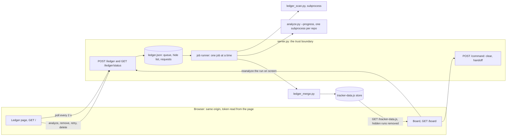
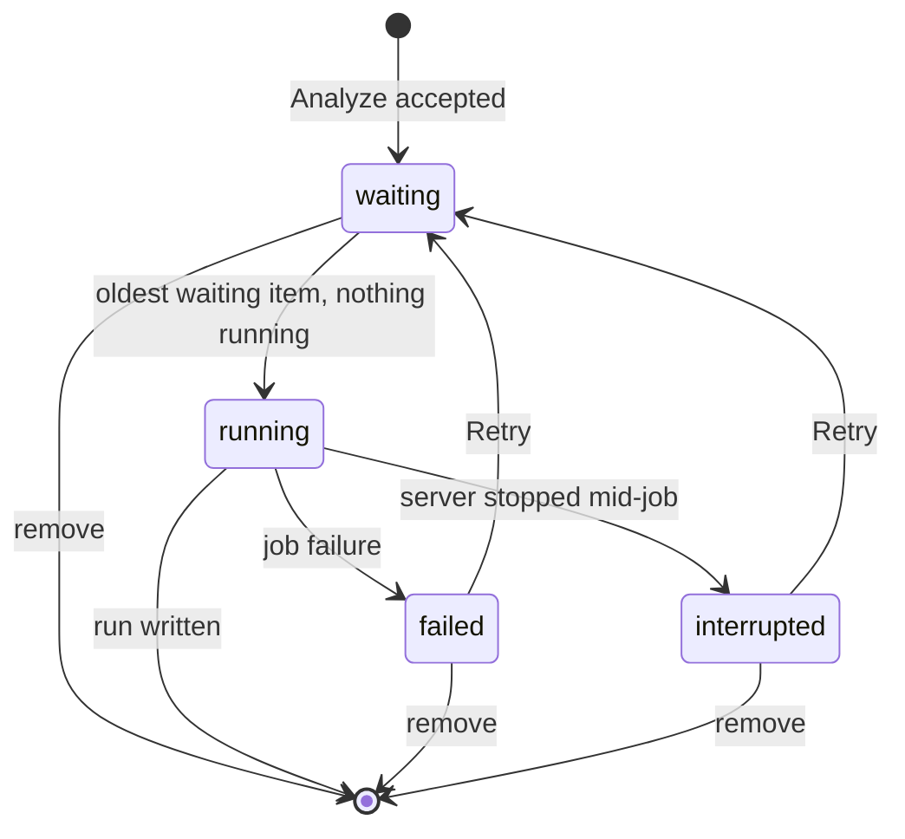

<!--
The spec half of docs/features/treko-ledger.md (ADR 0017's synced pair). It carries no
frontmatter because it is not a card: the analyzer selects cards by filename and skips every
`*.spec.md` (`grep -n SPEC_SUFFIX treko/analyze.py`). It also carries no checkbox lines on
purpose: `hooks/lib/feature_tasks.py` `compare()` matches task numbers between the two halves,
and the card's ## Tasks is not written yet. The checklist and the verification record stay in
the .md; this file is design, contracts, scenarios and acceptance criteria.
-->

# Treko Ledger — build spec

**What this builds.** A home page for Treko, the **Ledger**. The user types a directory; Treko
finds every git repository in and around it, analyzes them on the server one job at a time with a
progress bar that moves only when real work finishes, and lists every finished run with Open and
Delete. The card is `docs/features/treko-ledger.md`. Its decisions are cited here by number (D1–D12,
"Builder check results", and the correction about `analyze.py` at the end of that section). This
file turns them into contracts and tests. It does not reopen them.

**Tags.** **(spec call)** marks a detail the card left open that this spec settles with the
simplest safe option; the reviewer can overturn any of them. **OQ-n** marks a choice that changes
what the user sees or touches safety. Those waited for the user, in the last section, "Open
questions — resolved 2026-11-03". Where behaviour below depended on one, the text first said
"pending OQ-n" and described the recommended answer. Since 2026-11-03 it names the answer and its
tag, as the card does: **(user)** when he decided it, **(my call)** when the planning session
settled it and told him.

**Ground truth.** Written 2026-11-03 against `feat/treko-ledger` @ `5f194df`. Every `file:line`
was opened at that commit. Lines move, so each citation also names the symbol to `grep -n` for.

**Size (user, 2026-11-03).** He accepted this half running over ADR 0017's 800-line cap.

## 1. Shape of the change



| File | New or changed | Owns |
|---|---|---|
| `treko/Ledger.dc.html` | new | the Ledger page, ported from the prototype (§9) |
| `treko/ledger_scan.py` | new | directory scan, worktree families, D11 card choice, narrowing (§4) |
| `treko/ledger_merge.py` | new | one run from several per-repo runs (§7) |
| `treko/ledger_state.py` | new | `ledger.json`, run ids, run rows, the hide list (§5, §8) |
| `treko/ledger_jobs.py` | new | the job runner and its subprocesses (§5, §6) |
| `treko/server.py` | changed | routes, validation, idle rule, startup (§3) |
| `treko/analyze.py` | changed | two optional inputs and nothing else: the progress report (§6) and `--card` (§4.3; OQ-1, (my call)) |
| `treko/Treko.dc.html` | changed | two icon links, Re-analyze, graph svg size (§9.4) |
| `skills/treko/SKILL.md` | changed | routes, the Ledger, the new files in the store directory |

**(spec call)** The work lands in four new modules rather than in `server.py`, which is 793 lines
today (`wc -l treko/server.py`) against the house limit of 800 (`rules/core-conduct.md`). The
server stays the HTTP boundary and imports the others.

**(spec call)** No row is added to `STATIC_MANIFEST` (`server.py:83-101`, 17 rows, pinned by
`test_guards.py:560` `EXPECTED_MANIFEST_ROWS`). The Ledger page is served by a route, like the
board today, and every asset it loads is already on the manifest.

## 2. Task 1 gate: the wire-contract amendment (D10)

Today the page may send only `{"id": <one of three names>}`
(`tracking-feature-state.spec.md:404-411`; the allowlist at `:691-703`; "Command arguments of any
kind" out of scope at `:1101`). `server.py:592-598` enforces it: exactly one key, `id`, a string.
**This spec amends the rule "commands take no arguments, in v1 or after".** The amendment is
deliberately narrow:

- `POST /command` keeps the rule unchanged: no arguments, ever. Its allowlist **shrinks** to
  `clear` and `handoff`. **(spec call)** `reanalyze` leaves `/command`. The card moves the board's
  Re-analyze to "re-queue the run on screen" (builder check), which needs a run id, and an
  argument on the route that types into the session is exactly what the old rule forbids. Keeping
  the old `reanalyze` beside the queue would leave a second writer of the store racing the job
  runner, still minting the folder-name ids D12 replaces.
- Arguments are allowed **only** on the new `POST /ledger`, which never reaches the session: no
  `/ledger` operation invokes `cmux` (criterion A5).
- ADR 0034 accepted the store move partly because "the browser cannot name" a path and no verb
  "takes a filesystem path". `/ledger` reverses that for **reads**: the browser names a directory
  the server scans and runs read-only git in. It never names a directory the server writes or
  serves. The store directory still comes only from the process environment, and D8 shows it
  read-only.
- Old criterion 15 (`tracking-feature-state.spec.md:1079-1096`) loses its `500` row for
  `reanalyze` and the board's reload after a successful Re-analyze. `reanalyze` leaves `/command`,
  and after a `200` the board goes to the Ledger instead (§9.4; OQ-5, (user)).

**Task 1 writes an ADR** recording the routes, ops, argument shapes and validation of §3, the
amendments above, and D10's three defaults below. Take its number from `origin/main` at write time,
not from a local listing. It is judged the way a spec is: the compliance judge, with the
observability judge's architecting read alongside (`running-the-compliance-judge`). **No Ledger
screen task starts until that verdict passes.** The card's order (Ledger, then card 5, then the
relations card) is unchanged.

D10's three defaults, as requirements:

1. **Existing directories only.** `directory` must name an existing directory once expanded
   (§3.4). Nothing is created.
2. **Status polling never resets the idle timer.** Today every request resets it
   (`ControlServer.process_request`, `server.py:650-652`), so a polling tab would keep the server
   alive for ever. The reset moves to the point where the request line has been parsed and is
   skipped only when the path is `/ledger/status`, whatever the outcome. A request whose line
   cannot be parsed still resets it, as today.
3. **Git in scanned repos runs with `core.fsmonitor` off.** Measured 2026-11-03 on git 2.50.1: in a
   scratch repo whose own config set `core.fsmonitor` to a script that writes a marker file, a
   plain `git status --porcelain` ran the script, and `git -c core.fsmonitor=false status
   --porcelain` did not. Every scan and analyzer subprocess therefore gets
   `GIT_CONFIG_COUNT=1`, `GIT_CONFIG_KEY_0=core.fsmonitor`, `GIT_CONFIG_VALUE_0=false` in its
   environment. `git help config` documents that these pairs "override values in configuration
   files", and the analyzer's `_git` (`analyze.py:92-103`) passes no `env=`, so its git children
   inherit them with no change to `analyze.py`. **Not measured here:** the environment form itself.
   This session's worktree guard refused a command that sets `GIT_CONFIG_COUNT`. Criterion C8
   measures it. Other repo-config programs: OQ-8, answered 2026-11-03. Task 1's ADR tests whether
   a hook, or the index write `git status` may make, can run a program in a scanned repo. If it
   confirms either, the same environment also carries `GIT_OPTIONAL_LOCKS=0` and a second pair,
   `core.hooksPath=/dev/null` (`GIT_CONFIG_COUNT=2`); criterion C9. File filters **(user)**: if
   task 1 finds they cannot be switched off without breaking the scan, the scan still runs and the
   ADR records them as an accepted risk. Repositories that use Git LFS are never skipped
   **(user)**.

## 3. Wire contract

### 3.1 Routes

| Path | GET | POST | OPTIONS | Any other method |
|---|---|---|---|---|
| `/` | the Ledger page | 405 | 405 | 405 |
| `/board` | the board page | 405 | 405 | 405 |
| `/ledger/status` | status JSON | 405 | 204 | 405 |
| `/ledger` | 405 | the five ops | 204 | 405 |
| `/command` | 405 | `clear`, `handoff` | 204 | 405 |
| a `STATIC_MANIFEST` row | the asset, as today | 405 | 405 | 405 |
| anything else | 404 | 404 | 405 | 405 |

Routing reads only the path (`urllib.parse.urlsplit`), as today, so a query string never changes
the route. A `204` carries no `Access-Control-Allow-*` header, as `/command` does today.

### 3.2 The two pages

`GET /` serves `treko/Ledger.dc.html` (D1: the landing page; the skill already documents
`http://127.0.0.1:8422/` as the auto-opened tab). `GET /board` serves `treko/Treko.dc.html`.
**(spec call)** for the `/board` path. Both are served exactly as `_serve_index` serves the board
today (`server.py:452-476`): `Host` must be `127.0.0.1:<port>` (else `403 host_mismatch`); one
substitution injects the `tracker-token` and `tracker-channel` metas after `<head>`; headers
`Cache-Control: no-store`, the existing `CSP` (`server.py:115-119`) unchanged, and
`X-Content-Type-Options: nosniff`. **(spec call)** Both pages get both metas, through one function.
`check_index_injectable` (`server.py:197-209`) checks both files at startup.

### 3.3 `GET /ledger/status`

Checks, in order: `Host`; `Origin` and `Sec-Fetch-Site`, each only when present (the rule at
`server.py:531-536`); `X-Tracker-Token` by `hmac.compare_digest`. Every failure is the collapsed
`403 forbidden`. Success is `200`, `Content-Type: application/json`, `Cache-Control: no-store`,
`nosniff`:

```json
{
  "ok": true,
  "storeDir": "~/.local/state/treko",
  "queue": [
    {"item": "9f2c4a1b7d3e5f60", "state": "running", "label": "~/dev · repo memsearch",
     "queuedAt": "2026-11-03T09:12:44Z", "run": "r3fa9c2d17b40e815",
     "stage": {"done": 3, "total": 11, "label": "memsearch (1 of 2): reading cards"}},
    {"item": "0a7e1c55d2b94f31", "state": "failed", "label": "~/work", "queuedAt": "…",
     "run": "r…", "error": "analysis_failed"}
  ],
  "runs": [
    {"id": "r3fa9c2d17b40e815", "name": "dev · repo memsearch", "dir": "~/dev",
     "analyzedAt": "2026-11-03T09:13:20Z", "repos": 1, "branches": 6, "worktrees": 2,
     "features": 9, "tasksDone": 31, "tasksTotal": 58, "unreadableCards": 0, "canDelete": true}
  ],
  "runsError": null
}
```

`stage` appears only on the running item, and `stage.total` is `null` until the scan has finished
(§6.2). `error` appears only on a failed item. `runs` is `null` and `runsError` is
`"store_unreadable"` when the store cannot be parsed. **(spec call)** The queue is still returned
then, so a running job stays visible. `storeDir` is the server's store directory, home-collapsed
the way `analyze._home_collapse` does it (`analyze.py:116-119`), for D8.

### 3.4 `POST /ledger`

Checks, in order. Each failure answers once and writes one audit line:

1. `Host` (`403 host_mismatch`), then `Origin` and `Sec-Fetch-Site` (`403 origin_mismatch`),
   then the token (`403 bad_token`). Same code as `_handle_command` (`server.py:524-556`).
2. `Content-Type` is `application/json` (`415`).
3. The body: `Transfer-Encoding` refused, `Content-Length` required, at most
   `LEDGER_MAX_BODY_BYTES = 4096` bytes read (`413`), the same mechanics as `_read_body`
   (`server.py:558-599`). **(spec call)** 4096, not `/command`'s 1024: a macOS path alone can be
   1024 bytes, and JSON quoting can double it. `/command` keeps 1024.
4. The body is a JSON object with a string `op` (`400 malformed`).
5. `op` is one of the five below (`403 forbidden`, reason `unknown_op`). As with `/command`, an
   unknown op is indistinguishable from a bad token.
6. The key set is exactly the op's own keys, every value a string (`400 malformed`). Unknown keys
   are refused, never ignored.
7. The field rules below (`422`).
8. The op itself.

| `op` | Keys: required, optional | Effect |
|---|---|---|
| `analyze` | `directory`; `repo`, `branch`, `worktree` | runs the scan (§4) at once; if it finds work, queues the request (§5) |
| `reanalyze` | `run` | queues the request recorded for that run (§8.2; a run from before the Ledger: OQ-7, (my call)) |
| `remove` | `item` | removes a waiting, failed or interrupted item |
| `retry` | `item` | puts a failed or interrupted item back to waiting |
| `delete` | `run` | adds the run to the hide list (D12) |

| Field | Rule, checked before anything touches the filesystem or git |
|---|---|
| `directory` | at most 1024 UTF-8 bytes. No U+0000–U+001F or U+007F (`422 invalid_input`). After `os.path.expanduser` (a leading `~` only, the `store_location` rule) it is absolute (`422 relative_path`). Its `os.path.realpath` is an existing directory (`422 no_such_directory`). That real path is the canonical directory |
| `repo` | `""` means absent. At most 255 bytes, no control characters, no `/` (`422 invalid_input`). Only ever compared with folder names |
| `branch` | `""` means absent. At most 255 bytes, no control characters (`422 invalid_input`). Only ever compared with card `branch:` values |
| `worktree` | `""` means absent. At most 1024 bytes, no control characters (`422 invalid_input`). Only ever compared with worktree paths and folder names |
| `item` | matches `^[0-9a-f]{16}$` (`400 malformed`: the page only ever sends ids the server gave it) |
| `run` | 1–255 bytes, no control characters (`400 malformed`), and equal to the `id` of a run in the store (`404 no_such_run`) |

No value reaches a shell. `repo`, `branch`, `worktree`, `item` and `run` never reach git at all.
The canonical directory reaches git only as `git -C <absolute path>`, which cannot begin with
`-`. The scan subprocess receives the request as one JSON object on stdin, never as argv
**(spec call)**, so no value can be read as a flag.

Success bodies: `analyze` and `reanalyze` return
`{"ok": true, "op": "<op>", "item": "<id>", "started": <bool>}`, where `started` is true when no
other item was running or waiting. `remove`, `retry` and `delete` return
`{"ok": true, "op": "<op>"}`.

### 3.5 Every failure, with its audit reason

The body is always `{"ok": false, "error": "<error>"}` and echoes nothing from the request.
**Every row has a reason and every reason has a row**; criterion A2 checks both directions.

| Status | `error` | Cause | Audit `reason` |
|---|---|---|---|
| 400 | `malformed` | §3.4 steps 3, 4, 6; a bad `item` or `run` shape | `malformed` |
| 403 | `forbidden` | host, origin, token, unknown op | `host_mismatch`, `origin_mismatch`, `bad_token`, `unknown_op` |
| 404 | `no_such_item` | `remove`/`retry`: no item with that id | `no_such_item` |
| 404 | `no_such_run` | `delete`/`reanalyze`: no run with that id | `no_such_run` |
| 405 | `method_not_allowed` | §3.1 | `method_not_allowed` |
| 409 | `item_running` | `remove` of the running item | `item_running` |
| 409 | `not_retryable` | `retry` of a waiting or running item | `not_retryable` |
| 409 | `already_queued` | an item with the same run id is already **waiting** **(spec call)** | `already_queued` |
| 409 | `queue_full` | the queue already holds `MAX_QUEUE_ITEMS = 20` items, any state **(spec call)** | `queue_full` |
| 409 | `last_run` | `delete` of the only visible run (§8.4) | `last_run` |
| 413 | `too_large` | body over 4096 bytes | `too_large` |
| 415 | `unsupported_media_type` | not `application/json` | `unsupported_media_type` |
| 422 | `invalid_input` | a field length or character rule | `invalid_input` |
| 422 | `relative_path` | `directory` not absolute after expansion | `relative_path` |
| 422 | `no_such_directory` | not an existing directory | `no_such_directory` |
| 422 | `no_repository` | the scan found no repository (D2) | `no_repository` |
| 422 | `no_matching_repository` | repositories found, none with that `repo` folder name | `no_matching_repository` |
| 422 | `nothing_matched` | no card matches `branch`/`worktree`: a pop-up at submit, nothing queued (OQ-4, (user)) | `nothing_matched` |
| 500 | `scan_timeout` | the scan passed `TREKO_SCAN_SECS` | `scan_timeout` |
| 500 | `scan_failed` | the scan exited non-zero or printed something that is not its contract | `scan_failed` |
| 500 | `ledger_write_failed` | `ledger.json` could not be written | `ledger_write_failed` |
| 500 | `store_unreadable` | `delete`/`reanalyze`: the store does not parse | `store_unreadable` |

`GET /` and `GET /board` keep today's `500 asset_unreadable` for an unreadable page. `/command` is
unchanged apart from its allowlist: `{"id": "reanalyze"}` is now `403`, reason `unknown_id`.

### 3.6 Audit lines and diagnostics

The audit format (`server.py:134-147`) is unchanged: one line per request, polls included.
**(spec call)** `id=` carries the op for `/ledger`, `status` for the poll, and `-` for the pages
and for an op that failed before it was read. **Field values are never logged.** The directory is
request content, and the old spec bans logging request bodies "in whole or in part"
(`tracking-feature-state.spec.md:547-551`).
Job events go to stderr as `server: job <item> <event>` and name item and run ids only. An
analyzer's or scan's own last stderr line may follow, as `_reanalyze_failed` does today
(`server.py:348-351`).

The volume is the cost of keeping "one line per request": at the 2-second poll, a Ledger tab
writes up to 1,800 lines an hour while open. That is bounded, because polling alone cannot keep
the server alive (§2, default 2).

### 3.7 `GET /tracker-data.js` and the hide list (D12)

The containment check stays first, exactly as today (`server.py:486-501`). Then:

- **Empty hide list:** the file's bytes are served unchanged, so today's path is byte-identical.
- **Otherwise:** the server parses the store (`store.read_store`), removes runs whose `id` is
  hidden, and serves `store.dumps` of the result. A parse failure is the existing
  `500 asset_unreadable`.

Both pages therefore see only visible runs, and the board needs no hide logic. Over `file://`
there is no server, the board falls back to the bundled sample (`SKILL.md`, "Opening the vendored
file over file:// no longer shows your survey"), and nothing hidden exists to leak.

## 4. Directory scan (D2, D3 as confirmed, D11)

`ledger_scan.py` runs as a subprocess with the request on stdin and prints one JSON object on
stdout. It runs under `TREKO_SCAN_SECS = (30, 5)` (default, floor), with the same no-"never" rule
as the other timeouts (`read_timeout`, `server.py:153-168`), in its own process group, which is
killed when the bound passes. Each git call inside it has `GIT_TIMEOUT_SECS = 5` (`server.py:61`).
**(spec call)** Out of process for the reason `run_reanalyze` gives (`server.py:317-321`): a
directory listing that blocks cannot be interrupted inside a thread. The same scan runs twice:
at submit, to decide whether anything is queued at all (D2: nothing found means nothing queued),
and again as the job's first stage, because the tree may have changed in between.

### 4.1 Finding repositories

- **Down (D2).** List the canonical directory's subdirectories, breadth-first, to depth 5. The
  directory itself is depth 0. A depth-5 folder is checked but never listed. A folder holding a
  `.git` entry (directory or file) is a candidate and is not descended into. That includes the
  directory itself: when it holds a `.git` entry, nothing below it is listed. First launch relies
  on this (OQ-6): scanning the launch repo must not pull in repositories nested inside it.
  Skipped: `node_modules`;
  hidden folders, meaning a name beginning with `.` **or** the OS hidden flag
  (`st_flags & stat.UF_HIDDEN`); and symlinked folders, which are never followed. **(spec call)**
  for the hidden flag. Measured 2026-11-03: `~/Library` carries it and `~/Documents` and
  `~/Desktop` do not, so typing `~` skips `~/Library`, which Finder also hides. A folder that cannot
  be listed is skipped and counted.
- **Up (D2, accepted reading).** `git -C <dir> rev-parse --show-toplevel`. The result counts only
  if it is the directory itself or one of its 5 nearest ancestors.
- **Confirm.** Each candidate runs `git rev-parse --path-format=absolute --git-common-dir
  --show-toplevel`. A candidate git refuses (a stale worktree pointer, a repo another user owns)
  is skipped and named in a scan-level question (§7.2).
- **Families.** Candidates are grouped by their resolved common directory, so a repo reached
  directly and again through a worktree counts once (anti-goal 4). Each family's worktrees come
  from `git worktree list --porcelain`, not from the scan, so a worktree under a hidden folder is
  still pulled in (D2: "look at the related repos and other worktree"). Entries marked `prunable`
  or whose path no longer exists are left out. The **primary checkout** is the first listed
  worktree. **(spec call)** If that entry is `bare`, the first non-bare worktree takes its place.
- **Order.** Families are sorted by primary checkout path, so the same tree always yields the same
  run.

### 4.2 Narrowing (D3 as confirmed)

- **Repo** keeps the families whose primary checkout's folder name equals `repo` exactly. If
  families were found but none matches: `no_matching_repository`.
- **Branch** keeps, in each family, the cards whose chosen copy (§4.3) has `branch:` equal to
  `branch` exactly. The value is normalized as `Card.branch` does it (`analyze.py:273-274`).
- **Worktree** names a worktree of a family: either its resolved path equals the expanded,
  resolved `worktree`, or its folder name equals `worktree` **(spec call: both forms; the
  prototype's placeholder is a path)**. It keeps the cards whose chosen copy names that worktree's
  checked-out branch. Branch and Worktree together must both hold.
- **Closure.** Every card a kept card names in `## Depends on`, transitively, within its family, is
  kept too ("so the merge order stays true"). Edges come from `analyze.Card(...).depends_on`, the
  analyzer's own parser, imported rather than rewritten.
- Under Branch or Worktree, a family with no kept card is dropped from the run **(spec call)**. If
  every family is dropped: `nothing_matched`. At submit that is a pop-up and nothing is queued
  (OQ-4, (user)).
- `branches[]` and `questions[]` of every family that remains are kept whole. Narrowing removes
  cards and nothing else **(spec call: D3 speaks of cards only)**.

### 4.3 Which copy of a card counts (D11)

Each card name appears once. Its copies are `docs/features/<name>.md`, excluding `*.spec.md`, in
every worktree of the family. A copy is **on its branch** when its own `branch:` names the branch
checked out in the worktree it sits in. The chosen copy is:

1. the copy that is on its branch. If several are, the first in `git worktree list` order, and a
   question names the disagreement;
2. otherwise the primary checkout's copy;
3. otherwise, when the primary has none, the first listed worktree's copy.

**(spec call, also raised in OQ-1; its 2026-11-03 answer did not cover this reading)** "When a card
names a `branch:`" is read per copy, because copies can disagree about `branch:`. A planning card
on `main` may still say `branch: none` while its worktree copy names the branch, and D11's purpose
is the live copy. Copies are parsed with `analyze.Card`; a copy that cannot be read is never on
its branch.

**Mechanism: OQ-1, answered (my call).** D11 needs the analyzer to read the chosen copies, which
sit in several folders, while `_card_paths` reads exactly one (`analyze.py:192-198`). The answer,
first recommended here, is one more optional input to `analyze.py`: `--card PATH`, repeatable.
When given, the analyzer reads exactly those files, ordered by file name and then path, instead of
`<root>/docs/features/*.md`. When absent, behaviour is byte-identical to today: the same
"unchanged without the options" test as the progress report covers it (criterion E2), and
criterion E5 checks the option itself.
Narrowing then needs no post-filtering: the analyzer is handed only the kept cards and derives
waves, graph and constraints from them itself.

### 4.4 The scan's output

```json
{"outcome": "ok",
 "families": [{"root": "/Users/x/dev/memsearch", "label": "memsearch",
               "cards": ["/Users/x/wt/digest-reindex/docs/features/digest-reindex.md", "…"],
               "questions": [{"q": "…", "ctx": "…"}]}],
 "questions": [{"q": "…", "ctx": "…"}]}
```

`outcome` is `ok`, `no_repository`, `no_matching_repository` or `nothing_matched`. Each of these is
a result, printed with exit 0. A crash is a non-zero exit and becomes `scan_failed`.

### 4.5 Nothing found (D2)

When `outcome` is not `ok` at submit time, nothing is queued and the page shows a **pop-up**, not
inline text. The `no_repository` wording is the card's: "No git repository found in or around that
directory." The other two wordings are in §9.2.

## 5. The queue and the job runner (D4, D5, builder check)

### 5.1 `ledger.json`

Lives at `<store dir>/ledger.json`, beside the runs (D5). It is written atomically (temp file in
the same directory, `fsync`, `os.replace`, the `store.write_store` pattern at `store.py:160-186`)
at mode `0o600` **(spec call)**, on every change of queue, hide list or requests. Stage progress is
never written; it lives in memory.

```json
{"version": 1,
 "queue": [{"item": "9f2c4a1b7d3e5f60", "state": "waiting", "queuedAt": "2026-11-03T09:12:44Z",
            "request": {"directory": "/Users/x/dev", "repo": "memsearch", "branch": "",
                        "worktree": ""},
            "run": "r3fa9c2d17b40e815", "error": null}],
 "hidden": ["r0c4d…"],
 "requests": {"r3fa9c2d17b40e815": {"directory": "/Users/x/dev", "repo": "memsearch",
                                    "branch": "", "worktree": ""}}}
```

`state` is one of `waiting`, `running`, `interrupted`, `failed`. `error` is a §5.4 code when
`failed`, and `null` otherwise. `request.directory` is the canonical directory. `run` is the D12 id
(§8.1). `queuedAt` uses `store.TIMESTAMP_FORMAT` (`store.py:41`).

**On load,** an absent file is an empty ledger. A file that does not parse, carries a `version`
other than 1, or breaks any rule above **aborts startup** with exit 2, naming the file
**(spec call)**. This is the legacy-store posture the skill documents: a silent empty start would
drop waiting work and un-hide every deleted run.

**One server per store directory (spec call).** After the bind succeeds, so today's busy-port
messages are unchanged, the server takes `fcntl.flock(LOCK_EX | LOCK_NB)` on
`<store dir>/.treko-server.lock` (mode `0o600`, never deleted) and holds it for its lifetime. If
the lock is held, it aborts with exit 2: "another Treko server is using <store dir>". Without this,
two servers on different `TREKO_PORT`s would both start the same waiting item at launch, and the
store's read-modify-write could drop a run.

### 5.2 Item lifecycle



- **One job at a time, oldest first (D4).** "Oldest" means queue order, which is enqueue order. A
  retried item keeps its place, so it runs next.
- **Analyze starts now or queues (D4).** There is no per-item Analyze button. The runner starts
  the oldest waiting item whenever nothing is running.
- **A running item cannot be removed (D4)**: `409 item_running`.
- **Failed items stay listed** with their reason, Retry and remove, like interrupted ones
  **(spec call)**. A failure seen only by a page that was open when it happened would be invisible
  to the user D5 describes, who leaves and comes back.

### 5.3 Restart and shutdown

- **At startup,** after the lock: every `running` item becomes `interrupted`, the file is
  persisted, and the runner starts. Waiting items then start on their own (builder check, "After a
  server restart"). Interrupted items wait for Retry and are never restarted silently (D5).
- **First launch with an empty store (OQ-6, (user)).** Today `--open` runs the analyzer on the
  launch repo before it opens the browser (`server.py:756-763`). Instead, once the runner has
  started, the server submits `{"directory": <launch repo root>}` exactly as an `analyze` op
  would: the same validation, the same submit-time scan, the same D12 id. Then it opens the
  browser at `/`, where the Ledger shows the job. The condition is unchanged: the store holds no
  runs. **(spec call)** Nothing is submitted when an item for that request is already waiting or
  running, for example one carried over from the previous launch. A refusal, such as `--repo`
  naming a folder that is not a repository, is written to stderr, nothing is queued, and the
  server still serves. `run_reanalyze` (`server.py:314-345`) is then left with no caller and goes,
  and the `--repo` help text (`server.py:694-696`) stops naming `reanalyze`.
- **On shutdown** (idle, parent death, `Ctrl-C`): the runner kills the current subprocess's
  process group, marks the item `interrupted`, and persists. This must fit inside the existing
  bound, exit within `TREKO_POLL_SECS` + 1 s of parent death (old criterion 14). A hard kill skips
  this, and the next startup's recovery reaches the same state.

### 5.4 One job

1. Mark the item `running` and persist. Stage label: "scanning <dir>".
2. **Scan** (§4). An outcome other than `ok` fails the job with that code.
3. **Per family, in order:** `analyze.py <primary checkout> --progress`, plus one `--card` per
   chosen copy (§4.3; OQ-1, (my call)), run with `sys.executable` like `run_reanalyze`
   (`server.py:322-327`). It runs in its own process group, under `ANALYZE_SECS`
   (`server.py:56`) **per repo**, with D10's environment. stdout is drained by a second thread so
   a large run cannot fill the pipe and deadlock the stderr reader **(spec call)**. stdout must
   parse as a JSON object holding the run keys of ADR 0023's schema. A family that times out,
   exits non-zero or prints a bad run has **failed**. The job carries on, and the run gets a
   visible question naming that repo and why (§7.2). Only if every family fails does the job fail
   `analysis_failed` (OQ-2, (user)).
4. **Merge** (§7).
5. **Write**: `store.emit_run(store_path, run)` (`store.py:189-211`), which upserts by id, keeps
   position and stamps `analyzedAt`. Failure: `store_write_failed`.
6. **Success:** remove the item, set `requests[run] = request`, take `run` off the hide list
   (D12), persist, and record the end time for the idle rule (§5.5).

Job failure codes, as `error` on a failed item: `no_repository`, `no_matching_repository`,
`nothing_matched`, `scan_timeout`, `scan_failed`, `analysis_failed`, `store_write_failed`. A failed
job writes nothing to the store, so the previous run stays intact.

### 5.5 The idle exit

The watchdog's idle test (`server.py:668`) becomes a pure function, so it can be tested with an
injected clock:

```
idle  ⇔  not busy  and  now − max(last_request, last_job_end) ≥ idle_secs
busy  ⇔  an item is running or waiting
```

A running job counts as activity (D5's ⚠️), and so does its end **(spec call)**: without that, a
job that outlasts the idle period ends with the server exiting at once, under the user who just
watched it finish. `last_request` follows §2 default 2, so polls never move it. The parent-death
check is unchanged and still ends the server mid-job; the job becomes `interrupted` (§5.3).

## 6. Real progress (D6 and the correction)

### 6.1 The analyzer's one optional report

`analyze()` (`analyze.py:463`) gains an optional `progress` callable, defaulting to `None`. `main()`
(`analyze.py:778-793`) gains `--progress`, which passes a writer that prints
`treko-progress <stage>\n` to **stderr** and flushes. Stages are reported when they **finish**, in
this order:

| Key | Reported after (`analyze.py`, `5f194df`) | Label while it runs |
|---|---|---|
| `worktrees` | the repo check and `_worktrees(root)` (`:468`, `:472`) | reading worktrees |
| `branches` | `_base_branch` and `_collect_branch_facts` (`:473-481`) | reading branches |
| `cards` | the `Card(...)` list and `_ask_about_cards` (`:483-486`) | reading cards |
| `order` | everything from `_declared_edges` to `_build_kanban` (`:487-516`) | deriving merge order |

Nothing else in `analyze.py` changes, beyond `--card` (§4.3; OQ-1, (my call)). **The correction's
promise is a test (E2):** without `--progress` and `--card`, stdout, stderr and exit status are
byte-identical to today's analyzer. With `--progress`, stdout is byte-identical too, and stderr
adds exactly the four lines on success. `--card` has its own check (E5). Card 5 cites
`analyze.py` by line at seven distinct places
(`grep -o -E 'analyze\.py:[0-9-]+' docs/features/treko-branch-graph-traversal.md | sort -u`). As
the card records, those citations are re-checked when card 5 resumes.

### 6.2 The job's stage list and the bar

For a job over N families: 1 scan stage, 4 per family, 1 merge, 1 store write, so
`total = 4N + 3`. `done` counts finished stages only. Until the scan finishes, N is unknown, so
`total` is `null` and the bar is empty with the label "scanning <dir>". A failed family's
unreported stages count as done, so the bar keeps moving honestly.

**(spec call)** The label names the stage now running: the one after the last reported finish,
which the fixed order makes known. That is how bar and label stay in step, as D6 asks. Labels:
`scanning <dir>`, then `<label> (<i> of <N>): <stage label>` (the `(i of N)` part is dropped when
N is 1), then `merging the runs`, then `writing the store`.

The bar's width is `done / total`, recomputed only when a status response changes it. There is no
timer, no indeterminate animation, and no easing between polls apart from a CSS transition that
plays out a real change. Criterion E3 proves that nothing moves between reports.

## 7. One run from several repos (D9)

`ledger_merge.merge(request, parts, scan_questions) -> run`. It is a pure function. Each part is
one family's analyzer run and root, or that family's failure. Every job goes through it, one family
or many, so there is one code path.

### 7.1 Section by section

| Section | Rule |
|---|---|
| `id`, `name`, `dir` | from the request (§8.1). `analyzedAt` is `""`, stamped by the store |
| `features`, `branches` | concatenated in family order |
| `questions` | scan-level questions first, then the merge's own (failed families, OQ-2, (user)), then each family's; renumbered `q1…qN` (the analyzer restarts at q1: `analyze.py:306-310`) |
| `constraints` | concatenated; renumbered `C1…Cn` (`analyze.py:697-705`) |
| `waves` | **layered** waves merged by index: wave k is every family's wave-k items in family order, with the analyzer's own note for k. Every family's **cycle** wave, which the analyzer always emits last with the note `cycle — order undetermined, see questions` (`analyze.py:684-691`), merges into one final wave numbered after the longest layered run. The merge module holds that note as a constant, and criterion F2 pins it to the analyzer's real output |
| `graph` | nodes renumbered in family order with `analyze._node_id` (`analyze.py:333-338`); edges remapped. Each family keeps its x (column). Its y is shifted below the previous family's bottom row plus one empty row (`analyze.GRAPH_DY`) |
| `kanban` | the four columns (titles and tones are analyzer constants, `analyze.py:756-761`), items concatenated per column |

Repos are independent in this card: cross-repo dependencies belong to the relations card. So
merging waves by index claims nothing false: wave 1 of two repos can land in parallel.

**Repo labels and card names in multi-repo runs: OQ-3, answered (my call) as recommended.** Card
names stay exactly as the analyzer emits them, since every task row and kanban card already shows
its repo.
When two families share a folder name (`~/dev/foo` and `~/work/foo`), both families' repo label
becomes the home-collapsed primary-checkout path, in `tasks[].repo`, `branches[].repo` and the
kanban `m` prefix. Otherwise the board's branch grouping (`Treko.dc.html:715`, grouping by `repo`)
would fuse them.

### 7.2 Merge-level questions (spec call: wording)

- Unreadable folders, when the count is above zero: "Were repositories missed under `<dir>`?",
  context "N folders could not be listed during the scan, so any repository inside them is missing
  from this run."
- Candidates git refused: "Why could git not read `<path>`?", one per path, with git's message.
- Failed families (OQ-2, (user): visible, naming the repo and why): "Why could `<label>` not be
  analyzed?", with the exit status or timeout and the analyzer's last stderr line.
- Copies that disagree (§4.3): "Which copy of `<card>` is current?", naming the worktrees.

### 7.3 Two properties the tests pin

- **Identity.** One family, no narrowing: `merge()` returns the analyzer's run with only `id`,
  `name` and `dir` replaced. This is what proves the merge invents nothing.
- **Schema.** Every merged run has exactly the key set and value types of an analyzer run (ADR
  0023: the schema is not ours to change). Node, question and constraint ids are unique, every
  edge names existing nodes, and no two node boxes overlap.

### 7.4 The board's graph must grow with it

Measured 2026-11-03 on the pinned Chrome `156.0.8078.79`, with markup copied from
`Treko.dc.html:220` (`<svg width="700" height="260" style="position:absolute;inset:0">`): the svg's
box is 700×260 and its computed `overflow` is `hidden`. A stroke at y=400 does not hit-test; one at
y=100 does. So **any graph taller than 260px or wider than 700px loses edges today**, including a
single repo with more than three cards in one wave, and stacking families makes it certain. D9 asks
that multi-repo runs render correctly, so the svg's `height` binds to the computed `graphH`
(`Treko.dc.html:710`) and its `width` to the larger of 700 and the rightmost node's x + 188. No
data field is added.

## 8. Runs, ids and Delete (D7, D12)

### 8.1 Id, name, dir

- **id** = `"r"` + the first 16 hex digits of the SHA-256 of
  `json.dumps([directory, repo, branch, worktree], ensure_ascii=False, separators=(",", ":"))`,
  encoded as UTF-8. `directory` is canonical (§3.4). `worktree` is canonicalized the same way when
  it contains `/` or starts with `~`, and is otherwise used as given. Absent fields are `""`.
  `~/dev/foo` and `~/work/foo` differ; the same folder typed two ways does not (D12).
  **(spec call)** for the format.
- **name** = the canonical directory's last component, plus ` · repo <r>`, ` · branch <b>`,
  ` · worktree <w>` for each narrowing used **(spec call)**. Two runs of one folder must not look
  alike in the list.
- **dir** = the home-collapsed canonical directory.
- The **queue label** is the same, built on `dir` instead of the last component: the prototype's
  `parts.join(' · ')` (`Ledger.dc.html:176-177`).

### 8.2 Replace in place; requests

Re-analysis writes the same id, and `store.upsert_run` (`store.py:127-143`) replaces it in place.
`requests[id]` records the request each run was last written from, and the board's Re-analyze
re-queues exactly that request (builder check). Runs written before this card have a folder-name
id and no recorded request. For those, Re-analyze queues `{"directory": <the run's dir, with ~
expanded>}` with no narrowing. It lands as a new run under a D12 id, and the old run stays,
untouched, until the user deletes it (OQ-7, (my call)).

### 8.3 The row (D7: computed from the run's own data only)

| Shown | Derivation from the run object |
|---|---|
| name, analyzed-at, dir | `name`, `analyzedAt` as stored (an ISO timestamp, no relative time), `dir` |
| repos | distinct `branches[].repo` values (the prototype's derivation, `Ledger.dc.html:189`) |
| branches | `len(branches)` |
| worktrees | branches whose `wt` is neither `""` nor `—`. The prototype counts `b.wt` truthiness (`Ledger.dc.html:190`), but the analyzer writes `—` when a branch has no worktree (`analyze.py:443`), so that count equals every branch. Detached worktrees are not in the run's data and are not counted |
| features | `len(features)` |
| tasks-done bar | sums of `done` and `total` over features whose `meta` matches `^(\d+)/(\d+)$`. Label `<done> / <total> tasks done`, plus ` · <n> unreadable` when n features carry `?/?` (`analyze.py:47`), so the bar never reads as covering cards it skipped **(spec call)** |

Rows are sorted by `analyzedAt` descending, with ties in store order **(spec call)**. They are
computed server-side in `ledger_state.py` and cached on the store file's
`(st_mtime_ns, st_size)` **(spec call)**.

### 8.4 Delete

The prototype's dialog and wording are kept (D7): "Delete run?" / "“<name>” will be removed from
the ledger and the board. The analysis files on disk are not touched." / Cancel / Delete run
(`Ledger.dc.html:124-135`). Delete adds the id to `hidden`. Nothing on disk is erased (D12), and
the store's bytes are unchanged (criterion G3).

**(spec call, confirmed by the user 2026-11-03)** The ✕ shows only while more than one run is
visible (`canDelete`), as in the prototype (`Ledger.dc.html:196`, `canDel: runsAll.length > 1`),
and the server refuses the last one with `409 last_run`. The board cannot render zero runs:
`Treko.dc.html:649-650` reads `run.id` of `data.runs[0]`.

## 9. The pages (D1, D8, `file://`, Re-analyze)

### 9.1 The Ledger page

A port of the prototype, not an adoption (`treko-rename.md:746-751`). Copy the prototype's
structure and wording; take the board's conventions for everything else:

- **Assets:** the board's served set only (`vendor-resources.js` first, `support.js`, `_ds`,
  local phosphor regular and fill, `treko-icon.png`). **No `tracker-data*.js` script tag**, so
  `file://` can never pull in the sample.
- **Theme:** the board's token `<style>` block copied byte for byte, read from `taskTracker.theme`
  at mount **(spec call)**. A guard test pins the two copies equal. No colour literals outside the
  block; the prototype's hex values become the board's tokens.
- **Logic:** pure functions in a node-loadable slice between start and end markers, cut out and
  tested in node the way `test_ui_commands.py` tests the board's slice (`Treko.dc.html:402-525`).
  **(spec call)** This keeps the manifest closed.
- **Header:** icon, "Run ledger", "Every analysis this Treko instance has on disk.", and **Open
  the board**, which opens the most recent run (D1): the first row, by §8.3's order. It is
  disabled while there are no rows **(spec call)**, so the Ledger never leads to the board's
  sample data.
- **Form:** Directory path (placeholder `~/dev`); Repo, Branch, Worktree marked "· optional"; the
  subtitle "directory is required — repo, branch and worktree narrow the scan". One **Analyze**
  button (D4), disabled while its request is in flight. The page trims each box and sends `""`
  for empty ones. A blank directory never leaves the page ("Directory path is required." as in
  the prototype). On success the four boxes clear, as in the prototype.
- **D8:** under the form, "Artifacts path · where snapshots are written" and `storeDir` as
  monospace **text**. No `<input>`, no Save, no "Saved".
- **Queued:** shown when the queue is not empty, one row per item: label, a sub-line, and per
  state, running (bar and stage label, no ✕), waiting (✕), interrupted or failed (Retry and ✕).
- **Runs on disk:** count and rows (§8.3), each with Open and the ✕ when `canDelete`.
- **Polling:** `GET /ledger/status` on load, then every `LEDGER_POLL_MS = 2000` **(spec call)**.
  Polling stops on `403` and on a rejected fetch, both terminal (§9.2).
- **Open / Open the board:** write `taskTracker.run` to the run's id, then go to `/board`. That is
  the prototype's handoff (`Ledger.dc.html:198`) and the key the board already reads at mount
  (`Treko.dc.html:540`).
- `Esc` closes either dialog.

### 9.2 What the Ledger shows (the page never renders response text)

The board's three rules (`tracking-feature-state.spec.md:462-468`) hold here: every outcome
reaches a visible state; the page maps `error` codes to its own fixed strings and never displays
response text; an unknown code shows "Unexpected error." Data from the status response (names,
paths, stage labels, run rows) is rendered as **text content only**, never as HTML, an attribute
or a URL. Wording is **(spec call)** except where a source is named.

| Code or event | Where | Shown |
|---|---|---|
| `no_repository` | pop-up | "No git repository found in or around that directory." (D2) |
| `no_matching_repository` | pop-up | "No repository with that folder name was found in or around that directory." |
| `nothing_matched` | pop-up (OQ-4, (user)) | "No card matches that branch or worktree." |
| `relative_path` | inline | "Use a full path, or one starting with ~." |
| `no_such_directory` | inline | "No directory exists at that path." |
| `invalid_input` | inline | "Treko cannot use one of those values: check for stray characters." |
| `already_queued` | inline | "That analysis is already waiting in the queue." |
| `queue_full` | inline | "The queue is full. Remove an item first." |
| `scan_timeout` | inline / item | "The directory scan took too long. Try a smaller directory." |
| `scan_failed`, `analysis_failed`, `store_write_failed`, `ledger_write_failed` | inline / item | "That did not work. The server's log says why." |
| `200` analyze, `started` true / false | inline | "Started." / "Queued — it starts when the running analysis finishes." |
| interrupted item | item | "Interrupted when the server stopped. Retry to run it again." |
| `403` on any request | banner, terminal | "This page's token is stale — reload to reconnect." (the board's string) |
| fetch rejected | banner, terminal | "The control server is no longer running." (the board's string) |
| `runsError` | runs list | "The runs file cannot be read. The server's log says why." |
| `400`, `413`, `415` | inline | "Unexpected error." These are page bugs; the page cannot produce them by following this contract |

The pop-up uses the delete dialog's frame, with one **OK** button and the title "Nothing found".

### 9.3 `file://`

No `tracker-token` meta means no server. The page shows the header without Open the board, and a
notice: "No Treko server is running, so this page cannot analyze or list runs. Start one from the
repository with:" followed by `python3 treko/server.py --open` (the skill's launch command).
**(spec call)** for the wording and for hiding Open the board, which would lead to sample data. There
is no form, no queue and no run list. It makes no request for any `tracker-data*.js` file, so the
bundled sample is never listed (builder check). The board's own copy-only `file://` mode
(`Treko.dc.html:543-545`) is unchanged.

### 9.4 Board changes, and only these

1. **Icons (D1).** The two Treko icons, collapsed rail `Treko.dc.html:61` and expanded sidebar
   `:78`, are wrapped in `<a href="{{ ledgerHref }}" title="Back to Ledger">`, as the prototype
   wraps them (`Task Tracker.dc.html:55`, `:75`). `ledgerHref` is `/` when the token meta is
   present and `Ledger.dc.html` otherwise. The missing-data icon (`:50`) stays unlinked
   **(spec call)**.
2. **Re-analyze.** It posts `{"op": "reanalyze", "run": <on-screen run id>}` to `/ledger` and never
   posts to `/command`. After a `200` the board goes to `/`, where the job's progress is (OQ-5,
   (user)). That replaces today's reload after a successful `reanalyze` (`shouldReload`,
   `Treko.dc.html:483`, acted on at `:641`) and retires old criterion 15's `500` row
   (`tracking-feature-state.spec.md:1085-1087`), which has no server path left once `reanalyze`
   leaves `/command`. The board maps `403` to its stale-token string, a rejected fetch to its
   server-gone string, `no_such_run` to "This run is no longer on the Ledger.", `already_queued`
   and `queue_full` to the §9.2 strings, and every other code to "Re-analysis could not be queued.
   Open the Ledger to see why." **(spec call)** That small set avoids a second full copy of the
   Ledger's table. In copy mode (no token) the `python3 treko/analyze.py .` chip stays as it is.
3. **Graph svg size** (§7.4).

## 10. Scenarios

```gherkin
Scenario: a directory holding repositories is analyzed while nothing runs
  Given ~/dev holds repos alpha and beta, and the queue is empty
  When  the user types ~/dev and clicks Analyze
  Then  the response is 200 with started true and one item is running
  And   its stage total becomes 11 (4×2+3) once the scan has finished
  And   on success one run named "dev" lists repos 2 and replaces any earlier "dev" run in place

Scenario: Analyze while a job runs queues the request
  Given an item is running
  When  the user clicks Analyze for ~/work
  Then  the response is 200 with started false and the item is waiting
  And   it starts by itself once the running item finishes

Scenario: nothing found
  Given ~/empty holds no repository within 5 levels down and none within 5 levels up
  When  the user clicks Analyze
  Then  the response is 422 no_repository and the queue is unchanged
  And   a pop-up reads "No git repository found in or around that directory."

Scenario: a subfolder of a repo analyzes the repo
  Given ~/dev/memsearch is a repo
  When  the user analyzes ~/dev/memsearch/docs
  Then  the run covers memsearch

Scenario: a worktree pulls in its family, counted once
  Given ~/dev/foo has a worktree at ~/wt/foo-x, and the user analyzes ~
  When  the scan reaches both ~/dev/foo and ~/wt/foo-x
  Then  the run holds one family, foo, and its branches list both worktrees

Scenario: the worktree's copy of a card wins
  Given card x on main says "branch: none" and the copy in feat/x's worktree says "branch: feat/x"
  When  the repo is analyzed
  Then  features[] holds x once, with the ticks and phase of the feat/x copy

Scenario: Branch narrowing keeps the dependencies
  Given card b depends on a, and only b names branch feat/b
  When  the user analyzes the repo with Branch feat/b
  Then  the run holds a and b, and waves order a before b

Scenario: a refresh does not stop the job
  Given an item is running
  When  the page reloads, or every tab closes for longer than the poll interval
  Then  the item is still running and finishes, and no request was needed for it to finish

Scenario: the server stops mid-job, then restarts
  Given item 1 is running and item 2 is waiting
  When  the server is stopped and started again
  Then  item 1 is interrupted and does not run until Retry
  And   item 2 starts by itself

Scenario: removing items
  Given item 1 is running and item 2 is waiting
  When  the page sends remove for item 1, then for item 2
  Then  the first is 409 item_running and the second is 200, leaving only item 1

Scenario: Delete hides, and re-analysis brings the run back
  Given runs A and B are visible
  When  the user deletes A
  Then  status no longer lists A, GET /tracker-data.js omits A, and the store's bytes are unchanged
  When  the user analyzes A's directory again and the job succeeds
  Then  A is listed again

Scenario: the last visible run cannot be deleted
  Given only run A is visible
  Then  its row has no ✕, and delete A returns 409 last_run

Scenario: progress moves only on real stages
  Given an analyzer that reports "worktrees" and then sleeps 6 s
  When  the page polls three times during the sleep
  Then  stage.done is the same in all three responses

Scenario: polling alone does not keep the server alive
  Given no job and TREKO_IDLE_SECS=60
  When  a client polls /ledger/status every 2 s and sends nothing else
  Then  the server exits within 60 s + TREKO_POLL_SECS of the last other request

Scenario: a long job keeps the server alive
  Given TREKO_IDLE_SECS=60, TREKO_ANALYZE_SECS=120, and a one-repo job lasting 90 s, no requests
  Then  the server is alive when the job ends, and exits no sooner than 60 s after that

Scenario: a scanned repo's fsmonitor program never runs
  Given a repo whose .git/config sets core.fsmonitor to a marker-writing script
  When  a Ledger job analyzes it
  Then  no marker file exists

Scenario Outline: hostile and malformed requests are refused before git or cmux runs
  Given a valid token
  When  POST /ledger carries <body>
  Then  the answer is <status> <error>
  And   no git or cmux process was started

  Examples:
    | body                          | status | error         |
    | an unknown key                | 400    | malformed     |
    | an unknown op                 | 403    | forbidden     |
    | 5000 bytes                    | 413    | too_large     |
    | directory "dev/x"             | 422    | relative_path |
    | a directory containing a tab  | 422    | invalid_input |

Scenario: file:// shows no runs
  Given treko/Ledger.dc.html is opened as a file, with the sample data beside it
  Then  the no-server notice and the launch command show, with zero run rows
  And   no tracker-data*.js request is made

Scenario: the board returns to the Ledger
  Given /board is open
  When  the user clicks either Treko icon
  Then  the browser is at /

Scenario: Re-analyze from the board
  Given /board shows run R, recorded with request Q
  When  the user clicks Re-analyze
  Then  POST /ledger {"op":"reanalyze","run":R} queues Q, and /command receives nothing
  And   the browser is then at /, where the job shows

Scenario: Branch matches no card
  Given ~/dev holds repositories, and no card in them names branch feat/none
  When  the user clicks Analyze with Branch feat/none
  Then  the response is 422 nothing_matched and the queue is unchanged
  And   a pop-up reads "No card matches that branch or worktree."

Scenario: one repo of two fails
  Given ~/dev holds repos alpha and beta, and beta's analyzer exits non-zero
  When  the job runs
  Then  the run holds alpha, plus a visible question naming beta with its exit status and why
  When  both analyzers fail instead
  Then  nothing is written and the item fails with analysis_failed

Scenario: two repos share a folder name
  Given the scan finds ~/dev/foo and ~/work/foo
  When  the job runs
  Then  their repo labels are ~/dev/foo and ~/work/foo, and every card name is unchanged

Scenario: first launch with an empty store
  Given the store holds no runs
  When  server.py --open starts inside the repo ~/dev/memsearch
  Then  one item for ~/dev/memsearch is queued, then the browser opens at /
  And   the run it writes carries a D12 id, never the folder name

Scenario: Re-analyze of a run from before the Ledger
  Given run "memsearch" has a folder-name id and no recorded request
  When  the user clicks Re-analyze on the board
  Then  its directory is queued with no narrowing, and the result lands under a new D12 id
  And   the old run's bytes in the store are unchanged
```

## 11. Acceptance criteria

Each criterion names its test module; new modules are in `treko/`. Every new test module is shown
able to fail: run it against a stub that always allows and one that always refuses, then keep only
assertions that tell the two apart.

**A. Wire contract** (`test_ledger_routes.py`, server-level through `server_harness`)
- A1. `GET /` and `GET /board` serve their files with both metas, the CSP, `no-store` and `nosniff`.
  Both refuse a foreign `Host` with 403. `srv.token` (`server_harness.py:164`) still reads the
  token from `GET /`.
- A2. Every row of §3.5 is driven. Each returns its status and exact body, and writes one audit line
  with its reason. The test compares the table's reasons with the code's, both directions.
- A3. For each op, one unknown key gives 400. A 4097-byte body gives 413, and `/command` still gives
  413 at 1025.
- A4. `POST /command {"id":"reanalyze"}` gives `403` (`unknown_id`) and the store is untouched.
- A5. Across every `/ledger` and `/ledger/status` test, the fake cmux log stays empty.
- A6. The token appears in no file under the store directory (`ledger.json` and the lock
  included), in no child's environment or argv, and nowhere on stderr. This extends old
  criterion 10 (`tracking-feature-state.spec.md:889-899`).

**B. Lifetime** (`test_ledger_lifetime.py`)
- B1. The idle predicate (§5.5), as a table over injected clocks: busy is never idle, and the idle
  period counts from the later of the last request and the last job end.
- B2. End to end: a status-only poller does not keep the server alive (slow: the 60 s floor is
  never lowered to make it fast).

**C. Scan** (`test_ledger_scan.py`, on fixture trees)
- C1. Depth: a repo at depth 5 is found and one at 6 is not. Descent stops at a repo, including at
  depth 0: when the typed directory is itself a repo, a repo nested inside it is not found (OQ-6
  relies on this). Dot folders, `chflags hidden` folders (macOS only, skipped elsewhere),
  `node_modules` and symlinked folders are skipped.
- C2. Up: a directory 5 levels under a repo root finds it; 6 levels does not.
- C3. Families: a repo reached directly and through a worktree is one family. The family lists
  worktrees outside the scanned tree. Prunable entries are left out.
- C4. Narrowing: Repo by folder name; Branch; Worktree by path and by name; both together; the
  transitive closure; the three non-`ok` outcomes.
- C5. D11: each branch of §4.3's three-step rule, including disagreeing copies and their question.
- C6. Unreadable folders are counted, and refused candidates are named.
- C7. A scan that hangs is killed at `TREKO_SCAN_SECS` with its process group, and the result is
  `scan_timeout`.
- C8. D10 default 3, in two halves that must disagree: a job over a repo whose fsmonitor writes a
  marker leaves no marker, and the same run with the environment override removed (a test-only
  hook) writes one.
- C9. OQ-8, conditional on what task 1's ADR finds. If it confirms the hook route, a job over a
  fixture repo whose hook (the one task 1 shows `git status` can trigger) writes a marker leaves
  no marker, and the same run without the override writes one. If it confirms the index-write
  route, that repo's `.git/index` is byte-identical after the job. Whatever task 1 finds, a
  repository whose `.gitattributes` names `filter=lfs` is found and analyzed like any other
  (user: LFS repos are never skipped).

**D. Queue and jobs** (`test_ledger_jobs.py`, with fake analyzers dropped into the harness tree the
way `HANGING_ANALYZER` is, `server_harness.py:77`)
- D1. Start-or-queue; first in, first out; a retried item keeps its place.
- D2. The lifecycle of §5.2, every transition, and each refused one.
- D3. A restart turns running into interrupted and waiting into started; nothing restarts silently.
- D4. A job with no client connected runs to completion.
- D5. `ledger.json` survives a mid-write kill with the old or new content. A corrupt or
  wrong-version file aborts startup naming it. A second server on the same store directory aborts
  naming the lock.
- D6. Shutdown mid-job kills the analyzer's process group, so no orphan outlives the server's exit
  bound, and marks the item interrupted.
- D7. OQ-2 (user): a two-repo job whose second analyzer exits non-zero writes a run holding the
  first repo, plus one question naming the second with its exit status and the analyzer's last
  stderr line. A job whose analyzers all fail writes nothing, and its item fails with
  `analysis_failed`.
- D8. OQ-6 (user), in `test_autolaunch.py`. With `--open` and an empty store, one item for the
  launch repo is queued before the browser opens, and no run carries a folder-name id. With runs
  in the store nothing is queued: the meaning `test_existing_run_is_not_reanalyzed_on_launch`
  (`test_autolaunch.py:284`) keeps. With `--repo` naming a folder that is not a repository,
  stderr says so, nothing is queued and the server still serves. With an item for that request
  already waiting or running, no second one is queued.

**E. Progress** (`test_analyze.py` and `test_ledger_jobs.py`)
- E1. `--progress` prints exactly the four lines, in order, and stdout is byte-identical without
  it. Each line arrives as its stage ends: with a `git` wrapper first on `PATH` that delays
  `for-each-ref` by 2 s, the `worktrees` line is read at least 1.5 s before exit.
- E2. **"Unchanged", as a differential.** The baseline is blob
  `8b805d1f826cae5c22fdcb23de3a57e56049a734` (`git rev-parse 5f194df:treko/analyze.py`; last
  changed in `7028052`). It is materialized with `git cat-file -p`, beside a `hooks/lib` link as
  `build_tree` does (`server_harness.py:85-107`). Baseline and new analyzer run without `--progress`
  and without `--card` (OQ-1, (my call): one test covers both options) over three fixtures: a
  repo with worktrees, a depends-on chain, a cycle and a spec half; a directory that is not a repo
  (the exit-1 path); and a card with an id-less task. Fixtures commit
  with fixed dates, so git's relative times match. stdout, stderr and exit status must be equal
  byte for byte, both plain and with `--pretty`. A falsifier runs the same comparison on a copy
  with one default-path byte changed and must see it fail.
- E3. Between two progress reports, repeated polls return the same `stage`. The node slice's bar
  width is a pure function of `stage` alone.
- E4. `total` is `null` until the scan ends, then `4N + 3`. A failed family's remaining stages
  count as done.
- E5. `--card` (OQ-1, (my call)). Given every default card path of a fixture, stdout is
  byte-identical to a run without it. Given a subset, `features[]` holds exactly that subset,
  ordered by file name. A copy from another worktree is compared with its own spec half
  (`_ask_about_spec_half`, `analyze.py:573-582`).

**F. Merge** (`test_ledger_merge.py`)
- F1. Identity on one family (§7.3).
- F2. Two and three families: unique ids, remapped edges, no overlapping node boxes, waves merged
  by index with the cycle waves last, and the schema property. `CYCLE_NOTE` equals the note the
  real analyzer emits for a cycle fixture.
- F3. Colliding folder names (OQ-3, (my call)). When two families share a folder name, both are
  labelled by their home-collapsed paths in `tasks[].repo`, `branches[].repo` and the kanban `m`
  prefix, and every card name is unchanged. Without a collision, labels stay folder names.

**G. Runs, ids, Delete** (`test_ledger_state.py`)
- G1. Ids: one folder typed as `~/x`, `/abs/x` and through a symlink gives one id. `~/dev/foo` and
  `~/work/foo` give two. Every narrowing changes the id.
- G2. Re-analysis replaces in place, and every other run is byte-identical (old criterion 4's
  shape).
- G3. Delete: hidden in status and in `GET /tracker-data.js`, the store's bytes unchanged,
  un-hidden by a successful re-analysis and not by a failed one. With an empty hide list,
  `GET /tracker-data.js` is byte-identical to the file.
- G4. Row fields from fixture runs, including a `?/?` card, a `—` worktree and an empty run.
- G5. `last_run` (the spec call the user confirmed on 2026-11-03).
- G6. OQ-7 (my call): Re-analyze of a run with no recorded request queues its directory, `~`
  expanded, with no narrowing. The result lands under the D12 id, and the old run's bytes in the
  store are unchanged.

**H. Pages** (`test_ledger_page.py`: node slice plus CDP on the pinned Chrome; set
`TREKO_CHROME_DENY_BIRD=1` on this machine, as `treko-degraded-no-cmux.md` records)
- H1. Slice: every §9.2 row, an unknown code, and a hostile `error` string such as `"constructor"`
  or markup all reach fixed strings only.
- H2. Served: form, queue and rows render from a seeded store. Analyze on an empty folder shows the
  pop-up with the exact D2 wording and queues nothing. Analyze with a Branch that no card names
  shows the "No card matches that branch or worktree." pop-up and queues nothing (OQ-4).
- H3. `file://`: §9.3, with zero `tracker-data*.js` requests observed.
- H4. Board icons: `/` when served, `Ledger.dc.html` over `file://`.
- H5. Open and Open the board land on `/board` showing that run.
- H6. Re-analyze posts to `/ledger` and never to `/command`. After a `200` the browser is at `/`
  (OQ-5).
- H7. On a merged two-family run, the board's svg box contains every node box.
- H8. D8: the store directory is text, and the DOM has no input or Save for it.
- H9. The Ledger's token block equals the board's byte for byte.

**I. Docs.** `skills/treko/SKILL.md` describes the Ledger, the routes, `ledger.json` and the lock
file in "Where the survey is stored", the new startup aborts, and drops "`reanalyze` … is the only
thing that writes `tracker-data.js`". Its launch paragraph says first launch with an empty store
queues the launch repo on the Ledger rather than analyzing it before the browser opens (OQ-6).

## 12. Existing tests this changes (decided here, so no task discovers it)

- `test_server.py`: assertions about the page at `GET /` move to `/board`. Tests that use
  `reanalyze` as the cmux-free command (18 matching lines, `grep -c reanalyze treko/test_server.py`)
  move to a Ledger job or to `clear` with the fake cmux. The criterion-10 test's `reanalyze`
  precondition (`:297-301`) becomes "a Ledger job completed". Its comment that the server passes no
  `env=` to any child becomes false and is rewritten.
- `test_store_writer.py`: the writer is now the job runner.
- `test_degraded.py`: Re-analyze under no channel goes through `/ledger`.
- `test_ui_commands.py`: the page's ids posted to `/command` equal `SEND_COMMANDS`, and
  Re-analyze's outcome table is §9.4. After a `200`, Re-analyze now goes to `/` instead of
  reloading (OQ-5), so old criterion 15's `500` row for `reanalyze` retires with it.
- `test_guards.py`: the board's slice changes, so the fence pin (`:29`, sha256 `bfe17645…`,
  6692 bytes) is re-pinned deliberately in the same task, with the new figures recorded.
  `EXPECTED_COMMAND_IDS` (`:318`) stays valid if the button list is unchanged.
  `EXPECTED_MANIFEST_ROWS` (`:560`) stays 17.
- `test_theme.py:523` navigates to `/` expecting the board: it moves to `/board`.
- `test_autolaunch.py`: the first-run behaviour, as OQ-6 is answered. Answered (user): first
  launch with an empty store queues a Ledger job instead of writing a run before the browser opens
  (§5.3, criterion D8).

## 13. Security delta

`server.py` remains the whole trust boundary. What this card adds:

- **The page can make the server read any directory the user can read**, and show what it finds:
  repo, card and branch names and paths. The token limits this to pages the server itself served.
  Inputs are validated before any syscall (§3.4). Reads are bounded in depth and time (§4). The
  server writes only inside the store directory: the store, `ledger.json`, the lock.
- **Git runs in repositories the user did not explicitly name.** `core.fsmonitor` is off (measured,
  §2). Other config-driven programs: OQ-8, answered. Hooks and the optional index write are
  switched off if task 1 confirms them (C9). File filters that cannot be switched off without
  breaking the scan are an accepted risk the ADR records (user). LFS repositories are never
  skipped (user).
- **Nothing new reaches the session.** `/command` shrinks. `/ledger` never invokes cmux (A5).
- **Unchanged:** the token's lifetime and handling, the collapsed `403`, no CORS headers, the CSP,
  `frame-ancestors 'none'`, the `Host` guard, failure bodies that echo nothing, one audit line per
  request, and the parent-death check.
- **Rendering:** status data and run data come partly from scanned repositories, which may be
  hostile, and both pages render them as text only (§9.2, H1).

## 14. Non-goals

Carried from the card: PR data, branch ancestry and `## Depends on` traversal (card 5); sub-tasks,
`parent:`, spec and ADR links, `blocked-by:` and cross-repo dependencies (the relations card); an
LLM doing the analysis; the Configuration drawer (card 3, `treko-store-location.md:88-92`); a
working Save for the store path (D8). Also out: any new board data field (D9), and changing where
the store lives. Launching `server.py` outside a repository still aborts as today
(`resolve_repo`, `server.py:212-235`); the card does not ask to change it.

## 15. Pinned versions

Measured on this host 2026-11-03.

| Tool | Version | Re-read with |
|---|---|---|
| Python | 3.9.6 | `python3 -V`. Stdlib only: no `match`, no `X \| Y` annotations |
| pytest | 9.1.1 | `uv run --with pytest==9.1.1 --no-project pytest --version` |
| uv | 0.11.28 | `uv --version` |
| node | v26.5.0 | `node --version` (the slice tests) |
| git | 2.50.1 (Apple Git-155) | `git --version`. Needs 2.31 or later for `GIT_CONFIG_COUNT` and `--path-format` |
| Chrome | 156.0.8078.79 | `cdp_harness.PINNED_VERSION` (`cdp_harness.py:78`) |
| Nocturne export | `73641b21-c7ad-488a-8264-a28262dfe83e`, schema `version: 1` | the `_ds/` directory name; ADR 0023 |
| Phosphor | 2.1.1, vendored | `treko/vendor/phosphor/` |

No new dependency. Run the card's suite with
`TREKO_CHROME_DENY_BIRD=1 uv run --with pytest==9.1.1 --no-project pytest treko/test_ledger_*.py
treko/test_analyze.py treko/test_server.py treko/test_ui_commands.py treko/test_guards.py -q`.

## 16. Risks

- **Typing `~`.** Even with hidden folders skipped, depth 5 reaches `~/Documents`, `~/Desktop` and
  `~/Downloads`. macOS may ask the terminal app for folder access the first time. Not measured:
  probing it would raise the prompt. A large home folder may hit `TREKO_SCAN_SECS`, which then
  gives a clear failure rather than a hang.
- **Card 5's line citations into `analyze.py`** shift (§6.1).
- **Two pages share strings.** The board copies only five of the Ledger's messages (§9.4) to keep
  the drift surface small.
- **The Ledger's contrast is unguarded.** `test_theme.py` and `test_nontext_contrast.py` score the
  board only.
- **The card's `.md` half is 266 lines** against ADR 0017's 200-line cap. That is pre-existing,
  and for the reviewer.
- **File filters (OQ-8, user).** If task 1 cannot switch them off without breaking the scan, a
  scanned repository's own config can still name a filter program that `git status` runs. The
  user accepted that risk; task 1's ADR records it.

## Open questions — resolved 2026-11-03

Each has a recommendation. Where the spec above depends on one, it describes the recommended
answer. All eight were answered on 2026-11-03. Each answer follows its question with its tag,
**(user)** or **(my call)**, and names the places in this file it changed.

1. **OQ-1 — D11 contradicts the analyzer correction.** The correction allows `analyze.py` "one
   small optional progress report and nothing else". D11 needs it to read card copies from
   several worktrees, and `_card_paths` reads one folder (`analyze.py:192-198`). The other routes
   are re-implementing `analyze()`'s assembly in a new module, or patching its private
   `_card_paths` at run time. **Recommend:** allow a second optional input, `--card PATH`
   (§4.3), under the same byte-for-byte test (E2). It is the only route with no duplicate logic,
   and Branch/Worktree narrowing rides on it for free. Also confirm §4.3's reading: when copies
   disagree about `branch:`, the copy sitting in its own branch's worktree wins.

   **Answer (my call), 2026-11-03; the user was told.** Allow the second optional input,
   `--card PATH`. It falls under the same byte-for-byte "unchanged without the options" test as
   the progress report (E2), and E5 checks the option itself. Places changed: §1's file table,
   §4.3, §5.4 step 3, §6.1, criteria E2 and E5. **Not covered by this answer:** the confirmation
   asked for above, of §4.3's per-copy reading of D11. That reading stays a (spec call).
   Settled as **(my call)**, 2026-11-03: it is the reading that serves D11's stated purpose, the
   live copy.
2. **OQ-2 — one repo fails in a multi-repo job.** **Recommend:** write the run without it, plus a
   question naming the failure, and fail the job only when every repo fails. That is the
   analyzer's own "degrade, never die mid-repo" rule. The alternative fails the whole job, so one
   broken repo blocks a directory's survey.

   **Answer (user), 2026-11-03.** Keep the run with the repos that worked, plus a visible question
   naming the repo that failed and why. The job fails only if every repo fails. Places changed:
   §5.4 step 3, §7.1, §7.2, a new scenario, criterion D7.
3. **OQ-3 — telling repos apart in one run.** **Recommend:** leave card names as emitted, and
   when two repos share a folder name, label both by their home-collapsed path. The alternative
   prefixes every card with its repo, which is clearer for clashing names and noisier everywhere
   else.

   **Answer (my call), 2026-11-03.** As recommended: card names stay as the analyzer writes them,
   and repos are labelled by path only when two share a folder name. Places changed: §7.1, a new
   scenario, criterion F3.
4. **OQ-4 — Branch or Worktree matches no card.** **Recommend:** refuse at submit with a pop-up,
   "No card matches that branch or worktree.", and queue nothing. That matches D2's
   nothing-found rule. The alternative writes an empty run that he then has to delete.

   **Answer (user), 2026-11-03.** As recommended: no Branch or Worktree match is a pop-up at
   submit, and nothing is queued. Places changed: §3.5, §4.2, §9.2, a new scenario, criterion H2.
5. **OQ-5 — the board after Re-analyze is queued.** **Recommend:** go to the Ledger, where the
   progress is. The alternative is a notice on the board, which then needs its own polling to say
   when the run is ready.

   **Answer (user), 2026-11-03.** As recommended: after Re-analyze is queued, the board goes to the
   Ledger. Places changed: §9.4, the "Re-analyze from the board" scenario, criterion H6, §12.
6. **OQ-6 — first launch with an empty store.** Today `--open` analyzes the launch repo before
   opening the browser (`server.py:756-763`), writing a folder-name id. **Recommend:** queue that
   directory as an ordinary Ledger job, so the Ledger opens showing it running, with a D12 id.
   The alternatives are to open an empty Ledger, or to keep the old synchronous write.

   **Answer (user), 2026-11-03.** As recommended: first launch with an empty store queues the
   launch repo as an ordinary Ledger job. Places changed: §4.1 (depth 0 made explicit, so that job
   cannot pull in repos nested inside the launch repo), §5.3, a new scenario, criteria C1, D8 and
   I, §12.
7. **OQ-7 — runs from before the Ledger** carry a folder-name id and no recorded request.
   **Recommend:** Re-analyze queues `{directory: <their dir>}`. That lands as a new run with a D12
   id, and the old one stays until he deletes it, so nothing is rewritten. The alternative writes
   under the old id, after which the same folder analyzed from the form makes a second run anyway.

   **Answer (my call), 2026-11-03.** As recommended. Places changed: §3.4, §8.2, a new scenario,
   criterion G6.
8. **OQ-8 — other programs a scanned repo's config can start.** D10 switches off one key. Not
   measured here: other repo-config entries may make the analyzer's read-only git commands run a
   program, such as a clean filter that `git status` applies, or a hook run when `git status`
   rewrites the index. **Recommend:** task 1's ADR tests and, if confirmed, also sets
   `GIT_OPTIONAL_LOCKS=0` and `core.hooksPath=/dev/null`, and records filters as an accepted
   residual. Both settings are cheap and change nothing for a normal repo.

   **Answer, 2026-11-03.** The tightening as recommended: task 1's ADR tests hooks and optional
   lock writes and switches them off if confirmed. That half is **(my call)**: it only
   tightens safety, so it needed no user decision. File filters **(user)**: if task 1 finds
   they cannot be switched off without breaking the scan, the scan still runs and the ADR records
   them as an accepted risk. Repositories that use Git LFS are not skipped **(user)**. Places
   changed: §2 default 3, §13, §16, criterion C9.

**Also decided on 2026-11-03.** The user confirmed the spec call that the last visible run cannot
be deleted (§8.4, criterion G5). He accepted this file running over ADR 0017's 800-line cap
(recorded at the top).
