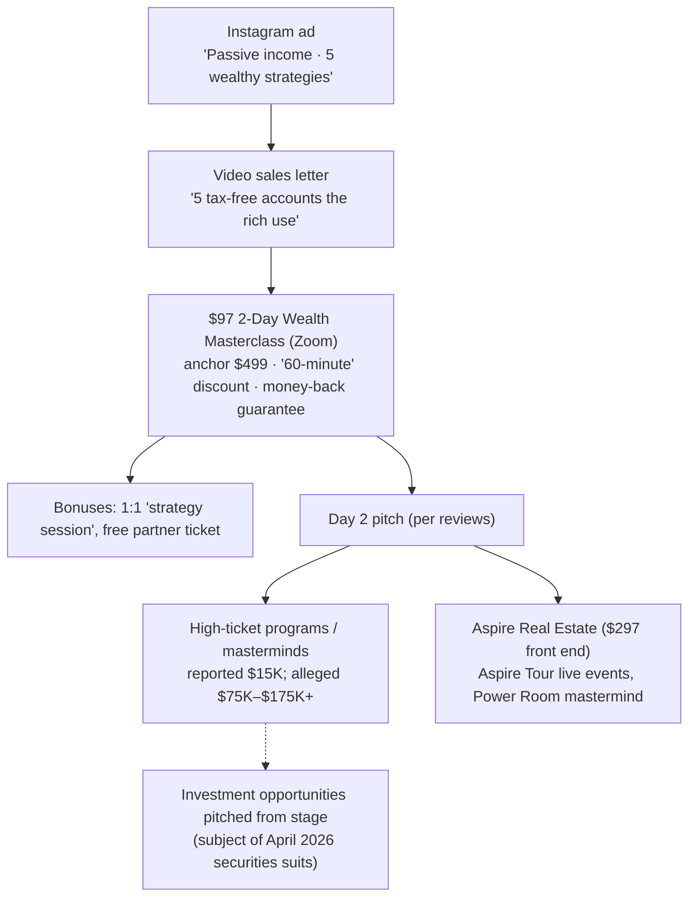

# Aspire4More "5 Accounts" Wealth Funnel — Full Analysis

**Subject:** `wealth.aspire4more.com/wealth-vsl---5-accounts` (reached from an Instagram ad)
**Presenter:** Andrew Cordle ("Tax Architect"), co-founder of Aspire4More with Eddie Wilson
**Researched:** 2026-10-24 · five parallel web-research passes plus spot-checks of the highest-stakes claims

---

## Bottom line

This page is the top of a classic seminar funnel. A free video promises the "5 tax-free accounts the rich use." It sells a **$97 two-day Zoom "Wealth Masterclass"**, discounted from an anchor price of $499, with a 60-minute countdown. Attendees say later sessions turn into a pitch for much more expensive programs.

The strategies it teaches are, as far as anyone can tell, **real and legal but ordinary**. Roth IRAs, Solo 401(k)s and HSAs are free to open at any brokerage. They are not secrets of the ultra-wealthy, and the annual contribution caps limit how much "generational wealth" they can build.

The serious finding is not about the tax advice. On **7 April 2026, federal securities lawsuits were filed in the Middle District of Florida** naming the Aspire entities and **both Cordle and Wilson personally**. The same suit also names Tai Lopez, Alex Mehr and Maya Burkenroad, whom the SEC charged in 2025 over an alleged ~$112M Ponzi-like scheme. These are unproven allegations, but they make up most of the risk.

**Recommendation:** treat the free and $97 content as entry-level education you can get free elsewhere. Do not buy any program priced at four figures or more, and do not invest in anything pitched from this stage, until the April 2026 securities suits are resolved.

---

## 1. Scope, method and confidence

- **The page itself could not be loaded.** This research environment's network blocks almost all websites; `wealth.aspire4more.com` did not even resolve. Everything below was rebuilt from web-search results: snippets and summaries of the company's own pages, court dockets, app-store listings, press releases and reviews.
- **Five research agents ran in parallel:**
  1. the funnel and offer
  2. Andrew Cordle
  3. Eddie Wilson
  4. reputation and legal
  5. an independent fact-check of the strategies
- **Re-checked directly before writing:** the court dockets and defendant list, the SEC case against REV, and the MDL 3189 link.
- **Not re-checked:** the 2026 contribution limits, which come from the fact-check pass citing IRS releases.
- **Confidence labels used throughout:**
  - **Confirmed** — a primary record, or two or more independent sources
  - **Reported** — a single source
  - **Claimed** — the company's own marketing
  - **Inferred** — reasoning, not a source
- **One contradiction resolved:** the Eddie Wilson research pass reported "no lawsuits found." Three other passes and a direct check all surfaced the April 2026 dockets, so the dockets win.

---

## 2. What the link itself reveals

The ad parameters in the URL show how the company sees this page:

| Parameter | Value | Meaning |
|---|---|---|
| `utm_source` / `hsa_src` | Facebook / `ig` | Meta ad, shown on **Instagram** |
| `utm_campaign` | `MF \| Scaling \| Purchase \| WE 3` | The campaign is in **scaling** mode and optimised for **purchases**. This is not lead capture; something is sold on or right after this page. |
| `utm_content` | `Passive Income \| INT – 5 Wealthy Strategies Lander` | The ad angle is **"passive income"**; "INT" is probably "interest"-based audience targeting. |
| `utm_term` | `SW Video 23 Fix` | Ad creative #23 (a re-cut). "SW" couldn't be identified; it may be an editor code or a creative series. |

The "Purchase" objective fits the **$97 masterclass** below (Inferred).

---

## 3. The offer and funnel

| Stage | Detail | Confidence |
|---|---|---|
| Hook | Page title *"The rulebook used by the ultra wealthy."* "Tax Architect Andrew Cordle" reveals "5 tax-free accounts the rich use to build generational wealth." Users are reassured they're "not smarter than you and not breaking the law." Framed as **Level 1**, a ladder that leads up to owning businesses and assets inside tax-free structures. | Confirmed (company pages, two research passes) |
| Front end | **2-Day Wealth Masterclass**, Zoom, **$499 → $97 "for the next 60 minutes"**. Bonuses: 1:1 strategy session, free partner ticket. The guarantee appears as both "30-day money back" and "100% Money Back Guarantee." The bonus training is titled **"4 Tax Free Accounts"**, which doesn't match the "5" in the ad. | Confirmed (`/register-now`) |
| Earlier version | "Aspire Wealth Masterclass," $297 → $97, 3-day, 7-day guarantee, dated Aug 2025. The page is now "temporarily paused." | Confirmed (`mastery.aspire4more.com/1`) |
| Sister offer | Aspire Real Estate masterclass, **$797 → $297**. | Reported |
| Back end | Reviewers: the event "felt like… a timeshare sales presentation"; "the one offer came at the end of day 2"; a "$15k 'mastermind' was essentially an upselling event." | Reported (individual reviews) |
| High ticket | An anonymous claimant-recruiting site alleges payments of **$75K–$175K+** for programs and "GP pathways" that were not delivered. | Reported, unverified advocacy |
| Live events | ASPIRE Tour arena events; 2023 tickets $49–$499 with upgrades sold on site. | Confirmed |

---

## 4. Who is behind it

### Andrew Cordle — the presenter

- **Role:** front man for the wealth funnel; billed as "Tax Architect," "renowned tax strategist for entrepreneurs" and "#1 tax strategist." (Claimed)
- **Self-told story:**
  - built a college window-cleaning business to about $1M and sold it
  - real-estate agent and investor in Atlanta and Chicago, claiming ~1,000 transactions
  - wiped out by the 2008 crash, then rebuilt through personal branding ("AC")
  - founded **Money Is** (show, magazine, company) in 2019
  - co-founded **Collective Influence** with Wilson in 2020
  - (Claimed: sponsored PR and podcast bios)
- **Earlier business, probably the same person:**
  - an Alpharetta, GA real-estate seminar and coaching operation ("NAREI/NAREIA" meetups; *iFlipUflip*)
  - books: *The Boom After the Bubble* and *Cash-Flow Finish Line*
  - (Inferred, strong)
- **Scale claims:** "$350M+ sold from stage," partner in 23 companies, "3-time bestselling author," "featured in Forbes, CNN, CNBC." (Claimed, unverified)
- **Credentials:** **none found.** Searches turned up no CPA, CFP, FINRA/SEC registration, insurance licence or real-estate licence. *Search can't settle this*, because the official lookups aren't indexed. Check directly (section 9). "Tax strategist" and "Tax Architect" are not protected titles.

### Eddie Wilson — co-founder and operator

- **Real, documented track record in media and events** (Confirmed by trade sources):
  - founder/CEO of **Think Realty**, which was sold in Sept 2025
  - president, then CEO, of Affinity Worldwide
  - majority owner of the **American Association of Private Lenders** from 2019, advisory chair from 2023
- **CEO of Collective Influence.** Its portfolio reportedly includes the ASPIRE Tour, Money Is, Power Room Mastermind and Empire Operating System. (Claimed)
- **Teaches business-building, not personal finance:**
  - the "Empire Operating System": five business phases and the "Brick" KPI
  - catchphrases: "King of Exits," "Build to Exit, Exit to Serve"
  - book: *The Titan Doctrine*
- **Exit-count claims contradict each other:** 80, 85, 94, 100+ and 125+ companies "exited," and "76 companies for $1.27B in 2019." (Claimed, inconsistent)
- **Credentials:** no financial, tax or insurance licence found. Same caveat as Cordle.

### Corporate web

| Entity | What it is | Confidence |
|---|---|---|
| Aspire4More / "Aspire For More LLC" / Aspire Virtual LLC / Collective Equity Inc. | Names used across the site's terms, footer and privacy policy | Confirmed (company pages) |
| Money Is (`moneyis.com`) | Cordle's earlier brand, now rebranded "Aspire Wealth"; the app's package name `com.beta.moneyis` carries it over | Confirmed |
| Aspire Events LLC | Florida LLC filed 21 Dec 2022, Ponte Vedra; owns the ASPIRE trademark | Reported (Sunbiz snippet) |
| Collective Influence | Wilson/Cordle holding group. A 2023 Business Wire release said Dan Fleyshman bought equity and claimed revenue "on pace" for **$72M** | Confirmed release; revenue figure claimed |
| Themed STR Capital Fund LLC | Short-term-rental fund near Disney World. Form D (Jan 2024) reports $0 raised. **Named defendant.** | Reported |
| Plurbo LLC / AptiCode | Listed app developer; no registration found | Reported |

---

## 5. The teaching — major points

What Cordle actually teaches, pieced together from his articles, podcast chapters, attendee write-ups and sales pages:

1. **"The rich write the rules."** The wealthy aren't smarter; they use tax law the middle class doesn't know about. (This is the core story hook.)
2. **Make it → keep it → multiply it.** Taxes are framed as your biggest expense, so "keeping" money through tax structure comes before investing it.
3. **Level 1 is the tax-free accounts.** An attendee wrote that he "broke down how to invest tax free, in 5 different tax free accounts." The candidates confirmed in his own material:
   - **Roth IRA.** He repeatedly cites Mitt Romney's "$100M Roth"; Romney's disclosed range was $20.7M–$101.6M.
   - **Solo 401(k) / Roth Solo 401(k).** He calls it a "Swiss Army knife for tax-free investing."
   - **Health Savings Account (HSA).**
   - The other two are **not identified** in anything indexed.
4. **Self-directed accounts and "Financial Friends."** You need specialist custodians or partners ("Financial Friends") to move money into alternative assets inside these accounts. (Reported.) **This is the bridge from education to the high-ticket and investment pitch.**
5. **Higher levels are business ownership and structures:** entities, owning assets inside tax-free wrappers, real estate, and estate tools such as dynasty trusts and GRATs (blog topics).
6. **Personal brand as an asset.** He presents this as his lesson from 2008, and it runs through Collective Influence's events.

**What was *not* found:** nothing ties Cordle to IUL, whole-life "infinite banking," 529 plans or "buy, borrow, die." The fact-check below covers them anyway, because they are the most common "accounts of the rich" in this niche.

---

## 6. Independent fact-check of the strategies

| Strategy | Reality (2026 rules) | Fair verdict |
|---|---|---|
| **Roth IRA / backdoor Roth** | $7,500/yr (+$1,100 at 50+). Income phase-out $153K–$168K single, $242K–$252K married filing jointly. A backdoor conversion is taxed proportionally across all your pre-tax IRA money. | Legitimate, mainstream, free. Romney's huge Roth came from putting private-equity stakes in at tiny valuations, which ordinary savers can't do. |
| **Solo 401(k) / SEP** | $24,500 employee deferral; $72,000 combined cap. You can only shelter a share of **actual self-employment profit**. | Legitimate for profitable self-employed people. Useless for a side hustle with no profit. |
| **HSA** | $4,400 self-only, $8,750 family (+$1,000 at 55+). Requires a qualifying high-deductible plan; 2026 expands which plans qualify. Non-medical withdrawals before 65: income tax plus 20% penalty. | Very good, but small. Not a "wealth account." |
| **529 → Roth rollover** | $35K lifetime; the account must be 15+ years old; counts against the annual Roth limit. | Real, narrow. Not a "backdoor." |
| **Augusta rule (§280A(g))** | Up to 14 days of tax-free rent, but a business renting your home needs fair-market rent and records. | Real. Influencers skip the documentation that audits test. |
| **Hiring your kids** | No payroll (FICA) tax for under-18s in a sole proprietorship or parents-only partnership; not in corporations. The work must be real and the pay reasonable. | Real, modest. |
| **Cost segregation / bonus depreciation** | 100% bonus depreciation is back for property placed in service after 19 Jan 2025. But rental losses are "passive": they can't offset a salary unless you qualify as a real-estate professional (750+ hours a year, more than half your working time). | "Wipe out your W-2 taxes" is false for most people with a day job. |
| **IUL / "infinite banking"** | Agents earn about 95–100% of first-year target premium. Surrender charges run 10–15 years. Overfunding can create a taxable "modified endowment contract." Policies can lapse under heavy loans. Illustration rules (AG 49-A, tightened again for 2026) exist because illustrations overstate returns. | Fits a narrow group only. The highest conflict of interest in this niche. *Not tied to Cordle in any source.* |
| **Buy, borrow, die** | Borrow against appreciating assets; heirs get a stepped-up cost basis. Exposed to margin calls and compounding interest. | A strategy for eight-figure portfolios. |

**Pattern:** ordinary tax-advantaged accounts rebranded as "the rulebook of the ultra wealthy." Each is worth learning, and every one is explained free by IRS.gov, Bogleheads and any brokerage's education pages.

---

## 7. Reputation and legal record

### Federal securities litigation — the material finding

- **Rivera et al. v. Aspire Events LLC et al.**, M.D. Fla. No. **3:26-cv-00770**, filed **7 Apr 2026**, nature of suit *Securities/Commodities*, Judge Wendy Berger. (Confirmed: Justia, CourtListener, PacerMonitor)
  - **Defendants:**
    - Aspire Events LLC
    - Collective Equity Inc.
    - Themed STR Capital Fund LLC
    - **Andrew Cordle**
    - **Eddie Wilson**
    - Retail Ecommerce Ventures LLC (REV Holdings)
    - **Taino Adrian "Tai" Lopez**
    - **Alexander Farhang "Alex" Mehr**
    - Maya Rose Burkenroad
  - **Counsel:** Allen S. Katz appeared for Aspire Events, Collective Equity, Cordle and Wilson.
- **Companion suits filed the same day:**
  - Zimon (3:26-cv-00775)
  - Graef (3:26-cv-00783)
  - McDaniel (3:26-cv-00787, citing 15 U.S.C. §77, the Securities Act)
  - Parkinson
  - Fusselman
  - Mosquera
  - Mayfield
  - (Confirmed: dockets; the last four by docket listing only)
- **Where the cases went:**
  - Plaintiffs asked the federal multi-district panel (JPML) to combine the cases.
  - Rivera is tagged **MDL 3189** and was reported transferred to the Central District of California in Aug 2026.
  - MDL 3189 is the **Norada Entities Securities Litigation** (Norada's CEO, Marco Santarelli, was sentenced to 33 months and ordered to repay about $63M to investors).
  - **Why the Aspire suits were grouped with Norada is not explained in any indexed source.** (Reported/unresolved)
- **The co-defendants' SEC case:** on 25 Sept 2025 the SEC charged Lopez, Mehr (co-founders of REV, the company behind the RadioShack, Pier 1 and Dress Barn online relaunches) and Burkenroad. The charge: raising ~$112M through fraudulent note and equity offerings promising up to 25% returns, with Ponzi-like payments. A settlement was reported as nearly finalised by mid-2026. (Confirmed: SEC LR-26413)
- **What isn't known:** the complaint's actual allegations against Cordle and Wilson, and any ruling. **A lawsuit is an allegation, not a finding of wrongdoing.** But a securities suit means investments, not course fees. That matches the "GP pathways" and fund language in the advocacy-site allegations, and the Themed STR fund being a defendant.

### Other record

- **aspiretourfraud.com** (anonymous, recruiting claimants) alleges:
  - $75K–$175K+ paid for programs that were not delivered
  - pressure to pay more to "unlock" results
  - agricultural-property pitches
  - "low-ball settlements ($25K–$100K) with gag clauses"
  - (Reported, unverified)
- **Schumacher v. Cordle** (St. Johns County FL, 2018): judgment enforcement seeking a charging order on "Cordle Family Ventures, LLC." Likely the same person: Ponte Vedra is in that county. (Reported)
- **Ripoff Report, 2017** (anonymous): the "Andrew Cordle Real Estate Workshop / NAREI" described as pushy sales with credit-line pressure; a $12,500 iFlipUflip coaching fee disputed. (Reported)
- **No SEC, FINRA, FTC or state attorney-general action against Cordle, Wilson or Aspire was found.**

### Ratings

| Platform | Score | Note |
|---|---|---|
| App Store (Aspire4More) | 4.9 from ~362 | Includes an Aug 2025 "complete scam" review about an unpaid refund |
| Google Play | ~4.8 from ~55 | "spending a large sum of money for access to a small return" |
| BBB — Aspire Tour | A+, accredited since Sept 2023; 4.91 from 79 | Complaint count not visible |
| Trustpilot — andrewcordle.com / moneyis.com / aspiretour.com | ~4.5–4.9, hundreds of reviews | Reviewers are largely event attendees, often reviewing on the day. Negatives cluster on upselling and refunds that weren't honoured. |

**How to read the ratings:** high star averages from people still in the room sit alongside a small but consistent cluster of negatives about money paid after the event. That combination is typical of seminar funnels and doesn't contradict the legal record. Beware the name collision: "Aspire Tours" refund complaints on Trustpilot belong to an unrelated UK travel firm.

---

## 8. Persuasion techniques on the page

| Technique | Where it shows up |
|---|---|
| **Secret-knowledge framing** | "Rulebook used by the ultra wealthy," "secrets of the 1%" |
| **Ego protection** | "Not smarter than you, not breaking the law": lowers resistance and pre-empts "this is too good to be true" |
| **Authority titles with no credential** | "Tax Architect," "#1 tax strategist" (no licence found) |
| **Price anchoring + countdown** | $499 → $97 "for the next 60 minutes" (earlier: $297 → $97) |
| **Risk reversal** | "100% money-back guarantee," but reviews dispute honouring refunds, and the company's own reply said it had "not historically offered a money-back guarantee" |
| **Ladder framing** | "Level 1" accounts imply you'll need the next level, which is the paid upsell |
| **Bonus stacking** | 1:1 "strategy session" (the sales call), free partner ticket (two people at the pitch) |
| **Number mismatch** | "5 accounts" in the ad, "4 Tax Free Accounts" as the bonus title: a sign of reused, recut creative |

The **FTC** has sent penalty-offence notices to 1,100+ money-making and coaching businesses: earnings and "passive income" claims must reflect *typical* results, and a disclaimer doesn't fix a misleading overall impression. It has sued sellers over exactly the "passive income" framing (e.g. the Publishing.com settlement and the Click Profit case).

---

## 9. Red flags vs. green flags

**Red**
- Federal securities suits naming both founders, joined with SEC-charged co-defendants
- No financial, tax or insurance credential found behind the "tax strategist" branding
- Seminar → high-ticket → investment-opportunity ladder; reviews describe a timeshare-style pitch
- Contradictory guarantee language; refund complaints
- Inflated, inconsistent self-reported numbers ($72M revenue "pace," 80–125 "exits," "$350M sold from stage")
- A 2017–2018 history of similar real-estate-seminar complaints and a judgment-enforcement case

**Green**
- The core tax accounts taught are real and legal; the basic message (use a Roth, a Solo 401(k) and an HSA) is sound
- Wilson's media and real-estate-association history is real and verifiable
- Many attendees report finding the content eye-opening; the $97 front end is low-risk on its own

---

## 10. How to verify yourself

1. **Read the complaint:** CourtListener docket 73156801 (*Rivera v. Aspire Events*) or PACER. This is the single most valuable next step.
2. **Licence lookups:** brokercheck.finra.org, adviserinfo.sec.gov, NIPR (insurance), Georgia Real Estate Commission, state CPA boards — for both founders.
3. **Meta Ad Library:** search "Aspire4More" to see the exact ad creative and VSL wording.
4. **Florida Sunbiz:** look up Collective Equity Inc., Aspire For More LLC and Plurbo LLC.
5. **Before paying for anything beyond $97,** ask in writing: what exactly is delivered, the refund terms, whether anyone is paid for referrals to "Financial Friends," and whether any investment is offered.

---

## 11. Open questions

- The exact five accounts named in the video. Only Roth, Solo 401(k) and HSA are confirmed.
- What the April 2026 complaints actually allege, and why they were grouped into MDL 3189.
- The name and price of the back-end programs.
- Who "SW" is in the ad creative code.
- Plurbo LLC's registration.

---

## Sources

**Company and promotional**
- wealth.aspire4more.com · /register-now · mastery.aspire4more.com/1 · realestate.aspire4more.com/start
- moneyis.com/terms · andrewcordle.com/use-solo-401k-instead-of-savings-accounts
- [App Store — Aspire4More](https://apps.apple.com/us/app/aspire4more/id6447053771) · [Google Play](https://play.google.com/store/apps/details?id=com.beta.moneyis)
- [Business Wire — Fleyshman / ASPIRE Tour (2023)](https://www.businesswire.com/news/home/20230809540681/en/)
- [Collective Influence](https://collectiveinfluence.com/what-is-collective-influence-2/)
- [Disrupt Magazine profile](https://disruptmagazine.com/andrew-cordle-better-known-as-ac-was-hit-hard-by-the-2008-recession-but-conquered-those-obstacles-to-become-an-expert-in-the-world-of-personal-brands-and-a-successful-entrepreneur/)
- [Podcast — Andrew Cordle exposes the tax strategies…](https://podcasts.apple.com/us/podcast/andrew-cordle-exposes-the-tax-strategies-the-irs/id1833077789)
- [Attendee blog — baldgirlbigworld](https://www.baldgirlbigworld.com/post/money-is)
- [Think Realty — acquisition](https://thinkrealty.com/article/affinity-real-estate-media-dba-think-realty-acquired-by-scott-ward/)
- [AAPL — ownership](https://aaplonline.com/articles/news/american-association-of-private-lenders-announces-new-ownership/)

**Legal and regulatory**
- [Rivera v. Aspire Events — Justia](https://dockets.justia.com/docket/florida/flmdce/3:2026cv00770/457195) · [CourtListener parties](https://www.courtlistener.com/docket/73156801/parties/rivera-v-aspire-events-llc/) · [PacerMonitor](https://www.pacermonitor.com/public/case/64000053/Rivera_et_al_v_Aspire_Events_LLC_et_al)
- [Zimon v. Aspire Events](https://dockets.justia.com/docket/florida/flmdce/3:2026cv00775/457200) · [Graef v. Aspire Events](https://dockets.justia.com/docket/florida/flmdce/3:2026cv00783/457242)
- [SEC LR-26413 — Lopez, Mehr, Burkenroad](https://www.sec.gov/enforcement-litigation/litigation-releases/lr-26413)
- [MDL 3189 — Norada](https://mdlupdate.com/mdl/3189-norada-entities-securities/) · [Norada sentencing](https://hoodline.com/2026/10/laguna-niguel-fund-boss-gets-33-months-owes-investors-63m-after-scam/)
- [aspiretourfraud.com](https://aspiretourfraud.com/) (advocacy, unverified)
- [Schumacher v. Cordle — Trellis](https://trellis.law/case/12109/ca18-0234/schumacher-bobbie-vs-cordle-andrew)
- [Ripoff Report — NAREI workshop](https://www.ripoffreport.com/reports/andrew-cordle-real-estate-workshop/nationwide/andrew-cordle-real-estate-workshop-narei-0-scam-pushy-sales-person-to-sign-a-contract-s-1361267)

**Reviews**
- [Trustpilot — andrewcordle.com](https://www.trustpilot.com/review/andrewcordle.com) · [Trustpilot — aspiretour.com](https://www.trustpilot.com/review/aspiretour.com)
- [BBB — Aspire Tour](https://www.bbb.org/us/fl/ponte-vedra/profile/event-planner/aspire-tour-0403-236018113)

**Fact-check**
- [IRS IR-2025-111 — 2026 401(k)/IRA limits](https://www.irs.gov/newsroom/401k-limit-increases-to-24500-for-2026-ira-limit-increases-to-7500) · [IRS Notice 2025-67](https://www.irs.gov/pub/irs-drop/n-25-67.pdf)
- [KPMG — 2026 HSA limits](https://kpmg.com/us/en/taxnewsflash/news/2025/05/tnf-rev-proc-2025-19-hsa-inflation-adjusted-amounts-for-2026.html)
- [Journal of Accountancy — 529→Roth](https://www.journalofaccountancy.com/news/2023/jul/the-new-529-rollover-roth-ira.html)
- [InsuranceNewsNet — IUL commissions](https://insurancenewsnet.com/innarticle/iul-what-you-need-to-know-about-commissions) · [NAIC AG 49-A](https://content.naic.org/sites/default/files/inline-files/AG%2049A(posted).pdf)
- [Advisor Perspectives — buy, borrow, die](https://www.advisorperspectives.com/articles/2025/06/16/buy-borrow-die-why-popular-tax-strategy-rich-doesnt-work)
- [FTC — money-making opportunities notice](https://www.ftc.gov/system/files/attachments/penalty-offenses-concerning-money-making-opportunities/cover-letter-mmo.pdf)
- [CBS — Romney IRA](https://www.cbsnews.com/news/romneys-tax-prep-blunder/)
